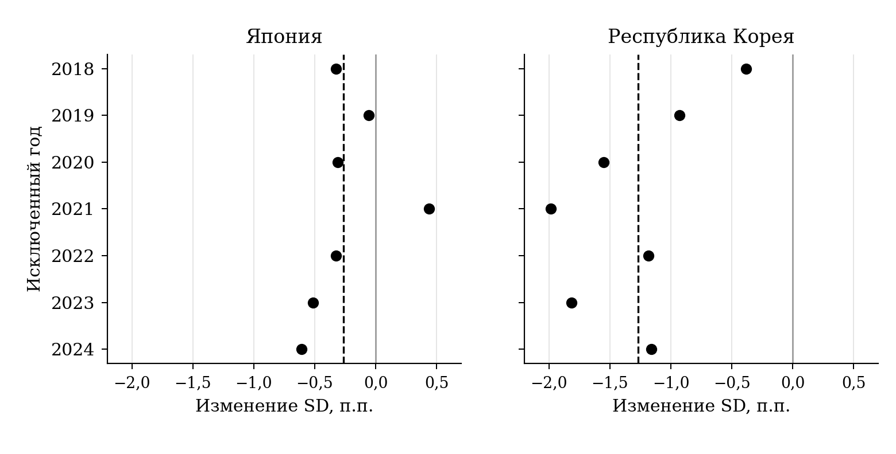

## 2.4 Устойчивость результатов и их экономическая интерпретация

Основная оценка характеризует определенный товарный охват, географическую сетку и историю темпов. Для установления границ полученных выводов необходимо проверить, как они меняются при изменении каждого из этих условий. Предусмотренный набор включает двенадцать вариантов, в том числе основной, для двух экспортеров. Из 24 сочетаний страны и варианта численный результат определен для 22. Два недоступных случая относятся к Корее и связаны с ненаблюдаемыми темпами. Все варианты рассматриваются совместно; они представляют связанные проверки на одной базе, а не независимые подтверждения одной гипотезы.

Сначала проверяется влияние укрупнения географии. При пяти отдельных направлениях и остатке изменение стандартного отклонения составляет −0,27 п.п. у Японии и −0,94 п.п. у Кореи. При отборе двенадцати кандидатов после проверки наблюдаемости сохраняется одиннадцать отдельных направлений; еще один кандидат включается в остаток по общему правилу. На этой сетке оценки равны −0,18 и −1,31 п.п. соответственно. Знаки товарных и географических вкладов в обоих случаях совпадают с основными. Следовательно, наблюдаемая компенсация составляющих не возникает исключительно вследствие выбора восьми направлений.

Включение частей интегральных схем HS854290 проверяет границу основной товарной совокупности. В пятикатегорийном варианте изменение стандартного отклонения равно −0,42 п.п. у Японии и −1,26 п.п. у Кореи. Для Кореи товарный и географический вклады составляют −171,98 и +98,51 п.п.², оставаясь близкими к основным −172,92 и +98,84 п.п.². В Японии включение частей усиливает отрицательную точечную оценку общего изменения, однако товарный вклад сохраняется положительным, географический — отрицательным. Основное исключение частей поэтому определяет предмет исследования, но не создает само направление полученного разложения.

Объединение Китая и Гонконга в одно направление позволяет оценить зависимость результата от их раздельного учета. После повторного формирования географии изменение стандартного отклонения составляет −0,09 п.п. у Японии и −1,24 п.п. у Кореи. Корейские вклады равны −171,34 п.п.² для товарного состава и +99,15 п.п.² для географии. В Японии географическая оценка остается отрицательной, но уменьшается по абсолютной величине до −7,52 п.п.². Эта проверка отражает иной способ агрегации торговых направлений и не восстанавливает конечное потребление реэкспортируемой продукции.

Переход к квартальным суммам и темпам относительно соответствующего квартала прошлого года дает 28 наблюдений. Изменение стандартного отклонения составляет −0,39 п.п. у Японии и −1,17 п.п. у Кореи, соотношение знаков вкладов сохраняется. Вместе с тем квартальная агрегация сглаживает внутригодовые колебания и уменьшает число временных наблюдений. Полученные уровни дисперсии относятся к другому ряду и не должны объединяться с месячными оценками как повторные измерения одной и той же величины. Значение проверки состоит в сохранении направления разложения при более крупном временном масштабе.

Для темпов от месяца к предыдущему месяцу результат иной. У Японии изменение стандартного отклонения становится положительным, +0,31 п.п.; оба вклада также положительны. Это свидетельствует о том, что знак основного японского результата не переносится автоматически с годового сопоставления на краткосрочную динамику. У Кореи данный вариант не определен: в фиксированной сетке имеются шесть значений темпов с двумя нулевыми стоимостями в сравниваемых месяцах. Им не присваивается нулевая изменчивость, и страна не исключается из сводки проверок.

**Таблица 2.5 — Чувствительность изменения стандартного отклонения**

| Вариант | T | Япония, п.п. | Корея, п.п. |
| --- | --- | --- | --- |
| Пять направлений | 84 | −0,27 | −0,94 |
| Двенадцать кандидатов | 84 | −0,18 | −1,31 |
| С частями | 84 | −0,42 | −1,26 |
| Китай и Гонконг вместе | 84 | −0,09 | −1,24 |
| Месячный лаг 1 | 95 | 0,31 | н/о |
| Квартальный годовой темп | 28 | −0,39 | −1,17 |
| Обычный процентный темп | 84 | 55,17 | н/о |
| Ковариации 2018–2020 | 36 | −0,24 | −3,53 |
| Ковариации 2021–2024 | 48 | −0,09 | −0,30 |
| 2017/2020, раннее окно | 36 | 0,41 | −1,91 |
| 2017/2020, позднее окно | 48 | 0,33 | −2,18 |

Примечание: T — число месячных либо квартальных темпов. н/о — оценка не определена; в корейских вариантах с лагом 1 и обычным ростом отсутствуют соответственно 6 и 22 значения темпов. Последние два варианта используют структуры 2017/2020. Двенадцать кандидатов дают одиннадцать отдельных направлений и остаток. Полное разложение приведено в приложении В.

Источник: расчеты автора по UN Comtrade.

Еще более заметную чувствительность показывает обычный процентный темп год к году. Для Японии изменение стандартного отклонения достигает +55,17 п.п. вместо основных −0,26 п.п. Диагностика выявляет влияние малых баз: например, стоимость поставок японской памяти во Вьетнам в сентябре 2022 года равнялась примерно 13,84 млн долл. при 23,05 тыс. долл. годом ранее. Обычный процентный темп этой ячейки составляет около 59 924%. Он способен резко увеличить дисперсию фиксированного индекса, даже если направление ранее имело небольшую стоимость. Симметричный темп ограничивает такой эффект, но тем самым задает другое измерение относительной динамики.

Обычный процентный рост Кореи не дает полного ряда на общей сетке из-за 22 ненаблюдаемых значений. Поэтому этот вариант не используется для заключения о знаке ее структурного результата. Сопоставление двух определений роста показывает содержательную цену выбранной меры: основная оценка устойчива к ограниченному числу структурных изменений спецификации, но не является универсальной характеристикой любого способа измерения экспортного риска. Выбор симметричного темпа был предусмотрен до основного расчета и сохраняется вместе с результатами альтернативы.

Проверка исторического окна сохраняет структуры 2017 и 2024 годов, но переоценивает матрицу ковариаций отдельно по 2018–2020 и 2021–2024 годам. Для Японии изменение стандартного отклонения в обоих окнах остается отрицательным: −0,24 и −0,09 п.п. Товарный вклад положителен, географический отрицателен. Для Кореи общая разность также отрицательна, −3,53 и −0,30 п.п., но географический вклад меняет знак: с −26,67 п.п.² в раннем окне на +169,09 п.п.² в позднем. Товарный вклад сохраняется отрицательным и равен соответственно −146,71 и −188,44 п.п.².

Это различие показывает зависимость географического результата от совместной динамики выбранного периода. При одинаковых структурных весах одна история колебаний дает отрицательную географическую оценку, другая — положительную. Поэтому положительный основной вклад Кореи нельзя трактовать как постоянное свойство новой географии. Более устойчивым является отрицательный знак товарной составляющей: он сохраняется во всех доступных предусмотренных вариантах Кореи, хотя величина вклада и определение измеряемого ряда различаются.

Дополнительное разложение общей матрицы ковариаций уточняет связь двух окон с полной оценкой. Полная матрица включает взвешенные внутрипериодные составляющие и составляющую различий средних темпов между окнами. В географическом результате Кореи им соответствуют −11,25; +95,75 и +14,34 п.п.². Их сумма воспроизводит основные +98,84 п.п.². Следовательно, положительный результат полной истории формируется преимущественно за счет совместных колебаний позднего периода; различия средних между окнами также дают положительную часть. Эти величины отличаются от отдельно рассчитанных вкладов −26,67 и +169,09 п.п.², поскольку в общей матрице внутрипериодные ковариации входят с соответствующими весами.

Отдельная временная проверка использует структуры 2017 и 2020 годов и географическую сетку, сформированную по начальному периоду. На ранней и поздней историях изменение стандартного отклонения составляет у Японии +0,41 и +0,33 п.п., у Кореи −1,91 и −2,18 п.п. Японские значения отличаются по знаку от основного сравнения, однако здесь заменяется и конечный год весов. Поэтому результат показывает свойства другого структурного сдвига. Он не опровергает арифметику сравнения 2017/2024 и не является его повторной оценкой на независимой выборке. Кроме того, используются пересмотренные статистические данные, а не исторические версии информации, доступные исследователю в 2020 году.

Для проверки роли отдельных лет выполнено дополнительное последовательное исключение каждого года темпов с 2018 по 2024. В каждом расчете сохраняются исходные веса, сетка и 72 оставшихся месячных наблюдения. У Кореи общая разность стандартных отклонений остается отрицательной во всех семи случаях и находится в пределах от −1,98 до −0,38 п.п. Товарный вклад также отрицателен во всех исключениях. У Японии при исключении 2021 года знак меняется: разность становится +0,44 п.п. При исключении других лет оценки отрицательны. Следовательно, японский итог сильнее зависит от присутствия конкретного участка истории. Результаты последовательных исключений представлены на рисунке 2.8.

**Рисунок 2.8 — Изменение оценки при последовательном исключении года**

Примечание: Точки — оценки по 72 оставшимся наблюдениям; пунктир — основной расчет по 84 наблюдениям. Для исключений отдельные интервалы не рассчитывались.

Источник: расчеты автора по UN Comtrade.

Исключение года является проверкой чувствительности точечной оценки. Для этих семи исключений не заявляются отдельные рассчитанные интервалы, и сохранение знака у Кореи не заменяет основной интервал общего изменения, включающий ноль. Удаляются наблюдения уже построенных годовых темпов, а не все исходные стоимости, связанные с соответствующим календарным годом. Поэтому проверка характеризует влияние блока наблюдений на ковариацию, сохраняя исходное определение темпа и структуры.

Уменьшение длины бутстреп-блока с двенадцати до шести месяцев сохраняет основные выводы об интервальной неопределенности. Корейский товарный интервал остается полностью отрицательным, [−242,77; −84,04] п.п.², географический составляет [−0,94; 194,49] п.п.² и включает ноль. Интервал общего изменения SD равен [−3,14; 0,71] п.п. Для Японии общий интервал равен [−1,28; 0,79] п.п.; интервалы обоих вкладов также включают ноль. Чувствительность к длине блока поэтому не меняет различие между отрицательным корейским товарным результатом и менее определенным общим итогом.

Блочная процедура предполагает, что наблюдавшиеся отрезки достаточно характеризуют временную зависимость ряда. Она сохраняет совместные колебания внутри блоков, но не устраняет возможную нестационарность и изменения режима. Для 84 годовых темпов, построенных по месячным значениям, число наблюдений также нельзя отождествлять с числом независимых отраслевых циклов. Сопоставление длин блока и временных окон показывает чувствительность оценок к этим условиям; оно не обеспечивает точного покрытия интервалов при любом структурном переломе. Поэтому интервальные выводы сохраняют условный исторический характер.

Содержательная интерпретация результатов дополняет исследования первой главы. Jo и Jung уже использовали замену долей памяти и остальных полупроводников при фиксированных темпах для объяснения падения корейского экспорта в начале 2023 года.[^ch2-4-kdi] Настоящий анализ не представляет саму идею замены товарных долей как новую. Его результат относится к изменчивости за несколько лет, двум экспортерам и раздельному учету географии внутри категорий. Дополнительное разложение уточняет, что в выбранном сравнении именно снижение доли памяти формирует большую часть отрицательной товарной оценки Кореи, тогда как географическая составляющая частично ей противодействует.

Доклад Банка Кореи также связывает отраслевую изменчивость с высокой долей памяти и структурой конечного спроса и содержит сравнение распределений темпов экспорта Кореи, Японии и Тайваня.[^ch2-4-bok] Поэтому различие фактической волатильности двух рассматриваемых стран само по себе не составляет отдельного нового вывода. Полученное здесь уточнение — количественное разделение двух видов структурных изменений на одной месячной базе и раскрытие их компенсации. При этом наш показатель направления поставки не заменяет использованную Банком Кореи оценку конечного спроса по устройствам и рынкам.

Работа Lee и Yu о корейской обрабатывающей промышленности связывает большую страновую диверсификацию с меньшим сокращением экспорта во время кризиса 2009 года.[^ch2-4-lee-yu] Положительный географический вклад в основном корейском расчете настоящего исследования не опровергает этот результат. Различаются период, товарный уровень, метод и сама зависимая величина: глубина падения в кризисе и дисперсия условного индекса за несколько лет. Смена знака географической составляющей между ранним и поздним окнами дополнительно показывает, почему результат для одного эпизода нельзя механически переносить на другую историю колебаний.

Значение ковариаций соответствует теоретической логике Caselli и соавторов и модели Esposito: возможности диверсификации зависят от совместной динамики шоков и рынков, а не только от равномерности долей.[^ch2-4-covariance] В настоящем анализе эта логика проявляется в сочетании снижения географического HHI Кореи с положительной точечной оценкой географического вклада. Однако оценены ковариации наблюдаемых экспортных стоимостей, а не отдельно идентифицированных шоков внешнего спроса. Поэтому эмпирическое соответствие механизму не означает проверки всех причинных предпосылок названных моделей.

Границы вывода определяются и свойствами данных. Основная модель относится к номинальным долларовым стоимостям. Проведенная проверка ценовых источников пока не дает полной сопоставимой корректировки всех четырех HS6 для обеих стран с согласованными товарным охватом и валютой. Поэтому в работе не утверждается устойчивость результата после дефлятирования и не делается вывод о снижении волатильности физического выпуска. Таможенные партнеры также не охватывают все связи конечного спроса, а агрегированные категории не раскрывают технологические разновидности чипов. Эти ограничения задают содержание уже полученных оценок, не меняя их численного определения.

В результате анализа установлено, что корейская структура между 2017 и 2024 годами стала менее сосредоточенной на памяти и на крупнейших исходных направлениях. Японская структура, напротив, характеризовалась усилением товарной концентрации при небольшом снижении географической. Стоимость экспорта памяти выросла в обеих странах, поэтому движение ее доли необходимо рассматривать относительно динамики остальных категорий. Фактические колебания корейского экспорта при этом оставались существенно более выраженными.

Основная модель показывает, что структурные изменения могут содержать противоположно направленные составляющие. У Кореи отрицательный товарный вклад имеет интервал, не включающий ноль, и преимущественно связан с уменьшением доли памяти. Положительная географическая оценка частично компенсирует этот результат, причем ее основная величина формируется перекрестными ковариациями. Для Японии знаки составляющих противоположны корейским, их масштаб меньше, а интервалы включают ноль. Общие интервалы изменения стандартного отклонения включают ноль у обеих стран.

Проверки устойчивости позволяют разграничить эти выводы по степени определенности. Корейский отрицательный товарный вклад сохраняет знак при предусмотренных изменениях расчета, тогда как географический зависит от исторического окна. Японский общий результат чувствителен к определению темпа и присутствию 2021 года. Следовательно, сокращение концентрации не может выступать достаточным условием снижения волатильности. Для оценки экспортных приоритетов необходимо совместно учитывать товарную специализацию, распределение направлений и характер их колебаний. Эти результаты образуют аналитическую основу следующей главы, в которой рассматриваются рекомендации, условия их осуществимости и показатели контроля.

[^ch2-4-kdi]: Jo K.; Jung K.-C. (2023). Semiconductor Market Trends and Macroeconomic Implications. KDI Economic Outlook, First Half, 10 May. С. 3.

[^ch2-4-bok]: Bank of Korea (2023). Characteristics of Demand Structure for Korea’s Semiconductors and Implications. Korea Economic Outlook, May. С. 54, 61–62; английская версия опубликована 31 июля.

[^ch2-4-lee-yu]: Lee J.; Yu B.-K. (2019). The Effects of Export Diversification on Macroeconomic Stabilization: Evidence from Korea. KDI Journal of Economic Policy, 41(1), 1–14. С. 5–11.

[^ch2-4-covariance]: Caselli F.; Koren M.; Lisicky M.; Tenreyro S. (2020). Diversification through Trade. Quarterly Journal of Economics, 135(1), 449–502. Использована авторская версия июня 2019 года, с. 2–3; Esposito F. (2022). Demand risk and diversification through international trade. Journal of International Economics, 135, 103562. Использована рабочая версия: Demand Risk and Diversification through Trade. MPRA Paper No. 100398, May 2020, с. 1–3.
