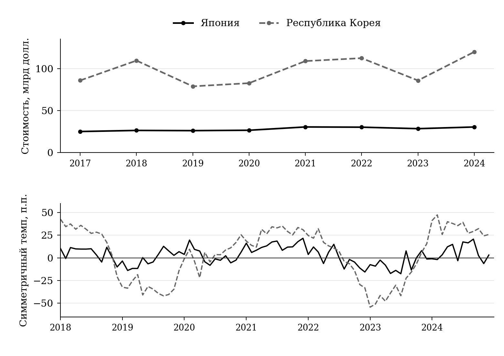
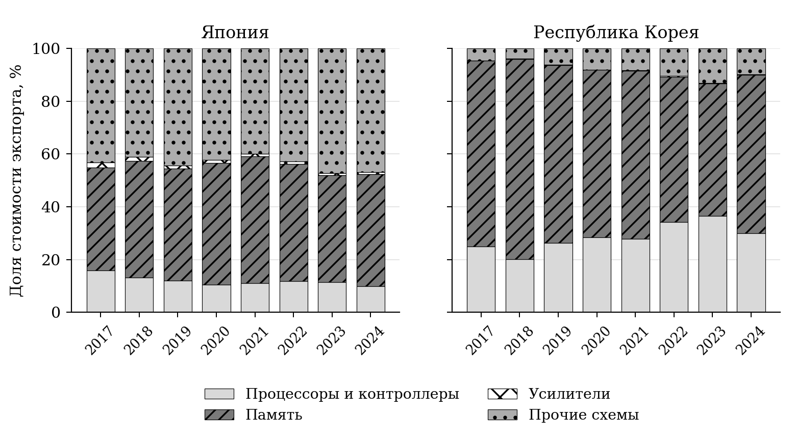
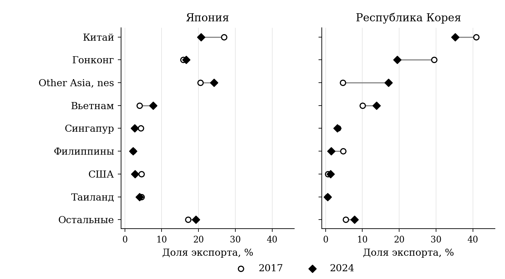
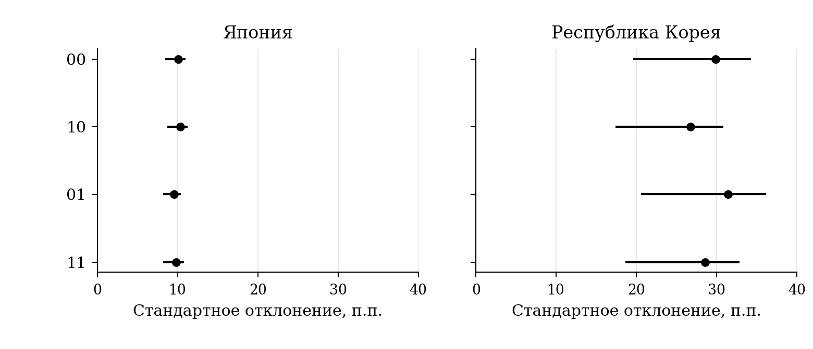
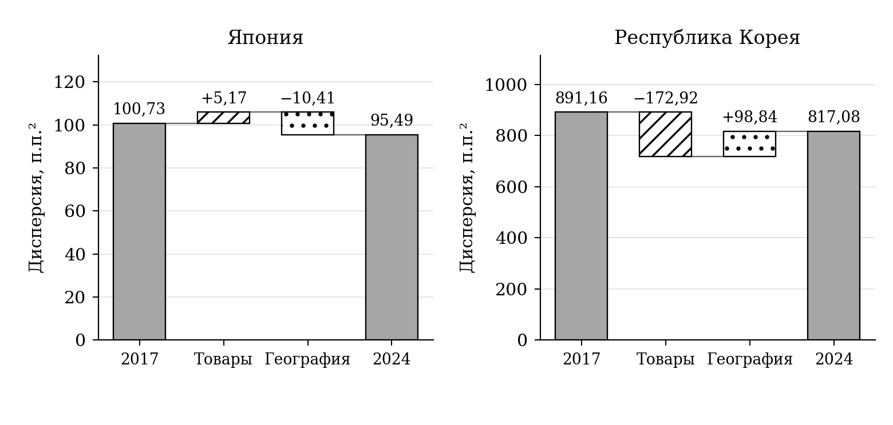
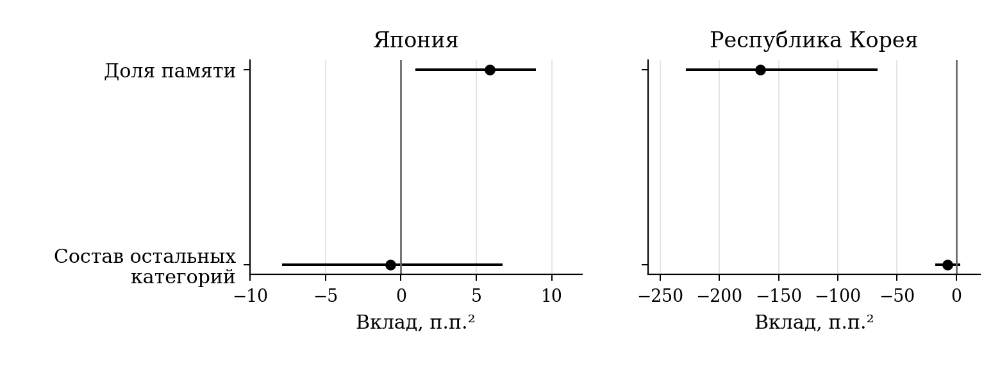
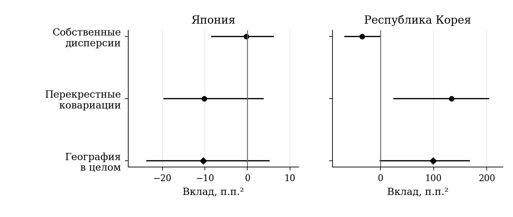

# Глава 2 Эмпирический анализ структуры и волатильности экспорта интегральных схем Японии и Республики Корея

## 2.1 Информационная база и методика анализа структуры и волатильности экспорта

Рассмотренные в первой главе подходы показывают, что связь экспортной диверсификации с волатильностью зависит как от состава поставок, так и от совместной динамики отдельных потоков. Для эмпирической оценки этой связи необходимо сопоставить различные экспортные структуры на общей истории колебаний. В настоящем исследовании такой анализ проводится для Японии и Республики Корея. Последовательность расчетов включает описание наблюдаемых изменений, оценку условной волатильности при фиксированных весах и разделение товарного и географического вкладов в ее изменение.

Исследовательский вопрос состоит в том, как изменяется условная дисперсия экспортного индекса при переходе от структуры 2017 года к структуре 2024 года и какую часть этой разницы дают товарные доли и география внутри товаров. Сопоставление двух стран позволяет рассмотреть этот вопрос при различном исходном весе памяти, сохраняя одинаковые товарные определения и правила расчета. Это целенаправленный выбор двух сравнительных случаев; он не представляет все страны — производители полупроводников. Начальный и конечный годы задают границы полной основной панели. Они не используются как даты начала и окончания отдельного политического воздействия.

Информационную основу составляют месячные данные UN Comtrade за январь 2017 — декабрь 2024 года, полученные из экспортной статистики самих стран-респондентов. Используется сохраненная выгрузка от 16 октября 2026 года.[^ch2-1-data] Стоимость поставок выражена в текущих долларах США на основе оценки FOB. В международной статистике такая оценка относится к стоимости товара на границе экспортирующей страны; для экспортных записей UN Comtrade она представлена основным стоимостным показателем.[^ch2-1-valuation] Исследуемые величины характеризуют зарегистрированный валовой экспорт. Они не являются показателями добавленной стоимости, созданной национальными компаниями, и сохраняют влияние цен, валютной переоценки и состава продукции.

Основная товарная совокупность включает четыре шестизначные позиции Гармонизированной системы: процессоры и контроллеры HS854231, память HS854232, усилители HS854233 и прочие интегральные схемы HS854239. Позиция HS854290, объединяющая части интегральных схем, используется при проверке чувствительности. Товарная позиция HS8542 служит для контроля полноты сумм. Таким образом, основной расчет относится к готовым интегральным схемам в принятой классификации, а не ко всему полупроводниковому производству. В него не входят производственное оборудование, материалы и иные категории полупроводниковой продукции.

В исходных ответах за 2017–2021 годы применяется редакция HS 2017, за 2022–2024 годы — HS 2022. Сопоставление номенклатур показывает сохранение выделенных кодов и наименований соответствующих подпозиций в обеих редакциях.[^ch2-1-wco] Это позволяет использовать единое товарное деление на протяжении периода. Вместе с тем одинаковый код не означает неизменного технологического состава поставок: например, позиция памяти не дает возможности раздельно анализировать ее отдельные технологические виды. Поэтому изменения внутри шестизначных категорий остаются частью наблюдаемой стоимостной динамики.

Полнота базы проверялась на уровне сочетания экспортера, месяца и товарного кода. Для двух стран, 96 месяцев и шести запрошенных кодов получено 1 152 таких набора данных, включая части и контрольную позицию HS8542. Это число проверенных наборов, а не независимых временных наблюдений модели. Проверены соответствие параметров отбора, отсутствие дублирующих записей и усечения ответов, наличие итоговой строки по миру. Суммы по направлениям сопоставлены с мировым итогом, а сумма пяти шестизначных позиций — с HS8542. Предусмотренные проверки согласования для основного периода пройдены. Строка World используется только как контрольный итог и не включается в распределение направлений.

Отдельно сопоставлены суммы двенадцати месячных значений с ранее полученной годовой статистикой. Максимальное абсолютное относительное расхождение среди 96 сопоставимых сочетаний страны, года и товарного кода составляет около 0,793%. Оно относится к японскому экспорту HS854239 за 2022 год. Месячные значения не корректировались для принудительного совпадения с годовым итогом. Все веса в последующем анализе рассчитаны из месячной базы, что сохраняет общую информационную основу структуры и динамики.

При построении панели разграничиваются отсутствие загруженного набора данных и отсутствие отдельного направления в успешно полученном и проверенном наборе. В первом случае значение остается неизвестным. Во втором оно учитывается как нулевая зарегистрированная поставка в пределах выбранной статистики. Такое правило не устраняет возможных ограничений исходного учета, но исключает подмену ошибок загрузки нулевым экспортом. Основные характеристики выборки представлены в таблице 2.1.

**Таблица 2.1 — Информационная база и параметры основной оценки**

| Характеристика | Принятое определение |
| --- | --- |
| Источник и экспортеры | UN Comtrade; Япония и Республика Корея, данные стран-респондентов |
| Период исходных стоимостей | Январь 2017 — декабрь 2024 года; 96 месяцев для каждой страны |
| Единица стоимости | Текущие доллары США, FOB |
| Основные товары | HS854231, HS854232, HS854233, HS854239 |
| Дополнительные и контрольные коды | HS854290 — части; HS8542 — итог для контроля сумм |
| Период годовых темпов | Январь 2018 — декабрь 2024 года; 84 месячных наблюдения |
| Географическая сетка | Восемь отдельных направлений и одна остаточная группа |
| Размерность основной модели | 36 товарно-географических ячеек для каждого экспортера |
| Сравниваемые структуры | Товарные доли и география внутри товаров за 2017 и 2024 годы |

Источник: составлено по UN Comtrade и результатам проверки исследовательской базы.

Для оценки относительной динамики используется симметричный темп изменения стоимости по сравнению с соответствующим месяцем предыдущего года. Пусть $x_{kj,t}$ обозначает стоимость экспорта товара $k$ по направлению $j$ в месяце $t$. Тогда темп определяется следующим образом:

$$
g_{kj,t}=\frac{2(x_{kj,t}-x_{kj,t-12})}{x_{kj,t}+x_{kj,t-12}}.
\tag{2.1}
$$

При положительном знаменателе показатель ограничен интервалом от −2 до 2. В отличие от обычного процентного роста он позволяет учитывать появление поставок после нулевого значения без деления на нулевую базу. При прекращении поставок темп равен −2, при их появлении — 2. Если оба значения нулевые, темп не определен. Для условного индекса с положительным фиксированным весом такая ситуация не трактуется как отсутствие волатильности. Лаг в двенадцать месяцев задает сопоставление одинаковых месяцев соседних лет, однако сам по себе не означает полной сезонной корректировки ряда.

Необходимость наблюдать темпы по всем используемым ячейкам определяет способ формирования общей географии. Сначала для каждого экспортера рассчитываются доли направлений в суммарной стоимости четырех товарных категорий за 2017–2020 годы. Затем доли двух стран усредняются с одинаковыми весами, и по полученному показателю выбираются восемь крупнейших кандидатов. Таким образом, ранжирование не определяется исключительно масштабом одного экспортера. Коды Японии и Республики Корея исключаются из списка отдельных общих направлений, а взаимные поставки сохраняются в остаточной группе.

Для каждого кандидата проверяется наличие определенных годовых темпов во всех четырех категориях и у обоих экспортеров за 2018–2024 годы. При нарушении этого условия направление должно объединяться с остатком для обеих стран. В основной оценке все восемь кандидатов прошли проверку: Китай, Гонконг, Other Asia, nes, Вьетнам, Сингапур, Филиппины, США и Таиланд. Вместе с остаточной группой они образуют девять направлений и 36 сочетаний товара и направления. Название Other Asia, nes сохранено в соответствии с источником. Проверка наблюдаемости использует всю выбранную историю, поэтому сетка предназначена для исторического анализа. Под направлением понимается статистический торговый партнер; его нельзя автоматически отождествлять с рынком конечного потребления изделий, в которых используются чипы.[^ch2-1-partner]

Годовые веса строятся из сумм месячной стоимости. Обозначим такую сумму для ячейки через $X_{kj,y}$, где $y$ — год. Доля товарной категории $a_{k,y}$ и доля направления внутри этой категории $b_{j\mid k,y}$ определяются как

$$
a_{k,y}=\frac{\sum_j X_{kj,y}}{\sum_k\sum_j X_{kj,y}},
\qquad
b_{j\mid k,y}=\frac{X_{kj,y}}{\sum_j X_{kj,y}}.
\tag{2.2}
$$

Вес товарно-географической ячейки равен произведению этих долей. Такое представление сохраняет различие между изменением удельного веса товара и перераспределением его поставок между направлениями. Для описания структуры рассчитываются товарный и географический индексы Херфиндаля — Хиршмана как суммы квадратов соответствующих долей. Используется шкала до единицы; минимум товарного индекса для четырех равновеликих категорий составляет 0,25. Географическая концентрация дополнительно оценивается на всех исходных направлениях и на укрупненной сетке модели. Объединение небольших направлений в остаток повышает концентрацию, поэтому уровни индекса сопоставляются при одинаковом способе группировки.

Основное сравнение относится к структурам 2017 и 2024 годов. Для отделения двух измерений строятся также состояния, в которых изменяется только товарный состав или только география внутри товаров. Обозначим начальный год как $y_0=2017$, конечный — как $y_1=2024$. В состоянии $(r,s)$ первый индекс указывает год товарных долей, второй — год географического распределения. Соответствующий индекс темпов имеет вид

$$
G_t^{rs}=\sum_k\sum_j w_{kj}^{rs}g_{kj,t},
\qquad
w_{kj}^{rs}=a_{k,y_r}b_{j\mid k,y_s},
\qquad r,s\in\{0,1\}.
\tag{2.3}
$$

Все веса неотрицательны и в каждом состоянии складываются в единицу. Четыре состояния представлены в таблице 2.2. Смешанные состояния позволяют определить значение каждой стороны структурного изменения при сохранении другой стороны на исходном или конечном уровне.

**Таблица 2.2 — Состояния экспортной структуры в основном сравнении**

| Состояние | Товарные доли | География внутри товаров | Содержание |
| --- | --- | --- | --- |
| 00 | 2017 год | 2017 год | Исходная структура |
| 10 | 2024 год | 2017 год | Замена только товарных долей |
| 01 | 2017 год | 2024 год | Замена только географических долей |
| 11 | 2024 год | 2024 год | Конечная структура |

Примечание: для всех состояний используются одни и те же 84 месячных наблюдения годовых темпов за 2018–2024 годы; матрица ковариаций оценивается отдельно для каждой страны.

Источник: составлено в соответствии с методикой исследования.

Условный индекс отличается от фактического темпа совокупного экспорта. Последний рассчитывается по сумме текущих поставок и их стоимости годом ранее; при агрегировании темпов отдельных ячеек его веса зависят от стоимости в обоих сравниваемых месяцах. В индексе $G_t^{rs}$ веса зафиксированы на протяжении всей истории. Благодаря этому различия между четырьмя состояниями связаны с их структурой при одинаковых наблюдаемых темпах. Дата 2024 в обозначении весов не означает, что волатильность оценивается только по двенадцати месяцам этого года.

Для каждой страны по 84 наблюдениям рассчитывается выборочная матрица ковариаций темпов $\widehat{\Sigma}$ с делителем $T-1$, где $T=84$. Она сохраняется неизменной при переходе между четырьмя состояниями. Дисперсия индекса и стандартное отклонение определяются соотношениями

$$
V_{rs}=(\mathbf{w}^{rs})^{\mathsf T}\widehat{\Sigma}\mathbf{w}^{rs},
\qquad
S_{rs}=100\sqrt{V_{rs}}.
\tag{2.4}
$$

Здесь $\mathbf{w}^{rs}$ — вектор весов всех 36 ячеек. Поскольку исходные темпы выражены в долях единицы, $S_{rs}$ измеряется в процентных пунктах симметричного темпа. Для представления дисперсии в квадратах процентных пунктов применяется множитель 10 000. Воспроизводимость расчета проверяется совпадением квадратичной формы с выборочной дисперсией непосредственно построенного ряда $G_t^{rs}$. Матрицы двух экспортеров оцениваются раздельно; основным объектом сравнения являются изменения внутри каждой страны.

В расчете не используется обращение матрицы ковариаций и не подбираются веса, минимизирующие дисперсию. Для каждого заранее заданного вектора весов квадратичная форма эквивалентна дисперсии одного временного ряда условного индекса. Это позволяет сохранять определенность показателя и в более коротких дополнительных окнах, когда матрица может быть вырожденной. Вместе с тем сокращение числа временных наблюдений ограничивает точность оценки; увеличение количества ячеек этого ограничения не устраняет.

Изменение дисперсии между конечной и исходной структурами разделяется по принципу Шепли. Как показано в работе Shorrocks, усреднение предельных вкладов по возможным порядкам замены позволяет получить точное аддитивное разложение.[^ch2-1-shorrocks] Для двух рассматриваемых измерений товарный вклад $C_T$ и географический вклад $C_G$ равны

$$
\begin{aligned}
C_T&=\frac{(V_{10}-V_{00})+(V_{11}-V_{01})}{2},\\
C_G&=\frac{(V_{01}-V_{00})+(V_{11}-V_{10})}{2}.
\end{aligned}
\tag{2.5}
$$

Их сумма составляет $V_{11}-V_{00}$. Взаимодействие изменений товарного состава и географии тем самым распределяется между двумя вкладами. Отрицательный вклад означает уменьшение дисперсии в принятом сравнении, положительный — ее увеличение. Аддитивность относится именно к дисперсии: значения в п.п.² нельзя интерпретировать как складывающиеся изменения стандартного отклонения. Разность $S_{11}-S_{00}$ рассчитывается отдельно и используется для представления масштаба результата.

Для объяснения полученных вкладов дисперсия каждого состояния также разделяется на собственные дисперсии ячеек и перекрестные ковариации. К этим составляющим применяется то же правило замены весов, поэтому их вклады складываются в соответствующий общий результат. Такая детализация позволяет установить, связан ли географический сдвиг преимущественно с изменением веса отдельных волатильных потоков или с их совместными колебаниями. Расчеты по направлениям и отдельным товарам служат дальнейшему раскрытию этого соотношения.

Неопределенность оценок учитывается с помощью парного циркулярного блочного бутстрепа. В отличие от независимого выбора отдельных месяцев блочный подход сохраняет временной порядок наблюдений внутри выбранных отрезков. Циркулярная схема допускает продолжение блока от конца ряда к его началу; такой способ формирования повторных выборок описан Politis и Romano.[^ch2-1-bootstrap] В настоящем исследовании используется 1 999 повторов с блоком 12 месяцев, а длина в 6 месяцев рассматривается дополнительно. Внутри каждого повтора одинаковые временные индексы применяются ко всем ячейкам и четырем состояниям. Это сохраняет их совместные колебания и обеспечивает парное сравнение структур.

В повторных выборках переоцениваются дисперсии четырех индексов, их разность и оба вклада. Границами 95%-интервала служат квантили 2,5 и 97,5% распределения соответствующей статистики. Интервал разности рассчитывается по разностям внутри повторов, а не вычитанием границ интервалов отдельных состояний. Веса и географическая сетка при этом фиксированы. Полученные интервалы характеризуют вариацию оценки на выбранной истории и не охватывают всю неопределенность статистического учета и структурных изменений. Семь лет темпов содержат ограниченное число отраслевых циклов, что учитывается при интерпретации результатов.

Предусмотренные проверки чувствительности изменяют товарный охват, степень укрупнения географии, определение темпов и историческое окно ковариаций. Их результаты рассматриваются в разделе 2.4. Основное сравнение сохраняет структуры 2017/2024 и общую историю 2018–2024 годов; дополнительные варианты не заменяют его в зависимости от полученного знака. Подготовленная база и система показателей позволяют далее перейти от описания фактических сдвигов к оценке их товарного и географического вкладов. Содержанием этой оценки является изменение исторической изменчивости при фиксированных весах, а не причинный эффект конкретной промышленной или торговой политики.

[^ch2-1-data]: United Nations Statistics Division. UN Comtrade Database. Месячный экспорт Японии и Республики Корея по HS8542 и подпозициям HS854231, HS854232, HS854233, HS854239, HS854290 за 2017–2024 годы. Выгрузка 16 октября 2026 года.

[^ch2-1-valuation]: United Nations (2011). International Merchandise Trade Statistics: Concepts and Definitions 2010. Statistical Papers, Series M No. 52, Rev. 3. New York. Пункты 4.6–4.8, с. 39–40; United Nations Statistics Division (2019). Methodology Guide for UN Comtrade User on UN Comtrade Upgrade 2019. Раздел III.D, с. 6.

[^ch2-1-wco]: World Customs Organization (2017). Harmonized System Nomenclature. Chapter 85, heading 85.42; World Customs Organization (2022). Harmonized System Nomenclature. Chapter 85, heading 85.42.

[^ch2-1-partner]: United Nations (2011). International Merchandise Trade Statistics: Concepts and Definitions 2010. Statistical Papers, Series M No. 52, Rev. 3. New York. Пункты 6.13–6.14, 6.24–6.25, с. 49, 51.

[^ch2-1-shorrocks]: Shorrocks A. F. (1999). Decomposition Procedures for Distributional Analysis: A Unified Framework Based on the Shapley Value. First draft, June. Раздел 2, с. 4–6.

[^ch2-1-bootstrap]: Politis D. N.; Romano J. P. (1991). A Circular Block-Resampling Procedure for Stationary Data. Technical Report No. 370, Department of Statistics, Stanford University, March. Раздел 2, с. 4.

## 2.2 Динамика и структурные изменения экспорта интегральных схем Японии и Республики Корея

Сравнение экспортной динамики позволяет установить, какие структурные изменения лежат в основе последующей оценки волатильности. Рассматриваются четыре категории готовых интегральных схем, определенные в разделе 2.1. Все стоимостные показатели рассчитаны суммированием месячных поставок из одной базы UN Comtrade. Поэтому описательная часть и модель относятся к одинаковой товарной совокупности. Анализ последовательно охватывает масштаб экспорта, его колебания, товарный состав и распределение по направлениям.

В течение 2017–2024 годов Республика Корея сохраняла существенно больший объем зарегистрированного экспорта рассматриваемой продукции. В 2017 году его стоимость составляла 85,84 млрд долл. против 24,99 млрд долл. у Японии, в 2024 году — 119,82 и 30,38 млрд долл. соответственно. Между крайними годами корейский показатель увеличился примерно на 39,6%, японский — на 21,5%. Эти величины характеризуют изменение номинальной экспортной стоимости; они не являются оценками роста физического выпуска или доли страны на мировом рынке.

За общей положительной динамикой скрываются заметно различающиеся траектории. Экспорт Японии в 2017–2020 годах находился в пределах 24,99–26,51 млрд долл. В 2021 году он вырос до 30,43 млрд долл., после чего сократился до 30,16 млрд долл. в 2022 году и 28,40 млрд долл. в 2023 году. Восстановление до 30,38 млрд долл. в 2024 году почти вернуло показатель к уровню 2021 года. Следовательно, увеличение между началом и концом выборки не сопровождалось непрерывным ростом: после заметного расширения поставок наблюдались два года снижения.

Колебания корейского экспорта были более выраженными. После увеличения до 109,49 млрд долл. в 2018 году стоимость поставок сократилась до 78,82 млрд долл. в 2019 году. Затем она поднялась до 108,90 млрд долл. в 2021 году и 112,38 млрд долл. в 2022 году, снизилась до 85,79 млрд долл. в 2023 году и достигла 119,82 млрд долл. в 2024 году. По обычному отношению годовых сумм падение составило 28,01% в 2019 году и 23,67% в 2023 году, а прирост в 2024 году — 39,67%. Таким образом, рост за весь период сочетался с глубокими промежуточными сокращениями.

Месячные наблюдения раскрывают различия, которые частично сглаживаются в годовых итогах. Стандартное отклонение фактического симметричного темпа год к году за 2018–2024 годы составило 9,88 п.п. для Японии и 28,48 п.п. для Кореи. Минимальное японское значение наблюдалось в июле 2023 года и равнялось −17,45 п.п., максимальное — в декабре 2021 года, 21,64 п.п. У Кореи соответствующие значения составили −54,32 п.п. в январе 2023 года и 47,44 п.п. в феврале 2024 года. Симметричные темпы имеют определение, приведенное в формуле (2.1), и не совпадают с обычным процентным приростом. Здесь они рассчитаны непосредственно по совокупной стоимости четырех категорий, без фиксации структурных весов. На рисунке 2.1 сопоставлены годовые стоимости и месячные темпы, позволяющие увидеть глубину отдельных спадов.

**Рисунок 2.1 — Стоимость экспорта и фактические годовые темпы его изменения**

Примечание: Верхняя панель — годовые суммы; нижняя — месячные темпы год к году. Четыре категории готовых схем; текущие доллары США.

Источник: расчеты автора по UN Comtrade.

Полученное различие согласуется с необходимостью учитывать отраслевую специализацию. В исследовании KDI спад полупроводникового экспорта в начале 2023 года рассматривается с разделением ценовой и количественной составляющих; отдельное внимание уделяется значительным колебаниям рынка памяти.[^ch2-2-kdi] Это дает контекст для наблюдаемой динамики, но не заменяет ее объяснения в нашей выборке: отраслевой охват и используемые показатели различаются. Данные настоящего исследования позволяют установить изменение стоимости поставок и их структуры, сохраняя вопрос о соотношении цен и физических количеств открытым.

Товарная структура Кореи на протяжении всего периода отличалась высокой долей памяти. В 2017 году на HS854232 приходилось 70,49% стоимости четырех категорий, в 2018 году — 75,85%. Затем доля снизилась до 67,45% в 2019 году и примерно 63,4–63,5% в 2020–2021 годах. В 2022 году она составляла 54,97%, в 2023 году — 50,00%, а в 2024 году вновь выросла до 60,11%. Сравнение крайних лет показывает уменьшение на 10,38 п.п., однако годовая траектория указывает на частичный возврат к большей доле памяти в конце периода.

Сокращение доли памяти между 2017 и 2024 годами сопровождалось увеличением абсолютной стоимости ее экспорта с 60,51 до 72,02 млрд долл. Следовательно, изменение структуры не означает свертывания поставок этой категории. Стоимость экспорта процессоров и контроллеров за тот же период выросла с 21,36 до 35,85 млрд долл., прочих интегральных схем — с 3,93 до 11,73 млрд долл. Остальные категории в совокупности расширялись быстрее памяти и тем самым уменьшали ее относительный вес. Для анализа структурных изменений сопоставление долей с абсолютными значениями поэтому принципиально.

Разложение прироста стоимостей уточняет масштаб этого перераспределения. Из общего увеличения корейского экспорта на 33,98 млрд долл. на процессоры и контроллеры приходится 14,49 млрд долл., или 42,63%, на память — 11,51 млрд долл., или 33,88%, на прочие схемы — 7,80 млрд долл., или 22,96%. Остальная часть относится к усилителям. Это бухгалтерское разделение изменения стоимости между категориями. Оно показывает, что расширение экспорта обеспечивалось несколькими товарными группами и что снижение доли памяти возникло при ее положительном вкладе в общий прирост.

Доля процессоров и контроллеров в корейском экспорте увеличилась с 24,88 до 29,92%, а прочих интегральных схем — с 4,57 до 9,79%. При этом в 2023 году их доли достигали соответственно 36,62 и 13,03%, то есть превышали значения конечного года. Усилители занимали значительно меньшую часть совокупности: 0,05% в 2017 году и 0,19% в 2024 году. В результате изменение корейской структуры связано прежде всего с перераспределением между памятью, процессорами и прочими схемами; вклад усилителей в общие стоимостные доли невелик, хотя категория сохраняется в расчетах.

У Японии исходная структура была менее сосредоточена на памяти. В 2017 году крупнейшей категорией являлись прочие интегральные схемы с долей 43,29%, далее следовали память — 38,98%, процессоры и контроллеры — 15,83% и усилители — 1,90%. К 2024 году доля прочих схем увеличилась до 46,86%, памяти — до 42,46%, тогда как доли процессоров и усилителей сократились до 9,99 и 0,69%. Совокупный вес двух крупнейших категорий тем самым вырос примерно с 82,26 до 89,32%. В отличие от Кореи, японское перераспределение не означало снижения товарной концентрации на уровне выделенных четырех кодов.

Абсолютные значения подтверждают различие направлений сдвига. Стоимость японского экспорта памяти выросла с 9,74 до 12,90 млрд долл., прочих схем — с 10,82 до 14,23 млрд долл. Для процессоров и контроллеров она сократилась с 3,96 до 3,04 млрд долл., для усилителей — с 0,48 до 0,21 млрд долл. Таким образом, повышение доли двух крупнейших категорий сочеталось с уменьшением стоимостного экспорта двух остальных. Эти изменения относятся к выбранным таможенным позициям и не позволяют судить об изменении всех технологических компетенций японской полупроводниковой промышленности.

В Японии общий прирост на 5,38 млрд долл. складывается из увеличения экспорта памяти на 3,16 млрд долл. и прочих схем на 3,42 млрд долл. при сокращении поставок процессоров на 0,92 млрд долл. и усилителей на 0,27 млрд долл. Поэтому усиление концентрации отражает одновременно расширение двух крупных категорий и снижение двух меньших. Корейская и японская структуры изменились по разным основаниям: первая стала более равномерной вследствие более быстрого роста остальных категорий относительно памяти, вторая — более сосредоточенной на двух группах, обеспечивших положительный прирост.

Японская товарная структура также менялась немонотонно. Доля памяти достигла 48,19% в 2021 году, снизилась до 40,49% в 2023 году и составила 42,46% в 2024 году. Конечная структура поэтому отражает определенное положение внутри наблюдаемой динамики, а не завершенный переход к постоянным пропорциям. Для обеих стран это обосновывает рассмотрение всей истории темпов при последующей оценке: сопоставления только двух годовых стоимостей недостаточно для характеристики изменчивости экспортных потоков. Изменение всех четырех товарных долей показано на рисунке 2.2.

**Рисунок 2.2 — Изменение товарной структуры экспорта**

Примечание: Каждый столбец составляет 100% стоимости четырех товарных категорий; части HS854290 исключены.

Источник: расчеты автора по UN Comtrade.

Различия товарной структуры сопровождаются перераспределением направлений поставок. В Корее суммарная доля Китая и Гонконга уменьшилась с 70,39% в 2017 году до 54,64% в 2024 году. Отдельно доля Китая снизилась с 40,90 до 35,19%, Гонконга — с 29,49 до 19,45%. Одновременно доля направления Other Asia, nes увеличилась с 4,66 до 17,10%, Вьетнама — с 10,07 до 13,84%. Следовательно, уменьшение удельного веса двух крупнейших исходных направлений сопровождалось заметным усилением других направлений в азиатской торговой сети.

Изменение распределения не было одинаковым для всех партнеров. Доля Филиппин в корейском экспорте уменьшилась с 4,81 до 1,49%, Сингапура — с 3,37 до 3,15%; доля США увеличилась с 0,67 до 1,37%. Доля Таиланда оставалась около 0,55%, а остаточной группы возросла с 5,48 до 7,86%. Небольшая доля США среди непосредственных направлений зарегистрированного вывоза не характеризует их значение для конечного спроса на электронику. Исследуемая статистика отражает торговые перемещения интегральных схем, включая поставки для последующих стадий производства.

Для Японии доля Китая сократилась с 26,94 до 20,67%, тогда как доля Other Asia, nes увеличилась с 20,48 до 24,18%. К 2024 году последнее направление стало крупнейшим среди выделенных в модели. Доля Гонконга выросла с 15,85 до 16,62%, Вьетнама — с 3,96 до 7,69%. Доли США и Сингапура, напротив, уменьшились с 4,52 до 2,77% и с 4,35 до 2,62% соответственно. Таким образом, в обеих странах сократился совокупный вес Китая, но изменения остальных направлений имели разный масштаб и состав. Рисунок 2.3 позволяет сопоставить направление и масштаб географических сдвигов двух экспортеров.

**Рисунок 2.3 — Перераспределение направлений экспорта между 2017 и 2024 годами**

Примечание: Доли рассчитаны по четырем категориям вместе. Остаток включает все направления вне восьми отдельно выделенных партнеров.

Источник: расчеты автора по UN Comtrade.

Распределение внутри памяти показывает, что наблюдаемые географические сдвиги не сводятся к изменению товарных весов. В корейском экспорте HS854232 доля Китая уменьшилась с 46,31 до 35,85%, Гонконга — с 35,84 до 25,45%, а Other Asia, nes выросла с 3,02 до 20,08%. Доля Вьетнама увеличилась с 4,84 до 10,34%. Это изменения географии одной и той же товарной категории. Их влияние на условный индекс можно отделить от изменения общей доли памяти, что и предусматривает разложение следующего раздела.

В японских поставках памяти доля Китая снизилась с 44,73 до 31,41%, Other Asia, nes увеличилась с 42,50 до 49,51%. Их совместный вес уменьшился, однако по отдельности они продолжали определять большую часть экспорта категории. Остаточная группа выросла с 1,60 до 7,35%. При этом в общей японской географии остаток имел существенно больший вес — 17,17% в начале периода и 19,27% в конце. Это показывает, что память и остальные схемы имеют разные распределения направлений; описание только совокупных долей скрывало бы часть различий.

Обобщенные характеристики исходной и конечной структур представлены в таблице 2.3. Индексы концентрации приведены в шкале от 0 до 1. Товарный HHI отражает распределение между четырьмя категориями, географический — распределение стоимости между направлениями. Значения последнего рассчитаны как на исходном перечне партнеров, так и на сетке модели, объединяющей остальные направления в одну группу.

**Таблица 2.3 — Характеристики экспортной структуры в 2017 и 2024 годах**

| Показатель | Япония, 2017 | Япония, 2024 | Корея, 2017 | Корея, 2024 |
| --- | ---: | ---: | ---: | ---: |
| Стоимость экспорта, млрд долл. | 24,99 | 30,38 | 85,84 | 119,82 |
| Доля памяти, % | 38,98 | 42,46 | 70,49 | 60,11 |
| Товарный HHI | 0,3647 | 0,4099 | 0,5609 | 0,4604 |
| Географический HHI, все направления | 0,1587 | 0,1541 | 0,2705 | 0,2125 |
| Географический HHI, сетка модели | 0,1771 | 0,1754 | 0,2731 | 0,2177 |
| Доля остаточной группы модели, % | 17,17 | 19,27 | 5,48 | 7,86 |

Примечание: основной товарный охват — HS854231, HS854232, HS854233 и HS854239. Годовые стоимости и доли рассчитаны из месячных данных. Географическая сетка модели включает восемь отдельных направлений и остаток.

Источник: расчеты автора по UN Comtrade.

Для Кореи оба вида концентрации между крайними годами снизились: товарный HHI — с 0,5609 до 0,4604, географический по всем направлениям — с 0,2705 до 0,2125. Для Японии снижение географического HHI было небольшим, с 0,1587 до 0,1541, тогда как товарный HHI повысился с 0,3647 до 0,4099. Поэтому описание двух стран единой формулировкой о диверсификации было бы неточным. В Корее уменьшилась концентрация по обоим измерениям, в Японии расширение географического распределения сочеталось с усилением концентрации внутри рассматриваемой товарной совокупности.

Укрупнение направлений повышает уровень географического HHI в обеих странах. Для Японии различие между полной и модельной сеткой больше, что соответствует более значительному весу остаточной группы. В 2024 году японский индекс на сетке модели равен 0,1754 при 0,1541 на всех направлениях; для Кореи — 0,2177 и 0,2125 соответственно. Тем не менее знак изменения между 2017 и 2024 годами сохраняется на обеих сетках. Следовательно, уменьшение концентрации не создается исключительно способом объединения небольших партнеров, хотя размер показателя зависит от агрегации.

Изменение HHI само по себе еще не определяет результат для волатильности. Оно учитывает доли потоков, но не различает их собственную изменчивость и совместные колебания. Например, перераспределение поставок между направлениями способно сделать доли более равномерными и одновременно увеличить вес потоков, динамика которых сильнее совпадает. В рассматриваемых данных такая возможность имеет практическое значение: география менялась одновременно с товарным составом, а память оставалась крупной категорией у обоих экспортеров.

Описательный анализ, таким образом, устанавливает несколько взаимосвязанных обстоятельств. Корейский экспорт характеризовался большим масштабом и более выраженными фактическими колебаниями, при этом к 2024 году доля памяти и географическая концентрация были ниже, чем в 2017 году. Японская структура стала более сосредоточенной на памяти и прочих схемах при небольшом снижении концентрации направлений. В обеих странах происходило существенное перераспределение географии внутри памяти. Следующий этап состоит в оценке того, как именно товарные и географические изменения соотносятся с условной волатильностью на общей истории наблюдений.

[^ch2-2-kdi]: Jo K.; Jung K.-C. (2023). Semiconductor Market Trends and Macroeconomic Implications. Korea Development Institute. С. 1–3.

## 2.3 Товарные и географические вклады в изменение условной волатильности экспорта

Выявленные структурные изменения по-разному воздействуют на веса отдельных экспортных потоков. Для оценки их соотношения применен описанный в разделе 2.1 расчет четырех состояний. Во всех состояниях используются одни и те же темпы за 2018–2024 годы и одна матрица ковариаций для каждого экспортера. Меняются только товарные доли и распределение направлений внутри товаров. Такое сопоставление показывает, насколько различается историческая изменчивость индекса при структурах 2017 и 2024 годов, и позволяет отделить два измерения структурного сдвига.

В основной оценке переход от исходных к конечным весам сопровождается уменьшением условного стандартного отклонения у обеих стран. У Японии оно снижается с 10,04 до 9,77 п.п., у Кореи — с 29,85 до 28,58 п.п. Разности составляют −0,26 и −1,27 п.п. соответственно. При этом основные 95%-интервалы разностей равны [−1,27; 0,89] и [−3,00; 0,42] п.п. и включают ноль. Поэтому отрицательные точечные оценки не дают основания считать общее снижение установленным независимо от неопределенности выборки. Основные значения и интервалы приведены в таблице 2.4.

**Таблица 2.4 — Условная волатильность экспортных структур и разложение ее изменения**

| Показатель | Япония: оценка [95%-интервал] | Корея: оценка [95%-интервал] |
| --- | ---: | ---: |
| SD, исходная структура 00, п.п. | 10,04 [8,44; 11,00] | 29,85 [19,61; 34,27] |
| SD, замена товарных долей 10, п.п. | 10,31 [8,72; 11,24] | 26,73 [17,39; 30,83] |
| SD, замена географии 01, п.п. | 9,52 [8,18; 10,35] | 31,41 [20,55; 36,17] |
| SD, конечная структура 11, п.п. | 9,77 [8,20; 10,77] | 28,58 [18,62; 32,89] |
| Изменение SD, п.п. | −0,26 [−1,27; 0,89] | −1,27 [−3,00; 0,42] |
| Изменение дисперсии, п.п.² | −5,25 [−24,56; 16,92] | −74,08 [−172,75; 21,56] |
| Товарный вклад Шепли, п.п.² | 5,17 [−4,31; 14,19] | −172,92 [−241,23; −67,54] |
| Географический вклад Шепли, п.п.² | −10,41 [−23,77; 5,21] | 98,84 [−1,67; 168,52] |

Примечание: структуры 2017 и 2024 годов, четыре товарные категории, восемь отдельных направлений и остаточная группа; 84 месячных наблюдения годовых симметричных темпов. Интервалы получены парным циркулярным блочным бутстрепом: 1 999 повторов, блок 12 месяцев. Интервал каждой разности или вклада рассчитан непосредственно по соответствующей статистике. Из-за округления последнего знака сумма отображенных вкладов может отличаться от отображенного общего изменения.

Источник: расчеты автора по UN Comtrade.

Смешанные состояния раскрывают причину различия между странами. Для Японии замена только товарных долей повышает стандартное отклонение с 10,04 до 10,31 п.п., тогда как замена только географии уменьшает его до 9,52 п.п. Конечная структура сочетает оба изменения и дает 9,77 п.п. Следовательно, в точечной оценке товарное перераспределение частично компенсирует уменьшение волатильности, связанное с географической частью. Это соответствует описательному наблюдению об увеличении доли памяти и прочих схем при некотором снижении концентрации направлений, хотя совпадение знаков не устанавливается самим HHI.

В Корее соотношение противоположно. При товарных долях 2024 года и географии 2017 года стандартное отклонение равно 26,73 п.п., то есть ниже исходных 29,85 п.п. При сохранении исходного товарного состава и замене географии оно достигает 31,41 п.п. Одновременный переход к конечным весам дает 28,58 п.п. Таким образом, более низкая конечная оценка формируется при противодействии двух структурных составляющих. Рассмотрение только исходного и конечного состояний скрывало бы этот результат. Оценки четырех состояний и их интервалы сопоставлены на рисунке 2.4.

**Рисунок 2.4 — Условная волатильность четырех экспортных структур**

Примечание: Точки — оценки; отрезки — 95%-интервалы, блок 12 месяцев. Обозначения состояний даны в таблице 2.2; шкалы одинаковы. Интервалы уровней не заменяют интервал разности.

Источник: расчеты автора по UN Comtrade.

Средние темпы условных индексов также различаются: при переходе от состояния 00 к 11 японское значение увеличивается с 1,12 до 4,18 п.п., корейское — с 1,81 до 7,65 п.п. Полные характеристики четырех состояний приведены в приложении Б. Это арифметические средние фиксированных индексов на общей истории, а не фактический среднегодовой прирост стоимости или ожидаемая доходность структуры. Поэтому уменьшение дисперсии рассматривается как отдельная характеристика. Модель не определяет оптимальные доли, поскольку не включает прибыльность, затраты на освоение продукции и ограничения изменения торговых связей.

Разложение Шепли дает точное разделение изменения дисперсии. В Японии исходная дисперсия равна 100,73 п.п.², конечная — 95,49 п.п.². Товарный вклад составляет +5,17 п.п.², географический — −10,41 п.п.², суммарное изменение — −5,25 п.п.². Интервалы обоих вкладов включают ноль. Следовательно, основная японская оценка описывает небольшое итоговое уменьшение при компенсации составляющих, но не позволяет уверенно выделить ненулевой общий товарный или географический вклад в пределах принятой процедуры оценивания.

Для Кореи исходная дисперсия составляет 891,16 п.п.², конечная — 817,08 п.п.². Товарный вклад равен −172,92 п.п.² с интервалом [−241,23; −67,54], географический — +98,84 п.п.² с интервалом [−1,67; 168,52]. Отрицательный товарный вклад выделяется среди основных результатов тем, что его интервал полностью расположен ниже нуля. Положительная географическая точечная оценка компенсирует примерно 57,16% абсолютной величины товарного вклада. Это отношение двух точечных оценок, а не самостоятельная оценка с доверительным интервалом.

Итоговая разность корейской дисперсии, −74,08 п.п.², меньше по абсолютной величине товарного вклада именно вследствие такой компенсации. Наличие отрицательного интервала у товарной составляющей не переносится автоматически на общую разность: ее собственный интервал составляет [−172,75; 21,56] п.п.². Кроме того, вклады относятся к дисперсии. Их нельзя прибавлять к исходному стандартному отклонению или читать как изменение волатильности на соответствующее число процентных пунктов. Переход к единицам стандартного отклонения выполняется после расчета дисперсии.

Относительно исходного уровня точечное уменьшение SD составляет 2,64% у Японии и 4,25% у Кореи; соответствующее уменьшение дисперсии — 5,21 и 8,31%. Это умеренный общий сдвиг на фоне более крупных компенсирующих составляющих. Широкие интервалы общего изменения допускают как снижение, так и повышение показателя и не равнозначны доказательству отсутствия различий. Наиболее содержательный основной вывод состоит в отрицательном товарном вкладе Кореи и в его частичной компенсации географической точечной оценкой, а не в утверждении о достоверном снижении общей волатильности. Каскады на рисунке 2.5 показывают масштаб компенсации товарного и географического вкладов.

**Рисунок 2.5 — Разложение изменения условной дисперсии по Шепли**

Примечание: Шкалы стран различаются. Промежуточная высота каскада складывается из усредненных вкладов Шепли и не является отдельным наблюдаемым состоянием. Интервалы вкладов приведены в таблице 2.4.

Источник: расчеты автора по UN Comtrade.

Для содержательного объяснения товарного результата проведено дополнительное разложение. Товарные веса представлены через долю памяти и относительные пропорции трех остальных категорий. Их замены усредняются по двум порядкам отдельно при исходной и конечной географии, а затем объединяются. Полученные составляющие точно складываются в первоначальный товарный вклад; географический вклад остается прежним. Такая процедура раскрывает исходное двухфакторное разложение и не является новым полным трехфакторным разложением Шепли.

Дополнительные расчеты по памяти, направлениям и ковариационным составляющим выполнялись после рассмотрения основной оценки и имеют объясняющий, поисковый характер. Их интервалы получены тем же способом повторного выбора наблюдений, но не скорректированы на множественное сопоставление детальных результатов. Поэтому они используются для установления того, какие элементы формируют рассчитанный вклад, с сохранением различия между основным выводом и его последующей детализацией.

Для Кореи изменение доли памяти дает −165,18 п.п.² с интервалом [−228,22; −66,29]. Перераспределение внутри остальных категорий дает −7,74 п.п.² с интервалом [−17,69; 3,22]. На долю памяти приходится около 95,52% отрицательного точечного товарного вклада. Следовательно, общий товарный результат связан преимущественно с уменьшением ее веса с 70,49 до 60,11%, а не с перестановкой пропорций процессоров, усилителей и прочих схем между собой.

Такое разложение имеет более узкий смысл, чем утверждение о диверсификации производства. Как показано в разделе 2.2, корейская экспортная стоимость памяти между крайними годами выросла, несмотря на сокращение доли. Модель устанавливает значение относительного веса категории при наблюдавшейся истории темпов. Она не разделяет физический выпуск, цены, качество продукции и изменение состава самой памяти. Тем более из HS854232 нельзя непосредственно выделить самостоятельные вклады HBM, DRAM или NAND. Для таких выводов потребовалась бы другая детализация данных.

Японское разложение показывает противоположное направление. Увеличению доли памяти соответствует вклад +5,88 п.п.² с интервалом [0,97; 8,95], изменению пропорций остальных категорий — −0,71 п.п.² с интервалом [−7,86; 6,74]. Их сумма составляет основные +5,17 п.п.². Положительный интервал отдельной дополнительной составляющей не меняет того, что интервал общего товарного вклада Японии включает ноль. Он помогает объяснить структуру точечной оценки, однако не заменяет результат первоначального сравнения. Рисунок 2.6 сопоставляет вклад доли памяти с вкладом пропорций остальных категорий.

**Рисунок 2.6 — Детализация товарного вклада**

Примечание: Вложенное симметричное разложение исходного товарного вклада; 95%-интервалы, блок 12 месяцев. Шкалы стран различаются. Дополнительные интервалы не скорректированы на множественные сравнения.

Источник: расчеты автора по UN Comtrade.

Географическая часть требует отдельного рассмотрения, поскольку у Кореи ее положительная точечная оценка сочетается со снижением HHI. Разделение дисперсии на собственные дисперсии ячеек и перекрестные ковариации показывает, что географический вклад включает −34,73 п.п.² первой составляющей и +133,57 п.п.² второй. Их сумма равна +98,84 п.п.². Следовательно, сдвиг географии уменьшает взвешенную сумму собственных дисперсий, но это уменьшение перекрывается изменением вклада совместных колебаний потоков.

Здесь речь идет об изменении весов при одной матрице ковариаций. Сам расчет не утверждает, что географическое перераспределение вызвало усиление корреляции или изменило свойства отдельных направлений. Он показывает, что конечные географические доли иначе распределяют вес уже наблюдавшихся совместных колебаний. Именно этого элемента нет в индексе концентрации. Поэтому уменьшение HHI и положительный вклад географии в условную дисперсию не противоречат друг другу: показатели учитывают разные свойства экспортной структуры.

Интервал корейской составляющей собственных дисперсий равен [−67,97; 1,50] п.п.², перекрестных ковариаций — [24,22; 204,50] п.п.². Последний полностью положителен в дополнительном расчете, однако интервал общего географического вклада включает ноль. Границы интервалов компонентов не складываются, поскольку компоненты оцениваются совместно и их колебания связаны. Содержательный вывод относится к доминированию ковариационной составляющей в точечном разложении, при сохранении неопределенности полного географического результата.

Для Японии географическая часть включает −0,28 п.п.² собственных дисперсий и −10,13 п.п.² перекрестных ковариаций. Их интервалы составляют [−8,53; 6,21] и [−19,74; 3,81] п.п.². Небольшая отрицательная точечная оценка первой составляющей показывает, что основное уменьшение здесь связано с перераспределением веса совместных колебаний. При этом оба интервала включают ноль. В сравнении с Кореей различаются и масштаб географического результата, и направление ковариационной части. На рисунке 2.7 показано соотношение собственных дисперсий, ковариаций и общего географического вклада.

**Рисунок 2.7 — Составляющие географического вклада**

Примечание: Точки и 95%-интервалы; шкалы стран различаются. Детализация выполнена после основной оценки. Интервалы компонентов не складываются в интервал суммы.

Источник: расчеты автора по UN Comtrade.

Для определения направлений, формирующих эти величины, использована аддитивная атрибуция по ячейкам. При замене одного вектора весов $\mathbf{w}^{A}$ на другой $\mathbf{w}^{B}$ вклад ячейки $i$ записывается как

$$
d_i^{A\to B}=(w_i^B-w_i^A)\left[(\widehat{\Sigma}\mathbf{w}^{B})_i+(\widehat{\Sigma}\mathbf{w}^{A})_i\right],
\qquad \sum_i d_i^{A\to B}=V_B-V_A.
\tag{2.6}
$$

Для географического вклада усредняются замены 00 → 01 и 10 → 11. Затем значения ячеек суммируются по направлениям. Формула учитывает ковариации каждой ячейки со всем остальным набором, поэтому отнесенная к направлению величина не является его изолированным риском. Атрибуция показывает участие изменения весов данного направления в общем результате при принятом правиле распределения.

В Корее наиболее крупные отрицательные географические вклады относятся к Гонконгу и Китаю: −163,88 и −116,61 п.п.². Отрицателен также вклад Филиппин, −78,75 п.п.². Им противостоят прежде всего Other Asia, nes с +368,93 п.п.² и Вьетнам с +63,17 п.п.². Эти величины соотносятся с рассмотренным ранее уменьшением долей Китая и Гонконга и увеличением веса других направлений. Абсолютные размеры отдельных составляющих превышают итоговые +98,84 п.п.², поскольку положительные и отрицательные вклады существенно компенсируются.

В дополнительных интервалах корейский вклад Other Asia, nes лежит в пределах [131,26; 497,45] п.п.², Китая — [−164,41; −36,45], Гонконга — [−224,46; −75,28]. Особенно крупная часть первого результата относится к памяти: для сочетания HS854232 и Other Asia, nes оценка равна +334,63 п.п.² с интервалом [114,85; 459,74]. Это согласуется с увеличением доли данного направления внутри корейской памяти с 3,02 до 20,08%. Вместе с тем величина отражает и собственную динамику ячейки, и ее ковариации с другими поставками; она не измеряет причинное воздействие конкретного покупателя или торговой территории.

У Японии наиболее заметный отрицательный вклад приходится на Китай: −17,99 п.п.² с интервалом [−24,11; −10,69]. Положительные оценки получены для Other Asia, nes, +9,70 п.п.² с интервалом [4,28; 13,95], и Вьетнама, +4,47 п.п.² с интервалом [0,29; 9,63]. Остальные направления совместно доводят географическую сумму до −10,41 п.п.². Таким образом, и японская оценка образуется из противоположно направленных составляющих, хотя их масштаб существенно меньше корейского. Отрицательный итог не означает одинакового изменения всех торговых связей.

Основной результат раздела состоит в различии механизмов структурного сдвига двух экспортеров. У Кореи уменьшение доли памяти формирует большую часть отрицательного товарного вклада, который частично компенсируется положительной географической оценкой, связанной прежде всего с перекрестными ковариациями. У Японии товарная составляющая имеет положительную точечную оценку, географическая — отрицательную, а общий результат невелик. Достоверность содержательной интерпретации зависит от того, сохраняются ли эти соотношения при изменении географической сетки, способа измерения темпов и исторического окна. Поэтому далее рассматривается весь предусмотренный набор проверок устойчивости.

## 2.4 Устойчивость результатов и их экономическая интерпретация

Основная оценка характеризует определенный товарный охват, географическую сетку и историю темпов. Для установления границ полученных выводов необходимо проверить, как они меняются при изменении каждого из этих условий. Предусмотренный набор включает двенадцать вариантов, в том числе основной, для двух экспортеров. Из 24 сочетаний страны и варианта численный результат определен для 22. Два недоступных случая относятся к Корее и связаны с ненаблюдаемыми темпами. Все варианты рассматриваются совместно; они представляют связанные проверки на одной базе, а не независимые подтверждения одной гипотезы.

Сначала проверяется влияние укрупнения географии. При пяти отдельных направлениях и остатке изменение стандартного отклонения составляет −0,27 п.п. у Японии и −0,94 п.п. у Кореи. При отборе двенадцати кандидатов после проверки наблюдаемости сохраняется одиннадцать отдельных направлений; еще один кандидат включается в остаток по общему правилу. На этой сетке оценки равны −0,18 и −1,31 п.п. соответственно. Знаки товарных и географических вкладов в обоих случаях совпадают с основными. Следовательно, наблюдаемая компенсация составляющих не возникает исключительно вследствие выбора восьми направлений.

Включение частей интегральных схем HS854290 проверяет границу основной товарной совокупности. В пятикатегорийном варианте изменение стандартного отклонения равно −0,42 п.п. у Японии и −1,26 п.п. у Кореи. Для Кореи товарный и географический вклады составляют −171,98 и +98,51 п.п.², оставаясь близкими к основным −172,92 и +98,84 п.п.². В Японии включение частей усиливает отрицательную точечную оценку общего изменения, однако товарный вклад сохраняется положительным, географический — отрицательным. Основное исключение частей поэтому определяет предмет исследования, но не создает само направление полученного разложения.

Объединение Китая и Гонконга в одно направление позволяет оценить зависимость результата от их раздельного учета. После повторного формирования географии изменение стандартного отклонения составляет −0,09 п.п. у Японии и −1,24 п.п. у Кореи. Корейские вклады равны −171,34 п.п.² для товарного состава и +99,15 п.п.² для географии. В Японии географическая оценка остается отрицательной, но уменьшается по абсолютной величине до −7,52 п.п.². Эта проверка отражает иной способ агрегации торговых направлений и не восстанавливает конечное потребление реэкспортируемой продукции.

Переход к квартальным суммам и темпам относительно соответствующего квартала прошлого года дает 28 наблюдений. Изменение стандартного отклонения составляет −0,39 п.п. у Японии и −1,17 п.п. у Кореи, соотношение знаков вкладов сохраняется. Вместе с тем квартальная агрегация сглаживает внутригодовые колебания и уменьшает число временных наблюдений. Полученные уровни дисперсии относятся к другому ряду и не должны объединяться с месячными оценками как повторные измерения одной и той же величины. Значение проверки состоит в сохранении направления разложения при более крупном временном масштабе.

Для темпов от месяца к предыдущему месяцу результат иной. У Японии изменение стандартного отклонения становится положительным, +0,31 п.п.; оба вклада также положительны. Это свидетельствует о том, что знак основного японского результата не переносится автоматически с годового сопоставления на краткосрочную динамику. У Кореи данный вариант не определен: в фиксированной сетке имеются шесть значений темпов с двумя нулевыми стоимостями в сравниваемых месяцах. Им не присваивается нулевая изменчивость, и страна не исключается из сводки проверок.

**Таблица 2.5 — Чувствительность изменения стандартного отклонения**

| Вариант | T | Япония, п.п. | Корея, п.п. |
| --- | --- | --- | --- |
| Пять направлений | 84 | −0,27 | −0,94 |
| Двенадцать кандидатов | 84 | −0,18 | −1,31 |
| С частями | 84 | −0,42 | −1,26 |
| Китай и Гонконг вместе | 84 | −0,09 | −1,24 |
| Месячный лаг 1 | 95 | 0,31 | н/о |
| Квартальный годовой темп | 28 | −0,39 | −1,17 |
| Обычный процентный темп | 84 | 55,17 | н/о |
| Ковариации 2018–2020 | 36 | −0,24 | −3,53 |
| Ковариации 2021–2024 | 48 | −0,09 | −0,30 |
| 2017/2020, раннее окно | 36 | 0,41 | −1,91 |
| 2017/2020, позднее окно | 48 | 0,33 | −2,18 |

Примечание: T — число месячных либо квартальных темпов. н/о — оценка не определена; в корейских вариантах с лагом 1 и обычным ростом отсутствуют соответственно 6 и 22 значения темпов. Последние два варианта используют структуры 2017/2020. Двенадцать кандидатов дают одиннадцать отдельных направлений и остаток. Полное разложение приведено в приложении В.

Источник: расчеты автора по UN Comtrade.

Еще более заметную чувствительность показывает обычный процентный темп год к году. Для Японии изменение стандартного отклонения достигает +55,17 п.п. вместо основных −0,26 п.п. Диагностика выявляет влияние малых баз: например, стоимость поставок японской памяти во Вьетнам в сентябре 2022 года равнялась примерно 13,84 млн долл. при 23,05 тыс. долл. годом ранее. Обычный процентный темп этой ячейки составляет около 59 924%. Он способен резко увеличить дисперсию фиксированного индекса, даже если направление ранее имело небольшую стоимость. Симметричный темп ограничивает такой эффект, но тем самым задает другое измерение относительной динамики.

Обычный процентный рост Кореи не дает полного ряда на общей сетке из-за 22 ненаблюдаемых значений. Поэтому этот вариант не используется для заключения о знаке ее структурного результата. Сопоставление двух определений роста показывает содержательную цену выбранной меры: основная оценка устойчива к ограниченному числу структурных изменений спецификации, но не является универсальной характеристикой любого способа измерения экспортного риска. Выбор симметричного темпа был предусмотрен до основного расчета и сохраняется вместе с результатами альтернативы.

Проверка исторического окна сохраняет структуры 2017 и 2024 годов, но переоценивает матрицу ковариаций отдельно по 2018–2020 и 2021–2024 годам. Для Японии изменение стандартного отклонения в обоих окнах остается отрицательным: −0,24 и −0,09 п.п. Товарный вклад положителен, географический отрицателен. Для Кореи общая разность также отрицательна, −3,53 и −0,30 п.п., но географический вклад меняет знак: с −26,67 п.п.² в раннем окне на +169,09 п.п.² в позднем. Товарный вклад сохраняется отрицательным и равен соответственно −146,71 и −188,44 п.п.².

Это различие показывает зависимость географического результата от совместной динамики выбранного периода. При одинаковых структурных весах одна история колебаний дает отрицательную географическую оценку, другая — положительную. Поэтому положительный основной вклад Кореи нельзя трактовать как постоянное свойство новой географии. Более устойчивым является отрицательный знак товарной составляющей: он сохраняется во всех доступных предусмотренных вариантах Кореи, хотя величина вклада и определение измеряемого ряда различаются.

Дополнительное разложение общей матрицы ковариаций уточняет связь двух окон с полной оценкой. Полная матрица включает взвешенные внутрипериодные составляющие и составляющую различий средних темпов между окнами. В географическом результате Кореи им соответствуют −11,25; +95,75 и +14,34 п.п.². Их сумма воспроизводит основные +98,84 п.п.². Следовательно, положительный результат полной истории формируется преимущественно за счет совместных колебаний позднего периода; различия средних между окнами также дают положительную часть. Эти величины отличаются от отдельно рассчитанных вкладов −26,67 и +169,09 п.п.², поскольку в общей матрице внутрипериодные ковариации входят с соответствующими весами.

Отдельная временная проверка использует структуры 2017 и 2020 годов и географическую сетку, сформированную по начальному периоду. На ранней и поздней историях изменение стандартного отклонения составляет у Японии +0,41 и +0,33 п.п., у Кореи −1,91 и −2,18 п.п. Японские значения отличаются по знаку от основного сравнения, однако здесь заменяется и конечный год весов. Поэтому результат показывает свойства другого структурного сдвига. Он не опровергает арифметику сравнения 2017/2024 и не является его повторной оценкой на независимой выборке. Кроме того, используются пересмотренные статистические данные, а не исторические версии информации, доступные исследователю в 2020 году.

Для проверки роли отдельных лет выполнено дополнительное последовательное исключение каждого года темпов с 2018 по 2024. В каждом расчете сохраняются исходные веса, сетка и 72 оставшихся месячных наблюдения. У Кореи общая разность стандартных отклонений остается отрицательной во всех семи случаях и находится в пределах от −1,98 до −0,38 п.п. Товарный вклад также отрицателен во всех исключениях. У Японии при исключении 2021 года знак меняется: разность становится +0,44 п.п. При исключении других лет оценки отрицательны. Следовательно, японский итог сильнее зависит от присутствия конкретного участка истории. Результаты последовательных исключений представлены на рисунке 2.8.

**Рисунок 2.8 — Изменение оценки при последовательном исключении года**

Примечание: Точки — оценки по 72 оставшимся наблюдениям; пунктир — основной расчет по 84 наблюдениям. Для исключений отдельные интервалы не рассчитывались.

Источник: расчеты автора по UN Comtrade.

Исключение года является проверкой чувствительности точечной оценки. Для этих семи исключений не заявляются отдельные рассчитанные интервалы, и сохранение знака у Кореи не заменяет основной интервал общего изменения, включающий ноль. Удаляются наблюдения уже построенных годовых темпов, а не все исходные стоимости, связанные с соответствующим календарным годом. Поэтому проверка характеризует влияние блока наблюдений на ковариацию, сохраняя исходное определение темпа и структуры.

Уменьшение длины бутстреп-блока с двенадцати до шести месяцев сохраняет основные выводы об интервальной неопределенности. Корейский товарный интервал остается полностью отрицательным, [−242,77; −84,04] п.п.², географический составляет [−0,94; 194,49] п.п.² и включает ноль. Интервал общего изменения SD равен [−3,14; 0,71] п.п. Для Японии общий интервал равен [−1,28; 0,79] п.п.; интервалы обоих вкладов также включают ноль. Чувствительность к длине блока поэтому не меняет различие между отрицательным корейским товарным результатом и менее определенным общим итогом.

Блочная процедура предполагает, что наблюдавшиеся отрезки достаточно характеризуют временную зависимость ряда. Она сохраняет совместные колебания внутри блоков, но не устраняет возможную нестационарность и изменения режима. Для 84 годовых темпов, построенных по месячным значениям, число наблюдений также нельзя отождествлять с числом независимых отраслевых циклов. Сопоставление длин блока и временных окон показывает чувствительность оценок к этим условиям; оно не обеспечивает точного покрытия интервалов при любом структурном переломе. Поэтому интервальные выводы сохраняют условный исторический характер.

Содержательная интерпретация результатов дополняет исследования первой главы. Jo и Jung уже использовали замену долей памяти и остальных полупроводников при фиксированных темпах для объяснения падения корейского экспорта в начале 2023 года.[^ch2-4-kdi] Настоящий анализ не представляет саму идею замены товарных долей как новую. Его результат относится к изменчивости за несколько лет, двум экспортерам и раздельному учету географии внутри категорий. Дополнительное разложение уточняет, что в выбранном сравнении именно снижение доли памяти формирует большую часть отрицательной товарной оценки Кореи, тогда как географическая составляющая частично ей противодействует.

Доклад Банка Кореи также связывает отраслевую изменчивость с высокой долей памяти и структурой конечного спроса и содержит сравнение распределений темпов экспорта Кореи, Японии и Тайваня.[^ch2-4-bok] Поэтому различие фактической волатильности двух рассматриваемых стран само по себе не составляет отдельного нового вывода. Полученное здесь уточнение — количественное разделение двух видов структурных изменений на одной месячной базе и раскрытие их компенсации. При этом наш показатель направления поставки не заменяет использованную Банком Кореи оценку конечного спроса по устройствам и рынкам.

Работа Lee и Yu о корейской обрабатывающей промышленности связывает большую страновую диверсификацию с меньшим сокращением экспорта во время кризиса 2009 года.[^ch2-4-lee-yu] Положительный географический вклад в основном корейском расчете настоящего исследования не опровергает этот результат. Различаются период, товарный уровень, метод и сама зависимая величина: глубина падения в кризисе и дисперсия условного индекса за несколько лет. Смена знака географической составляющей между ранним и поздним окнами дополнительно показывает, почему результат для одного эпизода нельзя механически переносить на другую историю колебаний.

Значение ковариаций соответствует теоретической логике Caselli и соавторов и модели Esposito: возможности диверсификации зависят от совместной динамики шоков и рынков, а не только от равномерности долей.[^ch2-4-covariance] В настоящем анализе эта логика проявляется в сочетании снижения географического HHI Кореи с положительной точечной оценкой географического вклада. Однако оценены ковариации наблюдаемых экспортных стоимостей, а не отдельно идентифицированных шоков внешнего спроса. Поэтому эмпирическое соответствие механизму не означает проверки всех причинных предпосылок названных моделей.

Границы вывода определяются и свойствами данных. Основная модель относится к номинальным долларовым стоимостям. Проведенная проверка ценовых источников пока не дает полной сопоставимой корректировки всех четырех HS6 для обеих стран с согласованными товарным охватом и валютой. Поэтому в работе не утверждается устойчивость результата после дефлятирования и не делается вывод о снижении волатильности физического выпуска. Таможенные партнеры также не охватывают все связи конечного спроса, а агрегированные категории не раскрывают технологические разновидности чипов. Эти ограничения задают содержание уже полученных оценок, не меняя их численного определения.

В результате анализа установлено, что корейская структура между 2017 и 2024 годами стала менее сосредоточенной на памяти и на крупнейших исходных направлениях. Японская структура, напротив, характеризовалась усилением товарной концентрации при небольшом снижении географической. Стоимость экспорта памяти выросла в обеих странах, поэтому движение ее доли необходимо рассматривать относительно динамики остальных категорий. Фактические колебания корейского экспорта при этом оставались существенно более выраженными.

Основная модель показывает, что структурные изменения могут содержать противоположно направленные составляющие. У Кореи отрицательный товарный вклад имеет интервал, не включающий ноль, и преимущественно связан с уменьшением доли памяти. Положительная географическая оценка частично компенсирует этот результат, причем ее основная величина формируется перекрестными ковариациями. Для Японии знаки составляющих противоположны корейским, их масштаб меньше, а интервалы включают ноль. Общие интервалы изменения стандартного отклонения включают ноль у обеих стран.

Проверки устойчивости позволяют разграничить эти выводы по степени определенности. Корейский отрицательный товарный вклад сохраняет знак при предусмотренных изменениях расчета, тогда как географический зависит от исторического окна. Японский общий результат чувствителен к определению темпа и присутствию 2021 года. Следовательно, сокращение концентрации не может выступать достаточным условием снижения волатильности. Для оценки экспортных приоритетов необходимо совместно учитывать товарную специализацию, распределение направлений и характер их колебаний. Эти результаты образуют аналитическую основу следующей главы, в которой рассматриваются рекомендации, условия их осуществимости и показатели контроля.

[^ch2-4-kdi]: Jo K.; Jung K.-C. (2023). Semiconductor Market Trends and Macroeconomic Implications. KDI Economic Outlook, First Half, 10 May. С. 3.

[^ch2-4-bok]: Bank of Korea (2023). Characteristics of Demand Structure for Korea’s Semiconductors and Implications. Korea Economic Outlook, May. С. 54, 61–62; английская версия опубликована 31 июля.

[^ch2-4-lee-yu]: Lee J.; Yu B.-K. (2019). The Effects of Export Diversification on Macroeconomic Stabilization: Evidence from Korea. KDI Journal of Economic Policy, 41(1), 1–14. С. 5–11.

[^ch2-4-covariance]: Caselli F.; Koren M.; Lisicky M.; Tenreyro S. (2020). Diversification through Trade. Quarterly Journal of Economics, 135(1), 449–502. Использована авторская версия июня 2019 года, с. 2–3; Esposito F. (2022). Demand risk and diversification through international trade. Journal of International Economics, 135, 103562. Использована рабочая версия: Demand Risk and Diversification through Trade. MPRA Paper No. 100398, May 2020, с. 1–3.
