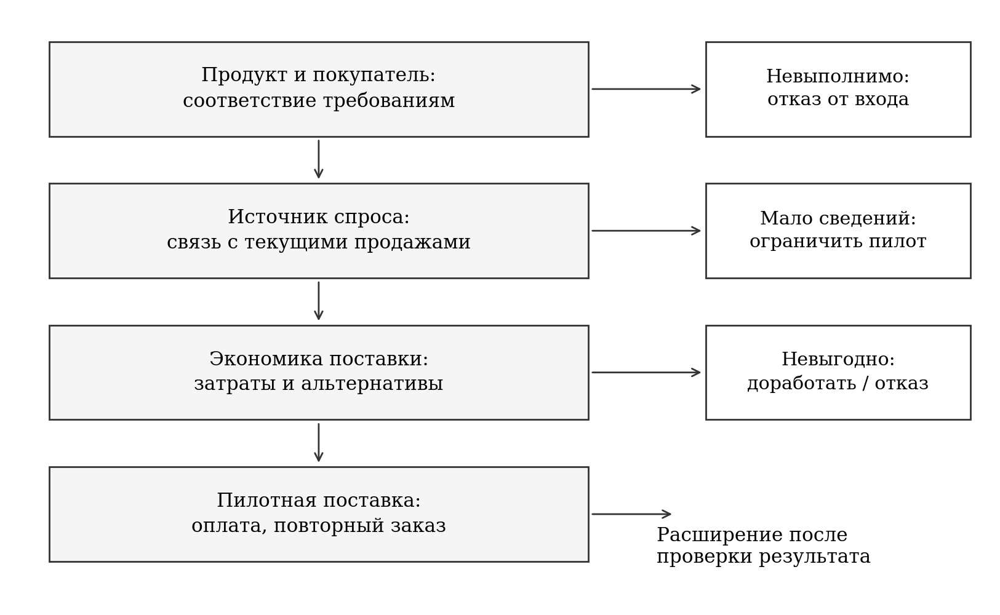
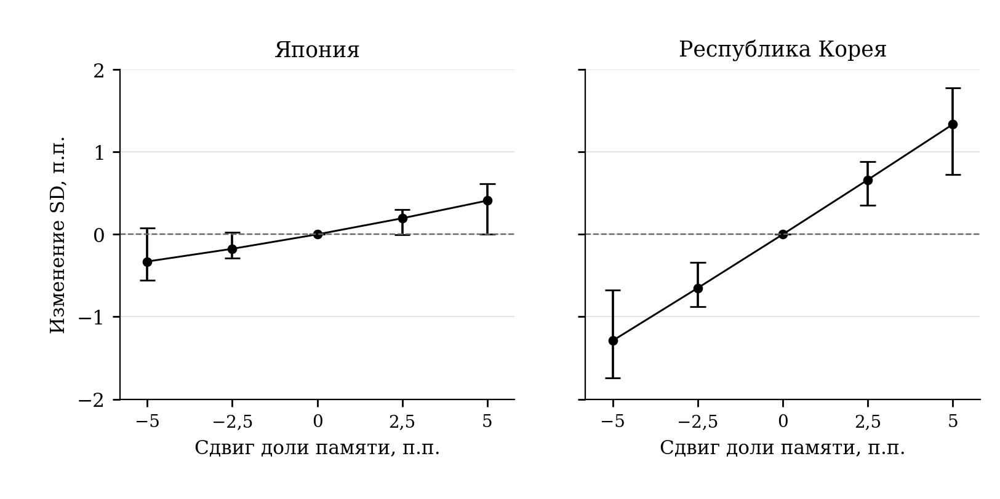
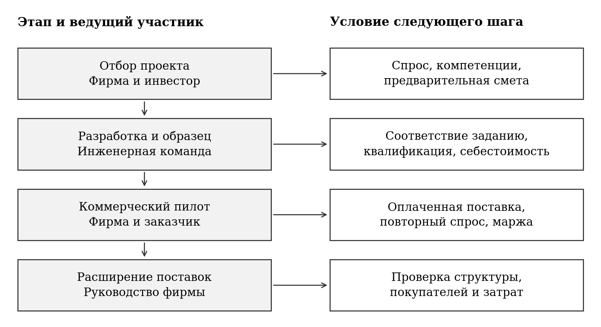

# Глава 3 Направления диверсификации экспорта интегральных схем Японии и Республики Корея

## 3.1 Приоритеты диверсификации экспорта по результатам исследования

Проведенный анализ позволяет перейти от описания изменений экспортной структуры к выбору направлений ее развития. Для Японии и Республики Корея общая задача состоит в расширении источников экспортной выручки при сохранении технологических преимуществ. Однако содержание этой задачи различается. У Кореи более отчетливо выражена связь товарного перераспределения со снижением условной волатильности. Для Японии результаты не дают столь же определенного основания для изменения крупных товарных пропорций. Поэтому рекомендации целесообразно строить с учетом силы полученных свидетельств, а их реализацию связывать с проверкой спроса и затрат на уровне конкретных проектов.

Под диверсификацией в данной главе понимается развитие сочетаний товара, покупателя и области применения, доходы от которых не полностью зависят от одного источника колебаний. Увеличение количества товарных позиций или стран назначения является лишь одним из возможных проявлений этого процесса. Снижение доли памяти за счет расширения других поставок, привлечение независимого заказчика и выход в новую область применения могут иметь различное значение для экспортного портфеля. Их оценка требует учитывать как дополнительную выручку, так и ее совместную динамику с уже существующими продажами.

Наиболее содержательное основание для корейских рекомендаций дает товарная составляющая разложения. Между структурами 2017 и 2024 годов ее оценка составляет −172,92 п.п.², а 95%-й интервал при двенадцатимесячном блоке — [−241,23; −67,54] п.п.². На изменение доли памяти приходится −165,18 п.п.², или около 95,5% товарного вклада. Эти результаты относятся к фиксированному историческому индексу. Они показывают, какое направление структурного изменения заслуживает первоочередной проверки, но не устанавливают целевую долю памяти и не оценивают отдачу государственной поддержки.[^ch3-1-data]

Практическим приоритетом для Кореи предлагается считать расширение коммерчески жизнеспособных поставок за пределами памяти. В такой постановке развитие процессоров, контроллеров и других интегральных схем дополняет сложившуюся специализацию. Сокращать успешные продажи памяти только ради изменения статистической доли экономически нецелесообразно: это может уменьшить выручку и ресурсы для новых разработок. Предпочтительным объектом отбора становятся проекты, которые способны привлечь дополнительные источники спроса и обеспечить положительную отдачу с учетом затрат на разработку, производство и обслуживание заказчика.

Японские результаты требуют иной расстановки приоритетов. Точечная оценка товарного вклада положительна, +5,17 п.п.², но ее интервал включает ноль. Географическая составляющая составляет −10,41 п.п.² и также не отделена от нуля своим интервалом. Общее изменение стандартного отклонения невелико: −0,26 п.п. с интервалом [−1,27; 0,89] п.п. Кроме того, во второй главе выявлена чувствительность знака общего результата к временной постановке. Поэтому для Японии обоснован отбор отдельных продуктово-рыночных проектов, а не единое требование изменить национальную долю памяти на заданную величину.

Выбор таких проектов должен опираться на совместимость новых изделий с компетенциями фирмы и требованиями заказчиков. В качестве объектов рассмотрения могут выступать интегральные схемы для промышленного оборудования, автомобильных электронных систем и иных специализированных применений. Их включение в перечень кандидатов не означает, что эти сегменты уже доказаны моделью как наиболее устойчивые. Таможенные категории не содержат необходимой детализации по назначению изделий. На следующем уровне отбора требуются сведения о конкретном продукте, его покупателях, цене, сроке квалификации и производственных возможностях.

Для обеих стран существенен географический результат Кореи. При снижении описательной концентрации направлений самостоятельный географический вклад в дисперсию оказывается положительным: +98,84 п.п.². Его основной интервал включает ноль, поэтому оценка не доказывает общего ухудшения вследствие географической диверсификации. Тем не менее она наглядно показывает, что снижение HHI и изменение условной волатильности могут расходиться. Следовательно, программа выхода на новые рынки должна проверять источники спроса и совместные колебания, а не ограничиваться подсчетом дополнительных направлений. Основания выбора приоритетов обобщены в таблице 3.1.

**Таблица 3.1 — Основания и приоритеты предлагаемых мер**

| Основание из главы 2 | Приоритет | Основной исполнитель | Граница вывода |
| --- | --- | --- | --- |
| Корея: отрицательный товарный вклад; ведущая роль памяти | Развитие дополнительных поставок других интегральных схем | Разработчики, производители и заказчики | Модель не задает оптимальную долю памяти |
| Япония: небольшое общее изменение и интервальная неопределенность | Отбор проектов на основе компетенций и подтвержденного спроса | Экспортирующие фирмы и отраслевые партнерства | Нет основания для одинаковой перестройки всех компаний |
| Расхождение географического HHI и вклада в дисперсию | Проверка конечного спроса и совместной динамики продаж | Коммерческие и аналитические подразделения | Новая страна назначения может обслуживать прежний спрос |
| Результаты зависят от истории колебаний | Поэтапное расширение и повторная оценка | Руководители проектов и организации поддержки | Исторический индекс не является прогнозом |

Источник: составлено автором по результатам главы 2.

Разделение исполнителей принципиально для предлагаемого подхода. Фирмы принимают решения о разработке изделия, выборе покупателя, цене и производственной программе. Они располагают информацией о качестве контрактов и затратах, которой нет в таможенной статистике. Государственные органы и организации поддержки могут облегчать доступ к исследовательской инфраструктуре, подготовке кадров, испытаниям и взаимодействию с потенциальными заказчиками. Поддержка должна устранять определенное ограничение проекта; само по себе соответствие желаемой экспортной структуре недостаточно для ее обоснования.

При этом результаты относятся к экспорту с территории страны, а не ко всем продажам компаний соответствующей национальности. Расширение зарубежной фабрики японской или корейской группы может увеличить ее консолидированную выручку, не увеличив наблюдаемый экспорт Японии или Кореи. Аналогично выручка от лицензирования разработок и ряда производственных услуг не тождественна стоимости поставок рассматриваемых товаров. В программе реализации необходимо заранее определить, какой результат оценивается: развитие фирмы, создание внутренней производственной базы или изменение товарного экспорта. В настоящей работе основным остается последний объект.

Рекомендации образуют последовательность из трех взаимосвязанных решений. Сначала устанавливается, какие дополнительные товары компания способна предложить с приемлемыми затратами. Затем проверяется наличие покупателей и отличие их спроса от существующих источников выручки. Наконец, определяется порядок расширения поставок и наблюдения за результатами. Сценарный расчет в параграфе 3.4 позволяет оценить масштаб возможного изменения исторического индекса при заданных товарных сдвигах. В сочетании с коммерческой проверкой он служит инструментом обсуждения проектов, сохраняя различие между статистическим свойством структуры и результатом конкретной меры.

[^ch3-1-data]: Источник исходных данных: United Nations Statistics Division. UN Comtrade Database. Месячный экспорт Японии и Республики Корея, 2017–2024; выгрузка 16 октября 2026 года. Численные результаты — расчеты автора, представленные в главе 2; основной товарный охват: HS854231, HS854232, HS854233, HS854239.

## 3.2 Направления товарной диверсификации экспорта интегральных схем

Товарная диверсификация требует изменения возможностей создавать и продавать продукцию. Простое перераспределение долей в расчетной модели не воспроизводит этот процесс. Новое изделие должно пройти разработку, изготовление опытного образца, испытания у заказчика и переход к регулярным поставкам. На каждом этапе возникают отдельные расходы и основания для отказа от проекта. Поэтому предлагаемые меры связываются с последовательностью коммерциализации, а изменение экспортных долей рассматривается как ее возможный результат.

Для Кореи целесообразно выделить направление развития компаний, проектирующих интегральные схемы без собственных фабрик, и их взаимодействия с производственными партнерами. Такая организация позволяет рассматривать новые изделия без обязательного строительства каждой компанией отдельной производственной площадки. Однако она сохраняет зависимость от доступа к средствам проектирования, интеллектуальной собственности, производственным услугам и проверке продукции. Предлагаемая поддержка должна оцениваться по тому, помогает ли она преодолеть конкретный барьер между разработкой и коммерческой поставкой.

Первое направление мер связано с ранней стадией проектирования. Небольшой разработчик должен подтвердить техническую осуществимость изделия и определить покупателя, которому нужны его характеристики. Предлагается связывать доступ к совместной инфраструктуре и софинансированию с наличием проверяемого технического задания, плана защиты интеллектуальных прав и календаря испытаний. Само количество поддержанных разработок является показателем объема деятельности, но не подтверждает появление устойчивого экспортного предложения. Более содержательный результат этой стадии — образец, отвечающий заранее согласованным требованиям потенциального заказчика.

Второе направление относится к изготовлению и испытанию опытных партий. Для подходящих проектов может применяться совместное размещение нескольких проектов на одной пластине — multi-project wafer, или MPW. Возможность такого взаимодействия должна проверяться по технологической совместимости проектов. Финансирование опытной партии имеет смысл сопровождать договоренностью об испытаниях, распределением ответственности за повторную разработку и оценкой стоимости следующей стадии. Тогда неудача образца позволяет пересмотреть проект до принятия более крупных обязательств.

Институциональный пример такого подхода содержится в объявлении корейского Министерства малого и среднего бизнеса и стартапов от 12 февраля 2025 года. Программа Fabless Startup Comprehensive Support Project разделяла поддержку по стадиям развития. В сообщении предусматривались доступ к готовым проектным блокам (IP) и средствам автоматизации проектирования (EDA) на раннем этапе, помощь с MPW и взаимодействием с заказчиками на стадии роста, а также проверка продукции с использованием инфраструктуры крупных компаний перед масштабированием. Этот пример подтверждает наличие соответствующих инструментов в практике поддержки. Объявление программы не содержит оценки ее влияния на экспорт и не используется здесь как доказательство эффективности.[^ch3-2-mss]

Третье направление — организация взаимодействия с заказчиком до завершения разработки. Предлагается отбирать проекты, в которых функциональные требования и условия испытаний согласованы с потенциальным покупателем. Участие заказчика снижает риск разработки изделия без понятного применения, но одновременно может создать зависимость от одной компании. Поэтому после первого успешного применения необходимо оценивать возможность адаптации к другим независимым покупателям. Для узкоспециализированного изделия такая возможность может быть ограничена; соответствующий риск должен отражаться в условиях финансирования и ожидаемой доходности.

Пример сотрудничества участников разных стадий представлен в сообщении корейского промышленного ведомства от 30 сентября 2025 года о проекте K-On-Device AI Semiconductor Technology Development. В нем предусматривались консорциумы заказчиков, разработчиков и производственных партнеров; запуск планировался на 2026 год. В настоящей работе используется сам принцип совместного определения требований и проверки изделия. Планы выпуска прототипов и последующих разработок из этого сообщения не трактуются как уже достигнутые результаты.[^ch3-2-motie]

При выборе продуктовых направлений для Кореи необходимо различать диверсификацию внутри памяти и за ее пределами. Развитие новых типов памяти может усиливать технологические позиции и менять состав покупателей, оставаясь в категории HS854232. В частности, укрупненная таможенная группа сама по себе не позволяет отделить изменение специализированных применений от изменения общей доли памяти. Поэтому улучшение качества продукции внутри этой группы и расширение остальных категорий следует оценивать раздельно. Основная модель дает более прямую информацию о втором процессе, но не устанавливает превосходство конкретной технологии.

Для Японии предлагается преимущественно развитие смежных продуктовых направлений, в которых компания может использовать существующие инженерные знания и связи с заказчиками. При рассмотрении автомобильного контроллера или промышленной интегральной схемы проверке подлежат требования к надежности, срок квалификации, ожидаемая продолжительность поставок и необходимые изменения производственного процесса. Эти характеристики должны подтверждаться проектными документами, а не предполагаться одинаковыми для всей отрасли. Связь с освоенными технологиями уменьшает объем неизвестных условий, но не гарантирует коммерческого успеха.

В опубликованном METI обзоре стратегии восстановления полупроводниковой отрасли Японии за июль 2024 года развитие памяти, передовой логики, специализированных промышленных полупроводников и корпусирования рассматривалось как несколько направлений общей политики. Для настоящей работы это существенно как подтверждение неоднородности отраслевых задач: поддержка одного вида продукции не исчерпывает развитие экспортного предложения. Вместе с тем охват стратегии шире исследуемых интегральных схем. Оборудование, материалы и дискретные силовые приборы не включаются автоматически в рекомендации по изменению четырех рассматриваемых товарных долей.[^ch3-2-meti]

Ограничение товарного охвата необходимо сохранить и при обсуждении новых технологий. Название области применения — например, автомобильная электроника — не определяет таможенную категорию каждого изделия. В ней могут использоваться как интегральные схемы, так и продукция вне позиции HS8542. Для проекта, включенного в программу диверсификации исследуемого экспорта, требуется установить конкретный вид поставляемого товара. Иначе рост продаж оборудования или иных компонентов будет ошибочно представлен как результат изменения структуры интегральных схем.

Еще одно ограничение связано с переносом выпуска между технологическими направлениями. В работе ОЭСР The Chip Landscape показано, что производственные мощности различаются по типам процессов и возможностям изготовления продукции; их взаимозаменяемость ограничена. Поэтому предполагаемое увеличение выпуска одной группы нельзя оценивать только по наличию незагруженной мощности в другой. До расширения проекта необходимы проверка доступного технологического процесса, оценка выхода годных изделий и согласование условий производства. Основные предлагаемые меры представлены в таблице 3.2.[^ch3-2-oecd-capacity]

**Таблица 3.2 — Меры по развитию дополнительных продуктовых направлений**

| Ограничение | Предлагаемая мера | Ответственные участники | Результат этапа |
| --- | --- | --- | --- |
| Нет проверенного применения | Совместное техническое задание и испытания у заказчика | Разработчик и потенциальный покупатель | Подтверждение требуемых характеристик |
| Высоки первоначальные расходы | Доступ к проектным средствам и совместным опытным партиям | Разработчик, оператор инфраструктуры, производственный партнер | Работоспособный образец и смета доработки |
| Неясен переход к серии | Ограниченная пилотная партия с заранее заданными критериями | Производитель и служба качества заказчика | Квалификация изделия и расчет себестоимости |
| Возникает зависимость от первого покупателя | Проверка адаптации для независимого заказчика | Коммерческая и инженерная команды | Второе подтвержденное применение либо явный учет зависимости |
| Масштабирование требует крупных вложений | Поэтапное финансирование после выполнения условий | Фирма, инвестор, организация поддержки | Подтвержденный заказ и приемлемая экономика серии |

Источник: предложения автора; институциональные примеры — MSS (2025), MOTIE (2025), METI (2024).

Для каждой меры необходим отдельный расчет ресурсов. На стадии разработки учитываются труд инженеров, лицензии и используемые проектные блоки; при изготовлении образца — производственные услуги, маски, испытания и возможная повторная итерация. Перед серийным выпуском добавляются расходы на квалификацию, обеспечение качества, оборотный капитал и обслуживание покупателей. Часть затрат может быть общей для нескольких проектов. Их распределение должно отражать фактическое использование инфраструктуры, чтобы общие расходы не скрывались за формально низкой стоимостью отдельной разработки.

Состав затрат позволяет определить основания для продолжения проекта. Если образец соответствует заданию, но покупатель не подтверждает потребность, требуется пересмотр коммерческой части. Если спрос подтвержден, но себестоимость превышает допустимый уровень, необходимо изменить конструкцию, условия производства или масштаб. При отсутствии реалистичного пути к приемлемой экономике дальнейшее финансирование не оправдывается одним лишь желанием расширить ассортимент. Такой порядок особенно важен при государственной поддержке, поскольку количество прототипов без коммерческого применения может создавать видимость диверсификации.

Предлагаемые товарные меры имеют общий принцип для обеих стран — развитие дополнительных возможностей получения выручки. Различается основание их приоритетности. В Корее эмпирические результаты поддерживают более пристальное внимание к росту поставок за пределами памяти. В Японии приоритет должен определяться качеством конкретных проектов и их связью с существующими компетенциями. В обоих случаях устойчивость оценивается после проверки спроса и затрат; принадлежность изделия к менее крупной товарной группе сама по себе не служит достаточным преимуществом.

[^ch3-2-mss]: Ministry of SMEs and Startups. Ministry of SMEs and Startups Announces Fabless Startup Comprehensive Support Project. Press release, 12 February 2025, pp. 1–3.
[^ch3-2-motie]: Ministry of Trade, Industry and Energy. End-Users, Fabless Firms, and Foundries Join Forces to Build Korea’s On-Device AI Semiconductor Ecosystem. Press release, 30 September 2025.
[^ch3-2-meti]: Ministry of Economy, Trade and Industry. Outline of Semiconductor Revitalization Strategy in Japan. July 2024; раздел «Overview of the Future Semiconductor Strategy I».
[^ch3-2-oecd-capacity]: OECD. The Chip Landscape: Geographical Distribution of Wafer Fabrication Capacity. OECD Science, Technology and Industry Policy Papers. 2025. No. 188. DOI: 10.1787/02dbd028-en.

## 3.3 Совершенствование географической структуры экспортных поставок

Географическая диверсификация должна дополнять развитие товарного предложения. Ее задача состоит в расширении круга покупателей и источников спроса с учетом затрат на обслуживание новых связей. Для интегральных схем особенно важно различать страну, указанную в торговой статистике, место использования компонента и рынок конечной продукции. Перемещение поставки через другой производственный или торговый узел способно изменить таможенную географию без существенного изменения экономического источника выручки.

Такое разграничение соответствует устройству международной производственной цепочки. В исследовании ОЭСР Mapping the Semiconductor Value Chain проектирование, изготовление пластин, сборка, тестирование и последующее использование рассматриваются как взаимосвязанные стадии с различным географическим размещением. Для предлагаемого подхода из этого следует необходимость сопоставлять торговое направление с ролью покупателя в цепочке. Сведения о прямом получателе дают отправную точку анализа, но не заменяют информации о применении изделия и зависимости от конечных заказов.[^ch3-3-oecd-chain]

Например, поставки двум сборочным компаниям в разных странах могут зависеть от продаж одной конечной продуктовой линейки. Формально экспорт распределен между двумя направлениями, однако общая причина изменения заказов сохраняется. Возможна и обратная ситуация: покупатели в одной стране обслуживают разные отрасли и имеют неодинаковую динамику спроса. Эти примеры не являются наблюдаемыми характеристиками отдельных партнеров из исследовательской панели. Они поясняют, какую дополнительную информацию требуется получить прежде, чем делать вывод об экономической самостоятельности нового направления.

Поэтому первым шагом предлагается составление карты покупателей. Для каждого существенного контракта фиксируются непосредственный контрагент, принадлежность к корпоративной группе, производственная функция и известная область применения продукции. Если конечный спрос не удается определить, соответствующая доля выручки выделяется отдельно. Неопределенность не должна автоматически трактоваться ни как независимость, ни как полная зависимость покупателей. Для публичной отчетности такие сведения можно агрегировать, сохраняя коммерческую конфиденциальность, а внутри компании использовать более подробный уровень.

Второй шаг состоит в оценке доступности нового сочетания продукта и покупателя. Проверяются соответствие характеристик изделия, сроки квалификации, организация сервисной поддержки, условия расчетов и применимые торговые ограничения. Изменение канала поставки само по себе не решает вопрос допустимости сделки. При невозможности выполнить обязательные требования направление исключается из рассматриваемого набора до оценки его исторической волатильности. Такой порядок позволяет избежать ситуации, когда привлекательная статистическая характеристика приписывается коммерчески недоступной поставке.

Третий шаг — анализ экономической самостоятельности спроса. При наличии сопоставимых рядов продаж проверяется совместная динамика с основными действующими покупателями, отдельно по продуктам и областям применения. Короткую историю нового контракта следует дополнять сведениями о деятельности заказчика, но нельзя превращать отсутствие наблюдений в нулевую ковариацию. Если надежной количественной оценки пока нет, возможна ограниченная пилотная поставка с заранее установленным пределом затрат. Ее назначение состоит в получении информации и проверке спроса.

Наконец, рассчитывается коммерческая сторона расширения. Ожидаемую дополнительную выручку необходимо сопоставить с производственными расходами, стоимостью входа, испытаний, логистики, сервисной поддержки и финансирования оборотного капитала. Одновременно рассматривается возможное вытеснение действующих заказов при ограниченной мощности. Контракт с новым покупателем не увеличивает совокупный результат фирмы автоматически, если ради него приходится отказаться от более выгодной поставки. Статистическая характеристика портфеля включается в решение вместе с этой оценкой. Предлагаемый порядок представлен на рисунке 3.1.

**Рисунок 3.1 — Последовательность оценки нового направления поставок**

Примечание: схема отражает предлагаемый порядок принятия решений; она не является оцененной моделью поведения фирм. При недостатке сведений допускается ограниченный пилот с отдельным бюджетом и сроком пересмотра.

Источник: разработано автором.

Рассмотренная последовательность не задает универсального списка предпочтительных стран. США, Китай, страны ЕС и азиатские производственные узлы следует включать в анализ как разные совокупности возможных покупателей. В каждом случае решающее значение имеет сочетание продукта, контрагента и области применения. Наличие крупного рынка или известного центра производства не подтверждает, что дополнительная поставка конкретной фирмы будет менее связана с ее прежними продажами. Для такого вывода требуется проверка на уровне заказчиков.

При этом основная эмпирическая сетка не позволяет одинаково подробно сравнить все эти направления. США и Китай представлены отдельно, тогда как страны ЕС входят в остаточную группу вместе с другими невыделенными партнерами. Отдельные оценки для европейских стран из основной модели получить нельзя. Перед решением о выходе, например, на конкретный европейский рынок потребуется самостоятельная детализация спроса и статистики. Включение ЕС в обсуждение рекомендаций означает направление дальнейшего коммерческого отбора, а не установленное преимущество по результатам главы 2.

Для Китая и Гонконга важна проверка связи прямого назначения с последующим движением продукции. Во второй главе их объединение использовалось как чувствительность к статистической группировке. Такая проверка не восстанавливает конечных покупателей и не позволяет определить, какая доля поставок обслуживает самостоятельный спрос. Поэтому решение о расширении или сокращении конкретных контрактов не может основываться только на результате объединения двух кодов. Требуются сведения о контрагенте и назначении поставляемого изделия.

Аналогичный принцип применяется к азиатским направлениям, связанным с международными производственными цепочками. Расширение числа партнеров может создавать полезные коммерческие связи и производственные возможности. Однако для оценки устойчивости нужно установить, означает ли оно появление нового заказчика, изменение стадии обработки либо только перераспределение маршрута. Категория Other Asia, nes и остаточная группа модели также не должны подменять собой перечень однородных рынков. Их агрегированный характер ограничивает допустимую детализацию рекомендаций.

Для Кореи приоритет географической работы предлагается связывать с развитием дополнительных применений новых товаров. Если расширение поставок за пределами памяти приводит к тем же конечным заказчикам и одинаковым источникам циклического спроса, часть ожидаемой устойчивости может не реализоваться. Поэтому товарный проект и поиск покупателя следует рассматривать совместно. Это не означает отказ от существующих крупных направлений: надежный действующий контракт может сохранять высокую экономическую ценность. Задача заключается в оценке добавляемой зависимости, а не в механическом уменьшении крупнейшей доли.

Для Японии предпочтителен последовательный поиск новых покупателей для продукции, по которой подтверждены технические и коммерческие преимущества фирмы. При небольшом и статистически неопределенном общем результате основной модели крупное перераспределение поставок ради заранее выбранной географической пропорции обосновано слабо. Более проверяемая мера — поддержка испытаний и первых контрактов с независимыми заказчиками, после которых можно оценить повторяемость спроса и стоимость обслуживания. Расширение проекта должно следовать за этой проверкой.

Организации поддержки способны содействовать поиску партнеров, доступу к испытательной инфраструктуре и пониманию требований покупателей. Однако число деловых встреч, выставок и подписанных соглашений следует учитывать как промежуточные результаты. Для оценки развития экспортных связей важнее переход к квалификации, оплаченной поставке и повторному заказу. Предлагается различать первоначальный контакт и устойчивую коммерческую связь, а расходы на сопровождение относить к соответствующему этапу. Это позволяет сопоставлять программы по результатам, связанным с поставками.

Географическая рекомендация, таким образом, сводится к проверке дополнительного источника спроса, а не к поиску статистически «безопасной» страны. Оценка совместных колебаний помогает выявить зависимости, но не заменяет анализа контракта. В сочетании с продуктовым отбором такой подход позволяет расширять экспортные возможности и одновременно контролировать цену входа, концентрацию покупателей и неопределенность новых связей.

[^ch3-3-oecd-chain]: OECD. Mapping the Semiconductor Value Chain: Working towards Identifying Dependencies and Vulnerabilities. OECD Science, Technology and Industry Policy Papers. 2025. No. 182. DOI: 10.1787/4154cdbf-en. Разделы 2–3.

## 3.4 Условия реализации рекомендаций и оценка их результатов

Реализация предложенных мер требует согласования трех уровней: отдельного проекта, портфеля компании и экспортной структуры страны. На уровне проекта проверяются техническая осуществимость, спрос и затраты. На уровне компании оцениваются концентрация покупателей, совместная динамика продаж и использование ограниченных ресурсов. На уровне страны наблюдаются агрегированные товарные и географические изменения. Положительный результат на одном уровне не гарантирует аналогичного результата на другом, поэтому показатели необходимо связывать с конкретным объектом решения.

Для количественного уточнения рекомендаций выполнен дополнительный сценарный расчет. Он использует ту же панель и те же определения темпов, что и основная модель. Исходные стоимости относятся к 2017–2024 годам; история годовых темпов содержит 84 месячных наблюдения за 2018–2024 годы. Базой служит структура 2024 года. Отдельно для каждой страны доля памяти изменяется на −5; −2,5; 0; +2,5 и +5 п.п. Доли трех остальных категорий меняются пропорционально, а распределение направлений внутри каждой категории сохраняется на уровне 2024 года.[^ch3-4-scenario]

Диапазон и правила расчета зафиксированы до получения новых сценарных результатов, после изучения основной модели. Поэтому упражнение является дополнительной исследовательской иллюстрацией, а не независимой предварительно зарегистрированной проверкой. Симметричный набор сдвигов позволяет показать обе стороны изменения структуры и исключает представление только выгодного варианта. Величины 2,5 и 5 п.п. задают масштаб сравнения; они не являются рекомендованными государственными целями или оценкой технологически достижимого сдвига.

Расчет удобно представить через два фиксированных индекса. Индекс $M_t$ описывает память при географии 2024 года, а $O_t$ — остальные три категории при их взаимных пропорциях и географии того же года. Если $m$ обозначает сценарную долю памяти, общий индекс определяется как

$$
G_t(m)=mM_t+(1-m)O_t.
\tag{3.1}
$$

Такое объединение точно воспроизводит исходный индекс из 36 ячеек при заданном пропорциональном изменении весов. Обозначим выборочные дисперсии двух индексов через $V_M$ и $V_O$, а их ковариацию — через $C_{MO}$. Все три величины рассчитываются для темпов, выраженных в долях. Тогда

$$
V(m)=m^2V_M+(1-m)^2V_O+2m(1-m)C_{MO}.
\tag{3.2}
$$

Стандартное отклонение в процентных пунктах равно квадратному корню из полученной дисперсии, умноженному на 100. Формула показывает, почему эффект изменения доли зависит от колебаний обеих частей и их совместной динамики. Даже при более высокой индивидуальной волатильности памяти ее сокращение не имеет универсального результата для любого портфеля: значение имеют исходная доля и ковариация. Здесь все эти условия задаются сохраненной историей соответствующей страны.

Для интервалов разности стандартных отклонений используется парная круговая блочная процедура: 1 999 повторов, блок 12 месяцев. Во всех сценариях внутри повтора выбираются одинаковые месяцы, что сохраняет их сопоставимость. В качестве чувствительности используется блок 6 месяцев. В таблицах 3.3 и 3.4 представлены 95%-е процентильные интервалы разности с базой. Они являются поточечными, без поправки на множественные сопоставления, и условны на фиксированные веса и историю. Нулевой сдвиг воспроизводит базу точно, поэтому его разность равна нулю в каждом повторе.

**Таблица 3.3 — Сценарии изменения доли памяти: Япония**

| Сдвиг доли, п.п. | Доля памяти, % | SD, п.п. | Изменение SD, п.п. | 95%-й интервал изменения, п.п. |
| --- | --- | --- | --- | --- |
| −5,0 | 37,46 | 9,44 | −0,33 | [−0,55; 0,08] |
| −2,5 | 39,96 | 9,60 | −0,18 | [−0,28; 0,03] |
| 0,0 | 42,46 | 9,77 | 0,00 | [0,00; 0,00] |
| +2,5 | 44,96 | 9,97 | +0,20 | [−0,01; 0,30] |
| +5,0 | 47,46 | 10,18 | +0,41 | [0,004; 0,61] |

Примечание: SD — стандартное отклонение условного индекса; география внутри товаров и взаимные пропорции остальных категорий фиксированы. Нижняя граница последнего интервала показана с дополнительным разрядом, чтобы округление не скрывало ее знак.

Источник: расчеты автора по сохраненной панели UN Comtrade.

**Таблица 3.4 — Сценарии изменения доли памяти: Республика Корея**

| Сдвиг доли, п.п. | Доля памяти, % | SD, п.п. | Изменение SD, п.п. | 95%-й интервал изменения, п.п. |
| --- | --- | --- | --- | --- |
| −5,0 | 55,11 | 27,29 | −1,29 | [−1,74; −0,68] |
| −2,5 | 57,61 | 27,93 | −0,65 | [−0,88; −0,34] |
| 0,0 | 60,11 | 28,58 | 0,00 | [0,00; 0,00] |
| +2,5 | 62,61 | 29,25 | +0,66 | [0,35; 0,88] |
| +5,0 | 65,11 | 29,92 | +1,34 | [0,73; 1,77] |

Примечание: определения и условия совпадают с таблицей 3.3; интервалы относятся к разности с собственной базой страны.

Источник: расчеты автора по сохраненной панели UN Comtrade.

У Кореи снижение доли памяти на 5 п.п., с 60,11 до 55,11%, уменьшает условное стандартное отклонение с 28,58 до 27,29 п.п. Разность составляет −1,29 п.п., ее интервал — [−1,74; −0,68] п.п. При сдвиге на −2,5 п.п. разность равна −0,65 п.п. Увеличение доли в обоих положительных сценариях повышает индекс. В пределах выбранного диапазона результат поддерживает внимание к развитию других поставок, но не определяет желательную границу расширения и не учитывает его цену.

Для Японии снижение доли памяти на 5 п.п. дает разность −0,33 п.п. при интервале [−0,55; 0,08] п.п. Интервал меньшего отрицательного сдвига также включает ноль. При увеличении доли на 5 п.п. точечная разность составляет +0,41 п.п.; нижняя граница интервала находится лишь немного выше нуля. Этот отдельный поточечный результат не превращает выбранный диапазон в оптимизационное решение. Совокупность сценариев указывает на меньшую чувствительность японского индекса и сохраняет основания для осторожного проектного отбора. Сопоставление двух стран представлено на рисунке 3.2.

**Рисунок 3.2 — Чувствительность условной волатильности к изменению доли памяти**

Примечание: точки — разности SD с базой 2024 года; отрезки — 95%-е поточечные интервалы, блок 12 месяцев. Шкалы двух панелей одинаковы. Линии соединяют заданные сценарии и не изображают прогнозную траекторию.

Источник: расчеты автора по UN Comtrade.

Изменение длины блока не меняет основной характер отрицательных сценариев. При сдвиге −5 п.п. шестимесячный интервал у Кореи составляет [−1,71; −0,75] п.п.; у Японии — [−0,56; 0,005] п.п. Отдельно рассмотрены две истории темпов с теми же весами: 2018–2020 годы и 2021–2024 годы. Для указанного сдвига японские разности равны −0,12 и −0,49 п.п., корейские — −1,30 и −1,31 п.п. Это проверки чувствительности на связанных наблюдениях; для двух окон отдельные интервалы не рассчитывались. Все пять сценариев и обе длины блока сохранены в расчетных материалах.

Сценарии также позволяют конкретизировать ограниченность концентрационных показателей. В Японии при снижении доли памяти на 5 п.п. товарный HHI увеличивается с 0,4099 до 0,4116, хотя условное SD снижается. Причина состоит в пропорциональном расширении остальных категорий, прежде всего уже крупной группы прочих интегральных схем HS854239: ее сценарная доля достигает 50,93%. В Корее тот же сдвиг уменьшает HHI с 0,4604 до 0,4291. Следовательно, одинаковое правило изменения памяти имеет неодинаковый концентрационный смысл для двух исходных структур.

Товарная перестройка изменяет и совокупные доли стран назначения, если товары имеют разную географию. Однако в данном упражнении самостоятельного изменения географии внутри товаров нет. Поэтому возможное изменение агрегированного географического HHI не следует называть дополнительным эффектом географической политики. Сценарий изолирует правило изменения товарных пропорций при неизменном распределении каждого товара между направлениями.

Полученные результаты нужно отличать от основной оценки главы 2. Там сравнивались фактически наблюдавшиеся структуры 2017 и 2024 годов с разложением двух измерений. Здесь рассматривается гипотетическое изменение только товарных долей относительно 2024 года. Отрицательный интервал корейского сценария не устраняет неопределенность общего исторического итога −1,27 п.п., интервал которого включает ноль. Это разные сопоставления, отвечающие на разные вопросы.

Экономический масштаб сдвига можно пояснить через дополнительное арифметическое условие. Пусть стоимость экспорта памяти остается неизменной, а ее доля уменьшается за счет роста остальных поставок. Если исходная доля равна $m_0$, целевая сценарная доля — $m_s$, а стоимость остальных поставок обозначена через $B_0$ и $B_s$, то

$$
\frac{B_s}{B_0}=\frac{m_0(1-m_s)}{m_s(1-m_0)}.
\tag{3.3}
$$

Величины $B_0$ и $B_s$ представляют годовую номинальную стоимость трех остальных категорий. Соотношение предполагает неизменную стоимость памяти и не описывает производственную реакцию. При неизменных ценах оно может использоваться как ориентир необходимого расширения остальных поставок; без такого условия часть изменения стоимости может быть ценовой. Результаты приведены в таблице 3.5.

**Таблица 3.5 — Масштаб расширения остальных поставок при неизменной стоимости памяти**

| Сдвиг доли памяти, п.п. | Япония: рост остальных поставок, % | Корея: рост остальных поставок, % | Япония: дополнительная стоимость, млрд долл. | Корея: дополнительная стоимость, млрд долл. |
| --- | --- | --- | --- | --- |
| −2,5 | 10,87 | 10,88 | 1,90 | 5,20 |
| −5,0 | 23,20 | 22,74 | 4,05 | 10,87 |

Примечание: расчет от фактической стоимости 2024 года. Дополнительная стоимость относится к экспорту остальных трех категорий; она не является бюджетом программы, инвестиционными расходами или прогнозом выручки.

Источник: расчеты автора по UN Comtrade.

Сдвиг на 5 п.п. предполагает увеличение стоимости остальных поставок примерно на 23% в обеих странах. В абсолютном выражении это около 4,05 млрд долл. для Японии и 10,87 млрд долл. для Кореи. Следовательно, даже умеренное изменение доли требует существенного коммерческого расширения при сохранении продаж памяти. Сценарные величины полезны для проверки масштаба предложений, но не обосновывают обещание быстро достичь заданной структуры. Реализуемость зависит от спроса, цен, мощностей и затрат, которые должны оцениваться отдельно.

Поэтапная реализация предлагается как способ ограничить расходы до получения необходимой информации. На первом этапе формируется перечень продуктово-рыночных проектов и собираются сведения об исходных продажах, покупателях и ресурсах. На втором проверяются техническое задание, опытный образец и условия квалификации. На третьем выполняется ограниченная коммерческая поставка. Решение о расширении принимается после оценки повторного спроса, себестоимости и зависимости от отдельных заказчиков. Переходы показаны на рисунке 3.3.

**Рисунок 3.3 — Этапы реализации и основания для расширения проекта**

Примечание: сроки каждого этапа определяются технологией и требованиями заказчика; единый календарный норматив для разных изделий не устанавливается. На каждой границе возможно продолжение, доработка или прекращение проекта.

Источник: разработано автором.

Финансовая оценка должна включать затраты всего цикла и возможные альтернативы использования ресурсов. Предлагается сравнивать проект с продолжением действующих поставок и с другими доступными разработками. Если используются государственные средства, отдельно учитываются объем поддержки и собственное участие фирмы. Снижение условного SD нельзя перевести в денежную выгоду простым умножением на годовой экспорт: индекс не является оценкой потерь или страховой премии. Для денежной оценки потребовались бы модель денежных потоков, отношение к риску и дополнительные сведения о компании.

Контроль результатов целесообразно организовать через согласованный набор показателей. Данные о ходе разработки и контрактах можно рассматривать ежеквартально. Структуру поставок и динамику индексов следует обновлять после получения полного и проверенного набора месячных данных, сохраняя годовой цикл итогового сопоставления. Годовые доли снижают зависимость структурной оценки от отдельных месячных партий, хотя сами по себе не устраняют ценовых колебаний. Предлагаемый набор показателей представлен в таблице 3.6.

**Таблица 3.6 — Показатели реализации и критерии пересмотра мер**

| Объект наблюдения | Показатель | Интерпретация | Основание пересмотра |
| --- | --- | --- | --- |
| Разработка | Выполнение задания и квалификация образца | Готовность перейти к следующей стадии | Требования не выполнены в пределах согласованных ресурсов |
| Коммерческий результат | Оплаченные и повторные поставки; маржа после затрат входа | Подтверждение спроса и экономики проекта | Нет повторного заказа либо сохраняется неприемлемая экономика |
| Покупатели | Доля крупнейших независимых групп; доля неизвестного конечного применения | Контроль зависимости и качества информации | Новый контракт воспроизводит прежнюю зависимость |
| Экспортная структура | Стоимость, товарные доли и HHI на сопоставимом охвате | Масштаб и состав поставок | Доли меняются преимущественно из-за сокращения успешных продаж |
| Историческая динамика | SD фиксированного индекса, ковариации, интервалы | Свойства структуры на общей истории | Вывод исчезает при обоснованной чувствительности |
| Ресурсы поддержки | Полные затраты, собственное участие, достигнутая стадия | Сопоставление расходов с проверяемым результатом | Расходы растут без продвижения к коммерческой поставке |

Источник: предложения автора.

При обновлении расчетов важно сохранять сопоставимость статистики. Товарные определения, источники, обработка ненаблюдаемых значений и правила географической группировки должны быть документированы. Сначала новая и прежняя структуры сопоставляются на одной доступной истории темпов, затем отдельно показывается влияние добавления новых наблюдений. Иначе изменение структуры будет смешано с изменением ковариаций. Отсутствие ответа в источнике данных не заменяется нулевой поставкой; пересмотр исходной статистики фиксируется вместе с датой обновления.

Для оценки программы поддержки необходимо также отличать мониторинг от установления причинного эффекта. Рост экспорта получателей помощи может отражать изменение цен или общий отраслевой подъем. Поэтому до запуска программы целесообразно определить круг потенциально подходящих компаний, критерии отбора и исходные характеристики. Если в дальнейшем доступна сопоставимая группа и обоснованы необходимые предпосылки, можно отдельно оценивать дополнительный результат поддержки. В настоящей работе такой эффект не рассчитывается; представленные показатели обеспечивают наблюдаемость реализации, а не заменяют оценку воздействия.

Условия остановки должны задаваться вместе с условиями продолжения. Отсутствие подтвержденного спроса, неустранимое несоответствие требованиям или превышение согласованного предела ресурсов служат основанием для пересмотра проекта. При этом неудачная опытная разработка не обязательно означает неэффективность всей программы: часть ее назначения состоит в раннем выявлении нежизнеспособных решений. Для такого вывода требуется учитывать затраты и результаты всего набора проектов, включая прекращенные, а не только успешные примеры.

Предложенный порядок связывает рекомендации с полученными свидетельствами и пределами их применимости. Для Кореи основное направление состоит в развитии коммерчески состоятельных поставок за пределами памяти при проверке источников спроса. Для Японии — в отборе смежных продуктово-рыночных проектов с подтвержденной экономикой и осторожной оценкой структурных сдвигов. В обеих странах решение о расширении должно опираться на сочетание технической готовности, спроса, затрат и свойств экспортного портфеля. Такой подход позволяет использовать результаты исследования для выбора и последовательной проверки мер, сохраняя экономический смысл диверсификации.

[^ch3-4-scenario]: Расчеты автора по той же панели UN Comtrade, что и в главе 2. Протокол сценариев зафиксирован 19 октября 2026 года; сдвиги доли памяти: −5; −2,5; 0; +2,5; +5 п.п.; база и география — 2024 год; история темпов — 2018–2024 годы. Основная модель не переоценивалась и не изменялась.

# Список использованных источников к третьей главе

1. Ministry of Economy, Trade and Industry. Outline of Semiconductor Revitalization Strategy in Japan. July 2024. Section “Overview of the Future Semiconductor Strategy I”.

2. Ministry of SMEs and Startups. Ministry of SMEs and Startups Announces Fabless Startup Comprehensive Support Project. Press release, 12 February 2025.

3. Ministry of Trade, Industry and Energy. End-Users, Fabless Firms, and Foundries Join Forces to Build Korea’s On-Device AI Semiconductor Ecosystem. Press release, 30 September 2025.

4. OECD. Mapping the Semiconductor Value Chain: Working towards Identifying Dependencies and Vulnerabilities. OECD Science, Technology and Industry Policy Papers. 2025. No. 182. DOI: 10.1787/4154cdbf-en.

5. OECD. The Chip Landscape: Geographical Distribution of Wafer Fabrication Capacity. OECD Science, Technology and Industry Policy Papers. 2025. No. 188. DOI: 10.1787/02dbd028-en.

6. United Nations Statistics Division. UN Comtrade Database. Monthly export data, Japan and Republic of Korea, 2017–2024. Выгрузка 16 октября 2026 года.
