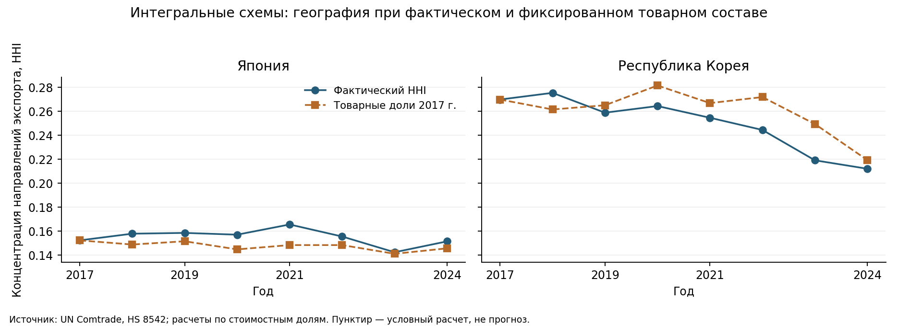
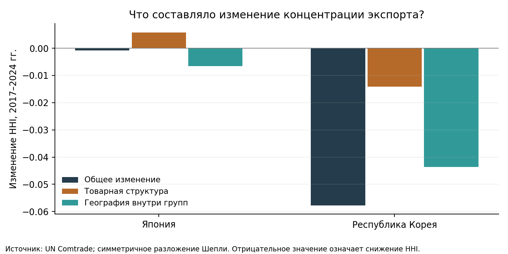

# Проверка второй темы: международная торговля чипами

Дата проверки: 15.10.2026. Статус: завершенный пилот и паспорт исследования, не готовая журнальная статья.

**Тема:** «Диверсификация экспорта интегральных схем Южной Кореи и Японии: смена рынков сбыта или изменение товарной структуры?»

**Вердикт:** тему можно брать в работу для короткой эмпирической статьи по мировой экономике. Данные и вычислительная часть прошли проверку. Новизна остается условной: общий предмет очень хорошо изучен, поэтому вклад нужно ограничить конкретным разложением и эмпирическим результатом. Требования конкретного журнала или конференции еще не заданы.

## Почему это экономическое исследование

Объект — международные экспортные потоки; предмет — изменение географической концентрации при различной товарной специализации. Экономический вопрос: насколько наблюдаемая диверсификация связана с распределением продаж одного и того же типа продукции между рынками, а насколько — с изменением долей разных типов продукции в экспортной корзине?

Такой вопрос относится к международной торговле и структуре отраслевого экспорта. Здесь не требуется исследовать инженерные свойства микросхем. Регрессия не обязательна: воспроизводимое разложение отвечает на поставленный вопрос. При этом HHI не измеряет всю экономическую зависимость, устойчивость фирм или корреляцию шоков разных покупателей.

**Проверяемое предположение:** агрегированный HHI может скрывать разнонаправленные изменения товарной структуры и географии внутри товарных групп. Направление эффекта заранее не задавалось; исходный план сохранен в [protocol.md](protocol.md).

## Проверка по пяти условиям допуска

| Условие | Результат | Основание |
|---|---|---|
| Доступность данных | Пройдено | Скачаны исходные ответы, а не только найдена ссылка на базу |
| Потенциальный вклад | Условный допуск | Сформулировано отличие от близких работ; мировое первенство не установлено |
| Метод | Пройдено для описательного вопроса | Точное разложение изменения HHI, две составляющие и проверки чувствительности |
| Срок и формат | Предварительно выполнимо | Пилот готов; требования площадки и фактический дедлайн неизвестны |
| Реальный расчет | Пройдено | Полная выбранная панель, независимая сверка HHI и числовые результаты |

Смешивать эти статусы в один процент «оригинальности» нельзя. Антиплагиат оценивает сходство текста, а не новизну результата.

## Данные действительно доступны

Источник: [UN Comtrade API](https://uncomtrade.org/docs/un-comtrade-api/), собственная экспортная отчетность Японии и Республики Корея, 2017–2024. Стоимость FOB в текущих USD. В выборке **5525 исходных строк**, из них **4118 наблюдений HS6 × направление** без World, **16 экспортеро-лет** и **80 сочетаний экспортер × год × товар**.

Пять HS6 внутри HS8542: процессоры/контроллеры, память, усилители, прочие интегральные схемы, части. Еще отдельно загружен HS8542 для проверки суммы. Товарная область уже всей полупроводниковой отрасли. Сравнение номенклатур ВТамО HS2017 и HS2022 описано в [classification.md](classification.md).

Получены 32 ответа API; самый большой содержит 238 строк при лимите 500. Пройдены **128 сверок** итогов: партнеры с World, HS6 с HS8542 и подкатегории с агрегатом для каждого направления. Максимальная относительная невязка — 1.67e-11. Дубликаты ключа, пустые и отрицательные стоимости не обнаружены. HHI независимо пересчитан из HS8542 для всех 16 экспортеро-лет.

Точные URL, время получения и хеши сохранены в `data/sources_manifest.json`. Это снимок данных на дату загрузки: последующие пересмотры могут менять числа. Период 2017–2024 не объявляется последним доступным; наличие 2025 года здесь не проверялось.

## Метод в одной формуле

Пусть `w[g]` — доля товарной категории, `p[g,d]` — доля направления внутри нее. Тогда доля направления `s[d] = Σg w[g]·p[g,d]`, а `HHI = Σd s[d]²`.

Для начального и конечного года рассчитываются четыре состояния `F00 = F(w0,p0)`, `F10 = F(w1,p0)`, `F01 = F(w0,p1)`, `F11 = F(w1,p1)`.

- Товарный компонент: `0.5 × [(F10−F00) + (F11−F01)]`.
- Географический компонент: `0.5 × [(F01−F00) + (F11−F10)]`.
- Их сумма равна `F11−F00` без остатка, с точностью вычислений.

Это двухфакторное симметричное разложение Шепли; метод известен. Числа — бухгалтерское разложение индекса, не причинные эффекты. Тот же расчет сделан для долей США, ЕС-27 и Китая с Гонконгом. Ноль отсутствующего партнерского потока используется только после сверки полноты сумм; World не включается в HHI.

## Полученный результат: 2017 → 2024

HHI лежит между 0 и 1; снижение означает менее концентрированное распределение прямых экспортных отгрузок между статистическими направлениями.

| Экспортер | HHI 2017 | HHI 2024 | Изменение | Товарный вклад | Географический вклад |
| --- | --- | --- | --- | --- | --- |
| Япония | 0.152278 | 0.151452 | -0.000826 | +0.005816 | -0.006642 |
| Республика Корея | 0.269797 | 0.212029 | -0.057767 | -0.014073 | -0.043694 |

**Япония.** Итоговый HHI почти не изменился. Однако положительный товарный компонент почти компенсировал отрицательный географический. Поэтому вывод «в структуре экспорта ничего не изменилось» был бы слишком сильным. Это совокупный эффект по корзине, а не утверждение о снижении концентрации каждой отдельной HS6-категории.

**Республика Корея.** Оба компонента снижали концентрацию. В основном сравнении около **75.6%** снижения HHI приходится на географический компонент и **24.4%** — на товарный. Это доли арифметического изменения индекса, не оценка вероятностей или эластичностей.

Доли отдельных направлений дают дополнительную картину:

| Экспортер | Направление | Доля 2017, % | Доля 2024, % | Изменение, п.п. | Товарный вклад, п.п. | Географический вклад, п.п. |
| --- | --- | --- | --- | --- | --- | --- |
| Япония | США | 4.53 | 2.82 | -1.70 | -0.70 | -1.00 |
| Япония | ЕС-27 | 3.64 | 1.44 | -2.19 | -0.58 | -1.62 |
| Япония | Китай + Гонконг | 41.09 | 35.60 | -5.49 | +0.06 | -5.54 |
| Республика Корея | США | 0.67 | 1.37 | +0.70 | +0.12 | +0.58 |
| Республика Корея | ЕС-27 | 0.88 | 1.27 | +0.39 | +0.22 | +0.17 |
| Республика Корея | Китай + Гонконг | 70.28 | 54.56 | -15.72 | -2.67 | -13.04 |

Снижение доли Китая с Гонконгом не означает равного переноса в США и ЕС. Особенно важно, что падение японской доли этих двух направлений сопровождается снижением долей прямых отгрузок в США и ЕС. Показатели конечного американского/европейского спроса из этого не следуют.

## Устойчивость и границы результата

При исключении частей 854290 и при объединении Китая с Гонконгом знак двух компонентов для основного сравнения сохраняется. Однако размер общего изменения, особенно у Японии, чувствителен к определению направления:

| Вариант 2017–2024 | Экспортер | Изменение HHI | Товарный вклад | Географический вклад |
| --- | --- | --- | --- | --- |
| Без частей | Япония | -0.004486 | +0.006405 | -0.010891 |
| Без частей | Республика Корея | -0.058052 | -0.014132 | -0.043920 |
| Китай и Гонконг объединены | Япония | -0.016460 | +0.006173 | -0.022633 |
| Китай и Гонконг объединены | Республика Корея | -0.161735 | -0.030855 | -0.130880 |
| Обе проверки | Япония | -0.021116 | +0.007031 | -0.028147 |
| Обе проверки | Республика Корея | -0.162420 | -0.030992 | -0.131428 |

**Базовый год имеет значение.** Нельзя переносить доли вкладов 2017–2024 на любой другой период:

| Экспортер | Сравнение | Изменение HHI | Товарный вклад | Географический вклад |
| --- | --- | --- | --- | --- |
| Япония | 2017–2024 | -0.000826 | +0.005816 | -0.006642 |
| Япония | 2021–2024 | -0.014085 | -0.008913 | -0.005172 |
| Япония | 2017–2021 | +0.013259 | +0.015368 | -0.002109 |
| Япония | 2019–2024 | -0.007051 | +0.000712 | -0.007763 |
| Япония | 2022–2024 | -0.004044 | -0.001188 | -0.002857 |
| Республика Корея | 2017–2024 | -0.057767 | -0.014073 | -0.043694 |
| Республика Корея | 2021–2024 | -0.042558 | -0.003659 | -0.038899 |
| Республика Корея | 2017–2021 | -0.015209 | -0.013256 | -0.001954 |
| Республика Корея | 2019–2024 | -0.046790 | -0.009523 | -0.037267 |
| Республика Корея | 2022–2024 | -0.032378 | +0.005743 | -0.038121 |

Например, в Японии товарный компонент положителен за 2017–2024, но отрицателен за 2021–2024. В Корее за 2022–2024 товарный компонент повышал HHI, а географический понижал его сильнее. Значит, постоянной роли товарного состава на всех интервалах нет. По CR3 за 2022–2024 у Японии концентрация растет, хотя HHI снижается: вывод о «диверсификации вообще» зависит и от показателя.

Долларовые веса меняются из-за цен, качества и количества. Отдельный вклад физических объемов не идентифицирован. HS6 не позволяет выделить HBM или передовые технологические узлы. Гонконг и другие сборочные/транзитные центры не равны конечным потребителям. Отгрузки фирм с зарубежных предприятий не являются экспортом страны происхождения компании. Утверждения «санкции вызвали диверсификацию» или «зависимость от Китая устранена» этими расчетами не подтверждаются. Искусственные p-value к точному разложению всей выбранной отчетности не добавляются; неопределенность здесь связана прежде всего с измерением и выбором определения.

## Проверка новизны

Сравнение с четырьмя доступными полными текстами (ifo/EconPol 2026, AMRO 2026, Yu & Yu 2026, Li et al. 2025) не выявило в них именно такого разложения агрегированного HHI. Вместе с тем найдены очень близкие работы Hong (2023), Shin & Shin (2021) и Kim (2021); для них проверены аннотации, но не полные тексты. Все источники, степень доступа и отличия перечислены в [literature.md](literature.md).

Допустимая формулировка вклада: **разделение товарного и географического компонентов изменения концентрации, выявление их компенсации для Японии и сравнение с Кореей**. Метод Шепли, HHI и изучение торговли чипами новыми не являются. Обновление лет и смена стран сами по себе достаточного вклада не дают. Оригинальность для конкретной площадки пока не гарантирована.

## Как довести до статьи в короткий срок

Ориентир — еще 2–4 полных рабочих дня при уверенном владении материалом; это оценка трудозатрат, а не гарантия принятия.

1. Закрыть доступ к двум приоритетным близким полным текстам Hong и Shin & Shin, сделать поиск цитирующих работ; сопоставить требования выбранной площадки с описательным дизайном.
2. Написать постановку через проблему агрегирования и товарной специализации. Сократить обзор до ближайших работ, не пересказывать всю геополитику отрасли.
3. Описать данные, единицы, цены, HS-коды и разложение; вставить основной результат, динамику и одну компактную таблицу проверок.
4. Обсудить, что индекс показывает и чего не показывает; проверить ссылки, воспроизвести расчет из сохраненных исходников и оформить рукопись.

Если площадке требуется причинная идентификация, этот дизайн не проходит ее требования автоматически. Нельзя исправить это добавлением произвольной регрессии на восьми годовых точках. Если обнаружится точная предшествующая декомпозиция с тем же вопросом, тему следует пересмотреть до написания полного текста.
