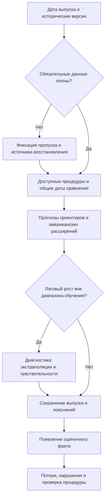

# Глава 3. Рекомендации по использованию финансовых условий США в мониторинге рисков роста еврозоны

Результаты прогнозного эксперимента позволяют определить условия, при которых американская финансовая информация может использоваться в анализе рисков роста еврозоны. В исходной спецификации включение NFCI и ANFCI снижает среднюю квантильную потерю относительно европейской модели AR + ESI. Вместе с тем это преимущество зависит от реакции базовой регрессии на экстремальный лаговый рост и не сопровождается устойчивым превосходством над простыми ориентирами. Поэтому практическое применение результатов требует внимания к устройству всей прогнозной процедуры: составу информации, способу формирования прогноза и правилам последующей оценки его качества.

В настоящей главе предлагается порядок работы для аналитических подразделений центральных и коммерческих банков, а также исследовательских организаций, изучающих внешние риски еврозоны. Рекомендации относятся к организации мониторинга и проверке дополнительной информативности финансовых показателей. Основанием служат выполненные сравнения моделей и рассмотренные в первой главе международные механизмы. Эффективность внедрения предлагаемого порядка в конкретной организации отдельно не оценивалась. Сначала раскрывается экономическое значение результатов, затем рассматривается организация квартального мониторинга и определяются условия пересмотра прогнозной процедуры.

## 3.1. Экономическое значение американских финансовых сигналов для оценки рисков роста еврозоны

Международная финансовая взаимозависимость создаёт несколько причин для наблюдения за американскими индикаторами при анализе европейской экономики. Изменение отношения глобальных инвесторов к риску способно отражаться на оценке активов в разных странах. Условия привлечения долларовых средств имеют значение для посредников, участвующих в международном финансировании. Пересмотр доступности кредита, в свою очередь, может влиять на инвестиционные решения и оборотный капитал европейских предприятий. В этой последовательности движение американского индекса является наблюдаемым обобщающим показателем финансовой среды, тогда как конечный объект исследования — неблагоприятные исходы роста реального выпуска еврозоны.

Исследование S. Miranda-Agrippino и H. Rey показывает международную передачу идентифицированных изменений денежно-кредитной политики США через цены активов, финансовый рычаг посредников и кредитные потоки.[^3-1] В работе V. Bruno и H. S. Shin трансграничные банковские потоки рассматриваются во взаимосвязи с балансами глобальных и местных банков.[^3-2] Эти результаты обосновывают внимание к внешней финансовой информации. Однако выполненная в настоящей работе квантильная регрессия имеет другую задачу: она проверяет прогнозное содержание двух составных индексов. Изменение NFCI или ANFCI может отражать несколько процессов одновременно, поэтому коэффициент при индексе не измеряет силу конкретного международного канала или отдельного решения Федеральной резервной системы.

Для практического анализа это разграничение определяет последовательность интерпретации. Ужесточение американских финансовых условий позволяет поставить вопрос о возможных затруднениях международного фондирования или переоценке европейских активов. Чтобы утверждать, что такой процесс уже передаётся в еврозону, потребовались бы дополнительные наблюдения о соответствующем канале. Рассматриваемые индексы и агрегированный ВВП не дают возможности установить, какие банки сократили кредитование, какие страны столкнулись с более высокой стоимостью заимствований и какая часть изменения выпуска связана именно с этим обстоятельством. Поэтому предлагаемое использование индексов начинается с выделения внешнего финансового сигнала и проверки его согласованности с европейской информацией.

Особое значение имеет уровень агрегирования. Единая оценка роста еврозоны удобна для общего макроэкономического анализа, но объединяет экономики с различными финансовыми структурами. Предположение о неодинаковой реакции стран и заёмщиков согласуется с механизмами первой главы, однако непосредственно в модели не проверяется. Отсюда следует граница практического применения: прогноз агрегированного нижнего квантиля нельзя автоматически переносить на отдельную страну, отрасль или кредитный портфель. Для таких задач потребовались бы собственные целевые показатели, данные о финансовой чувствительности и самостоятельная оценка качества.

Дополнительная прогнозная информативность американского показателя определяется по отношению к уже включённым европейским переменным. В исследовании эту роль выполняют доступный лаговый рост ВВП и ESI. Если европейские настроения уже отражают часть новостей о внешнем спросе, стоимости финансирования или мировой конъюнктуре, американский индекс может добавлять сравнительно мало новой информации. Такое пересечение представляет собой возможное объяснение результата, а не установленную в работе декомпозицию. Более общий вывод состоит в том, что полезность показателя необходимо определять для конкретного информационного набора и горизонта. Экономически содержательная переменная способна оказаться избыточной в одной процедуре и полезной в другой.

Результаты второй главы показывают, насколько существенен выбор европейского ориентира. В основном расширяющемся эксперименте добавление NFCI и ANFCI снижает потерю AR + ESI примерно на 9% при прогнозировании на один квартал. На четырёхквартальном горизонте соответствующий выигрыш составляет 23,2 и 42,5%. Однако после ограничения текущего лагового роста диапазоном обучения потеря самой европейской базы уменьшается на 26,3 и 51,5% по двум горизонтам. В этой диагностической конфигурации оба американских расширения уступают ей по средней потере.[^3-3] Следовательно, существенная часть наблюдаемой дополнительности связана с особенностями базовой регрессии. Эти результаты поддерживают объяснение через компенсацию неустойчивой экстраполяции, но не дают точной оценки доли выигрыша, обусловленной каждым механизмом.

Практическое следствие состоит в необходимости нескольких ориентиров. Сравнение только с AR + ESI могло бы привести к слишком благоприятной оценке американских расширений. Включение HIST и AR позволяет проверить, оправдывает ли усложнение информационного набора дополнительные параметры. После диагностики экстремального роста меняется и положение HIST: отдельные европейские процедуры имеют меньшую среднюю потерю. Поэтому исторический квантиль следует сохранять как обязательный простой ориентир, а выбор единственной предпочтительной модели рассматривать отдельно. Полученный результат обосновывает последовательное сравнение процедур, но не универсальное первенство одного метода.

Сравнение NFCI и ANFCI также требует содержательного прочтения. NFCI описывает широкий набор американских финансовых условий, тогда как ANFCI учитывает их обычную совместную динамику с экономической активностью и инфляцией. В методике ANFCI используются собственные оценённые веса финансовых переменных; разность двух индексов поэтому не выделяет точно определённую макроэкономическую составляющую.[^3-4] В практическом выпуске целесообразно показывать оба показателя раздельно и сопровождать их соответствующим определением. Само наличие макроэкономической корректировки ещё не устанавливает, что ANFCI должен лучше прогнозировать иностранный выпуск.

В историческом эксперименте ANFCI имеет более благоприятные описательные результаты относительно NFCI на четырёхквартальном горизонте. Вместе с тем замена исторических версий индексов поздними меняет их ранжирование. Для аналитика это означает, что вывод о предпочтительном показателе зависит не только от названия ряда, но и от информации, которая действительно использовалась при прогнозировании. Работа A. J. Amburgey и M. W. McCracken показывает значимость исторических версий финансовых индексов для анализа их прогнозного содержания и отдельно рассматривает статистическое сравнение вложенных квантильных моделей при пересмотрах данных.[^3-5] В настоящем исследовании необходимость сохранять версии подтверждается собственным контрфактическим сравнением. Оценка по современной истории отвечает другому вопросу, чем проверка прогноза, возможного в прошлом.

Временной охват индексов представляет ещё один аспект интерпретации. Ограничение американских агрегатов первыми двумя месяцами квартала сохраняет средний выигрыш над исходной европейской базой. Значит, наличие наблюдений третьего месяца не является необходимым условием этого выигрыша в выполненном эксперименте. При этом результаты не устанавливают полную сопоставимость всех публикационных задержек и пересмотров. Практическая рекомендация заключается в раскрытии фактического охвата каждого блока данных. Обозначение показателя как квартального недостаточно: следует уточнять, какие месяцы или недели вошли в расчёт и из какой версии они взяты.

Отдельного внимания требует смысл прогнозируемой величины. Десятый процентиль характеризует нижнюю часть условного распределения роста. При корректной условной калибровке фактическое значение должно оказываться ниже такой границы примерно в 10% случаев для соответствующего информационного набора. В данной работе калибровка требует самостоятельной проверки. Отрицательная оценка десятого процентиля не сообщает точную вероятность рецессии, а рост этой оценки сам по себе не доказывает уменьшения всех видов макроэкономического риска. Для вероятности отрицательного роста потребовалась бы оценка распределения в точке ноль, а не только одного его квантиля. Поэтому в аналитическом документе показатель следует представлять как модельную оценку нижней границы роста с указанием горизонта и определения цели.

Результаты за 2022–2025 годы полезны для описания недавнего поведения процедур, но требуют осторожного переноса на практические решения. В этой подвыборке имеется 16 прогнозов на один квартал и 13 прогнозов на четыре квартала, причём у всех исходных моделей отсутствуют нарушения границы. Различия потерь в таком случае отражают близость прогнозных границ к реализовавшемуся росту снизу. Они не показывают, насколько успешно модели обнаруживают фактические пересечения нижнего хвоста.[^3-6] Поэтому данный эпизод дополняет оценку по полной выборке, сохраняя ограниченную роль при выборе рабочего индикатора.

Таблица 3.1. Эмпирические результаты и рекомендации по использованию финансовых индикаторов США

| Результат исследования | Аналитическое значение | Рекомендация | Граница применения |
| --- | --- | --- | --- |
| Американские расширения улучшают исходную AR + ESI, но проигрывают ей после ограничения экстремального роста | Выигрыш зависит от устойчивости базы | Использовать несколько ориентиров и диагностику экстраполяции | Эффективность ограничения роста на новых прогнозах не установлена |
| Поздние версии индексов меняют ранжирование NFCI и ANFCI | Версия данных влияет на содержательный вывод | Сохранять исходные версии и отдельно оценивать пересмотры | Современная история не воспроизводит прошлый информационный набор |
| Сокращение охвата до двух месяцев сохраняет исходный выигрыш | Третий месяц не является необходимым условием выигрыша | Раскрывать охват и проверять его влияние | Все различия календарей этим не устранены |
| Результаты различаются по горизонтам и по частоте нарушений | Средняя потеря не исчерпывает свойства прогноза | Оценивать каждый горизонт и калибровку отдельно | Наблюдаемое преимущество одного горизонта не переносится на другой |
| Устойчивое превосходство американских расширений статистически не подтверждено | Выбор единственного победителя недостаточно обоснован | Сохранять параллельное сравнение и показывать неопределённость | Отсутствие подтверждения не устанавливает равенства моделей |

Источник: составлено автором по результатам главы 2.

Американские индикаторы, таким образом, сохраняют содержательное место в наблюдении за внешней финансовой средой еврозоны. Их роль в основном количественном прогнозе должна определяться дополнительной проверкой относительно достаточно устойчивой европейской процедуры. Такая постановка позволяет связать международно-экономическую мотивацию с фактическим качеством прогноза и задаёт основу для предлагаемого порядка мониторинга.

## 3.2. Организация мониторинга рисков роста с учётом финансовых условий США

Практическая организация мониторинга начинается с определения результата, который должен получать аналитик. В рамках данной работы таким результатом является сопоставимый набор квартальных оценок нижнего квантиля роста еврозоны, сопровождаемый сведениями об использованной информации и причинах расхождения моделей. Предлагается вести регулярный выпуск, в котором европейские ориентиры и американские расширения сохраняют собственные прогнозы. Это позволяет проследить изменение оценок риска во времени, не связывая весь анализ с одной спецификацией, преимущество которой пока не подтверждено.

Первый этап заключается в формировании исторически определённого информационного набора. Для европейского блока необходимы версия реального ВВП, доступный лаговый рост и значения ESI, включаемые в квартальный агрегат. Для американского блока сохраняются NFCI и ANFCI с датами наблюдений и версиями публикации. По каждому источнику необходимо различать период измерения, дату публичной доступности и дату получения данных исследователем. Такая запись особенно важна для пересматриваемых рядов: файл, загруженный сегодня, может содержать значения, которых не было в момент прежнего прогноза. Подход следует из устройства использованных баз ЕЦБ и ALFRED и из результатов проверки версий во второй главе.[^3-7]

Для продолжения сопоставимого эксперимента целесообразно сохранить дату выпуска — пятнадцатый календарный день после окончания исходного квартала. Европейский снимок должен удовлетворять ограничениям по дате фиксации и публичной доступности, применённым в главе 2. Американские индексы берутся в версии на конец квартала. В ESI включаются первые два месяца, а в исходный американский агрегат — допустимые недельные наблюдения с семидневным запасом между датой наблюдения и концом квартала.[^3-8] Этот календарь имеет ценность как единое правило сравнения; он намеренно не использует все публикации, которые могли появиться к дате выпуска.

При переходе к более оперативному набору данных потребуется выделить новую прогнозную процедуру. Например, включение третьего месяца ESI или более позднего американского выпуска изменит информационные преимущества модели. Такой вариант можно исследовать, но его результаты следует хранить отдельно от исходной последовательности. В противном случае изменение качества будет трудно связать с конкретной причиной: новым показателем, более свежими сведениями или пересмотренной историей. Разделение процедур делает календарь экономически содержательной частью модели.

Между квартальными выпусками возможно наблюдение за недельными значениями NFCI и ANFCI. В предлагаемой организации это отдельный информационный обзор: он фиксирует движение индексов и вопросы, требующие дальнейшего анализа. Перенос квартальной регрессии на еженедельный выпуск означал бы изменение частоты прогнозирования и способа обращения с неодновременным обновлением данных. Такая модель в работе не оценивалась. Поэтому недельный комментарий и квартальная количественная оценка должны иметь ясно обозначенные даты и задачи.

Второй этап включает проверку полноты и сопоставимости информации. Если один из двух необходимых месяцев ESI отсутствует, нельзя незаметно заменять двухмесячное среднее единственным наблюдением. Аналогично требуется фиксировать пропуски недель американского индекса и изменения состава исходной истории. В исследовании отдельные архивные значения восстанавливались по опубликованным материалам ЕЦБ. Для практического продолжения предлагается сохранять источник такого восстановления и его основание. Когда восстановление невозможно, прогноз, требующий отсутствующего показателя, отмечается как недоступный; сравнение моделей проводится на явно указанном общем наборе дат. Прогнозы остальных процедур при этом могут сохраняться отдельно.

Третий этап — получение сопоставимых оценок. В основном наборе остаются исторический квантиль HIST, авторегрессионная модель AR, европейская AR + ESI и два её американских расширения. Все процедуры должны использовать одинаковое определение будущего роста, допустимые обучающие цели и общий календарь в пределах каждого горизонта. Регрессии необходимо сравнивать при одинаковой доступности факта в обучении. Пересчёт одной модели по поздним данным при сохранении исторического набора у другой изменил бы предмет сравнения и мог бы создать ложное впечатление преимущества.

Оценки на один и четыре квартала предлагается представлять в отдельных частях выпуска. Короткий горизонт характеризует ближайшую динамику, тогда как четырёхквартальная цель охватывает накопленное изменение выпуска за более продолжительный интервал. Их нельзя объединять в один показатель качества без дополнительного определения весов и практической задачи. При сопоставлении сохраняется принятое в исследовании годовое выражение логарифмических темпов. В частности, прогноз одноквартального роста в годовом выражении не следует описывать как буквальное процентное изменение уровня ВВП за три месяца.

Четвёртый этап направлен на выявление неустойчивой экстраполяции. Для текущего лагового роста проверяется его положение относительно диапазона допустимого обучающего окна. При выходе за границы требуется показать, насколько этот предиктор влияет на прогноз и как меняется оценка при диагностическом ограничении. Событие выхода за диапазон не означает ошибочности самого наблюдения: необычное значение может быть корректным отражением экономической динамики. Поэтому исходные данные сохраняются, а результат чувствительности публикуется рядом с исходным прогнозом. Решение об изменении постоянной рабочей процедуры должно приниматься отдельно.

Экономическое содержание такой проверки видно на прогнозе от 15 января 2021 года. Доступный лаговый рост составлял около 47,01% в годовом выражении при верхней границе обучающего диапазона примерно 4,93%. Исходная AR + ESI дала одноквартальный прогноз нижней границы 28,05%, а диагностическое ограничение уменьшило его до 0,61%; оценочный факт составил −1,15%. Все величины здесь выражены в принятой логарифмической годовой шкале.[^3-9] Эти значения показывают, как формально допустимая линейная экстраполяция может доминировать над остальной информацией. В аналитическом выпуске такой случай должен сопровождаться объяснением вклада регрессора, а не только итоговой цифрой прогноза. Приведённый эпизод служит ретроспективной иллюстрацией: правило ограничения было предложено после изучения исходных ошибок.

При этом исторический минимум и максимум не являются экономическими пределами будущего роста. В новом режиме ограничение может подавить полезную информацию о необычном, но содержательном изменении. Поэтому в предлагаемом мониторинге ему отводится диагностическая роль. Сама процедура позволяет увидеть зависимость прогноза от предположения о продолжении прежней линейной связи за наблюдавшийся диапазон. Для превращения этой диагностики в постоянное правило требуется последующая проверка, рассмотренная в параграфе 3.3.

Пятый этап связан с интерпретацией расхождений моделей. Если американское расширение даёт существенно иную границу, сначала проверяются технические основания: версия индекса, его охват, наличие пропусков и положение текущих предикторов относительно обучения. После этого обсуждается экономическая интерпретация. Возможные направления анализа включают изменение внешних условий финансирования и согласованность американского сигнала с европейскими настроениями. Величина расхождения сама по себе не идентифицирует внешний шок и не даёт оснований приписать изменение прогноза отдельному международному механизму.

Важен и способ разложения прогнозного различия. Добавление финансового индекса сопровождается повторным оцениванием всех коэффициентов, поэтому разрыв между расширенной и базовой моделью не равен непосредственному вкладу американской переменной. Во второй главе это показано на том же прогнозе января 2021 года: американские расширения снижают общий прогноз, хотя непосредственное слагаемое индекса в них положительно. Следовательно, аналитический комментарий должен учитывать изменение всей спецификации. Обозначение разницы двух прогнозов как величины американского воздействия было бы экономически неверным.[^3-9]

Рисунок 3.1. Порядок формирования и последующей проверки квартальной оценки рисков роста

Источник: разработано автором; схема предлагаемой организации анализа.

Итогом квартального цикла становится краткий аналитический документ. В нём необходимо указать дату выпуска, исходный квартал, целевой интервал и горизонт, использованные версии и фактический охват данных. Затем представляются прогнозы пяти процедур, отметка о необычных предикторах и комментарий к расхождениям. Если рассчитан диагностический вариант, он получает отдельное обозначение. Диапазон оценок разных моделей показывает чувствительность к спецификации; без специального вероятностного обоснования его нельзя называть доверительным или прогнозным интервалом.

После появления оценочного факта в сохранённый выпуск добавляются потери и сведения о нарушении границы. Исходный прогноз остаётся неизменным. Основная оценка должна сохранять принятое во второй главе определение факта с ограниченной зрелостью — версию, выбираемую по установленному правилу примерно через шесть месяцев после конца целевого интервала. Сопоставление с поздней историей ВВП ведётся дополнительно.[^3-10] Это позволяет отделить собственно прогнозную ошибку от последующего изменения статистического измерения выпуска.

Предлагаемое распределение аналитических действий отвечает различным задачам пользователя. Макроэкономист получает сопоставимые границы роста; специалист, отвечающий за данные, может восстановить использованный информационный набор; исследователь качества прогноза видит потери и причины крупных расхождений. В небольшой организации эти функции может выполнять один аналитик. Существенно сохранение последовательности решений и результатов, позволяющее проверить, что было известно в момент прогноза. Именно такая организация делает американскую финансовую информацию наблюдаемой и проверяемой частью европейского анализа рисков.

## 3.3. Оценка надёжности прогнозных сигналов и условия пересмотра моделей

Регулярное получение прогнозов имеет практический смысл, если сопровождается последовательной оценкой их качества. В противном случае аналитик может выбирать модель по отдельному удачному эпизоду или по соответствию ожидаемой экономической истории. Для рассматриваемой задачи предлагается заранее определить главный горизонт, основной показатель потерь, набор ориентиров и порядок анализа ошибок. В исследовании основным является горизонт в один квартал, а четырёхквартальный результат используется дополнительно. Такое разграничение следует сохранять при дальнейшем накоплении прогнозов, чтобы выбор предпочтительного горизонта не зависел от получившегося ранжирования.

Основной критерий должен соответствовать прогнозируемой характеристике распределения. Для десятого процентиля используется квантильная функция потерь, определённая во второй главе. Она учитывает направление и величину отклонения факта от прогнозной границы. Подход согласуется с принципом применения правил оценки, соответствующих заявленной вероятностной задаче, рассмотренным T. Gneiting и A. E. Raftery.[^3-11] В практическом сравнении следует сохранять единый критерий для всех моделей. Замена его долей угаданных направлений роста или обычной среднеквадратической ошибкой без изменения исследовательской задачи затруднила бы интерпретацию результата.

Средняя потеря должна рассматриваться вместе с распределением ошибок по времени. Для каждой пары моделей полезно сохранять последовательность разностей потерь и показывать, какая часть итогового разрыва приходится на отдельные даты. Дополнительно можно указывать число прогнозов, на которых одна процедура лучше другой, и результат диагностического исключения каждого наблюдения. Эти характеристики помогают отличить частый небольшой выигрыш от компенсации нескольких крупных ошибок. При этом основной результат сохраняет все допустимые даты: редкие неблагоприятные исходы составляют сам предмет анализа рисков. Удаление неудобного эпизода ради более привлекательной средней потери изменило бы задачу исследования.

Второе направление оценки связано с нарушениями прогнозной границы. Частота, близкая к 10%, полезна как первоначальная характеристика, но не доказывает правильной условной калибровки. Модель может давать слишком высокую границу в одном состоянии экономики и слишком низкую в другом, сохраняя приемлемую общую частоту. Поэтому предлагается анализировать расположение нарушений во времени, их связь с доступной информацией и величину соответствующих ошибок. Работа V. Corradi, J. Fosten и D. Gutknecht предоставляет методологическую основу для более строгого сравнения условного покрытия квантильных прогнозов.[^3-12] Применение специальной процедуры авторов относится к дальнейшему развитию исследования; в выполненных расчётах такой тест не проводился.

Эмпирические результаты показывают необходимость этой дополнительной характеристики. В объединённой проверке с двухмесячными индексами и ограничением роста частоты нарушений NFCI составляют 25,9 и 43,6% на двух горизонтах, тогда как для ANFCI — 12,1 и 16,4%.[^3-3] Эти значения нельзя заменить общим утверждением, что американские расширения одинаково хорошо отражают нижний хвост. Вместе с тем близость ANFCI к номинальному уровню на коротком горизонте не устанавливает его условную калибровку. Различие между качеством по потерям и свойствами нарушений должно сохраняться и в аналитическом выводе, и в последующем выборе модели.

Третье направление связано с неопределённостью сравнительных оценок. Вневыборочная часть включает 58 прогнозов на один квартал и 55 прогнозов на четыре квартала. Для редких исходов такой объём даёт ограниченную информацию; соседние четырёхквартальные цели дополнительно перекрываются. Поэтому небольшое различие средних потерь следует сопровождать оценкой его неопределённости. На основном горизонте выполненные вспомогательные сравнения скользящих процедур после поправки на множественность не подтверждают превосходства американских расширений. На дополнительном горизонте отдельные результаты зависят от настройки оценки долговременной дисперсии и благоприятны для HIST.[^3-13]

Для интерпретации принципиально, что статистические результаты относятся к конкретному способу получения прогнозов. Использованный вариант сравнения в духе Giacomini–White относится к фиксированному скользящему окну; его выводы не переносятся автоматически на основное расширяющееся окно.[^3-14] Кроме того, включение новых спецификаций в анализ увеличивает число сравнений, но не число независимых экономических наблюдений. Поэтому дальнейший выбор модели должен опираться на заранее определённую семью сравнений и раскрывать все её результаты. Отсутствие статистически подтверждённого различия не означает эквивалентности процедур, а значимость в одной настройке сама по себе не определяет практическую ценность прогноза.

Условия пересмотра модели целесообразно связывать с конкретной выявленной проблемой. Если выигрыш присутствует только относительно слабой базы, требуется проверить устойчивость базового прогноза. Если ошибки связаны с выходом регрессора за обучающий диапазон, рассматривается реакция модели на экстраполяцию. Если ранжирование меняется после пересмотра индекса, исследуется влияние версии. Такой порядок ограничивает произвольный перебор спецификаций: предлагаемое изменение отвечает наблюдаемой проблеме и получает самостоятельную последующую оценку.

Таблица 3.2. Основания для проверки и пересмотра прогнозной процедуры

| Наблюдаемая проблема | Необходимая проверка | Возможное действие | Требуемое подтверждение |
| --- | --- | --- | --- |
| Текущий рост выходит за диапазон обучения | Вклад регрессора и чувствительность к ограничению | Публикация диагностического варианта и проверка формы зависимости | Качество зафиксированного изменения на новых прогнозах |
| Выигрыш имеется только над одной европейской базой | Сравнение с HIST, AR и устойчивостью европейской спецификации | Пересмотр обоснования дополнительности индекса | Сохранение содержательного выигрыша относительно нескольких ориентиров |
| Нарушения границы концентрируются в отдельных состояниях | Хронология ошибок и условное покрытие | Проверка калибровки и причин систематических отклонений | Улучшение соответствующих свойств при приемлемой квантильной потере |
| Изменяется методика или история индекса | Сопоставимость версий и вклад пересмотров | Выделение новой версии прогнозной процедуры | Отдельная оценка без подмены ранее сохранённых прогнозов |
| Преимущество зависит от одной даты или настройки | Влияние наблюдений, интервалы и заранее заданные проверки | Сохранение нескольких ориентиров и осторожного вывода | Последующее подтверждение устойчивости на новых наблюдениях |
| Для отдельных дат отсутствует обязательный показатель | Причина пропуска и состав доступных моделей | Прозрачное обозначение пропуска или документированное восстановление | Сопоставимость данных и общий набор дат для парной оценки |

Источник: разработано автором на основе результатов главы 2. Таблица задаёт основания для аналитической проверки; универсальные численные пороги принятия решений в исследовании не устанавливались.

Для ограничения экстремального роста особенно важна независимая последующая проверка. Правило было предложено после обнаружения проблемной экстраполяции и оценено на уже известном историческом периоде. Прозрачность его определения и одинаковое применение к регрессиям делают диагностику содержательной, но не устраняют ретроспективный характер решения. Поэтому предлагается зафиксировать правило до формирования новых прогнозов, сохранять рядом исходную и диагностическую процедуры и оценивать их по общему календарю появления факта. Если правило меняется после очередной ошибки, такое изменение должно получать новую дату начала проверки.

Независимость последующего этапа определяется порядком принятия решений. Формальное выделение части уже изученной истории недостаточно, если её результаты повлияли на выбор спецификации. Более убедительная проверка предусматривает сохранение прогнозов до реализации целевых значений и отсутствие последующей корректировки этих прогнозов. Для четырёхквартального горизонта требуется учитывать не только время ожидания факта, но и перекрытие соседних целей. Поэтому быстрое накопление большого числа выпусков не гарантирует столь же быстрого увеличения информации о редких событиях.

Решение о включении американского индекса в основной прогноз должно учитывать величину выигрыша, его неопределённость и практическую устойчивость. Возможен результат, при котором средняя потеря немного уменьшается, но улучшение сопровождается ухудшением калибровки или сильной зависимостью от версии. В таком случае требуется содержательная оценка компромисса. Аналогично небольшое преимущество сложной процедуры может не оправдывать дополнительные затраты на получение исторических данных и поддержку расчёта. В настоящей работе такие организационные затраты и денежная ценность прогноза не измерялись, поэтому количественная оценка эффективности внедрения не приводится.

В дальнейшем следует сохранять простую последовательность приоритетов. Первым направлением является накопление новых прогнозов по уже определённым правилам. Вторым — более строгая оценка калибровки и статистическое сравнение, согласованное с вложенностью моделей, способом обучения и пересмотрами данных. Третьим — исследование отдельных международных каналов с использованием соответствующих показателей и самостоятельной идентификационной стратегии. Последнее направление может уточнить, почему финансовая информация США полезна в одних состояниях и мало добавляет в других, но требует иной эмпирической постановки. Оно не заменяет проверку качества текущего агрегированного прогноза.

Такой порядок соответствует более общему вопросу литературы о Growth-at-Risk: в какой мере обнаруженные связи сохраняют полезность при прогнозировании за пределами обучающей выборки. Работа M. Plagborg-Møller и соавторов рассматривает именно проблему оценки предсказуемости распределения роста с использованием финансовой информации.[^3-15] Результаты настоящего исследования дополняют эту постановку прикладным сравнением двух американских индикаторов для еврозоны. Их практическое значение заключается в выявлении условий, от которых зависит вывод о дополнительности, и в формировании проверяемого порядка работы с такими сигналами.

**Выводы по третьей главе**

Американская финансовая информация имеет содержательное основание для включения в наблюдение за внешней средой еврозоны. Международная переоценка риска и трансграничное финансирование объясняют экономический интерес к NFCI и ANFCI, однако выполненная модель оценивает их прогнозное содержание, сохраняя границы причинной интерпретации. Практический вывод зависит от качества европейского ориентира: после диагностики экстремального лагового роста средний выигрыш американских расширений над базой исчезает. Поэтому выбор одного индекса как безусловно предпочтительного инструмента оценки рисков роста не обоснован.

Предложена организация квартального мониторинга с сохранением исторических версий, единым календарём, несколькими прогнозными ориентирами и отдельной проверкой экстраполяции. Результаты каждого выпуска должны дополняться анализом расхождений, а после появления факта — квантильными потерями и характеристиками нарушений. Такая процедура позволяет проследить связь между доступной информацией и прогнозом. Её совокупная эффективность как организационного решения остаётся предметом дальнейшей проверки.

Условия пересмотра моделей связаны с конкретными источниками нестабильности: экстремальными предикторами, пересмотрами индексов, качеством базы и калибровкой нижней границы. Последующая проверка зафиксированных процедур должна предшествовать сильным заявлениям об их устойчивом преимуществе. Тем самым рекомендации сохраняют международно-экономический смысл исследования и соответствуют объёму эмпирических свидетельств, полученных во второй главе.

## Источники и примечания к главе 3

[^3-1]: Miranda-Agrippino S., Rey H. *U.S. Monetary Policy and the Global Financial Cycle*. Review of Economic Studies. 2020. Vol. 87, No. 6. P. 2754–2776. DOI: https://doi.org/10.1093/restud/rdaa019. Использованная полная рабочая версия: NBER Working Paper No. 21722, редакция марта 2019 года, https://www.nber.org/papers/w21722. В архиве: `revision16/sources/Miranda_Rey_NBER21722.pdf`. Работа обосновывает международный механизм; причинные результаты её модели не приписываются выполненной здесь квантильной регрессии.

[^3-2]: Bruno V., Shin H. S. *Cross-border banking and global liquidity*. BIS Working Papers. 2014. No. 458. URL: https://www.bis.org/publ/work458.htm. В архиве: `revision16/sources/Bruno_Shin_BIS458.pdf`. Используется механизм передачи через банковские балансы и трансграничные потоки; собственная оценка этого канала в дипломе не выполнена.

[^3-3]: Расчёты автора, представленные в главе 2, таблицы 2.2, 2.6 и 2.7. Проверяемые значения: `revision25/results/scores.csv`; исходные и диагностические процедуры, расширяющееся окно. Снижение потерь европейской базы рассчитано относительно исходной AR + ESI; частоты нарушений относятся к конфигурации `M2_clip_g`. Полные результаты: `chapter2/Appendix_Chapter_2_Additional_Experiments.md`. При написании главы 3 модели не переоценивались.

[^3-4]: Brave S. A., Kelley D. *Introducing the Chicago Fed’s New Adjusted National Financial Conditions Index*. Chicago Fed Letter. 2017. No. 386. URL: https://www.chicagofed.org/publications/chicago-fed-letter/2017/386. В архиве: `papers/S41.pdf`. Также: Federal Reserve Bank of Chicago. *About the NFCI*. URL: https://www.chicagofed.org/research/data/nfci/background. Исторический эксперимент сохраняет опубликованные определения соответствующих версий индексов.

[^3-5]: Amburgey A. J., McCracken M. W. *On the real-time predictive content of financial condition indices for growth*. Journal of Applied Econometrics. 2023. Vol. 38, No. 2. P. 137–163. DOI: https://doi.org/10.1002/jae.2943. Использована полная рабочая версия Federal Reserve Bank of St. Louis Working Paper No. 2022-003B от 3 июня 2022 года; `papers/S27.pdf`. Собственное сравнение исторических и поздних индексов: `revision19/results/ANFCI_revision_effect.csv`, глава 2, таблица 2.5. Специальная процедура статистического вывода авторов в дипломе не реализована.

[^3-6]: Расчёты автора: `revision19/results/ANFCI_episode_scores.csv`; исходное расширяющееся окно, целевые интервалы полностью внутри 2022–2025 годов. См. параграф 2.4. Для этой подвыборки у всех пяти исходных моделей число нарушений равно нулю.

[^3-7]: European Central Bank. *Real Time Database: Data information*. URL: https://data.ecb.europa.eu/data/datasets/RTD/data-information. Federal Reserve Bank of St. Louis. *ALFRED*, ряды NFCI и ANFCI: https://alfred.stlouisfed.org/series?seid=NFCI и https://alfred.stlouisfed.org/series?seid=ANFCI. Описание использованных архивных данных и ограничений содержится в параграфе 2.1; предложения по их сохранению сформулированы автором.

[^3-8]: Авторский календарь: `revision18/results/forecast_calendar_59.csv`, `revision18/results/ESI_monthly_actual_dates_118.csv`, `revision19/results/ANFCI_calendar_59.csv`. Определения текущих и обучающих наборов приведены в параграфах 2.1–2.2. Рекомендация продолжать этот календарь направлена на сопоставимость с выполненным экспериментом; оптимальность выбранной даты выпуска не оценивалась.

[^3-9]: Расчёты автора по прогнозу от 15 января 2021 года: `chapter2/evidence/forecast_2021_01_15_diagnostic.json`; ограниченный прогноз — `revision25/results/forecasts.csv`, расширяющееся окно, `Q_clip_g`, `AR_ESI`, горизонт один квартал. Определение преобразования роста соответствует главе 2. Пример ретроспективный; он не является свидетельством применения ограничения в реальном времени в январе 2021 года.

[^3-10]: Авторское определение оценочного факта: `revision18/results/evaluation_targets.csv`, параграф 2.2. Основной факт имеет ограниченную зрелость и не равен обязательно первой опубликованной оценке ВВП. Поздняя история используется в отдельной проверке чувствительности.

[^3-11]: Gneiting T., Raftery A. E. *Strictly Proper Scoring Rules, Prediction, and Estimation*. Journal of the American Statistical Association. 2007. Vol. 102, No. 477. P. 359–378. DOI: https://doi.org/10.1198/016214506000001437. Полный текст: `papers/S21.pdf`; авторская копия — https://sites.stat.washington.edu/people/raftery/Research/PDF/Gneiting2007jasa.pdf. Источник обосновывает соответствие правила оценки прогнозной задаче; используемая квантильная потеря определена в главе 2.

[^3-12]: Corradi V., Fosten J., Gutknecht D. *Out-of-sample tests for conditional quantile coverage an application to Growth-at-Risk*. Journal of Econometrics. 2023. Vol. 236, No. 2. Article 105490. DOI: https://doi.org/10.1016/j.jeconom.2023.105490. Полный текст: `papers/S11.pdf`; репозиторий авторского университета — https://openaccess.city.ac.uk/id/eprint/33296/. Работа используется как направление развития проверки условного покрытия, а не как уже выполненная процедура.

[^3-13]: Расчёты автора: `revision25/results/rolling52_inference.csv`. Основной горизонт — один квартал; поправка Holm применяется к двадцати сравнениям соответствующей семьи, основной HAC с четырьмя лагами и чувствительность к восьми. Полная матрица, обычные и одновременные интервалы приведены в приложении ко второй главе. На четырёхквартальном горизонте при восьми лагах два сравнения ANFCI с HIST благоприятны для HIST; при четырёх лагах после поправки отвержений на уровне 5% нет.

[^3-14]: Giacomini R., White H. *Tests of Conditional Predictive Ability*. Econometrica. 2006. Vol. 74, No. 6. P. 1545–1578. DOI: https://doi.org/10.1111/j.1468-0262.2006.00718.x. Использованная полная рабочая версия 2003 года: `revision18/sources/Giacomini_White_2003.pdf`. Применённый вспомогательный вариант с постоянным инструментом и его ограничения описаны в параграфах 2.2 и 2.4.

[^3-15]: Plagborg-Møller M., Reichlin L., Ricco G., Hasenzagl T. *When Is Growth at Risk?* Brookings Papers on Economic Activity. 2020. Spring. P. 167–229. DOI: https://doi.org/10.1353/eca.2020.0002. Использованная полная авторская версия от 2 июля 2020 года: `papers/S04.pdf`. Работа служит основанием для постановки вопроса о вневыборочной предсказуемости; диплом не представляется её прямой репликацией.

Глава подготовлена 19 октября 2026 года. Численные положения основаны на сохранённых расчётах главы 2 и редакции 25 исследовательского архива. Организация мониторинга, представление результатов и условия пересмотра моделей являются авторскими рекомендациями. Новые эконометрические модели при подготовке главы не оценивались.

