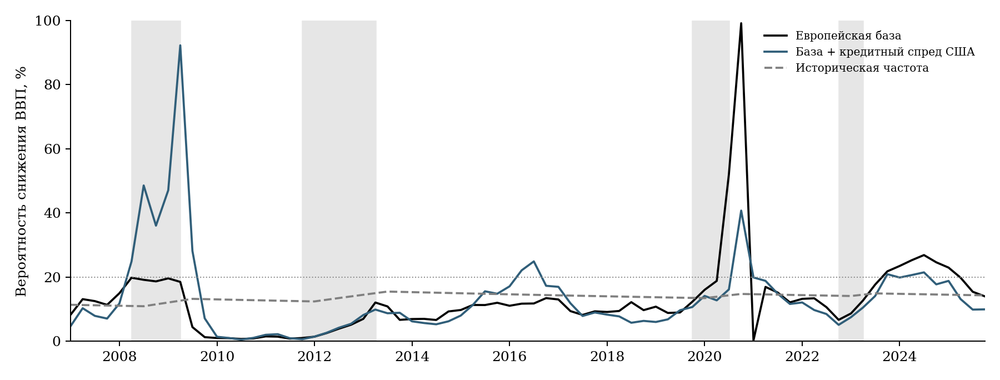
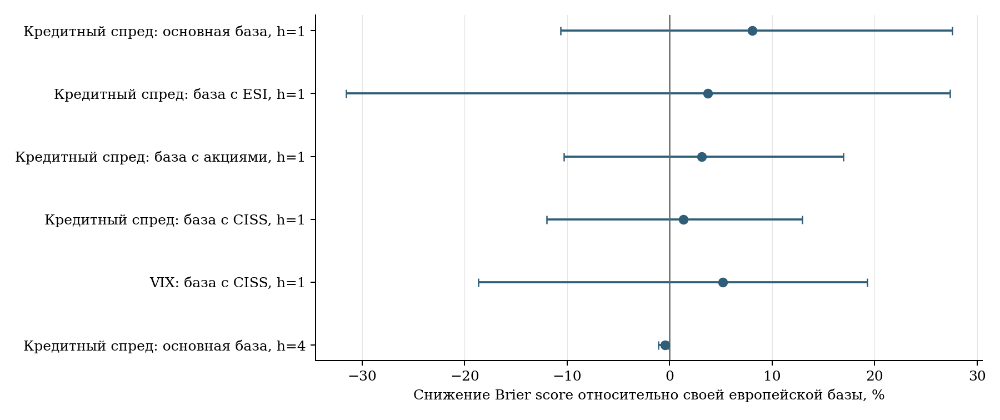

# Вероятностная модель спадов еврозоны: первые четыре этапа

31 октября 2026 года. Автор: Суховерхов Артем.

Выполнены паспорт исследования, сбор данных, оценивание моделей и проверки. Главы диплома и три прежних документа не изменялись. Подтверждение гипотезы не является условием завершения исследования.

Основной результат: добавление американского кредитного спреда снижает Brier score относительно компактной европейской базы на 8,05%, но 95%-й парный блочный интервал включает ноль, а простой частотный прогноз лучше. После исключения самого влиятельного оценочного квартала 2020Q4 преимущество составляет 2,50%. В архивном упражнении NFCI/ANFCI не улучшают собственную европейскую базу. Это результат выполненного дизайна, а не доказательство бесполезности всей американской информации.

## Читать в таком порядке

- [Паспорт исследования](RESEARCH_PASSPORT.md): объект, предмет, цель, гипотезы, периоды и метод.
- [Численные результаты и интерпретация](RESULTS.md): основное сравнение, интервалы, ограничения и архивное упражнение.
- [Замороженный протокол](protocol_lock.json): выборы до оценивания новых бинарных моделей и отпечатки входов.
- [Источники и версии](SOURCE_REGISTER.md), [машиночитаемый реестр](data/source_manifest.json).
- [Панель 1970–2025](data/processed/quarterly_panel.csv), [независимая сверка ВВП](data/processed/gdp_crosscheck.csv).
- [Сводные оценки](results/scores.csv), [парные интервалы](results/paired_comparisons.csv), [эпизоды](results/episode_scores.csv), [пересмотры целевых исходов](results/outcome_revision_scores.csv).
- [Проверки](checks/validation.json), [данные](checks/data_audit.json), [влияние отдельных кварталов](checks/influence_audit.json).

Основные промежуточные результаты сохранены полностью: 8 790 прогнозов, 6 965 рекурсивных оцениваний, параметры и обучение каждого прогноза. Это число повторных оцениваний фиксированных процедур, а не перебор тысяч моделей с выбором победителя.

## Воспроизведение

Из корня репозитория, в среде Python с пакетами из [requirements.txt](requirements.txt):

```bash
OPENBLAS_NUM_THREADS=1 python research/03_us_financial_conditions/downturn_extension/run_all.py --offline
```

Без `--offline` сборщик может получить отсутствующие официальные ответы; существующие замороженные ответы не загружаются повторно. Если источник изменился и контрольная сумма больше не соответствует протоколу, расчёт останавливается. `--reuse-models` повторно оценивает критерии и выполняет проверки сохранённых оценок, не переоценивая коэффициенты. При этом проверяются исходные хеши и сохранность имеющихся выходов.

Крупные CSV/JSONL сохранены в GitHub в gzip без изменения распакованных байтов. `run_all.py` автоматически восстанавливает их перед использованием; отдельно это делает `python cache_files.py --hydrate`. [Реестр сжатого кэша](compressed_cache_manifest.json) содержит исходные и сжатые отпечатки. Исходные пакеты AWM и ECFIN уже являются ZIP. Файлы старого архива `revision18`, `revision19` и `revision30` читаются из этого же репозитория и не переписываются.

## Важные различия экспериментов

Длинная AWM — EA21, поздняя реконструированная история. Основной прогноз на конец t использует входы до t−1; фактическое наличие тогда каждого современного значения не предполагается. Вариант с текущими рыночными данными — отдельно обозначенная чувствительность.

Архивное упражнение использует реальные прошлые выпуски RTD/ALFRED и собственный календарь. Дата — 15 дней после конца квартала r; цель r+1+h ещё полностью в будущем. На h=1 доступны 57 прогнозов, на h=4 — 54. ВВП — движущийся региональный агрегат; в AWM он не подставляется. В парном позднем контрфакте заменяются только NFCI/ANFCI, европейская информация и факты не меняются.

Расширенные базы с ESI, акциями, CISS и VIX имеют более короткое обучение. В каждой паре выборки совпадают; отличие выигрышей между разными экспериментами нельзя приписать одному добавленному европейскому контролю. Горизонт четыре квартала означает знак роста отдельного будущего квартала, а не накопленный годовой рост. Спад квартального ВВП, рецессия CEPR и старый GaR — разные целевые величины.

Блочные интервалы условны на сохранённых прогнозах; переобучения в бутстрэп-повторах нет. Порог предупреждения 20% иллюстративный. Преимущество над одной регрессией не объявляется превосходством всей процедуры над простыми ориентирами. Причинный эффект США не оценивался.

## Диагностика



Серые полосы обозначают отрицательные квартальные изменения ВВП в замороженной AWM. Пунктирная горизонталь — заданный порог 20%. Это оценки вероятностей, не доверительные интервалы.



Каждая строка сравнивает расширение с собственной европейской базой при одинаковых обучении и датах. Положительная точка — меньше Brier-потеря; отрезок — 95%-й парный блочный интервал. Строки разных экспериментов не образуют общий рейтинг процедур.
