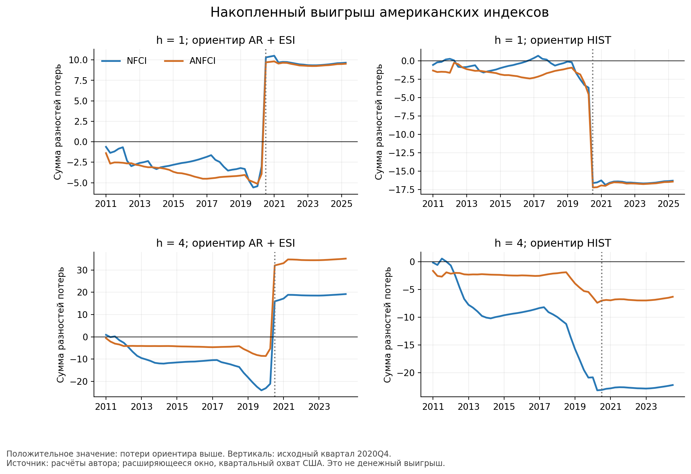
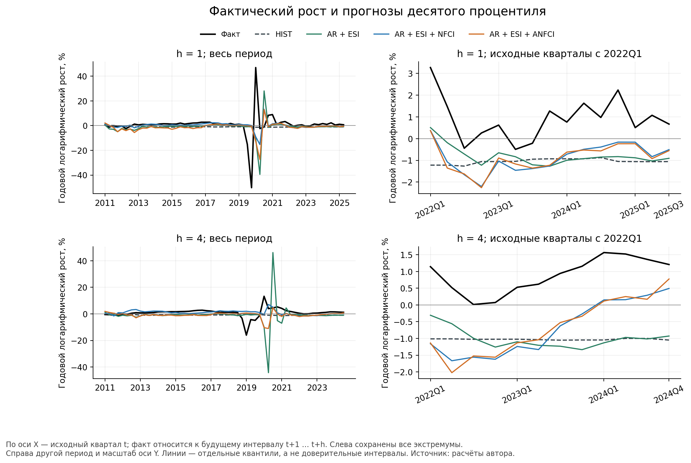
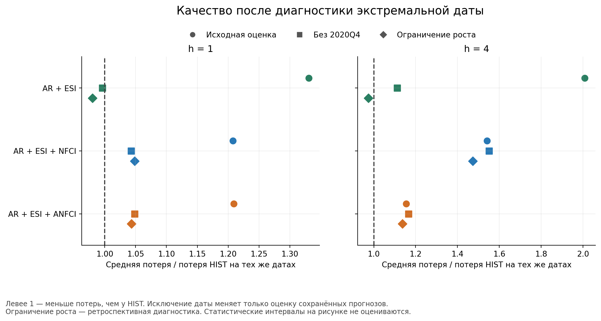
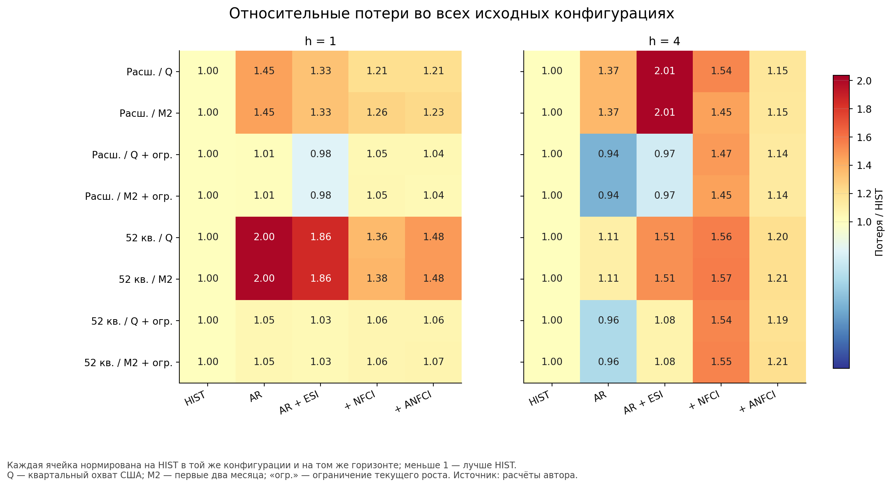
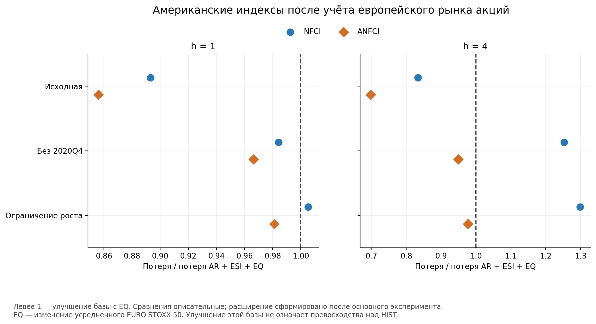
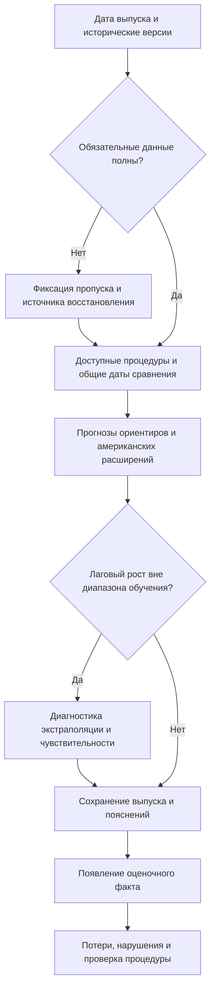

# Финансовые условия США в прогнозировании рисков роста еврозоны

## Оглавление

- [Введение](#introduction)
- [Глава 1. Теоретические основы международной передачи финансовых условий и прогнозирования рисков роста](#chapter-1)
  - 1.1. Финансовые условия и роль США в международной финансовой системе
  - 1.2. Каналы связи финансовых условий США с экономикой еврозоны
  - 1.3. Growth at Risk: теоретическая рамка, результаты исследований и постановка прогнозной задачи
- [Глава 2. Эмпирическая оценка прогнозной информативности финансовых условий США](#chapter-2)
  - 2.1. Данные и формирование исторического информационного набора
  - 2.2. Модели и организация прогнозного эксперимента
  - 2.3. Сравнительная оценка качества прогнозов
  - 2.4. Устойчивость результатов и границы их интерпретации
- [Глава 3. Рекомендации по использованию финансовых условий США в мониторинге рисков роста еврозоны](#chapter-3)
  - 3.1. Экономическое значение американских финансовых сигналов для оценки рисков роста еврозоны
  - 3.2. Организация мониторинга рисков роста с учётом финансовых условий США
  - 3.3. Оценка надёжности прогнозных сигналов и условия пересмотра моделей
- [Заключение](#conclusion)
- [Список использованных источников](#references)
- [Приложения](#appendices)
  - Приложение А. Паспорт данных и календаря прогнозирования
  - Приложение Б. Полные результаты дополнительных проверок
  - Приложение В. Состав расчётных материалов и воспроизведение
  - Приложение Г. Форма квартальной аналитической записки

<a id="introduction"></a>

# Введение

Международные финансовые взаимосвязи определяют условия, в которых формируется экономическая динамика еврозоны. Европейские компании и банки участвуют в трансграничном движении капитала, используют международные рынки финансирования и сталкиваются с переоценкой активов, происходящей одновременно в нескольких экономиках. Особое место в этой системе занимают США. Изменения стоимости долларового фондирования, склонности международных инвесторов к риску и состояния балансов финансовых посредников способны передаваться за пределы американской экономики и отражаться на доступности кредита, инвестициях и выпуске в других странах. Исследования глобального финансового цикла и трансграничной банковской деятельности раскрывают экономические основания такой передачи [9; 12]. Для еврозоны это означает необходимость учитывать внешнюю финансовую среду наряду с внутренними показателями активности.

При этом международная значимость американских финансовых рынков сама по себе не определяет полезность их показателей для прогноза. Часть внешних изменений может уже отражаться в европейских обследованиях настроений, а американские индексы — реагировать на общие новости о мировой экономике. Включение дополнительной переменной требует оценивания новых коэффициентов и может увеличивать чувствительность модели к отдельным наблюдениям. Поэтому экономически правдоподобная связь финансовых условий с выпуском не обязательно обеспечивает устойчивое улучшение прогноза. Разграничение этих вопросов особенно важно при оценке рисков слабого роста, когда сравнительное качество моделей может зависеть от немногих крупных ошибок.

Актуальность исследования обусловлена потребностью в проверяемой оценке внешних финансовых сигналов для еврозоны. Важна не только центральная траектория выпуска, но и граница его неблагоприятных исходов: относительно благоприятный средний прогноз может сочетаться с существенным риском слабой динамики. Подход Growth at Risk позволяет исследовать нижний условный квантиль будущего роста и связывать его с доступной макрофинансовой информацией [20; 22]. Однако переход от объяснения прошлых спадов к практическому прогнозированию требует учитывать даты публикации и пересмотры данных, сопоставлять результаты с простыми ориентирами и проверять, сохраняется ли выигрыш после изменения отдельных элементов процедуры.

Степень разработанности проблемы определяется несколькими направлениями литературы. Работы S. Miranda-Agrippino и H. Rey, V. Bruno и H. S. Shin, C. Kaufmann раскрывают международную передачу финансовых изменений через рынки активов, банковские балансы и инвестиционные фонды [9; 12; 13]. Исследования T. Adrian, N. Boyarchenko и D. Giannone формируют основу анализа уязвимого роста, а J. M. Figueres и M. Jarociński рассматривают значение выбора финансового индикатора для еврозоны [22; 24]. В то же время M. Plagborg-Møller и соавторы, C. Brownlees и A. B. M. Souza показывают, почему вневыборочное качество и выбор модели сравнения требуют самостоятельной проверки [26; 27]. A. J. Amburgey и M. W. McCracken исследуют прогнозное содержание финансовых индексов с учётом исторических версий и пересмотров [30]. Близким прикладным предшественником выступает модель рисков роста Германии J. Plaasch и A. Röthig, в которой американский NFCI используется совместно с внутренними показателями [39]. Таким образом, применение американской финансовой информации к европейской экономике уже имеет предшественников; исследовательская задача заключается в уточнении её дополнительной полезности в конкретном сопоставимом прогнозном дизайне.

В настоящей работе сравниваются National Financial Conditions Index (NFCI) и Adjusted National Financial Conditions Index (ANFCI) Федерального резервного банка Чикаго. Первый обобщает финансовые условия США, второй учитывает их обычную совместную динамику с экономической активностью и инфляцией. Сравнение содержательно интересно, поскольку корректировка может уменьшать информационное дублирование, но одновременно исключать сведения об общем цикле, полезные для европейского прогноза. Кроме того, индексы различаются оценёнными весами, поэтому разность их результатов нельзя полностью приписать одной макроэкономической корректировке [7].

Основной исследовательский вопрос формулируется следующим образом: **улучшают ли NFCI и ANFCI прогноз десятого процентиля роста реального ВВП еврозоны после учёта доступного лагового роста и европейских экономических настроений, и насколько возможное улучшение устойчиво к выбору ориентира, версии данных и реакции модели на экстремальные наблюдения?** Отдельный вопрос касается различий между двумя американскими индикаторами при одинаковых правилах прогнозирования.

В дополнительной проверке вопрос уточняется: сохраняется ли американский сигнал после включения европейского фондового показателя? Она расширяет информационный ориентир при неизменном целевом квантиле и дополняет основное сравнение.

Цель исследования — оценить дополнительную прогнозную информативность финансовых условий США для рисков роста еврозоны и определить границы её практического использования на основе сопоставления NFCI и ANFCI с европейской базовой моделью и простыми прогнозными ориентирами.

Для достижения поставленной цели решены следующие задачи:

1. Раскрыть экономическое содержание финансовых условий и международные механизмы их связи с выпуском еврозоны через трансграничное финансирование, переоценку активов и балансы экономических агентов.
2. Систематизировать исследования Growth at Risk и определить место собственного сравнения в литературе о финансовых индикаторах, прогнозировании нижнего роста и исторической доступности данных.
3. Сформировать сопоставимые исторические информационные наборы по ВВП еврозоны, индикатору экономических настроений ESI, NFCI и ANFCI с учётом публикационных задержек и пересмотров.
4. Построить прогнозы десятого процентиля роста на горизонтах одного и четырёх кварталов с использованием европейской базовой модели, двух американских расширений и простых ориентиров HIST и AR.
5. Сопоставить качество прогнозов по квантильной потере, частоте нарушений нижней границы и распределению выигрышей и ошибок по отдельным датам.
6. Проверить чувствительность выводов к обучающему окну, версиям данных, временному охвату американских индексов и экстремальной экстраполяции; отдельно оценить статистическую неопределённость сравнения.
7. Сформулировать рекомендации по использованию американской финансовой информации в квартальном мониторинге рисков роста еврозоны и определить условия пересмотра прогнозной процедуры.

Объектом исследования является совокупная экономическая динамика еврозоны в условиях международных финансовых взаимосвязей. Предмет исследования — дополнительная прогнозная информативность индексов финансовых условий США NFCI и ANFCI относительно европейской макроэкономической базы при оценке нижнего условного квантиля роста реального ВВП еврозоны. Такое разграничение соответствует выполненной эмпирической работе: международные механизмы обосновывают выбор предикторов, а модель проверяет их прогнозное содержание. Причинный эффект отдельного решения ФРС или конкретного канала трансграничной передачи в исследовании не идентифицируется.

Под дополнительной прогнозной информативностью далее понимается результат добавления индекса к конкретной процедуре: изменение её вневыборочной квантильной потери. Это операциональное определение не означает измерения всего информационного содержания американских рынков. Оно позволяет сформулировать проверяемый вывод даже в случае, когда расширенная модель улучшает слабую базу, но проигрывает простому ориентиру.

Проверяются две исследовательские гипотезы. Первая состоит в том, что добавление NFCI или ANFCI к модели с лаговым ростом ВВП и ESI уменьшает ожидаемую вневыборочную квантильную потерю. Её оценка предполагает разграничение наблюдаемого среднего улучшения, его устойчивости и статистического подтверждения. Вторая гипотеза состоит в различии ожидаемых квантильных потерь двух американских расширений при одинаковой европейской базе; направление различия заранее не задаётся. Различия частот нарушений рассматриваются отдельно как диагностическая характеристика. Преимущество над европейской базой дополнительно сопоставляется с результатами HIST и AR, поскольку улучшение одной регрессии не означает достижения лучшего качества среди доступных процедур.

Методологическую основу составляют сравнительный анализ научной литературы, анализ временных рядов и квантильное эконометрическое моделирование. Прогнозируемой характеристикой является условный квантиль уровня 0,10; основной горизонт составляет один квартал, дополнительный — четыре квартала. Нижняя граница выражается в годовом логарифмическом темпе роста и не отождествляется с вероятностью рецессии. Основное сравнение использует расширяющееся обучающее окно. Скользящее окно из 52 допустимых наблюдений применяется как дополнительная схема, в том числе для вспомогательного сравнения средних потерь с учётом временной зависимости и множественности проверок. Анализ устойчивости включает влияние отдельных дат, изменение версии данных, сокращение охвата американских индексов до первых двух месяцев квартала и диагностическое ограничение текущего лагового роста диапазоном обучения. Последнее предложено после выявления проблемы экстраполяции и рассматривается как ретроспективная проверка, а не как независимо подтверждённое правило прогнозирования.

Информационно-эмпирическую базу составляют исторические версии реального ВВП и ESI из Real-Time Database ЕЦБ, статистические таблицы экономических бюллетеней ЕЦБ, методические материалы Европейской комиссии и Федерального резервного банка Чикаго, а также архивные версии NFCI и ANFCI из ALFRED Федерального резервного банка Сент-Луиса, а для дополнительной проверки — исторические уровни EURO STOXX 50 из RTD и таблиц бюллетеней [47–58; 60–62]. Исходная квартальная история охватывает 1995–2025 годы. Вневыборочная проверка начинается с информационного набора II квартала 2011 года, после начала публичного выпуска американских индексов [46]. На горизонте одного квартала доступны 58 прогнозов, на горизонте четырёх кварталов — 55; все оцениваемые целевые интервалы заканчиваются не позднее IV квартала 2025 года. Дата формирования прогноза установлена на пятнадцатый календарный день после окончания исходного квартала. Факт для оценки качества выбирается отдельно по правилу ограниченной зрелости, примерно через шесть месяцев после завершения целевого интервала. Географический охват соответствует историческим определениям еврозоны в использованных публикациях и не является неизменным составом EA20.

По своему статусу это исторический вневыборочный эксперимент с реконструкцией доступных версий, а не последовательность прогнозов, фактически опубликованных автором в 2011–2025 годах. Календарь исключает использование будущих данных при формировании каждого прогноза, но выбор исследовательской постановки и часть диагностик сделаны после знакомства с историей. Доступность данных и независимость выбора спецификации поэтому оцениваются раздельно.

Элементы научной новизны заключаются в совместном сопоставлении NFCI и ANFCI для агрегата еврозоны при единых прогнозных датах и исторических версиях, а также в последовательном разделении источников относительного выигрыша. Помимо исходной макроэкономической базы рассматривается её расширение европейским фондовым показателем. Это позволяет разграничить состав европейской информации, влияние экстремальной экстраполяции и конкурентоспособность американского расширения относительно простых прогнозов. Вклад имеет прикладной методологический характер: новый класс моделей и приоритет применения GaR к Европе не заявляются. Сопоставление с ближайшими исследованиями представлено в таблице 1.1.

Практическая значимость исследования состоит в разработке порядка подготовки квартальной аналитической записки о рисках роста еврозоны. Предлагается сохранять версии входных данных, публиковать сопоставимые ориентиры, отдельно диагностировать необычные предикторы и оценивать результат после появления факта. Рекомендации адресованы макроэкономическому аналитику и показаны на двух реконструированных исторических выпусках. Они определяют, какие выводы допустимы при неоднозначном результате моделей, но не предполагают оценённой денежной эффективности внедрения или готового правила принятия решений по денежно-кредитной политике.

Работа состоит из введения, трёх глав, заключения, списка использованных источников и приложений. В первой главе рассматриваются международные финансовые механизмы, теоретическая рамка Growth at Risk и результаты исследований, на основе которых формулируются гипотезы. Вторая глава содержит описание данных и календаря, спецификации моделей, результаты сравнения и проверки устойчивости. В третьей главе разрабатываются рекомендации по организации мониторинга и пересмотру прогнозных процедур. В заключении обобщаются результаты и даётся ответ на исследовательский вопрос. Приложения содержат паспорт данных, подробные таблицы дополнительных проверок, описание воспроизведения и форму квартальной аналитической записки.

<a id="chapter-1"></a>

# Глава 1. Теоретические основы международной передачи финансовых условий и прогнозирования рисков роста

## 1.1. Финансовые условия и роль США в международной финансовой системе

Финансовые связи между странами создают возможность передачи экономических рисков за пределы национальных границ. Изменение стоимости фондирования американских банков, переоценка риска на рынке ценных бумаг США или пересмотр портфелей международных инвесторов могут отражаться на условиях финансирования европейских компаний. Одновременно американские финансовые показатели способны реагировать на новости о мировой экономике раньше, чем эти изменения проявятся в квартальной статистике выпуска. Поэтому возникает исследовательский вопрос: содержат ли финансовые условия США дополнительную информацию о рисках слабого роста еврозоны после учёта доступных европейских макроэкономических показателей? Наличие международных финансовых связей делает такой вопрос содержательным, однако само по себе не предопределяет положительного результата прогнозирования.

Для его рассмотрения необходимо определить, что понимается под финансовыми условиями. Они характеризуют стоимость и доступность средств, с которыми сталкиваются фирмы и домохозяйства при принятии решений о заимствовании, инвестициях и потреблении. В эту систему входят процентные ставки, кредитные премии, цены активов, требования к обеспечению, возможности рефинансирования и ограничения со стороны финансовых посредников. J. Hatzius и соавторы связывают понятие финансовых условий с состоянием финансовых переменных, влияющих на поведение экономических агентов и будущую динамику экономики. Соответственно, их измерение предполагает использование рыночных цен, количественных показателей и обследований доступности финансирования [1].

Финансовые условия шире текущего уровня ставки центрального банка. При неизменной ставке стоимость заимствований для компании может увеличиваться вследствие роста кредитной премии или ухудшения обеспечения. При повышении ставки отдельные условия, напротив, могут смягчаться, если снижается воспринимаемый риск или растёт стоимость залоговых активов. Важна и возможность получить средства: одинаковая объявленная ставка не означает одинакового доступа к кредиту для заёмщиков с разными балансами. Поэтому сведение финансовой среды к одному инструменту денежно-кредитной политики не позволяет полностью описать ограничения, с которыми сталкивается реальный сектор.

Отдельные финансовые показатели несут различающуюся информацию. Доходности облигаций характеризуют стоимость рыночных заимствований, кредитные спреды — дополнительную компенсацию относительно выбранного ориентира, а банковские обследования — требования кредиторов и оценки доступности средств. Объёмы кредитования зависят одновременно от предложения кредита и спроса на него. Их сокращение может быть вызвано как ограничениями банков, так и отказом компаний от инвестиционных проектов. Обобщающий индекс позволяет учитывать несколько сторон финансовой среды, но не устраняет неоднозначность экономических причин её изменения. S. Brave и R. A. Butters подчёркивают необходимость охвата банковского сектора, рыночного финансирования и финансовых инструментов за пределами традиционного кредитования [2].

Следует также различать финансовые условия, финансовый стресс и финансовые уязвимости. Условия описывают широкий диапазон состояний, включая периоды дешёвого и доступного финансирования. Стресс характеризует напряжённость в функционировании финансовой системы. Уязвимости относятся к накопленным особенностям балансов и обязательств, способным усиливать будущие нарушения: высокой долговой нагрузке, зависимости от краткосрочного фондирования или необходимости одновременного рефинансирования. Низкий текущий стресс поэтому совместим с накоплением риска. В исследовании S. Brave и R. A. Butters показатели риска, кредита и финансового рычага рассматриваются как источники различающейся информации о текущем состоянии системы и её потенциальной неустойчивости. Для прогнозирования роста это означает, что близкие по названию индексы могут иметь разное экономическое содержание [3].

Индексы финансовых условий сводят большое число переменных к одному показателю. Для этого используются простые и взвешенные средние, метод главных компонент и динамические факторные модели. Выбор метода определяет, какой вид совместной динамики будет выделен из исходных данных. Однако более сложное агрегирование не гарантирует более полезного прогноза выпуска. S. Arrigoni, A. Bobasu и F. Venditti показывают, что простые комбинации финансовых показателей способны конкурировать с более сложными конструкциями. Следовательно, качество индекса необходимо оценивать относительно конкретной задачи: описание финансовой среды, выявление стресса и прогнозирование нижнего квантиля роста предъявляют к нему разные требования [4].

Показателен в этом отношении Composite Indicator of Systemic Stress, или CISS. D. Holló, M. Kremer и M. Lo Duca предложили учитывать при объединении отдельных сегментов финансового рынка меняющиеся взаимные корреляции. Одновременная напряжённость в нескольких сегментах увеличивает итоговый показатель сильнее, поскольку указывает на более системный характер нарушений. S. Chavleishvili и M. Kremer впоследствии разработали обновлённую ежедневную конструкцию CISS для еврозоны и США и исследовали её связь с рисками роста. Эти работы показывают, что важны и состав исходных переменных, и правило их объединения. Поэтому CISS и широкий индекс финансовых условий нельзя считать взаимозаменяемыми измерителями одного и того же явления [5; 6].

В настоящей работе рассматриваются американский National Financial Conditions Index, или NFCI, и его скорректированный вариант ANFCI, публикуемые Федеральным резервным банком Чикаго. NFCI объединяет информацию о риске, кредите и финансовом рычаге в банковском секторе и на финансовых рынках США. Положительные значения указывают на более жёсткие условия относительно исторической нормы, отрицательные — на более мягкие. Это стандартизированный составной показатель: его значение не является процентной ставкой, вероятностью кризиса или величиной ожидаемого падения выпуска. Изменение индекса отражает совокупное движение входящих в него переменных, причины которого требуют отдельного анализа [2].

ANFCI учитывает обычную совместную динамику финансовых условий, экономической активности и инфляции. Его экономическая интерпретация связана с тем, насколько жёсткими или мягкими являются финансовые условия относительно состояния макроэкономики. Методика была изменена в 2017 году: расширился набор корректирующих макроэкономических переменных, а оценивание стало лучше учитывать взаимосвязь корректировок и весов финансовых показателей. Как следует из описания S. A. Brave и D. Kelley, NFCI и ANFCI различаются не только наличием макроэкономической корректировки, но и оценёнными весами. Поэтому разность индексов не представляет собой точное выделение макроэкономического компонента, а ANFCI не является идентифицированным внешним финансовым шоком [7, с. 2–3 PDF].

Сопоставление NFCI и ANFCI представляет интерес именно потому, что близость их исходной конструкции сочетается с различием экономического содержания. Оба показателя относятся к финансовой системе США и публикуются одной организацией, что облегчает сравнение в едином календаре. Вместе с тем ANFCI характеризует финансовую среду с поправкой на её обычную связь с макроэкономическими условиями. Такое сравнение позволяет проверить, какой вариант обобщения американской информации полезнее для европейского прогноза, сохраняя остальные элементы модели одинаковыми.

Из этого следуют два конкурирующих предположения. Корректировка может уменьшить дублирование информации о цикле и выделить более полезный финансовый сигнал. Однако американская активность способна отражать международный спрос, поэтому устранение связанной с ней части информации может ухудшить прогноз еврозоны. Дополнительно корректировка относительно макроэкономики США не означает устранения всей информации, уже содержащейся в европейском ESI: индексы относятся к разным экономикам и охватывают разные стороны активности. Преимущество ANFCI, таким образом, не следует из его названия. В исследовании сравниваются две готовые конструкции индекса; различие их качества не может быть приписано исключительно макроэкономической корректировке.

Проблема взаимосвязи финансовых условий и макроэкономической среды сохраняет значение в современных исследованиях. T. Bletzinger, G. Martorana и J. Mistak предлагают совместно оценивать индекс финансовых условий еврозоны и макрофинансовую VAR, учитывая обратные связи между финансовыми показателями, выпуском и инфляцией. Для настоящего исследования эта работа важна как подтверждение необходимости различать измерение финансовой среды и её воздействие на экономику. Предложение нового индекса или его полезность для одной прогнозной задачи ещё не устанавливают превосходства в прогнозировании выбранного нижнего квантиля. Индекс, опубликованный позднее рассматриваемых прогнозных дат, также нельзя включать в исторический информационный набор как реально доступный в прошлом [8].

Международная роль финансовых условий США связана с использованием доллара в финансировании, деятельностью глобальных посредников и общими позициями инвесторов на рынках разных стран. S. Miranda-Agrippino и H. Rey показывают, что идентифицированные изменения американской денежно-кредитной политики связаны с международной динамикой финансового рычага, кредитных потоков и цен активов. Из их результатов следует, что наличие собственного обменного курса не обеспечивает полной независимости национальных финансовых условий от глобальных факторов. Для еврозоны внешние финансовые изменения поэтому остаются значимыми и при наличии самостоятельной денежно-кредитной политики ЕЦБ [9].

В то же время глобальный финансовый цикл не означает полного совпадения условий в США и еврозоне. M. M. Habib и F. Venditti обращают внимание на тесное совместное движение финансового стресса при возможном расхождении более широких финансовых условий. T. Matheson строит отдельные индексы для США и еврозоны, учитывая региональную информацию и её связь с активностью. Различия в структуре финансирования, балансах и денежно-кредитной политике могут менять силу международной передачи. Поэтому американский показатель представляет интерес как возможный дополнительный источник информации, полезность которого необходимо проверять после учёта выбранных европейских переменных [10; 11].

Для настоящей темы существенны два вывода. Экономическое содержание индекса определяется тем, какие финансовые состояния он измеряет и как отделяет их от макроэкономической среды. Международная значимость США создаёт основание для включения такого показателя в европейский анализ, но вопрос о его дополнительной полезности остаётся открытым. Чтобы перейти от определения индексов к проверяемым ожиданиям, необходимо проследить, каким образом изменение финансовой среды может достигать реального сектора еврозоны.

## 1.2. Каналы связи финансовых условий США с экономикой еврозоны

Международная передача финансовых условий представляет собой последовательность взаимосвязанных изменений. Сначала переоценка риска и стоимости ликвидности на американских рынках влияет на фондирование посредников и решения международных инвесторов. Затем изменяются доступность кредита, цены активов и стоимость привлечения средств европейскими компаниями. Реакция инвестиций и оборотного капитала отражается на выпуске, а её сила зависит от состояния балансов заёмщиков. Банковский, портфельный и балансовый механизмы описывают разные звенья этой последовательности. Общие новости о мировой экономике могут воздействовать на неё одновременно, поэтому анализ должен учитывать как передачу финансового изменения, так и совместную реакцию двух регионов.

Банковский канал начинается с условий привлечения средств финансовыми посредниками. Банк, использующий международные рынки фондирования, зависит от стоимости и доступности средств за пределами страны своего размещения. Рост стоимости фондирования или сокращение доступных лимитов может приводить к ужесточению требований к заёмщикам и пересмотру структуры активов. Для компаний это означает удорожание кредита, сокращение финансирования оборотного капитала или перенос инвестиционных проектов. Внешняя финансовая напряжённость тем самым способна влиять на выпуск даже при неизменной ставке ЕЦБ.

V. Bruno и H. S. Shin объясняют международное движение банковского капитала через взаимодействие глобальных и местных банков. Изменение способности глобальных посредников расширять баланс отражается на финансировании других банков и конечных заёмщиков. В модели этот механизм связан с циклом финансового рычага и валютным курсом; эмпирическая часть использует панель из 46 стран. Существенно, что авторы рассматривают валовые трансграничные потоки. Рост взаимных зарубежных активов и обязательств может усиливать финансовые связи, даже когда чистая внешняя позиция изменяется незначительно. Поэтому международную финансовую зависимость нельзя оценивать только по сальдо потоков капитала [12].

Для еврозоны значение этого механизма зависит от структуры обязательств банков, валюты фондирования, возможностей хеджирования и источников ликвидности. Однако NFCI не измеряет непосредственно долларовые обязательства европейских банков или объём кредита европейским компаниям. Его прогнозная информативность была бы совместима с действием банковского канала, но для отдельной оценки такого канала потребовались бы данные о международных балансах и идентификационная стратегия. В одноуравневой модели роста индекс выступает обобщающим внешним показателем, а не прямой мерой трансграничного банковского воздействия.

Портфельный канал связан с перераспределением средств между финансовыми активами и странами. Изменение американских ставок, премий за риск и ожиданий влияет на относительную привлекательность европейских облигаций и акций. Международные инвесторы могут корректировать позиции одновременно на нескольких рынках, в том числе из-за общих ограничений ликвидности и риска. Такая корректировка меняет цены активов и требуемую доходность, а через них — условия размещения ценных бумаг европейскими компаниями. Сокращение доступного рыночного финансирования способно ограничивать инвестиции и повышать риск слабого выпуска.

Роль небанковских посредников подробно рассматривает C. Kaufmann. Используя структурную байесовскую VAR, автор связывает смягчение денежно-кредитной политики США с притоками средств в инвестиционные фонды, изменением цен активов и выпуском ценных бумаг в еврозоне. Работа показывает конкретный путь от американской политики через международные портфели к финансированию европейских компаний. Однако реакция на идентифицированное смягчение политики не тождественна реакции на произвольное изменение NFCI: составной индекс отражает разные виды финансовых и макроэкономических новостей. Кроме того, последствия ужесточения и смягчения могут быть асимметричными [13].

Балансовый механизм объясняет, почему первоначальное внешнее изменение может усиливаться внутри экономики. В модели финансового акселератора B. S. Bernanke, M. Gertler и S. Gilchrist ухудшение финансового положения заёмщика увеличивает премию за внешнее финансирование. Ограничение инвестиций затем снижает выпуск и доходы, дополнительно ослабляя баланс. Применительно к международной связи переоценка риска или снижение цен активов могут уменьшать стоимость обеспечения европейских заёмщиков и усиливать первоначальное ухудшение условий финансирования. Возникает обратная связь между финансовым положением компаний и реальной активностью [14].

Этот механизм помогает обосновать интерес к нижней части распределения роста. При устойчивых балансах и достаточных резервах ликвидности ухудшение внешних условий может быть поглощено без значительного сокращения расходов. При высокой долговой нагрузке и необходимости рефинансирования аналогичное изменение способно привести к более сильному падению инвестиций. Возникает асимметрия: благоприятная финансовая среда не обязательно вызывает столь же большой прирост выпуска, сколь значительным может оказаться его падение при одновременном ограничении финансирования и ухудшении обеспечения. Это экономическое основание для исследования нижнего квантиля, а не только среднего роста.

Вместе с тем сила международной передачи определяется состоянием принимающей экономики. Долгосрочное финансирование, собственные денежные резервы и возможность сменить источник средств способны ослаблять немедленную реакцию компаний. Напротив, одновременная потребность многих заёмщиков в рефинансировании делает внешнее ужесточение более существенным. Из изложенных механизмов следует, что один и тот же уровень американского индекса может сопровождаться разными европейскими последствиями. Это теоретическое ожидание неоднородности, а не оценённый в настоящей работе отдельный эффект долговой нагрузки. Оно мотивирует проверку устойчивости результата по времени и предостерегает от переноса зависимости одного кризисного эпизода на весь период.

Прямая литература о международной передаче стресса подтверждает важность временных лагов и состояния экономики. J. Dovern и B. van Roye в глобальной VAR для 20 стран находят быструю международную передачу финансового стресса и более запаздывающую отрицательную реакцию активности. S. Dajčman и соавторы показывают, что последствия американского стресса для еврозоны зависят от фазы делового цикла и оказываются сильнее в рецессионном состоянии. Финансовая реакция и изменение выпуска, следовательно, могут происходить в разные моменты, а средняя связь за весь период способна скрывать значительную неоднородность [15; 16].

Направление передачи также не обязано оставаться постоянным. B. K. Altınkeski и соавторы на недельных данных США и еврозоны за 2000–2021 годы находят преимущественно одностороннюю связь в центральной части распределения стресса и двустороннюю зависимость в его хвостах. G. N. Apostolakis и N. Giannellis рассматривают международные последствия финансового стресса в глобальной системе взаимосвязанных экономик. Эти результаты поддерживают изучение состояния рынка и обратных связей. При этом выводы о распределительной предсказуемости показателей стресса не устанавливают универсального одностороннего причинного влияния США на европейский ВВП [17; 18].

Особое значение имеет различение американских и общих глобальных факторов. L. Brandt и соавторы исследуют роль внутренних факторов, американских воздействий и глобального риска в динамике финансовых рынков еврозоны. В этой постановке одинаковое изменение европейской доходности может возникать по разным экономическим причинам. Для настоящего исследования это означает, что значение NFCI нельзя автоматически истолковывать как интенсивность воздействия, исходящего исключительно из США. Индекс способен отражать как события американской экономики, так и совместную реакцию международных рынков [19].

Общий информационный канал дополняет передачу через балансы и потоки капитала. Новости о мировом спросе, торговле и ценах могут одновременно изменять финансовые показатели США и перспективы европейского выпуска. Тогда американский индекс содержит информацию о будущем росте еврозоны, хотя конкретный трансграничный поток не является причиной наблюдаемой связи. Работы о глобальном финансовом цикле позволяют ожидать такое пересечение информации. Оно важно для выбора контрольных переменных: американский индекс и европейский показатель настроений могут отражать одну и ту же новость с разной скоростью и полнотой [9; 10].

Отсюда следуют два различающихся ожидания для прогноза. Если финансовые рынки раньше отражают информацию, ещё не попавшую в европейские обследования и статистику выпуска, американский показатель может уменьшить прогнозную ошибку. Если же ESI уже учитывает эту информацию, дополнительный коэффициент способен увеличить неопределённость оценивания без сопоставимого информационного выигрыша. Слабое улучшение после включения ESI поэтому совместимо с сильными международными связями: часть внешнего воздействия уже могла быть отражена в европейском предикторе. Это объяснение представляет проверяемую интерпретацию результата, а не доказанную декомпозицию информации в индексах.

Международный механизм и проверяемый прогнозный результат соединяются через последовательность «финансовый сигнал — европейские условия финансирования и ожидания — будущий выпуск». На первом переходе возможна передача через банки и портфели, на втором — изменение инвестиционных и потребительских решений. Однако эмпирическая модель наблюдает только начало и итог этой последовательности, а ESI частично характеризует её промежуточное звено. Поэтому отсутствие добавочного выигрыша после включения ESI совместимо как с быстрым отражением внешней информации в европейских настроениях, так и с недостаточной точностью малой линейной модели. Различить эти объяснения по одному сравнению потерь нельзя; результат ограничивает выбор прогнозного инструмента, а не существование международной передачи.

Поэтому в эмпирической части исследуется дополнительная информативность после учёта лагового роста ВВП и индикатора экономических настроений Европейской комиссии — Economic Sentiment Indicator, или ESI. Такая спецификация образует европейскую макроэкономическую базу. Она не содержит полного набора европейских финансовых переменных и не позволяет утверждать, что американский индекс полезен сверх всей информации финансового рынка еврозоны. Более сильное заключение потребовало бы отдельного сравнения с базой, включающей европейский финансовый показатель, например CISS. Это различие ограничивает интерпретацию результата, но сохраняет ясный вопрос о добавлении внешней финансовой информации к выбранной макроэкономической модели.

Международная аргументация тем самым задаёт ожидаемую направленность связи и условия её изменения. Ужесточение внешнего финансирования способно ухудшать нижние исходы роста через кредит, инвестиции и балансы, особенно при ограниченной способности заёмщиков поглощать потери. Но способность американского индекса улучшать прогноз зависит также от того, насколько рано появляется сигнал и какая его часть уже отражена в европейских данных. Поэтому предметом эмпирической проверки становится дополнительная прогнозная информативность в заданном информационном наборе. Причинная оценка отдельного канала требует самостоятельной идентификационной стратегии.

## 1.3. Growth at Risk: теоретическая рамка, результаты исследований и постановка прогнозной задачи

Прогноз среднего роста описывает центральную тенденцию, но не исчерпывает информацию о неблагоприятных сценариях. Два распределения могут иметь одинаковое среднее при разной вероятности и глубине слабых исходов. Подход Growth at Risk, или GaR, переносит внимание на нижний условный квантиль будущего роста. В прикладной рамке A. Prasad и соавторов такой показатель связывает макрофинансовую информацию с оценкой рисков для экономической активности и используется в анализе финансовой стабильности. Его экономический смысл состоит в измерении границы неблагоприятной части распределения, зависящей от состояния экономики и доступной информации [20].

Для точного определения объекта прогнозирования обозначим через $Y_t$ уровень реального ВВП еврозоны за квартал $t$, а через $h$ — число кварталов в целевом интервале. В работе используется годовой логарифмический темп роста:

$$
G_{t,h}=\frac{400}{h}\ln\left(\frac{Y_{t+h}}{Y_t}\right).
\tag{1.1}
$$

При $h=1$ это квартальный логарифмический прирост, приведённый к годовому выражению; при $h=4$ — логарифмический рост за четыре квартала, умноженный на 100. Показатель не совпадает в точности с обычным процентным приростом. Различие особенно заметно при крупных изменениях выпуска, поэтому определения цели и единиц измерения должны сохраняться во всех моделях и проверках.

Квартал $t$ необходимо отличать от календарной даты формирования прогноза $d_t$. В настоящем дизайне прогноз строится через 15 календарных дней после окончания квартала, поэтому горизонт $h$ характеризует целевой интервал роста, а не полное число кварталов после календарной даты прогноза. Информационный набор должен содержать только доступные к этой дате сведения. Точный календарь публикаций и правило включения наблюдений в обучение рассматриваются во второй главе.

Пусть $\mathcal I_{d_t}$ — выбранный информационный набор, доступный на дату прогноза. Тогда:

$$
\operatorname{GaR}_{\tau,t,h}
=Q_\tau\!\left(G_{t,h}\mid\mathcal I_{d_t}\right).
\tag{1.2}
$$

Здесь $Q_\tau$ обозначает условный квантиль уровня $\tau$. В общем случае это наименьшее значение, при котором условная функция распределения достигает $\tau$. Для непрерывного распределения фактический рост оказывается ниже истинного десятого процентиля с условной вероятностью 10%. Сам квантиль может быть как отрицательным, так и положительным. Поэтому GaR не равен вероятности рецессии, максимально возможному падению ВВП или ожидаемому росту в худших 10% случаев. Для вычисления вероятности отрицательного роста требуется дополнительная информация о распределении; один квантиль её не определяет.

Основой оценивания служит квантильная регрессия R. Koenker и G. Bassett. Она позволяет моделировать выбранную характеристику условного распределения без предположения о нормальности ошибок. Для линейной спецификации прогноз имеет вид:

$$
\widehat q_{\tau,t,h}
=X_{d_t}^{\prime}\widehat\beta_{\tau,h;d_t},
\tag{1.3}
$$

где $X_{d_t}$ включает константу и доступные предикторы, а $\widehat\beta_{\tau,h;d_t}$ — коэффициенты, оценённые заново на соответствующую дату. Линейность является ограничением выбранной модели, а не свойством определения квантиля. Отсутствие требования нормальности не устраняет проблемы эндогенности, временной зависимости или влияния отдельных наблюдений. Качество условной модели поэтому должно подтверждаться проверкой её прогнозов [21].

В работе T. Adrian, N. Boyarchenko и D. Giannone ухудшение финансовых условий США связано со снижением условного среднего роста и увеличением условной волатильности. Нижние квантили изменяются сильнее верхних, что согласуется с усилением неблагоприятных финансовых воздействий. P. A. Adams и соавторы развивают анализ макроэкономических рисков, рассматривая информацию о распределении вокруг центральных прогнозов. Эти исследования обосновывают переход от оценки средней динамики к распределительному подходу. Однако выявленная связь финансовых условий с ростом США сама по себе не устанавливает ни переносимости на еврозону, ни устойчивого преимущества конкретного индекса вне выборки [22; 23].

Исследования еврозоны позволяют уточнить, насколько вывод зависит от измерителя финансовой среды. J. M. Figueres и M. Jarociński сопоставляют показатели на общем годовом горизонте роста. CISS оказывается наиболее информативным среди рассматриваемых измерителей; вывод проверяется также при контроле текущего роста ВВП. В приложении авторы сравнивают прогнозные плотности по логарифмической оценке в псевдовневыборочном эксперименте. Следовательно, результат относится к определённому набору индикаторов, базе и критерию качества. Он обосновывает внимание к измерению европейского стресса, но не устанавливает, что любой финансовый индекс улучшит прогноз десятого процентиля при использовании исторических версий данных [24, с. 8, 10, 18–19 рабочей версии].

T. Szendrei и K. Varga развивают европейскую постановку через отбор финансовых переменных, регуляризацию и ограничения, предотвращающие пересечение квантилей. S. Chavleishvili и M. Kremer исследуют системный стресс в одноуравневых и системных квантильных моделях. В совокупности эти исследования показывают, что «финансовая информация» не является одним неизменным предиктором: результат зависит от того, измеряется ли общий финансовый фон или системный стресс, как отбираются переменные и какие ограничения задаются модели. Для настоящей работы это основание сравнивать конкретные конструкции NFCI и ANFCI, сохраняя остальные элементы эксперимента одинаковыми [25; 6].

Другую сторону проблемы раскрывают M. Plagborg-Møller, L. Reichlin, G. Ricco и T. Hasenzagl. Их исследование объединяет многострановый анализ предсказуемости с подробными прогнозными экспериментами для США. В последней постановке авторы различают общий фактор из широкого набора макроэкономических и финансовых данных и дополнительный финансовый фактор, ортогональный общему. Слово «общий» здесь относится к совместной информации показателей, а не к отдельному индексу международного финансового цикла. Авторы находят ограниченную дополнительную полезность финансового компонента и высокую неопределённость характеристик распределения за пределами среднего. При переходе к данным реального времени преимущество финансовых показателей по оперативности в значительной степени сокращается после учёта других своевременных индикаторов [26, с. 12–13, 16–20, 39–40 авторской версии].

Сопоставление этих исследований выявляет первое существенное расхождение результатов: финансовые условия могут объяснять нижние квантили исторического роста и одновременно слабо предупреждать о будущих неблагоприятных исходах. Описание уже наблюдавшихся кризисов использует больше информации, чем прогноз на соответствующую дату. Кроме того, своевременная реакция рынка на начало спада отличается от предупреждения до его появления. Наконец, финансовый предиктор может воспроизводить информацию, уже содержащуюся в реальных переменных. Для нашей модели из этого следует необходимость оценивать выигрыш после включения ESI и соблюдать единый календарь; значимого коэффициента или убедительного совпадения с прошлым кризисом недостаточно.

C. Brownlees и A. B. M. Souza проводят вневыборочную проверку GaR для 24 стран ОЭСР. По опубликованным результатам квантильные регрессии не демонстрируют безусловного преимущества перед моделями условной волатильности: стандартные модели типа GARCH дают сопоставимые или более точные прогнозы. Значение этой работы для настоящего исследования состоит в выборе содержательной точки сравнения. Финансовая модель должна оправдывать свою сложность относительно доступной альтернативы, а не только соответствовать экономически правдоподобной гипотезе. Используемые здесь HIST и AR образуют иной и более узкий набор ориентиров; выводы нашего сравнения распространяются именно на него [27].

Второе различие между исследовательскими выводами связано с выбором ориентира: добавление финансового индекса может улучшить одну регрессию и одновременно не обеспечить преимущества перед простым прогнозом. Эти сравнения отвечают на разные вопросы. Снижение потери относительно AR + ESI показывает полезность изменения данной спецификации. HIST, напротив, позволяет проверить, оправдывает ли оценивание условной модели её чувствительность к ограниченной выборке и редким событиям. У простой процедуры меньше возможностей адаптироваться к текущему состоянию, но меньше и параметров, которые необходимо оценивать. На короткой истории выигрыш от дополнительной информации может быть перекрыт ошибкой оценивания.

Поэтому положительные результаты Figueres и Jarociński, критические выводы Plagborg-Møller и соавторов и результаты Brownlees и Souza следует сопоставлять по устройству эксперимента. В одном случае центральным является выбор измерителя финансовых условий, в другом — его добавочная информация сверх широкой макроэкономической базы, в третьем — качество относительно альтернативного класса прогнозных моделей. Наш дизайн разделяет эти вопросы: одинаковые данные и даты фиксируют условия сравнения индексов, европейская база задаёт информационный ориентир, а HIST и AR — ориентиры практического качества. Такой подход позволяет интерпретировать неоднозначный результат, не сводя его к утверждению о всеобщей полезности или бесполезности GaR [24; 26; 27].

Горизонт прогноза меняет экономическое содержание финансового сигнала. T. Adrian и соавторы в исследовании временной структуры GaR показывают, что мягкие финансовые условия могут сочетаться с меньшими ближайшими рисками и их последующим накоплением. J. H. Lang, M. Rusnák и M. Greiwe для еврозоны различают текущий стресс и финансовые уязвимости; их относительная информативность меняется при переходе к более отдалённым горизонтам. Поэтому сопоставление одного и четырёх кварталов в настоящем исследовании позволяет оценить ближайшую перспективу, но не заменяет анализ накопления уязвимостей на горизонтах от трёх лет. Одинаковый знак связи на всех горизонтах не должен приниматься как исходное требование [28; 29].

Влияние доступности данных непосредственно исследуют A. J. Amburgey и M. W. McCracken. Авторы строят неофициальные исторические версии NFCI для раннего периода, сопоставляют их с официальными версиями и разрабатывают сравнение вложенных квантильных моделей с пересмотрами. В их эксперименте для США включение NFCI улучшает прогнозы нижнего роста после учёта его лагового значения; исторические версии могут сохранять полезную информацию при приближении рецессии. Следовательно, пересмотренная история не обязательно является лучшим предиктором: она способна сглаживать изменения, которые выглядели заметнее в момент формирования прогноза [30, с. 3–7, 22–26 рабочей версии].

Сопоставление с Plagborg-Møller и соавторами показывает, почему спор нельзя разрешить одним указанием на «данные реального времени». У Amburgey и McCracken исходная база содержит лаг роста, тогда как в другом исследовании финансовую информацию сопоставляют с широким макроэкономическим фактором. Различаются и способы измерения финансового состояния. Положительный результат при более узкой базе совместим с небольшим добавочным сигналом при более насыщенной базе. Поэтому в настоящей работе отдельно фиксируются версии данных и состав европейских контролей. Замена позднего NFCI историческим и добавление ESI решают разные задачи; результат одной проверки не заменяет другую [26, с. 12–13, 17; 30, разд. 5–6].

Пересмотры важны не только для американского индекса. Квартальный ВВП и часть европейских показателей публикуются с задержкой и впоследствии уточняются. История, доступная сегодня, отличается от истории, известной на прошлой прогнозной дате; при переоценивании модели могла использоваться уже пересмотренная к тому моменту часть ряда. T. Matheson прямо учитывает публикационные задержки и свойства пересмотров при построении финансовых индексов. Поэтому необходимо различать три объекта: информацию для обучения, предикторы на дату прогноза и версию фактического роста для последующей оценки качества. Использование позднего факта только для расчёта потерь не равнозначно использованию поздних данных при построении прогноза [11].

Для собственной модели принцип исторической доступности означает проверку того, что индекс США действительно мог участвовать в принятии решения на соответствующую дату. Основной эксперимент использует ограниченный консервативный набор, а не всю информацию, известную рынку. Публикационные задержки, пересмотры, пробелы архива и состав агрегата еврозоны входят в описание данных во второй главе. В теоретическом отношении существенна граница: преимущество, полученное с использованием сведений, появившихся позднее даты прогноза, не подтверждает оперативную полезность индикатора.

Преимущество финансовых данных по частоте обновления используется в исследованиях L. Ferrara, M. Mogliani и J.-G. Sahuc, а также R. A. De Santis и W. Van der Veken. В первом случае байесовские MIDAS-квантильные регрессии позволяют обновлять GaR еврозоны с учётом высокочастотной информации. Во втором рассматривается прогнозирование макроэкономических рисков в реальном времени, включая тяжесть крупных спадов. Эти работы помогают различать раннее предупреждение о событии и уточнение оценки после появления первых признаков ухудшения. Квартальное сравнение с фиксированной датой прогноза решает более ограниченную задачу и не измеряет всего возможного выигрыша от оперативного обновления финансовых данных [31; 32].

Выводы чувствительны и к эконометрической спецификации. По опубликованному авторами описанию D. Cho и S. Rho рассматривают высокую устойчивость предикторов и показывают, что соответствующие методы оценивания способны сохранять основные результаты об уязвимом росте и улучшать нижние прогнозы. W. Long, L. Peng и B. Yang обращают внимание на коррелированные ошибки и лаговую структуру: вывод о текущей финансовой переменной может измениться, хотя совместная значимость финансовых условий и их лагов сохраняется. Эти исследования показывают необходимость различать информативность переменной в конкретном уравнении и свойства более общего динамического процесса. Они не дают основания объявлять все квантильные модели финансовых условий некорректными [33; 34].

Более широкий набор предикторов и нелинейные зависимости рассматривают T. E. Clark и соавторы в многострановой непараметрической квантильной факторной модели. Обзор и эмпирический анализ Экспертной группы ЕЦБ по Macro-at-Risk также показывают, что полезный набор финансовых, денежных и реальных показателей зависит от горизонта и прогнозной задачи. Эти работы представляют важную альтернативу малой линейной модели. Её преимущество в настоящем исследовании состоит в прозрачности сравнения: при добавлении NFCI или ANFCI можно непосредственно проследить изменение результата. Цена такого выбора — ограничение класса зависимостей, которые модель способна обнаружить. Отсутствие выигрыша в линейной спецификации не доказывает отсутствия любой возможной предсказуемости [35; 36].

Следует учитывать и различие между отдельным квантилем и полной плотностью. J. Mitchell, A. Poon и D. Zhu показывают, что способ восстановления плотности по квантильным прогнозам влияет на возможность отразить особенности распределения, в том числе многомодальность. T. Adrian, Y. Sasaki и Y. Wang исследуют эконометрику крайних хвостов, допускающую изменение хвостового показателя. Эти задачи выходят за пределы оценивания одного десятого процентиля. В настоящей работе не восстанавливается полная плотность и не делаются выводы о её форме, вероятности рецессии или поведении значительно более редких событий [37; 38].

Отдельно следует различать реализовавшийся спад и нарушение прогнозируемого квантиля. Спад определяется отрицательным темпом роста, тогда как нарушение — положением факта относительно зависящей от модели границы. Положительный рост может оказаться ниже завышенного десятого процентиля, а умеренно отрицательный — выше очень низкого прогноза. Поэтому число нарушений не равно числу рецессий, а их экономическая интерпретация требует одновременно видеть факт, прогноз и дату формирования информации.

Ближайшим прикладным предшественником является работа J. Plaasch и A. Röthig о GaR Германии. Авторы оценивают 200 спецификаций для пятого и десятого процентилей на горизонте одного квартала. В предпочитаемую модель входят два лага роста ВВП, немецкий индекс финансового стресса CLIFS, американский NFCI и индикатор делового доверия BCI. Более устойчивыми оказываются оценки десятого процентиля; пандемийный период исключается из анализа. Работа прямо показывает, что применение американского индекса к европейской экономике уже исследовалось, причём вместе с внутренним финансовым показателем [39, с. 1–2, разд. 2].

Настоящая постановка меняет не только географический объект. Агрегат еврозоны переносит вопрос на уровень общей экономической динамики валютного союза, но одновременно сглаживает различия между его участниками. Вместо широкого перебора спецификаций сопоставляется небольшой фиксированный набор, в котором NFCI и ANFCI по отдельности добавляются к одной базе. Историческая доступность и влияние отдельных дат становятся самостоятельными условиями оценки. Пандемийные наблюдения сохраняются в основной выборке, а их исключение используется для чувствительности. Это позволяет проверить, насколько вывод об американской информации зависит от выбранного индекса и устройства прогнозного эксперимента.

Различие с немецкой работой одновременно указывает на границу собственного вклада: основная база с лаговым ростом и ESI не содержит аналога CLIFS. В дополнительном эксперименте она расширена изменением EURO STOXX 50. Фондовый показатель охватывает один сегмент финансовой среды, поэтому это более содержательный европейский ориентир, но не репликация немецкой спецификации и не контроль всей финансовой информации еврозоны. Такое разграничение определяет масштаб проверяемого расширения.

Экономическое основание такого контроля состоит в том, что цена акций объединяет ожидания будущих денежных потоков и требуемую инвесторами доходность. Европейский фондовый рынок способен раньше текущего выпуска отражать местные перспективы и международную переоценку риска. Если американский индекс дублирует эту информацию, его добавочная полезность может уменьшиться после включения европейского сигнала. Если он охватывает иные ограничения, например банковское или долларовое фондирование, часть полезности может сохраниться. Этот прогнозный контраст не идентифицирует отдельный канал: европейские акции сами реагируют на глобальные новости, а совместное включение индикаторов не превращает их в экзогенные шоки [9; 12; 19].

Выбор $\tau=0{,}10$ позволяет исследовать неблагоприятную часть распределения, не переходя к ещё более редким исходам пятого процентиля. Однако это компромисс между содержанием риска и доступной информацией, а не гарантия устойчивости оценок. На короткой квартальной выборке нижние исходы немногочисленны, а несколько экстремальных дат могут определять значительную часть различий между моделями. Поэтому необходимы одновременно подходящая функция потерь, проверка частоты нарушений прогнозируемой границы и анализ концентрации выигрыша по датам.

Для оценки выбранного квантиля применяется асимметричная функция потерь:

$$
\rho_\tau(u)=u\left[\tau-\mathbf{1}\{u<0\}\right],
\qquad u=G_{t,h}-\widehat q_{\tau,t,h}.
\tag{1.4}
$$

При $\tau=0{,}10$ ошибка, когда фактический рост оказывается ниже прогноза, получает вес $0{,}90$, а отклонение той же величины в противоположную сторону — $0{,}10$. При конечном первом абсолютном моменте ожидаемая квантильная потеря минимизируется на соответствующем квантиле; при его единственности минимум определяет его однозначно. Это обосновывает использование средней потери для сравнения прогнозов нижнего риска. Работы R. Koenker и G. Bassett, а также T. Gneiting и A. E. Raftery обосновывают соответствие оценивания и проверки интересующей характеристике распределения. В авторской версии T. Gneiting и R. Ranjan квантильная оценка входит в представление взвешенных критериев для полной плотности; здесь используется только потеря одного фиксированного квантиля. Средняя квадратичная ошибка прогноза среднего не заменяет этот критерий [21; 40; 41].

Первый ориентир сравнения — HIST, эмпирический десятый процентиль обучающих целей. Он не использует текущие предикторы, но обновляется по мере изменения обучающей выборки. Второй — AR, квантильная регрессия с константой и одним доступным лаговым темпом роста $g_{t-1}=400\ln(Y_{t-1}/Y_{t-2})$. Добавление ESI формирует европейскую макроэкономическую базу AR + ESI. Далее NFCI и ANFCI включаются в неё по отдельности. Одинаковые обучающие строки, прогнозные даты и целевые значения позволяют связать различие потерь с изменением состава предикторов. Улучшение AR + ESI показывает дополнительную полезность относительно выбранной базы; преимущество перед HIST и AR представляет самостоятельный, более требовательный результат.

Калибровка характеризует соответствие прогнозируемого квантиля частоте последующих исходов. При корректной условной модели и непрерывном распределении вероятность оказаться ниже десятого процентиля равна 10% с учётом доступной информации. Частота по всей выборке даёт лишь предварительный ориентир: даже близкое к 10% значение не исключает концентрации нарушений в отдельных состояниях экономики, а случайные отклонения от этой доли возможны и при корректной модели. V. Corradi, J. Fosten и D. Gutknecht разрабатывают вневыборочные процедуры проверки условного покрытия. В настоящем исследовании доля нарушений и их распределение по датам используются как описательная диагностика. Они не объявляются реализацией полного условного теста авторов [42].

Различие средних потерь необходимо соотносить со статистической неопределённостью. R. Giacomini и H. White рассматривают прогнозную процедуру вместе со способом оценивания её параметров. A. J. Amburgey и M. W. McCracken показывают значение пересмотров при сравнении вложенных квантильных моделей. Поэтому подходящий тест зависит от схемы эксперимента, а перекрывающиеся многоквартальные цели требуют учёта временной зависимости. В эмпирической части ранжирование потерь, описательная калибровка и статистическая оценка рассматриваются отдельно: они характеризуют разные стороны качества прогноза [43; 30].

Особую роль играют экстремальные наблюдения. A. Carriero и соавторы показывают в байесовских VAR со стохастической волатильностью, что пандемийные выбросы способны существенно менять оценивание и прогнозы. Их метод не переносится автоматически в квантильную регрессию, но сама проблема влияния отдельных дат сохраняется. Необходимо различать удаление даты только из расчёта качества готовых прогнозов и исключение экстремальных целей из обучения с повторным оцениванием. Первая проверка показывает, насколько средний выигрыш сосредоточен в одном событии; вторая изменяет прогнозную процедуру. В основной оценке экстремальные события сохраняются, поскольку именно неблагоприятные исходы составляют предмет GaR. Пандемия используется для проверки чувствительности и не задаёт основной исследовательский вопрос [44].

Третий открытый вопрос относится к макроэкономической корректировке финансового сигнала. ANFCI может представлять более специфическую финансовую информацию, но именно более широкий NFCI способен сохранять полезные сведения об общей экономической динамике. Рассмотренные исследования показывают, что качество прогноза определяется совместно составом индекса и содержанием базы. Поэтому сравнение NFCI и ANFCI получает экономический смысл через вопрос об избыточности и дополнительности американской информации относительно европейских предикторов. Различие весов и исторических методик при этом ограничивает возможность объяснить результат одной лишь «очисткой» индекса [7, с. 2–3 PDF; 26; 30].

Собственный вклад имеет прикладной методологический характер и состоит в совместной проверке трёх условий полезности внешнего финансового сигнала: дополнительности относительно европейской макроэкономической базы, конкурентоспособности относительно простых прогнозов и устойчивости к версии данных и отдельным событиям. Применение GaR, использование NFCI в Европе и учёт исторических версий уже имеют предшественников. Собственное расширение объединяет их в сопоставлении NFCI и ANFCI для агрегата еврозоны при единых датах и правилах оценивания. Оно позволяет установить, в какой части такого последовательного сравнения возможный выигрыш сохраняется или исчезает, и сформулировать соответствующие ограничения для мониторинга рисков.

Таблица 1.1. Ближайшие исследования и границы собственного расширения

| Исследование | Близкая постановка | Дополнение настоящей работы |
|---|---|---|
| Adrian, Boyarchenko, Giannone (2019) [22] | Финансовые условия и нижние квантили роста США; исходная рамка уязвимого роста | Агрегат еврозоны, сравнение NFCI и ANFCI при общих датах |
| Figueres, Jarociński (2020) [24] | Еврозона; измерение финансовой среды, роль CISS и оценка прогнозных плотностей | Один фиксированный квантиль, два горизонта, исторические версии и простые ориентиры |
| Szendrei, Varga (2023) [25] | Еврозона; отбор финансовых переменных, регуляризация, непересечение квантилей | Сопоставление небольшого набора спецификаций и их устойчивости |
| Plagborg-Møller et al. (2020) [26] | Добавочная финансовая информация после широкой макроэкономической базы | Зависимость выигрыша от состава более узкой европейской базы и экстраполяции роста |
| Brownlees, Souza (2021) [27] | Вневыборочная оценка для 24 стран ОЭСР; конкуренция QR и GARCH | Сравнение с HIST и AR в собственном календаре; GARCH в текущей работе не оценён |
| Amburgey, McCracken (2023) [30] | США; исторические версии NFCI, пересмотры и тесты вложенных квантильных моделей | Еврозона, NFCI против ANFCI, европейские контролирующие переменные; специальный тест авторов не реализован |
| Ferrara, Mogliani, Sahuc (2022) [31] | Еврозона; байесовские MIDAS-квантильные прогнозы с частым обновлением | Фиксированный квартальный календарь и проверка двухмесячного охвата |
| Plaasch, Röthig (2025) [39] | Германия; NFCI вместе с CLIFS и BCI, перебор 200 спецификаций, исключение пандемии | Агрегат еврозоны, два американских индекса, сохранение экстремальных дат, отдельная база с европейским фондовым сигналом |

Источник: составлено автором по указанным работам. Для [27] использованы официальная аннотация и доступные фрагменты; остальные строки опираются на полнотекстовые версии из библиографии. Таблица сопоставляет задачи, а не ранжирует научное качество работ.

Такое сопоставление позволяет сузить формулировку вклада: в едином историческом календаре проверяется, выдерживает ли относительный выигрыш американского индекса смену информационной базы, простой прогнозный ориентир и диагностику экстремальной экстраполяции. Контроль европейского рынка акций позволяет проверить, не обусловлен ли результат исключительно отсутствием рыночного показателя в базе. Сама переменная EQ не является новым финансовым индексом; приоритет применения американской информации к Европе не заявляется. Значение имеет воспроизводимая последовательность сравнений и выявление границ вывода.

Первая исследовательская гипотеза состоит в том, что добавление NFCI или ANFCI уменьшает ожидаемую вневыборочную квантильную потерю относительно AR + ESI. Экономическое основание — наличие информации о внешней финансовой среде, не полностью отражённой лаговым ростом и европейскими настроениями. Наблюдаемое снижение средней потери служит эмпирическим свидетельством в пользу гипотезы, сила которого зависит от статистической неопределённости и устойчивости. Сравнение с HIST и AR отдельно отвечает на вопрос, обеспечивает ли такое улучшение преимущество перед более простым прогнозом.

Вторая гипотеза относится к различию ожидаемых квантильных потерь моделей с NFCI и ANFCI при одинаковых остальных условиях. Её направление заранее не фиксируется: корректировка может как уменьшить избыточность сигнала, так и устранить полезную информацию об общем цикле. Проверка строится на парном сопоставлении потерь при одинаковых остальных условиях и дополняется описательной оценкой калибровки. Даже при различии качества нельзя полностью отделить роль корректировки от различия весов индексов. Статистическая убедительность обеих гипотез рассматривается отдельно от наблюдаемого ранжирования средних потерь.

Основной горизонт составляет один квартал, дополнительный — четыре. Анализ отдельных периодов, включая 2022–2025 годы, служит описанию неоднородности. Вывод об устойчивости требует согласованности нескольких проверок и не может основываться только на наиболее благоприятном коротком отрезке. Порядок формирования спецификаций и проведения проверок раскрывается в эмпирической части, чтобы отделить исходные решения от расширений, предложенных после знакомства с результатами.

Теоретический анализ задаёт два уровня последующего вывода. Первый относится к экономическому содержанию: международные финансовые связи создают основания ожидать информацию о рисках еврозоны в американских показателях. Второй относится к прогнозной практике: полезность этой информации должна подтверждаться сопоставлением на одинаковых данных и сохранять значение после проверки устойчивости. Отсутствие преимущества представляет содержательный результат о границах выбранного инструмента, но не опровержение международных механизмов. Во второй главе рассматриваются данные и календарь их доступности, сравнение моделей и устойчивость результатов; в третьей — рекомендации по использованию внешней финансовой информации в мониторинге рисков роста еврозоны.

<a id="chapter-2"></a>

# Глава 2. Эмпирическая оценка прогнозной информативности финансовых условий США

## 2.1. Данные и формирование исторического информационного набора

Эмпирическая проверка дополнительной прогнозной информативности финансовых условий США требует согласования экономического содержания показателей с моментом их доступности. Американские финансовые индексы обновляются еженедельно, европейские обследования настроений — ежемесячно, а статистика ВВП — ежеквартально и с публикационной задержкой. Кроме того, ранее опубликованные значения могут пересматриваться. Поэтому исследовательская база формируется как последовательность информационных наборов, восстановленных для отдельных прогнозных дат. Такая организация позволяет проверить, насколько сведения о финансовой среде США дополняют информацию о европейской активности в условиях, приближённых к практическому прогнозированию.

Объектом исследования является совокупная экономическая динамика еврозоны в условиях международных финансовых взаимосвязей. Выбор этого уровня агрегирования соответствует вопросу о внешней финансовой информации для валютного союза с общей денежно-кредитной политикой. При этом он ограничивает детализацию вывода: результаты относятся к агрегированному выпуску и не характеризуют отдельно страны, отрасли или группы заёмщиков. Как показано в первой главе, сила международной передачи может различаться в зависимости от структуры финансирования и состояния балансов. Агрегат еврозоны отражает совокупный результат этих различий, но не позволяет непосредственно оценить каждый канал.

Исходная квартальная история, используемая при подготовке данных, охватывает период с I квартала 1995 года по IV квартал 2025 года. Начальная допустимая дата обучающих строк установлена на III квартал 1995 года с учётом формирования лагового роста. Вневыборочная проверка начинается с информационного набора II квартала 2011 года. Такой выбор связан с началом публичного выпуска NFCI и ANFCI весной 2011 года и наличием архивных версий обоих индексов. Ретроспективные значения за более ранние годы используются в обучении как история, уже доступная на прогнозную дату после запуска индексов. Они не рассматриваются как свидетельство того, что соответствующие прогнозы могли публиковаться до 2011 года [46]. Поэтому мировой финансовый кризис 2008–2009 годов присутствует в обучающей истории, но не во вневыборочной оценке. По данному эксперименту нельзя судить, позволили бы индексы заранее обнаружить риски именно этого кризиса. Это существенная граница анализа международной передачи финансового стресса, а не просто техническое сокращение периода.

Следует различать объём исходной истории и число оцениваемых прогнозов. Для каждого американского индекса сохранено 59 исторических снимков на концах кварталов с 2011Q2 по 2025Q4. Однако конечная точка прогнозируемых интервалов ограничена 2025Q4. Поэтому основной горизонт в один квартал включает 58 прогнозов, сформированных с 15 июля 2011 года по 15 октября 2025 года, для роста в кварталах 2011Q3–2025Q4. На горизонте четырёх кварталов доступны 55 прогнозов с 15 июля 2011 года по 15 января 2025 года; конечные кварталы соответствующих годовых интервалов лежат между 2012Q2 и 2025Q4. Снимок за 2025Q4 присутствует в подготовленных данных, но будущие относительно него цели выходят за зафиксированную границу оценки. Уменьшение числа прогнозов на более длинном горизонте, таким образом, связано с доступностью целевого интервала. Эти наблюдения также нельзя считать полностью независимыми: соседние четырёхквартальные цели перекрываются [^calc2-2].

Основным источником исторической европейской статистики служит Real-Time Database Европейского центрального банка, далее RTD. База содержит версии макроэкономических рядов, соответствующие материалам экономических бюллетеней ЕЦБ, а за более ранний период — ежемесячных бюллетеней. Для данных до 2015 года используются самостоятельные архивные снимки; для последующего периода — история изменений рядов, полученная через интерфейс ЕЦБ. RTD является исследовательской базой, поэтому её использование предполагает дополнительную проверку состава ряда и дат публикации. В работе эта проверка выполнена по календарям и сохранённым статистическим таблицам бюллетеней [47].

Выпуск измеряется сезонно скорректированным реальным ВВП. Используемый ряд RTD отражает объём ВВП в денежных единицах соответствующей ценовой базы; в современной системе обозначений ему соответствует код RTD.Q.S0.S.G_GDPM_TO_C.E. В расчётах сохраняются опубликованные определения исторических версий. Темпы роста определяются по отношению уровней внутри одной версии, поэтому изменение ценовой базы между выпусками не превращается в искусственный скачок роста. Уровни ВВП из разных снимков непосредственно не сшиваются. Самостоятельная повторная сезонная корректировка в исследовании не проводится [47; 48].

Реальный ВВП выполняет две функции. Из него рассчитывается будущий рост, нижний условный квантиль которого прогнозируется, и формируется показатель прошлой европейской активности. Для квартала происхождения прогноза $t$ используется лаговый темп

$$
g_{t-1}^{(d_t)}
=400\ln\left(\frac{Y_{t-1}^{(d_t)}}{Y_{t-2}^{(d_t)}}\right),
\tag{2.1}
$$

где $d_t$ обозначает календарную дату прогноза, а верхний индекс указывает на версию данных, включённую в доступный к этой дате набор. Множитель 400 приводит квартальное логарифмическое изменение к годовому выражению. Это определение сохраняется при подготовке обучающих наблюдений и текущего предиктора. Свойства целевой переменной на разных горизонтах и её связь с квантильной моделью рассматриваются в следующем параграфе.

Второй европейский показатель — Economic Sentiment Indicator, или ESI, рассчитываемый Европейской комиссией на основе обследований предприятий и потребителей. Он объединяет оценки промышленности, услуг, строительства, розничной торговли и домохозяйств. Индекс нормируется относительно долгосрочного среднего, равного 100; превышение этого уровня соответствует более благоприятным настроениям по сравнению с нормой. Значение ниже 100 само по себе не означает отрицательного роста ВВП. Для настоящей работы ESI важен как своевременный показатель европейской конъюнктуры, который способен уже содержать часть информации о международном спросе и финансовой среде [49; 50].

Исторические значения ESI извлекаются из RTD и при необходимости дополняются данными опубликованных таблиц ЕЦБ; первичным составителем показателя остаётся Европейская комиссия. Это различие между составителем и источником архивной версии необходимо для воспроизводимости. Месячные значения не заменяются сегодняшней выгрузкой на всех прошлых прогнозных датах. Европейская комиссия пересматривает веса и параметры нормирования, поэтому современная история может отличаться от доступной в прошлом. В квартальный предиктор включается арифметическое среднее первых двух месяцев квартала. Оно рассчитывается только при наличии обоих значений: усреднение единственного доступного месяца не допускается [49; 50].

Американский блок включает NFCI и ANFCI Федерального резервного банка Чикаго. NFCI обобщает состояние денежного рынка, рынков долговых и долевых инструментов, банковского и небанковского финансирования. Его положительное значение соответствует более жёстким, а отрицательное — более мягким условиям относительно исторической нормы. ANFCI учитывает обычную связь финансовых показателей с экономической активностью и инфляцией США. Оба ряда используются в индексных единицах и представляют собой составные показатели. Их значения не имеют непосредственного смысла процентной ставки или вероятности кризиса [51].

Для восстановления прошлой информации используются версии из ALFRED Федерального резервного банка Сент-Луиса. Этот источник позволяет выбрать историю ряда, доступную на заданную дату, вместо применения одной современной истории ко всем прогнозам. Недельные наблюдения NFCI и ANFCI относятся к неделям, заканчивающимся в пятницу. При каждом новом выпуске могут меняться и значения прошлых периодов, поскольку пересматриваются исходные данные и оценки индекса. Для ANFCI дополнительное значение имеют пересмотры макроэкономических переменных, на которые производится корректировка [52; 53; 54].

Для обоих индексов применяется одинаковое правило квартального агрегирования. Из снимка на конец квартала $t$ выбираются недельные наблюдения этого квартала, для которых дата наблюдения плюс семь календарных дней не превышает конец квартала. По ним рассчитывается простое арифметическое среднее. Семидневный интервал представляет собой консервативный запас между периодом измерения и использованием информации. Он применяется вместе с выбором исторической версии; одно лишь исключение последних дней из современной истории не воспроизводило бы прошлый информационный набор. Тот же способ агрегирования используется для предшествующих кварталов обучающей выборки.

Сопоставимость NFCI и ANFCI обеспечивается едиными датами и правилами подготовки, но не означает полной неизменности их экономического содержания. В 2017 году методика ANFCI была обновлена: изменились процедура оценивания, набор макроэкономических корректировок и глубина истории. В основном эксперименте сохраняется определение, опубликованное в соответствующем снимке. Современная методика не переносится задним числом на ранние прогнозы. При интерпретации также учитывается, что индексы различаются весами финансовых переменных, поэтому их разность не выделяет строго определённую макроэкономическую компоненту. Чувствительность результатов к исторической версии и периоду после изменения методики рассматривается в параграфе 2.4 [7].

Календарь объединяет разнородные источники в один прогнозный набор. Дата $d_t$ установлена на пятнадцатый календарный день после окончания квартала $t$. Для европейских рядов выбирается наиболее поздний подходящий снимок, дата фиксации которого не позже конца $t$, а дата публичной доступности — не позже $d_t$. Дата внутренней фиксации данных ЕЦБ и дата публикации бюллетеня рассматриваются отдельно. Для ранних ежемесячных снимков используется консервативная верхняя граница доступности — последний день месяца выпуска. Начиная с 2015 года версии сопоставляются с официальным календарём экономических бюллетеней. Американские индексы сохраняются в версии на конец $t$.

Это правило формирует намеренно ограниченный набор.

Его можно обозначить как $\mathcal J_{d_t}\subseteq\mathcal I_{d_t}^{all}$, где $\mathcal I_{d_t}^{all}$ — вся публичная информация к дате выпуска, а $\mathcal J_{d_t}$ — поднабор, включённый в эксперимент. В остальных формулах работы символ $\mathcal I_{d_t}$ относится именно к выбранному поднабору. Строго соблюдённая задержка защищает от использования будущих сведений, но сама по себе не обеспечивает равной оперативности европейского и американского блоков. К пятнадцатому дню следующего квартала могут быть опубликованы более свежие американские индексы и третий месяц ESI. Они не добавляются к зафиксированной процедуре. Поэтому эксперимент оценивает полезность конкретного набора исторически доступной информации, а его результаты не характеризуют максимально возможную точность прогноза при использовании всех оперативных публикаций. Ограничение одинаково применяется на протяжении выборки и сохраняет сопоставимость NFCI и ANFCI.

При этом отсутствие будущей информации не означает одинаковой свежести всех предикторов. ESI отражает первые два месяца квартала, тогда как исходные американские агрегаты включают допустимые недели почти до его окончания. Поэтому сравнение с AR + ESI затрагивает и содержание финансовой информации, и её временной охват. Для проверки второй составляющей дополнительно рассчитаны американские агрегаты только за первые два месяца. Сохраняются прежние исторические снимки и дата прогноза; сопоставляется состав включённых недель. Такая проверка ограничивает возможное объяснение выигрыша данными третьего месяца, но не уравнивает все даты публикации и пересмотров разнородных источников. Результаты приведены в параграфе 2.4.

Конкретный пример даёт прогноз от 15 января 2025 года, которому соответствует $t=2024Q4$. Макроэкономические данные берутся из снимка от 11 декабря 2024 года, связанного с экономическим бюллетенем ЕЦБ № 8 за 2024 год, опубликованным 9 января 2025 года. Таким образом, снимок удовлетворяет обоим условиям: сформирован до конца IV квартала и опубликован до даты прогноза. Лаговый показатель относится к росту ВВП в III квартале 2024 года. Соответствующий регулярный выпуск национальных счетов состоялся 6 декабря 2024 года; наличие этой публикации и доступность выбранной версии проверяются отдельно [^calc2-2][55].

В этом же прогнозе ESI формируется по октябрю и ноябрю 2024 года; даты соответствующих выпусков — 30 октября и 28 ноября. Среднее включённых в выбранную версию значений составляет приблизительно 95,75 пункта. Для NFCI и ANFCI используются снимки на 31 декабря 2024 года и по 12 недельных наблюдений; последнее включённое наблюдение датировано 20 декабря. Полученные квартальные агрегаты равны приблизительно −0,5752 и −0,6209. Лаговый годовой логарифмический темп роста ВВП составляет 1,6368. Эти значения описывают один воспроизводимый набор предикторов; они не являются итоговыми оценками точности моделей [^calc2-2].

Прогнозируемый интервал в этом примере зависит от горизонта. При $h=1$ целевой показатель характеризует изменение ВВП между IV кварталом 2024 года и I кварталом 2025 года, при $h=4$ — между IV кварталом 2024 года и IV кварталом 2025 года. На 15 января часть первого целевого квартала уже прошла, поэтому обозначение горизонта относится к интервалу измерения роста, а не к полному числу месяцев после календарной даты прогноза. Уровень ВВП за IV квартал 2024 года, входящий в знаменатель цели, к этой дате ещё не опубликован. Он не используется как текущий регрессор или доступный обучающий ответ. Цели обучающих строк допускаются только при наличии необходимых данных и завершении целевого интервала не позднее $t-1$; в рассматриваемом случае — III квартала 2024 года.

Существенная часть подготовки связана с неполнотой электронной истории. Восстановление состояния RTD непосредственно по событиям интерфейса оставляло пробелы для четырёх кварталов происхождения прогноза: 2022Q2, 2023Q1, 2023Q2 и 2025Q3. Их причины включают отсутствие отдельных значений и временное удаление истории ряда. Для этих случаев использованы опубликованные статистические таблицы экономических бюллетеней ЕЦБ № 4/2022, № 2/2023, № 4/2023 и № 6/2025. Восстанавливались содержащиеся в таблицах месячные значения ESI, включая доступные пересмотры. Если новая полная история отсутствовала, сохранялись ранее опубликованные наблюдения с указанием источника. Исчезновение записи из электронного интерфейса не трактовалось как исчезновение информации, уже известной исследователю [56–59][^calc2-11].

Отдельного пояснения требует ВВП за I квартал 2022 года. В соответствующей таблице бюллетеня опубликованы округлённые темпы: 0,6% к предыдущему кварталу и 5,4% к соответствующему кварталу предыдущего года. Они преобразованы в требуемые логарифмические показатели как $400\ln(1{,}006)$ и $100\ln(1{,}054)$. На их основе не восстанавливался предполагаемый уровень ВВП. Использование округлённой публикации ограничивает точность отдельных производных наблюдений; это обстоятельство отмечено в расчётных материалах. Влияние восстановленных дат и округления рассматривается в проверках устойчивости [56–59][^calc2-11].

Географическое определение еврозоны также меняется между публикациями. RTD следует исторически действовавшим методологическим определениям, поэтому используемая база не является единым рядом для неизменного состава EA20. Темпы ВВП рассчитываются внутри одной версии с сохранением её охвата. Такая процедура устраняет искусственное соединение уровней разных выпусков, но не отменяет изменения статистического объекта между прогнозными датами. Дополнительная особенность возникает при сохранении старой истории ESI во время архивного пробела 2023 года: обучающий ряд может объединять наблюдения, опубликованные при разных определениях агрегата. Две соответствующие даты отдельно отмечены для анализа чувствительности. Это ограничение учитывается при оценке переносимости выводов во времени [47].

Формирование будущего фактического роста для оценки качества проводится отдельно от построения предикторов. Основной ориентир — значение, доступное в пределах примерно шести месяцев после окончания целевого интервала. Точнее, выбирается наиболее поздняя подходящая опубликованная версия с ограничением по концу второго квартала после целевого квартала. Если необходимая конечная точка в ней отсутствует, используется более ранняя опубликованная версия, содержащая данные для того же целевого интервала и не выходящая за установленный срок. Полученный факт может содержать пересмотры относительно первого сообщения о ВВП, поэтому он не обозначается как первая флэш-оценка. Все модели на данной дате сравниваются с одной и той же целью.

Тем самым в расчётной части прогноз проверяется относительно опубликованной статистической оценки роста с заданной зрелостью. Между прогнозной и оценочной датами могут измениться сезонная корректировка и статистическое определение агрегата. Эти изменения относятся к измерению целевого результата и одинаково затрагивают сравниваемые модели на данной дате, однако не исчезают благодаря парному сравнению. Проверка по позднему ВВП позволяет оценить чувствительность к одной альтернативной версии, но не определяет ненаблюдаемое «истинное» значение роста.

Например, для прогноза от 15 января 2025 года при $h=1$ целевой квартал заканчивается в марте, а установленная граница зрелости факта приходится на 30 сентября 2025 года. В расчёте используется версия со снимком от 10 сентября, опубликованная 25 сентября 2025 года. При $h=4$ конечной точкой является 2025Q4, границей зрелости — 30 июня 2026 года; выбрана версия со снимком от 10 июня, опубликованная 25 июня 2026 года. В обоих случаях эти данные появляются после формирования прогноза и используются для его последующей оценки. Дополнительно сохраняется поздняя версия факта, позволяющая проверить чувствительность выводов к пересмотру национальных счетов без изменения самих прогнозов [^calc2-2].

Выборки сохраняют значительные различия между экономическими эпизодами. В основной оценочной версии квартальный рост, приведённый к годовому логарифмическому выражению, составляет −50,21 для II квартала 2020 года и 46,94 для III квартала. В обычных квартальных процентах этим величинам соответствуют приблизительно −11,80% и 12,45%. Указание единиц необходимо, поскольку годовое приведение существенно увеличивает численный масштаб наблюдений. Наличие столь крупных изменений мотивирует отдельный анализ их влияния на сравнение моделей; в основной выборке они сохраняются как реализовавшиеся неблагоприятные и восстановительные исходы [^calc2-2].

Европейские настроения и американские финансовые условия при этом не изменяются тождественно. Среднее ESI за первые два месяца II квартала 2020 года в использованном информационном наборе равно 66,2 пункта, а для IV квартала 2022 года — 93,2 пункта. На последней из этих дат квартальный NFCI составляет приблизительно −0,1285, ANFCI — 0,0115. Различие знаков двух американских индексов согласуется с различием их точек отсчёта: оценка финансовой среды относительно собственной исторической нормы может отличаться от оценки относительно макроэкономического состояния США. Однако одно такое наблюдение не позволяет отделить влияние корректировки от различия весов и не доказывает прогнозного преимущества какого-либо индекса. Оно показывает, почему их сопоставление имеет содержательный смысл [^calc2-2].

После объединения источников значения всех четырёх предикторов — лагового роста, ESI, NFCI и ANFCI — присутствуют на 59 предусмотренных датах. Для каждого горизонта модели оцениваются на общих полных обучающих строках, чтобы преимущество одной спецификации не объяснялось иным составом наблюдений. Проверка календаря охватывает даты регулярных публикаций лагового ВВП и 118 месячных выпусков ESI. Контрольные изменения событий, наступивших после прогнозной даты, не меняли ранее сформированный набор в проверенных случаях. Эти проверки подтверждают соблюдение заданной процедуры, сохраняя оговорённые ограничения полноты архивов и исторических определений [^calc2-2].

Сформированная база позволяет сопоставить европейскую макроэкономическую информацию с двумя вариантами американского финансового сигнала в едином календаре. Её основные особенности — использование исторических версий, одинаковая подготовка индексов, отдельный выбор факта для оценки и явное документирование восстановленных наблюдений. Они определяют границы исследовательского вывода: далее проверяется дополнительная информативность NFCI и ANFCI относительно выбранного набора европейских переменных. Наблюдаемое улучшение должно быть оценено вместе с его чувствительностью к версиям, отдельным датам и размеру выборки. На этой основе в следующем параграфе формулируются модели и правила прогнозного сравнения.

Дополнительный европейский финансовый контроль EQ строится по ценовому индексу EURO STOXX 50: месячные средние уровни, ряд RTD.M.S0.N.C_DJE50.X. Изменение среднего первых двух месяцев квартала относительно такого же среднего предыдущего квартала определяется как $EQ_t=100\ln(A_t/A_{t-1})$. Это изменение усреднённой цены без дивидендов, а не доходность покупки и продажи на концах кварталов. Двухмесячное покрытие согласуется с ESI; американские индексы в этом дополнении сохраняют исходный квартальный охват. EQ описывает фондовый сегмент и не является полным европейским FCI [60].

До 2015 года использованы месячные выпуски RTD со старым ключом FM.M.U2.EUR.4F.EI._STOXX50E.HST; с 2015 года — история событий API с привязкой к публичным бюллетеням. На 60 сопоставимых старых снимках все общие значения API и независимого месячного архива совпадают. Четыре отсутствовавших в нужной версии месячных уровня непосредственно прочитаны в своевременно опубликованных таблицах: апрель 2020 года, январь 2021 года, апрель и май 2022 года. Они округлены до 0,1 пункта индекса; источники и даты раскрыты в приложении А.5. Интерполяция и подстановка поздней пересмотренной истории не применялись [56; 61; 62].

После восстановлений все 59 исходных наборов содержат EQ; оценка сохраняет 58 и 55 дат. Новый контроль не сокращает общую обучающую выборку. Изменение будущих API-событий в контрольных реконструкциях не влияет на исторические признаки. Календарь остаётся консервативным и не использует все котировки, которые мог видеть оперативный аналитик [^calc30].

## 2.2. Модели и организация прогнозного эксперимента

Исследовательский вопрос переводится в три последовательных сравнения. Первое устанавливает, уменьшается ли средняя вневыборочная потеря прогноза нижнего квантиля роста еврозоны при добавлении NFCI или ANFCI к европейской макроэкономической базе. Второе проверяет, даёт ли полученная модель преимущество относительно простых ориентиров HIST и AR. Третье выясняет, различаются ли два американских расширения и насколько их ранжирование зависит от горизонта, обучающего окна и версии данных. Эти вопросы не равнозначны: дополнительный показатель может улучшать определённую регрессию, но вся расширенная процедура всё ещё может уступать более простому прогнозу. Во всех трёх сравнениях наблюдаемая разность потерь отделяется от её устойчивости и статистического подтверждения.

Целевой показатель определяется как средний за горизонт темп изменения реального ВВП в годовом логарифмическом выражении:

$$
G_{t,h}=\frac{400}{h}\ln\left(\frac{Y_{t+h}}{Y_t}\right),
\qquad h\in\{1,4\},
\tag{2.2}
$$

где $Y_t$ — уровень реального ВВП еврозоны, а $h$ — число кварталов в целевом интервале. При $h=1$ прогнозируется рост за следующий квартал с приведением к годовому выражению; при $h=4$ — изменение выпуска за четыре квартала. В последнем случае показатель не является суммой четырёх независимо оценённых квартальных квантилей. Для каждого горизонта непосредственно оценивается своя модель соответствующего накопленного роста. Кварталы $t+1,\ldots,t+h$ образуют целевой интервал; дата выпуска прогноза $d_t$ определяется календарём из параграфа 2.1.

Прогнозируемая характеристика — условный квантиль уровня $\tau=0{,}10$. При корректной модели и непрерывном условном распределении фактический рост должен оказываться ниже этой границы в 10% случаев. Сам квантиль выражается в единицах роста, а не в вероятностях: например, отрицательная оценка квантиля не задаёт величину вероятности рецессии. Она также не равна среднему падению в худших 10% исходов. Оценивание только одного квантиля не восстанавливает полную прогнозную плотность и не позволяет непосредственно вычислять ожидаемые потери в нижнем хвосте. Выбор десятого процентиля сохраняет направленность анализа на неблагоприятные исходы, одновременно ограничивая число оцениваемых характеристик при сравнительно короткой квартальной выборке [21].

Основным горизонтом выступает один квартал, дополнительным — четыре. Такая иерархия фиксирует приоритет краткосрочной проверки и препятствует выбору наиболее благоприятного горизонта по результатам расчётов. Четырёхквартальный прогноз содержательно важен, поскольку международная передача финансовых условий может проявляться с задержкой. Однако соседние четырёхквартальные цели перекрываются: значительная часть изменений выпуска входит сразу в несколько наблюдений. Это необходимо учитывать при интерпретации устойчивости и статистической неопределённости.

Используются пять моделей, различающихся составом предикторов. Их назначение приведено в таблице 2.1. Все модели прогнозируют один и тот же квантиль одной и той же цели; обозначение AR относится к квантильной регрессии с доступным лаговым ростом. При $h=1$ модель связывает будущий рост $g_{t+1}$ с $g_{t-1}$: текущий $g_t$ ещё не опубликован. Поэтому AR здесь не означает обычную однопериодную авторегрессию с наблюдаемым ростом за квартал $t$ и не является прогнозом условного среднего.

Таблица 2.1. Модели прогнозирования десятого процентиля роста еврозоны

| Модель | Состав прогноза | Назначение в сравнении |
| --- | --- | --- |
| HIST | Эмпирический десятый процентиль доступных обучающих целей | Ориентир без текущих предикторов |
| AR | Константа и один доступный лаговый темп роста ВВП | Проверка полезности информации о предшествующей активности |
| AR + ESI | AR и европейский индикатор экономических настроений | Европейская макроэкономическая базовая модель |
| AR + ESI + NFCI | Европейская база и широкий индекс финансовых условий США | Проверка дополнительной информативности NFCI |
| AR + ESI + ANFCI | Та же база и макроэкономически скорректированный индекс США | Сопоставимая проверка ANFCI |

Источник: составлено автором по спецификациям прогнозного эксперимента [^calc2-13].

Для условного квантиля используется линейное рабочее приближение. Это ограничение класса прогнозных функций, а не установленное свойство истинного распределения роста. Расширенная модель задаёт прогноз в виде

$$
\widehat q_{\tau,t,h}^{(j)}=
\widehat\alpha_{\tau,h;d_t}^{(j)}
+\widehat\beta_{g,\tau,h;d_t}^{(j)}g_{t-1}^{(d_t)}
+\widehat\beta_{s,\tau,h;d_t}^{(j)}ESI_{t,2m}^{(d_t)}
+\widehat\beta_{f,\tau,h;d_t}^{(j)}F_{t,\mathrm{avail}}^{(j)},
\quad j\in\{NFCI,ANFCI\}.
\tag{2.3}
$$

Здесь $g_{t-1}^{(d_t)}$ — доступный на прогнозную дату темп роста ВВП за предыдущий квартал, $ESI_{t,2m}^{(d_t)}$ — среднее индикатора настроений за первые два месяца квартала $t$, а $F_{t,\mathrm{avail}}^{(j)}$ — квартальный агрегат американского индекса, сформированный по правилам исторической доступности. Индекс $d_t$ у коэффициентов означает, что они повторно оцениваются на каждой прогнозной дате. Два американских показателя входят в разные спецификации; коэффициенты европейской части также оцениваются заново для каждой из них. Следовательно, разность прогнозов расширенной и базовой моделей включает как непосредственный вклад финансового регрессора, так и изменение остальных оценённых коэффициентов.

Модель AR + ESI получается из (2.3) исключением финансового индикатора, модель AR — дополнительным исключением ESI. Во всех регрессионных спецификациях сохраняется константа. В основной базе используется ровно один лаговый темп роста; добавление лагов или совместное включение NFCI и ANFCI по итогам сравнения не производится. В исходную пятёрку отдельный европейский финансовый показатель не входит; её дополнение фондовым сигналом рассматривается отдельно ниже. Поэтому положительный результат характеризовал бы дополнительность американского показателя относительно выбранной европейской макроэкономической базы, а не относительно всей финансовой информации еврозоны. С учётом константы модели AR, AR + ESI и каждое американское расширение содержат соответственно два, три и четыре оцениваемых коэффициента. Умеренное число параметров снижает риск избыточной сложности, но само по себе не гарантирует устойчивости оценки нижнего хвоста.

Единицей сравнения служит вся прогнозная процедура: регрессоры, календарь версий, обучающее окно и правило получения прогноза. Для первой гипотезы содержательно интересует отрицательное ожидаемое значение разности потерь «американское расширение минус AR + ESI», для второй — ненулевое ожидаемое значение разности «ANFCI минус NFCI». Далее используется двусторонняя нулевая гипотеза равенства средних потерь только во вспомогательном сравнении скользящих процедур; направление обнаруженного разрыва определяется его знаком. Положительный или отрицательный коэффициент финансового индекса не заменяет ни одно из этих сравнений.

Оценивание проводится методом квантильной регрессии. Для вектора регрессоров $x_s^{(m,d_t)}$ модели $m$ и обучающей совокупности $\mathcal T_{t,h}$ параметры определяются решением

$$
\widehat b_{\tau,h;d_t}^{(m)}
\in\arg\min_b\sum_{s\in\mathcal T_{t,h}}
\rho_\tau\left(G_{s,h}^{(d_t)}-x_s^{(m,d_t)\prime}b\right),
\qquad
\rho_\tau(u)=u\left(\tau-\mathbf 1\{u<0\}\right).
\tag{2.4}
$$

В отличие от метода наименьших квадратов, минимизируется асимметричная линейная потеря. При $\tau=0{,}10$ ошибка $u<0$, то есть фактический рост ниже прогнозной границы, получает вес 0,90; ошибка противоположного знака — вес 0,10. Тем самым чрезмерно высокая оценка нижней границы роста штрафуется сильнее, чем столь же большое отклонение в сторону осторожного прогноза. Вместе с тем механическое занижение границы также увеличивает потерю: крайне пессимистичный прогноз не получает преимущества только потому, что фактический рост редко оказывается ниже него [21; 40].

На каждой дате $d_t$ заново формируется доступная к ней обучающая история: и цели $G_{s,h}^{(d_t)}$, и значения прошлых предикторов берутся из допущенных к этой дате версий. Ранние строки не навсегда фиксируются в том виде, в каком они выглядели на своей первоначальной дате $d_s$. Таким образом, прогнозист использует уже опубликованные к $d_t$ пересмотры прошлого, но не последующие сведения. Обучающие цели также отличаются от оценочного факта, по которому позднее измеряется качество уже выпущенного прогноза. В основную обучающую совокупность входят наблюдения начиная с 1995Q3, удовлетворяющие условию

$$
s+h\leq t-1,
\tag{2.5}
$$

и требованиям фактической доступности и полноты данных. Условие (2.5) оставляет между последней обучающей целью и прогнозируемым интервалом необходимый календарный разрыв. При этом само по себе завершение квартала не означает публикацию ВВП: соответствие версий датам выпуска обеспечивается отдельно, на этапе формирования базы.

Для всех пяти моделей отбираются одинаковые строки с непустыми значениями цели, лагового роста, ESI, NFCI и ANFCI, включая случаи, когда конкретная модель использует лишь часть переменных. Такой общий отбор исключает объяснение различий качества разным составом обучения. Основная схема использует расширяющееся окно: по мере появления доступных наблюдений они добавляются к прежней истории. Число обучающих строк возрастает с 62 до 119 при $h=1$ и с 59 до 113 при $h=4$. Предикторы стандартизируются по средним и стандартным отклонениям только текущего обучающего окна. При наличии константы и отсутствии штрафа на коэффициенты это линейное преобразование не меняет класс прогнозов, но облегчает численное решение. Параметры нормировки всей будущей выборки не используются [^calc2-13].

Ориентир HIST рассчитывается на той же совокупности целей. Применяется обратная эмпирическая функция распределения:

$$
\widehat q_{\tau,t,h}^{HIST}
=\inf\left\{z:\frac{1}{n_{t,h}}
\sum_{s\in\mathcal T_{t,h}}\mathbf 1\{G_{s,h}^{(d_t)}\leq z\}\geq\tau\right\}.
\tag{2.6}
$$

При упорядоченной выборке это наблюдение с номером $\lceil n_{t,h}\tau\rceil$, без интерполяции между соседними значениями. Такой выбор соответствует одной из оценок квантиля, минимизирующих выборочную функцию потерь при наличии только константы. HIST является простым, но обновляемым ориентиром: прогноз может изменяться по мере расширения обучающей истории и пересмотра уже доступных данных. Его нельзя отождествлять с единственной постоянной границей, рассчитанной по всей выборке, включая будущее.

Две дополнительные схемы меняют процедуру оценивания. Первая ограничивает обучение последними 52 допустимыми квартальными наблюдениями. Скользящее окно уменьшает влияние старой истории, но сокращает объём данных, на котором определяется нижний квантиль. Вторая сохраняет расширяющийся принцип, исключая обучающие цели, интервалы которых пересекаются с 2020Q1–2021Q4. При $h=4$ исключаются все такие перекрывающиеся интервалы, а не только строки с пандемийной меткой квартала. Прогнозные даты и набор фактов для оценки при этом сохраняются. Эта схема представляет собой ретроспективную проверку чувствительности к экстремальным обучающим целям; она не устраняет любую пандемийную информацию из предикторов и не задаёт заранее известного в прошлом правила распознавания кризиса. При окне из 52 наблюдений HIST соответствует шестому элементу упорядоченной выборки. Это наглядно показывает дискретность оценки десятого процентиля в короткой истории. Для квантильной регрессии было бы неверно считать, что используются только шесть наблюдений: её целевая функция включает все обучающие строки, хотя информация о поведении нижнего хвоста остаётся ограниченной.

Главная метрика качества — средняя квантильная потеря на общих вневыборочных датах:

$$
\overline L_{m,h}=\frac{1}{P_h}\sum_{t\in\mathcal O_h}
\rho_\tau\left(G_{t,h}^{eval}-\widehat q_{\tau,t,h}^{(m)}\right),
\qquad P_1=58,\quad P_4=55.
\tag{2.7}
$$

Здесь $G_{t,h}^{eval}$ — фактический рост в оценочной версии с ограниченной зрелостью, описанной в параграфе 2.1; $\mathcal O_h$ — общая совокупность прогнозных кварталов. Чем меньше $\overline L_{m,h}$, тем точнее прогноз по выбранному критерию. Величина потери имеет размерность исходного показателя роста, но не является обычной средней абсолютной ошибкой: отклонения разных знаков имеют разные веса. Значения для двух горизонтов относятся к разным целям и не интерпретируются как прямое доказательство большей предсказуемости одного горизонта.

Для удобства сопоставления рассчитывается отношение потерь расширенной модели к ориентиру $b$:

$$
R_{m/b,h}=\frac{\overline L_{m,h}}{\overline L_{b,h}}.
\tag{2.8}
$$

Значение меньше единицы означает наблюдаемое улучшение; относительное снижение потери составляет $100(1-R_{m/b,h})\%$. Сначала проводится сравнение с AR + ESI, затем с HIST и AR, а также прямое сопоставление двух американских расширений. Это позволяет отделить полезность дополнительной переменной от качества всей прогнозной процедуры.

Дополнительно рассчитывается число прогнозных дат, на которых потеря первой модели строго ниже потери ориентира. Эта характеристика позволяет отличить частый небольшой выигрыш от улучшения, сосредоточенного в немногих крупных ошибках. Основным критерием остаётся средняя квантильная потеря: доля выигранных сравнений игнорирует размер отклонений и не заменяет соответствующее квантилю правило оценки. Для описания величины разрыва используется разность «потеря первой модели минус потеря ориентира»; её отрицательное среднее означает улучшение.

Второй показатель — частота нарушений прогнозной границы:

$$
\widehat\pi_{m,h}=\frac{1}{P_h}\sum_{t\in\mathcal O_h}
\mathbf 1\{G_{t,h}^{eval}<\widehat q_{\tau,t,h}^{(m)}\}.
\tag{2.9}
$$

Её ориентир составляет 10%, однако близость выборочной частоты к этому значению не доказывает условную калибровку. Нарушения могут концентрироваться в отдельных состояниях экономики, а размеры ошибок могут значительно различаться. Поэтому частота рассматривается вместе с функцией потерь и хронологией ошибок. Полноценный тест условного покрытия, учитывающий информацию на прогнозную дату, в данном эксперименте не реализован [42]. На имеющихся 58 и 55 датах номинальному уровню соответствуют лишь 5,8 и 5,5 нарушения в среднем при корректной калибровке. Поэтому несколько дополнительных пересечений существенно меняют выборочную частоту. Эти ожидания не означают независимости событий и не обосновывают применение обычного биномиального теста к перекрывающимся четырёхквартальным целям.

Нарушения являются модельно зависимыми событиями: их множество у NFCI и ANFCI различается, поэтому средняя величина ошибки только на таких датах не образует сравнения на общей подвыборке. Сопоставимым остаётся вклад соответствующей группы в полную среднюю потерю, рассчитанный с одним знаменателем $P_h$. Такое разложение используется ниже, чтобы объяснить, как близкие итоговые потери могут сочетаться с разной частотой нарушений.

Две дополнительные модификации направлены на конкретные слабости исходной процедуры. Первая ограничивает наблюдения NFCI и ANFCI первыми двумя месяцами каждого квартала: дата недели плюс семь дней должна быть не позже конца второго месяца. Применяется прежнее среднее недельных значений. Агрегаты пересчитываются во всех обучающих строках и в текущем прогнозном наборе; европейские показатели, цели и состав строк остаются прежними. Обозначение Q соответствует исходному квартальному охвату, M2 — сокращённому. Это проверка роли временного охвата, а не перенос даты выпуска прогноза на месяц раньше [^calc2-16].

Вторая модификация проверяет роль экстраполяции по текущему лаговому росту. Если этот рост выходит за диапазон значений в допустимом обучающем окне, в прогноз подставляется ближайшая граница диапазона:

$$
\widetilde g_{t-1}^{(d_t)}=\min\left\{\max\left[g_{t-1}^{(d_t)},\min_{s\in\mathcal T_{t,h}}g_{s-1}^{(d_t)}\right],\max_{s\in\mathcal T_{t,h}}g_{s-1}^{(d_t)}\right\}.
\tag{2.10}
$$

Здесь используются только значения из текущего обучающего окна; при скользящей схеме — из последних 52 допустимых строк. Оценённые коэффициенты и обучающие ответы не меняются. Правило одинаково применяется к AR, AR + ESI и обоим американским расширениям; HIST от текущего регрессора не зависит. Внутри диапазона прогноз остаётся прежним. Обозначение raw означает исходный рост, clip_g — применение (2.10). Четыре сочетания Q_raw, M2_raw, Q_clip_g и M2_clip_g рассматриваются в расширяющейся и скользящей схемах. Тем самым отдельно проверяются временной охват, реакция на экстремальный рост и их сочетание.

Правило ограничения предложено после обнаружения проблемной экстраполяции. До новых расчётов были зафиксированы четыре конфигурации, две схемы обучения и набор сравнений; дополнительные пороги и окна по качеству не выбирались. Однако такая последовательность не превращает проверку в независимое подтверждение заранее разработанной прогнозной стратегии. Её назначение — установить, сохраняется ли дополнительный выигрыш индекса после одного прозрачного изменения европейской части модели. Исходный эксперимент остаётся главным, а все четыре конфигурации публикуются полностью.

Разности средних потерь расширяющегося окна интерпретируются описательно. Вспомогательное статистическое сравнение относится к фиксированному окну 52 квартала: подход Giacomini–White с постоянным инструментом и оценкой долговременной дисперсии Bartlett HAC. Постоянный инструмент задаёт сравнение средних потерь, а не равенства качества во всех состояниях экономики. Для пяти пар в каждой из четырёх конфигураций рассчитываются разности, 95%-е асимптотические интервалы и двусторонние p-значения. На основном горизонте двадцать сравнений образуют единую семью с поправкой Holm [45]; четырёхквартальный горизонт образует отдельную дополнительную семью. Основная длина усечения HAC — четыре квартала, проверка чувствительности — восемь. Результаты не переносятся на расширяющееся окно и не заменяют специальную процедуру для вложенных квантильных моделей с пересмотрами. Полная матрица сравнений и интервалы с поправкой Bonferroni приведены в приложении Б [43; 30][^calc2-16].

Исследование развивалось последовательно: ANFCI был добавлен после первоначального анализа NFCI, а проверки временного охвата и экстраполяции — после получения основного результата. Каждый этап сохраняет свой протокол и расчёты. Такая история позволяет проследить исследовательские решения, но не даёт оснований представлять весь проект как предварительно зарегистрированный до знакомства с данными. Сначала рассматривается исходный эксперимент, затем — чувствительность его выводов к явно обозначенным изменениям.

Дополнительное сравнение сохраняет квантиль, горизонты, факты и расширяющееся окно. К пяти исходным моделям добавляются AR + ESI + EQ, AR + ESI + EQ + NFCI и AR + ESI + EQ + ANFCI. Во всех восьми процедурах используются одинаковые полные обучающие строки. Для базы с EQ оцениваются четыре коэффициента с учётом константы, для её американского расширения — пять. Индикатор и его преобразование выбраны до расчёта результатов нового этапа. Сам этап предложен после знакомства с исходным экспериментом и имеет статус дополнительной ретроспективной проверки.

Все 1 130 прогнозов исходной пятёрки, включая ограничение роста, воспроизведены с точностью до 10^-8. Дополнительный расчёт содержит 1 808 строк: восемь моделей, две формы использования текущего роста и 113 пар «дата — горизонт». Выполнены 904 процедуры оценивания — 113 оценок HIST и 791 квантильная регрессия; ограничение текущего роста не требует повторной оценки коэффициентов. Число независимых оценочных дат от этого не увеличивается. Новые p-значения не рассчитываются и не добавляются к прежнему семейству тестов. Последовательно оцениваются дополнительность относительно AR + ESI + EQ, конкурентоспособность относительно HIST и чувствительность к 2020Q4 [^calc30].

## 2.3. Сравнительная оценка качества прогнозов

Основные результаты относятся к расширяющемуся обучающему окну, историческим версиям предикторов и фактическому росту с ограниченной зрелостью. На одноквартальном горизонте оцениваются 58 прогнозов с исходными кварталами 2011Q2–2025Q3; на четырёхквартальном — 55 прогнозов с исходными кварталами 2011Q2–2024Q4. В пределах каждого горизонта даты, обучающие строки и значения факта одинаковы для всех моделей. Следовательно, наблюдаемые различия связаны с прогнозными спецификациями, а не с тем, что одна из них оценивалась на более благоприятном наборе событий.

Таблица 2.2. Качество прогнозов десятого процентиля: основное расширяющееся окно

| Модель | Средняя потеря, $h=1$ | Нарушения, $h=1$ | Средняя потеря, $h=4$ | Нарушения, $h=4$ |
| --- | ---: | ---: | ---: | ---: |
| HIST | 1,3533 | 8/58; 13,8% | 0,7473 | 11/55; 20,0% |
| AR | 1,9598 | 4/58; 6,9% | 1,0245 | 8/55; 14,5% |
| AR + ESI | 1,8008 | 4/58; 6,9% | 1,5006 | 9/55; 16,4% |
| AR + ESI + NFCI | 1,6343 | 16/58; 27,6% | 1,1518 | 26/55; 47,3% |
| AR + ESI + ANFCI | 1,6365 | 6/58; 10,3% | 0,8626 | 11/55; 20,0% |

Примечание. Меньшая средняя квантильная потеря означает лучшее качество по выбранному критерию. Нарушение — случай, когда фактический рост ниже прогнозируемого десятого процентиля. Частота нарушений представляет собой описательный показатель; различия средних потерь в таблице не сопровождаются заявлением о статистической значимости для расширяющегося окна. Источник: расчёты автора [^calc2-19].

На основном горизонте $h=1$ включение ESI снижает потерю относительно AR с 1,9598 до 1,8008, то есть на 8,1%. Добавление NFCI к этой европейской базе даёт дальнейшее снижение до 1,6343, или на 9,2%; добавление ANFCI — до 1,6365, или на 9,1%. В этом парном сравнении добавление каждого индекса уменьшает среднюю квантильную потерю на выбранных датах. Само по себе это ещё не устанавливает регулярно воспроизводимого преимущества. Средние потери двух расширений практически совпадают: потеря ANFCI выше потери NFCI лишь на 0,13%. Заметного различия по основной метрике на данном горизонте не наблюдается.

Однако HIST имеет ещё меньшую потерю — 1,3533. Отставание американских расширений от этого ориентира составляет 20,8% для NFCI и 20,9% для ANFCI. Таким образом, последовательное улучшение AR + ESI за счёт внешнего финансового показателя не приводит к лучшему результату среди всех пяти процедур. Это существенно для практической интерпретации: использование более богатого информационного набора требует оценивания дополнительных коэффициентов, а полезность такой адаптации должна подтверждаться вне обучающей выборки. Наличие содержательной экономической связи само по себе не гарантирует, что её оценённое линейное приближение обеспечит меньшую прогнозную потерю.

На дополнительном горизонте $h=4$ различия выражены сильнее. NFCI снижает потерю AR + ESI с 1,5006 до 1,1518, или на 23,2%; ANFCI — до 0,8626, или на 42,5%. Прямое сравнение американских расширений показывает преимущество ANFCI перед NFCI на 25,1%. При этом ANFCI также улучшает результат AR на 15,8%, тогда как NFCI уступает AR на 12,4%. Следовательно, на четырёхквартальном горизонте скорректированный показатель даёт более благоприятную комбинацию результатов относительно европейских регрессионных ориентиров.

Положение HIST остаётся особым: его потеря 0,7473 ниже потери ANFCI на величину, соответствующую отставанию последнего на 15,4% относительно HIST. Отставание NFCI составляет 54,1%. Кроме того, сама модель AR + ESI на этом горизонте хуже AR на 46,5%. Поэтому большой процент улучшения относительно AR + ESI следует оценивать вместе с качеством выбранной базы. Чем сильнее её собственные ошибки, тем менее убедительно одно только относительное снижение потери как свидетельство практической достаточности расширенной модели.

Результат HIST не означает, что историческое распределение полностью описывает риски роста или что финансовые условия не имеют экономического значения. В проведённом эксперименте этот ориентир оказывается лучшим по средней потере среди пяти конкретных процедур. Его относительная устойчивость может быть связана с меньшей чувствительностью к оцениванию наклонов и экстремальным значениям текущих предикторов. Это объяснение согласуется с устройством моделей и далее проверяется на отдельных датах; оно не превращает выборочный результат в утверждение об универсальном превосходстве безусловного прогноза.

Средняя потеря не показывает, насколько широко выигрыш распределён по времени. Для этого в таблице 2.3 сопоставлены средняя разность потерь и число отдельных дат с меньшей потерей. Даты совпадают внутри каждой пары, а равные потери в число выигрышей не включаются.

Таблица 2.3. Величина и распространённость выигрыша на отдельных прогнозных датах

| Первая модель / ориентир | Средняя разность, $h=1$ | Дат с меньшей потерей, $h=1$ | Средняя разность, $h=4$ | Дат с меньшей потерей, $h=4$ |
| --- | ---: | ---: | ---: | ---: |
| NFCI / AR + ESI | -0,1665 | 37/58 | -0,3488 | 26/55 |
| ANFCI / AR + ESI | -0,1643 | 25/58 | -0,6380 | 24/55 |
| NFCI / HIST | +0,2810 | 36/58 | +0,4045 | 25/55 |
| ANFCI / HIST | +0,2832 | 26/58 | +0,1153 | 22/55 |
| ANFCI / NFCI | +0,0022 | 20/58 | -0,2892 | 33/55 |

Примечание. В этой таблице NFCI и ANFCI обозначают соответствующие расширения AR + ESI. Разность определяется как потеря первой модели минус потеря ориентира; отрицательное значение благоприятно для первой модели. Столбцы с количеством дат отражают попарные выигрыши по потере, а не нарушения квантильной границы и не число лучших прогнозов среди всех пяти моделей. Источник: расчёты автора по сохранённым прогнозам [^calc2-20].

На одноквартальном горизонте NFCI имеет меньшую потерю, чем HIST, на 36 из 58 дат, но проигрывает ему в среднем. Значит, более частые небольшие выигрыши не компенсируют совокупный размер проигрышей. Обратная ситуация видна у ANFCI относительно AR + ESI: средняя потеря ниже на обоих горизонтах, хотя отдельные выигрыши встречаются только на 25 из 58 и 24 из 55 дат. Улучшение среднего здесь не следует описывать как преимущество на большинстве дат. Сопоставление ANFCI с NFCI при $h=4$ выглядит более согласованным по двум характеристикам: отрицательная средняя разность сочетается с выигрышем на 33 из 55 дат. Однако и это описательное сочетание не является тестом устойчивости за пределами данной выборки.

Частоты нарушений раскрывают свойства прогнозов, которые средние потери сглаживают. При $h=1$ для NFCI фактический рост оказывается ниже прогнозируемого десятого процентиля в 16 случаях из 58, или в 27,6% наблюдений. Это существенно выше номинального ориентира 10%: нижняя граница слишком часто располагается выше реализовавшегося роста. Для ANFCI частота составляет 6/58, или 10,3%. При почти одинаковой средней потере две модели, следовательно, по-разному распределяют ошибки между наблюдениями и знаками. Близость частоты ANFCI к номинальному уровню представляет собой благоприятный диагностический признак, но не доказывает, что прогноз корректен условно на каждой дате.

При $h=4$ у NFCI наблюдаются 26 нарушений из 55, или 47,3%. Такой результат плохо согласуется с ролью прогноза именно как границы нижних 10% исходов. ANFCI сокращает частоту до 20,0%, однако и она превышает номинальный ориентир. Ту же частоту имеет HIST, несмотря на меньшую среднюю потерю; наиболее близкая к 10% частота на этом горизонте наблюдается у AR — 14,5%. Поэтому лучшая модель по средней потере и модель с наиболее близкой безусловной частотой нарушений не обязаны совпадать. Первое сравнение учитывает величину отклонений, второе — только число пересечений границы.

Разложение потери проясняет этот результат. При $h=1$ у NFCI вклад нарушений в полную среднюю потерю равен 1,4011, вклад остальных исходов — 0,2333; у ANFCI соответствующие значения составляют 1,2741 и 0,3624. У ANFCI меньший вклад ошибок с фактом ниже прогноза компенсируется большим вкладом ошибок противоположного знака, вследствие чего итоговые потери почти совпадают. Множества нарушений у моделей различаются; разложение охватывает все 58 общих дат. При $h=4$ вклад нарушений у NFCI достигает 1,0421, или 90,5% всей потери, а у ANFCI — 0,6230, или 72,2%. В обоих случаях доля относится к функции потерь с весами 0,90 и 0,10, а не к доле спада ВВП или экономического ущерба. Полное разложение приведено в приложении Б.9 [^calc29].

Хронология ошибок показывает, почему этих двух показателей недостаточно для механического выбора индекса. До 2020 года, если подвыборку определять по окончанию целевого интервала, NFCI имеет 12 нарушений из 34 при $h=1$ и 19 из 31 при $h=4$. Для ANFCI соответствующие значения равны 2/34 и 5/31. Таким образом, высокая общая частота нарушений NFCI не объясняется исключительно внезапным пандемийным падением выпуска. Уже в предшествующем интервале его прогнозная граница часто оказывалась слишком высокой. При этом средние потери обоих американских расширений до 2020 года превышают потери AR и AR + ESI. Это указывает на неоднородность результата во времени: улучшение в полной выборке не складывается из равномерного выигрыша в каждом экономическом эпизоде [^calc2-19].

Особенно показателен прогноз с исходным кварталом 2020Q4, сформированный 15 января 2021 года. В доступной на эту дату версии лаговый квартальный рост, приведённый к годовому логарифмическому выражению, составляет 47,01. Максимум того же предиктора среди допустимых обучающих наблюдений равен 4,93 на обоих горизонтах. Текущая точка, следовательно, существенно выходит за исторический диапазон обучения по переменной роста. Причина связана с резким восстановлением выпуска в III квартале 2020 года и публикационным разрывом: это восстановление уже присутствует в текущем предикторе, но соответствующая ему строка ещё не может войти в обучение с известной будущей целью [^calc2-21].

Линейная форма квантильной регрессии объясняет уязвимость к такому наблюдению. Асимметричная линейная функция потерь ограничивает рост штрафа по сравнению с квадратичной, но не накладывает границы на прогноз при экстремальном значении регрессора. Поэтому выбор квантильного метода не устраняет автоматически риск экстраполяции далеко за диапазон обучения. В данном случае проблема относится к сочетанию текущего предиктора, оценённого наклона и календарного разрыва; её нельзя свести только к необычному будущему значению ВВП.

На одноквартальном горизонте модель AR + ESI прогнозирует десятый процентиль на уровне 28,05 при последующем факте −1,15. NFCI снижает прогноз до 13,25, ANFCI — до 12,91, но обе границы остаются намного выше фактического роста. HIST даёт −1,20 и на этой дате практически совпадает с фактом. Американские расширения уменьшают крупную ошибку европейской регрессии, однако не предотвращают крупного завышения нижней границы. Наблюдаемое снижение потери на этой дате отражает прежде всего разницу в масштабе неудачной экстраполяции.

На четырёхквартальном горизонте для того же прогноза европейская база даёт границу 46,17 при последующем росте за 2021 год 4,54. Добавление NFCI снижает её до 5,08, ANFCI — до 4,71. Здесь американские расширения заметно ближе к факту и имеют меньшую потерю, чем HIST на этой отдельной дате. Вместе с тем этот результат не равен прогнозированию пандемийного обвала: целевой интервал заканчивается в 2021Q4, а сама дата формирования прогноза наступает уже после основного падения и первоначального восстановления выпуска. Точная привязка результата к календарю меняет его экономическую интерпретацию.

Разложение прогноза по сохранённым коэффициентам показывает, что различия нельзя приписать только непосредственному слагаемому американского индекса. При $h=4$ коэффициент лагового роста у AR + ESI на данной дате составляет приблизительно 1,009, а у расширения с ANFCI — 0,087. В исходных единицах регрессоров соответствующие слагаемые прогноза равны 47,43 и 4,10. При этом непосредственное слагаемое ANFCI положительно и составляет около 1,94: отрицательное значение индекса умножается на отрицательный оценённый коэффициент. Следовательно, снижение общей прогнозной границы нельзя объяснять отрицательным непосредственным слагаемым американского индекса. Оно включает прежде всего изменение реакции спецификации на крайне высокий лаговый рост, а также изменения константы и коэффициента ESI. Такое разложение является алгебраическим, зависит от выбранной нормировки отдельных слагаемых и не идентифицирует международный причинный эффект [^calc2-21].

Международно-экономическое содержание эксперимента определяется тем, почему показатель финансовой среды США вообще может дополнять сведения о европейской активности. В исследовании Miranda-Agrippino и Rey рассматривается связь американской денежно-кредитной политики с глобальными ценами рискованных активов, балансами посредников и финансовым циклом. Работа Bruno и Shin раскрывает механизм трансграничного банковского финансирования: условия привлечения средств международными банками, долларовое фондирование и балансовые ограничения могут передавать изменения финансовой среды между экономиками. Для еврозоны это задаёт правдоподобную последовательность: изменение стоимости и доступности международного финансирования отражается в условиях кредита и оценки активов, а затем — в инвестициях, потреблении и выпуске. Указанная литература обосновывает выбор внешнего финансового индикатора, но её выводы об идентифицированных механизмах нельзя автоматически перенести на прогнозную регрессию настоящей работы [9; 12].

Наблюдаемый выигрыш совместим с такими связями, однако не позволяет выбрать между ними. NFCI и ANFCI могут содержать сведения об общей переоценке риска, американском деловом цикле и мировом спросе, а также отражать новости, первоначально возникшие за пределами США. Поэтому слово «американский» обозначает финансовую систему, по которой построен индекс, а не установленное происхождение всех заключённых в нём шоков. Часть общей информации уже может входить в ESI через ожидания европейских предприятий и потребителей. В таком случае добавление индекса проверяет, остаётся ли полезный для прогноза сигнал сверх этой базы. Различие результатов при $h=1$ и $h=4$ характеризует два прогнозных задания. Оно не оценивает скорость международной передачи: четырёхквартальная цель усредняет последовательность квартальных изменений, её обучающие строки заканчиваются раньше, а соседние цели перекрываются. Даже при совпадении исходных дат эти свойства способны менять относительное качество моделей.

Сравнение NFCI и ANFCI уточняет этот вывод. Более низкая четырёхквартальная потеря ANFCI и меньшая частота нарушений на обоих горизонтах показывают, что способ измерения американских условий имеет значение для прогнозной процедуры. Однако макроэкономическая корректировка ANFCI сопровождается отличиями построения и весов индекса. Поэтому результат нельзя представить как доказательство того, что удаление единственной «макроэкономической компоненты» причинно улучшает прогноз. Для такого вывода потребовался бы отдельный идентификационный дизайн.

Исходный эксперимент даёт положительный ответ на вопрос о среднем улучшении выбранной европейской базы, но не подтверждает преимущества американских расширений относительно HIST. Прямое сравнение индексов зависит от горизонта: при $h=1$ средние потери почти одинаковы, при $h=4$ ANFCI лучше NFCI. Обнаруженная неоднородность ошибок и роль крупной экстраполяции требуют проверить, какие из этих выводов сохраняются при изменении оценочных дат, обучающего окна, версии данных, временного охвата индексов и реакции на экстремальный рост.

Рисунок 2.1. Накопленные разности потерь американских расширений и ориентиров



Источник: расчёты автора. Линия выше нуля означает меньшую суммарную потерю американской модели. Резкое изменение около 2020Q4 показывает концентрацию выигрыша относительно AR + ESI; сравнение с HIST даёт другой знак. Накопленная величина использует уже реализовавшиеся ошибки и не является сигналом, известным на каждой исходной дате.

Рисунок 2.2. Фактический рост и прогнозы нижнего квантиля



Источник: расчёты автора. Факт и прогноз совмещены по исходному кварталу; факт относится к будущему целевому интервалу. Полный масштаб сохраняет экстремумы; отдельный фрагмент показывает обычные колебания. Близость прогноза к факту не доказывает правильной условной калибровки.

## 2.4. Устойчивость результатов и границы их интерпретации

Проверки устойчивости устанавливают, какие свойства прогнозов сохраняются при изменении процедуры, а какие связаны с конкретными наблюдениями. Сначала рассматриваются состав оценочных дат, обучающее окно и версия данных. Затем проверяются временной охват американских индексов и ограничение экстраполяции по лаговому росту. При исключении даты из оценки прогнозы не переоцениваются; при изменении обучения или состава предикторов формируется новая процедура. Эти операции имеют разный смысл, поэтому их результаты представлены раздельно.

Первой проверкой является последовательное исключение каждой одной прогнозной даты из расчёта средней потери. Прогнозы при этом не переоцениваются, а обучающие выборки не меняются. Такая диагностика показывает, может ли вывод о среднем преимуществе быть определён единичной большой ошибкой. В частности, исключение прогноза с исходным кварталом 2020Q4, выпущенного 15 января 2021 года, меняет сравнение обоих американских расширений с европейской базой. На горизонте $h=1$ отношение потерь NFCI к AR + ESI становится равным 1,0469, ANFCI — 1,0525. На горизонте $h=4$ соответствующие отношения составляют 1,3951 и 1,0494. Таким образом, после удаления этой единственной даты из оценки среднее улучшение европейской базы исчезает для обоих индексов на обоих горизонтах [^calc2-23].

Для ANFCI выигрыш относительно AR + ESI на указанной дате составляет 143,0% суммарного чистого выигрыша полной выборки при $h=1$ и 106,3% при $h=4$. Доля выше 100% означает, что положительный вклад данной даты частично компенсируется совокупным проигрышем на остальных датах. Этот результат уточняет средние улучшения на 9,1% и 42,5%, представленные в параграфе 2.3: их положительный итог зависит от размера выигрыша на одном прогнозе. Это утверждение относится к концентрации величины потерь; распространённость выигрышей по отдельным датам показана отдельно в таблице 2.3. Существенную роль играет способность расширенной модели уменьшить конкретную ошибку экстраполяции европейской базы.

При этом прямое преимущество ANFCI перед NFCI на четырёхквартальном горизонте не исчезает: без указанной даты отношение потерь равно 0,7522. Следовательно, зависимость дополнительности относительно AR + ESI от одного наблюдения не исчерпывает различия между самими американскими индексами. Другой устойчивый описательный результат относится к HIST: в основном расширяющемся эксперименте он сохраняет меньшую среднюю потерю, чем каждое американское расширение, после любого одиночного исключения — во всех 58 вариантах при $h=1$ и во всех 55 при $h=4$. Его преимущество перед этими двумя моделями не обусловлено только одним удачным прогнозом [^calc2-21][^calc2-23].

Поскольку одиночное исключение не охватывает соседние ошибки, дополнительно удалён из оценки каждый возможный блок из четырёх последовательных исходных кварталов. Для исходного расширяющегося эксперимента получены 55 вариантов при $h=1$ и 52 при $h=4$. В каждом из них HIST сохраняет меньшую потерю, чем оба американских расширения. Выигрыш каждого расширения над AR + ESI исчезает ровно в четырёх вариантах каждого горизонта — во всех блоках, содержащих 2020Q4. ANFCI при $h=4$ остаётся лучше NFCI во всех 52 вариантах. Это уточняет концентрацию результата и показывает, что устойчивость ранжирования двух индексов отличается от устойчивости их дополнительности относительно европейской базы. Удаление блоков не является статистическим тестом и не убирает все последствия одного события из перекрывающихся целей. Прогнозы не переоценивались; опубликованы все варианты (приложение Б.11) [^calc29].

Исключение даты из оценки не означает, что её следует удалить из главного результата. Резкие изменения выпуска являются частью того риска, ради которого строится модель. Основная таблица сохраняет все наблюдения. Диагностика лишь показывает концентрацию сравнительной потери и помогает отделить улучшение прогноза в отдельном необычном состоянии от регулярно воспроизводимой дополнительной информации. Выявленная в параграфе 2.3 экстраполяция за диапазон обучающего роста даёт содержательное объяснение этой концентрации, но не устраняет сам факт ошибочного прогноза.

Вторая группа проверок изменяет обучение. В таблице 2.4 сопоставлены расширяющееся окно, скользящее окно из 52 наблюдений и расширяющееся окно без обучающих целей, пересекающих 2020–2021 годы. Для сравнения также показано одиночное исключение из оценки. Все отношения рассчитаны к соответствующему ориентиру в той же схеме: например, скользящий ANFCI сравнивается со скользящим HIST.

Таблица 2.4. Чувствительность относительной потери модели AR + ESI + ANFCI

| Процедура | $h$ | Число оцениваемых прогнозов | К AR + ESI | К AR + ESI + NFCI | К HIST |
| --- | ---: | ---: | ---: | ---: | ---: |
| Основное расширяющееся окно | 1 | 58 | 0,9088 | 1,0013 | 1,2093 |
| Основное расширяющееся окно | 4 | 55 | 0,5748 | 0,7489 | 1,1543 |
| Скользящее окно, 52 наблюдения | 1 | 58 | 0,7939 | 1,0867 | 1,4755 |
| Скользящее окно, 52 наблюдения | 4 | 55 | 0,8003 | 0,7722 | 1,2047 |
| Без пандемийных целей в обучении | 1 | 58 | 0,9629 | 1,0054 | 1,2207 |
| Без пандемийных целей в обучении | 4 | 55 | 0,8523 | 0,7176 | 1,1743 |
| Основные прогнозы без 2020Q4 в оценке | 1 | 57 | 1,0525 | 1,0053 | 1,0482 |
| Основные прогнозы без 2020Q4 в оценке | 4 | 54 | 1,0494 | 0,7522 | 1,1663 |

Примечание. Значение меньше единицы означает меньшую среднюю потерю ANFCI относительно указанного ориентира. Последние две строки меняют только набор оценочных дат, остальные — процедуру получения прогнозов. Метка 2020Q4 обозначает исходный квартал прогноза от 15 января 2021 года. Источник: расчёты автора [^calc2-23].

Во всех трёх схемах оценивания ANFCI имеет меньшую среднюю потерю, чем европейская база, но уступает HIST. При переходе к скользящему окну относительный результат ANFCI по сравнению с HIST ухудшается: отставание составляет 47,6% при $h=1$ и 20,5% при $h=4$. Следовательно, простое сокращение обучающей истории до 13 лет не решает проблему преимущества над безусловным ориентиром. Наблюдаемое снижение средней потери относительно AR + ESI сохраняется, однако её величина заметно зависит от окна.

На четырёхквартальном горизонте ANFCI имеет меньшую потерю, чем NFCI, во всех трёх схемах: отношения находятся в диапазоне 0,7176–0,7722. Это более устойчивое свойство сравнительного результата, чем близость двух индексов на одноквартальном горизонте. Для самого NFCI улучшение AR + ESI при $h=4$ не сохраняется при изменении обучения: отношение потерь становится равным 1,0363 в скользящем окне и 1,1878 после исключения пандемийных обучающих целей. Таким образом, выводы о двух американских показателях не следует объединять в недифференцированное утверждение о полезности «финансовых условий США».

Исключение пандемийных целей из обучения не равнозначно оценке модели в мире без пандемии. В прогнозной выборке остаются все исходные даты, а в доступных предикторах могут сохраняться последствия экстремальных событий. Кроме того, при четырёхквартальном горизонте правило исключения удаляет более широкий набор перекрывающихся целей и меняет состав обучения. Результат этой проверки показывает чувствительность к конкретной группе ответов, но не идентифицирует причинный эффект пандемии на качество модели.

Третья группа проверок относится к пересмотрам американских индексов. В симметричном контрфактическом эксперименте исторические NFCI и ANFCI заменяются их поздними историями из одного выпуска ALFRED от 15 октября 2026 года, доступного при запросе 16 октября. При каждой исходной прогнозной дате поздняя история обрезается по прежним календарным правилам, однако сами значения прошлых наблюдений уже включают последующие пересмотры. Поэтому это не допустимая в прошлом прогнозная процедура, а измерение чувствительности результата к версии индекса. Европейские предикторы, обучающие цели и оценочный факт сохраняются прежними.

Таблица 2.5. Средняя потеря при замене исторической версии американского индекса поздней

| Американское расширение | Исторический индекс, $h=1$ | Поздний индекс, $h=1$ | Исторический индекс, $h=4$ | Поздний индекс, $h=4$ |
| --- | ---: | ---: | ---: | ---: |
| AR + ESI + NFCI | 1,6343 | 1,5870 | 1,1518 | 0,8913 |
| AR + ESI + ANFCI | 1,6365 | 1,5678 | 0,8626 | 0,9603 |

Примечание. Расширяющееся окно; 58 прогнозов при $h=1$ и 55 при $h=4$. Меняется только версия соответствующего американского индекса. HIST, AR и AR + ESI в этом контрфакте не меняются. Источник: расчёты автора [^calc2-23].

На горизонте $h=4$ происходит смена ранжирования: исторический ANFCI лучше исторического NFCI, тогда как при поздних версиях преимущество получает NFCI. Его потеря снижается с 1,1518 до 0,8913, а потеря ANFCI увеличивается с 0,8626 до 0,9603. На горизонте $h=1$ поздние версии уменьшают потери обоих расширений и дают небольшое преимущество ANFCI. Следовательно, использование современной выгрузки вместо исторических снимков может изменить содержательный ответ на вопрос о предпочтительном американском индикаторе. Этот результат непосредственно связывает исследование с литературой о прогнозном содержании пересматриваемых финансовых индексов [30].

Замена истории индекса включает совокупное действие пересмотров исходных наблюдений, оценённых весов, нормировки и методологических изменений. Проведённое сравнение не разделяет их вклады и не оценивает причинный эффект одного из них. Оно показывает, что историческая доступность является частью определения прогнозной процедуры. При этом даже поздние финансовые версии не обеспечивают меньшую потерю, чем HIST, на обоих горизонтах.

Отдельно проверяется чувствительность к версии факта. Если сохранить исходные исторические прогнозы и оценить их по поздней версии ВВП, средняя потеря HIST составляет 1,3114 при $h=1$ и 0,7275 при $h=4$, NFCI — 1,5031 и 0,9636, ANFCI — 1,5304 и 0,8406. HIST сохраняет первое место среди пяти моделей, а ANFCI — преимущество перед NFCI на четырёхквартальном горизонте. Значения потерь меняются, но эти два вывода выдерживают данную замену. Проверка факта отделена от контрфакта финансовых индексов: в ней не меняются ни прогнозы, ни информация, использованная для их получения [^calc2-19].

Изменение методики ANFCI в 2017 году мотивирует рассмотрение исходных кварталов начиная с 2018Q1. Оценка на этой подвыборке использует уже сформированные основные прогнозы; модели не начинают обучение заново с 2018 года. Остаются 31 наблюдение при $h=1$ и 28 при $h=4$. Потери ANFCI равны соответственно 2,7241 и 1,2799, NFCI — 2,7911 и 1,6040, HIST — 2,2572 и 1,1346. Более поздний отрезок не устраняет отставание американских расширений от HIST. Вместе с тем он не позволяет приписать изменение относительного качества реформе ANFCI: одновременно меняется состав экономических эпизодов, а последующие обычные пересмотры сохраняются [7][^calc2-23].

Различие числа прогнозов на двух горизонтах проверено отдельно. Если ограничить оба сравнения общими 55 исходными кварталами 2011Q2–2024Q4, одноквартальные потери составляют 1,4172 у HIST, 1,8899 у AR + ESI, 1,7167 у NFCI и 1,7186 у ANFCI. Ранжирование сохраняется: оба расширения улучшают исходную базу, практически совпадают между собой и уступают HIST. Четырёхквартальные показатели не меняются. Таким образом, исключение трёх более поздних одноквартальных прогнозов не меняет этот вывод, хотя сами задачи двух горизонтов остаются различными (приложение Б.10) [^calc29].

Проверки восстановленных наблюдений направлены на другой источник неопределённости — полноту архивной базы. После исключения из оценки четырёх отмеченных исходных кварталов остаются 54 прогноза при $h=1$ и 52 при $h=4$: квартал 2025Q3 не входил в основную четырёхквартальную оценку. HIST сохраняет меньшую потерю, чем оба американских расширения; ANFCI по-прежнему лучше NFCI при $h=4$. Отдельное исключение двух дат архивного пробела ESI, 2023Q1 и 2023Q2, также не меняет эти выводы. Однако удаление оценочных дат не исправляет возможные особенности исторических определений внутри обучающих рядов. Эти проверки ограничивают влияние отмеченных случаев на сравнение, сохраняя оговорку об изменениях состава еврозоны и истории ESI [^calc2-23].

Отдельная локальная проверка относится к округлённым темпам ВВП за I квартал 2022 года. В исходном четырёхмодельном эксперименте выполнены 144 сценария: девять сочетаний округления, два горизонта, два окна и четыре модели. При замене только прогноза для исходного квартала 2022Q2 максимальное изменение полной средней потери составляет около 0,000051. В этом ограниченном сравнении округление не объясняет основные разрывы качества. ANFCI и переоценивание последующих дат проверкой не охвачены; поэтому результат не является общей верхней границей влияния округления. Конкретные значения сценариев и границы проверки приведены в приложении Б [^calc2-24].

Проверка временного охвата позволяет уточнить объяснение исходного выигрыша. После ограничения американских индексов первыми двумя месяцами все 59 информационных наборов остаются полными; текущие агрегаты включают семь или восемь недель. Для оценки сохраняются те же 58 и 55 дат и точно те же обучающие строки. В таблице 2.6 показаны исходный квартальный и сокращённый охваты при неизменном правиле использования лагового роста.

Таблица 2.6. Средняя потеря при ограничении американских индексов первыми двумя месяцами

| Модель | Q_raw, $h=1$ | M2_raw, $h=1$ | Q_raw, $h=4$ | M2_raw, $h=4$ |
| --- | ---: | ---: | ---: | ---: |
| HIST | 1,3533 | 1,3533 | 0,7473 | 0,7473 |
| AR | 1,9598 | 1,9598 | 1,0245 | 1,0245 |
| AR + ESI | 1,8008 | 1,8008 | 1,5006 | 1,5006 |
| AR + ESI + NFCI | 1,6343 | 1,7040 | 1,1518 | 1,0834 |
| AR + ESI + ANFCI | 1,6365 | 1,6655 | 0,8626 | 0,8585 |

Примечание. Расширяющееся окно; Q_raw — исходная конфигурация, M2_raw — сокращённый временной охват американских индексов. HIST, AR и AR + ESI не меняются. Исторические версии, оценочный факт и даты прогнозов прежние. Источник: расчёты автора [^calc2-16].

При $h=1$ M2-расширения с NFCI и ANFCI уменьшают потерю европейской базы соответственно на 5,4% и 7,5%; при $h=4$ — на 27,8% и 42,8%. Следовательно, наличие наблюдений третьего месяца не является необходимым условием среднего выигрыша в этом эксперименте. Вместе с тем ограничение охвата не устраняет прежнюю слабость: после удаления только прогноза с исходным кварталом 2020Q4 из оценки выигрыш над AR + ESI исчезает для обоих индексов на обоих горизонтах. Оба M2-расширения также уступают HIST. Вывод относится к исключённым недельным наблюдениям; влияние всех пересмотров и различий публикационного календаря здесь не разделяется.

Проверка ограничения роста отвечает на более узкий вопрос: сохраняется ли преимущество финансового показателя, если европейская регрессия меньше реагирует на значения роста далеко за диапазоном обучения? Правило (2.10) срабатывает лишь на трёх исходных кварталах при $h=1$ — 2020Q2, 2020Q3 и 2020Q4. При $h=4$ к ним добавляются 2021Q3 и 2021Q4. Этот набор одинаков в расширяющейся и скользящей схемах, хотя сами обучающие границы различаются. Даты не удаляются; оцениваются все прежние прогнозы.

Таблица 2.7. Средняя потеря при ограничении текущего лагового роста обучающим диапазоном

| Модель | Q_clip_g, $h=1$ | M2_clip_g, $h=1$ | Q_clip_g, $h=4$ | M2_clip_g, $h=4$ |
| --- | ---: | ---: | ---: | ---: |
| HIST | 1,3533 | 1,3533 | 0,7473 | 0,7473 |
| AR | 1,3677 | 1,3677 | 0,7052 | 0,7052 |
| AR + ESI | 1,3266 | 1,3266 | 0,7284 | 0,7284 |
| AR + ESI + NFCI | 1,4186 | 1,4226 | 1,1013 | 1,0847 |
| AR + ESI + ANFCI | 1,4120 | 1,4079 | 0,8494 | 0,8487 |

Примечание. Расширяющееся окно. В обеих конфигурациях применяется (2.10); в M2_clip_g дополнительно сокращён охват американских индексов. Для каждой модели используются границы общего обучающего окна соответствующего горизонта. HIST остаётся неизменным. Источник: расчёты автора [^calc2-16].

Потеря AR + ESI снижается с 1,8008 до 1,3266 при $h=1$ и с 1,5006 до 0,7284 при $h=4$, то есть на 26,3% и 51,5%. Теперь оба американских расширения имеют большую среднюю потерю, чем эта база, как при квартальных, так и при двухмесячных агрегатах. В объединённой M2_clip_g конфигурации отставание NFCI и ANFCI от AR + ESI составляет соответственно 7,2% и 6,1% на коротком горизонте, 48,9% и 16,5% — на длинном. Положительная разность сохраняется после любого одиночного исключения оценочной даты в расширяющейся схеме. Таким образом, результат уже не сводится к одной удалённой дате: при сохранении всей выборки прозрачное изменение реакции на лаговый рост устраняет средний выигрыш обоих индексов над европейской базой.

На ключевой дате 15 января 2021 года изменение видно непосредственно. Одноквартальный прогноз AR + ESI уменьшается с 28,05 до 0,61 при факте −1,15; четырёхквартальный — с 46,17 до 3,71 при факте 4,54. Для этого не требуется дополнительная американская информация. Такой результат поддерживает объяснение, согласно которому заметная часть прежнего относительного выигрыша компенсировала неустойчивую экстраполяцию выбранной базы. Он не доказывает отсутствия полезной финансовой информации при других спецификациях или режимах.

Изменяется и место простого исторического ориентира. После ограничения роста AR + ESI имеет на 2,0% меньшую потерю, чем HIST, при $h=1$; при $h=4$ наименьшая потеря в расширяющейся схеме принадлежит AR — 0,7052 против 0,7473 у HIST. В скользящем окне ограниченный AR также лучше HIST на длинном горизонте, тогда как на коротком HIST сохраняет первое место. Поэтому прежний вывод о лучшем результате HIST необходимо относить к исходным процедурам и к сравнению с американскими расширениями. Небольшое среднее преимущество новых европейских процедур описывается как результат этой диагностической проверки; отдельная значимость их выигрыша над HIST здесь не заявляется.

Ограничение роста также не решает все проблемы нижнего квантиля. В M2_clip_g частоты нарушений для NFCI составляют 25,9% и 43,6%, для ANFCI — 12,1% и 16,4% на двух горизонтах. Снижение крупных ошибок и близость частоты к 10% остаются разными свойствами. Кроме того, минимум и максимум прошлой выборки не являются экономическими пределами будущего роста. При новом режиме ограничение способно сгладить содержательный экстремальный сигнал. Поэтому улучшение европейской базы в этой ретроспективной проверке обосновывает диагностику экстраполяции, но ещё не выбор универсального эксплуатационного правила.

Переход к скользящему окну подтверждает основное направление эффекта ограничения: на полной выборке обе американские модели уступают ограниченной AR + ESI при обоих охватах и горизонтах. Для ANFCI этот знак сохраняется после каждого одиночного исключения. Для NFCI при $h=1$ два исключения меняют знак; значит, полная устойчивость этого конкретного сравнения к любой отдельной дате не достигнута. Подробная матрица потерь, частот и влияния дат вынесена в приложение Б.

Рисунок 2.3. Относительное качество после диагностики экстремального роста



Источник: расчёты автора. Для каждой точки используется HIST на тех же датах. Исключение 2020Q4 меняет состав оценки, ограничение роста — прогнозную процедуру. Эти результаты не объединяются в одну исправленную оценку.

Рисунок 2.4. Матрица относительных потерь исходных процедур



Источник: расчёты автора. В каждой строке нормировка выполнена на соответствующий HIST. Матрица относится к первоначальным пяти моделям; европейское фондовое расширение представлено отдельно.

Результаты исходной конфигурации Q_raw за 2022–2025 годы рассматриваются как дополнительное описание недавнего поведения моделей. В подвыборку включаются только прогнозы, весь целевой интервал которых находится между 2022Q1 и 2025Q4. Это даёт 16 наблюдений для $h=1$ и 13 для $h=4$. Потеря ANFCI составляет 0,1717 и 0,1630, NFCI — 0,1722 и 0,1654, AR + ESI — 0,1704 и 0,1918, HIST — 0,2075 и 0,1996. На одноквартальном горизонте европейская база немного лучше обоих расширений; на четырёхквартальном ANFCI имеет наименьшую потерю среди рассматриваемых процедур [^calc2-19].

Для интерпретации этих чисел принципиально, что ни одна из пяти исходных моделей не имеет нарушений границы в данной подвыборке. При отсутствии нарушений квантильная потеря равна одной десятой положительного расстояния между фактом и прогнозом. Поэтому различия в ней отражают, насколько близко снизу проходят границы к реализовавшемуся росту, но не показывают способность распознавать фактические пересечения нижнего хвоста. На коротком отрезке нулевое число нарушений само по себе не доказывает неправильную калибровку; при $h=4$ зависимость перекрывающихся целей дополнительно ограничивает информацию. Этот период также не рассматривается как причинный эксперимент по воздействию ужесточения денежно-кредитной политики. Время формирования прогнозов и совпадение с международными событиями не заменяют идентификацию шока.

Механическое перекрытие годовых целей дополнительно рассмотрено через четыре подпоследовательности: прогнозы с исходными кварталами I, II, III и IV. В каждой из них последовательные цели на четыре квартала не перекрываются; остаются 13 либо 14 прогнозов. На исторических версиях ANFCI имеет меньшую потерю, чем NFCI, во всех четырёх группах, но уступает HIST в каждой из них. По сравнению с AR + ESI результат неодинаков: ANFCI выигрывает только в группах III и IV кварталов, NFCI — только IV квартала. Следовательно, среднее преимущество над европейской базой не воспроизводится во всех календарных группах. Такое разбиение уменьшает число наблюдений и не устраняет зависимость, связанную с общей обучающей историей; четыре группы не являются независимыми репликациями. Полные результаты всех пяти моделей представлены в приложении Б.12 [^calc29].

Статистическая часть охватывает двадцать парных сравнений, перечисленных в протоколе дополнительного этапа до его расчёта, для каждой горизонтной семьи. В них входят обе модификации; это не означает предварительной регистрации всей истории исследования. На основном горизонте $h=1$ после поправки Holm ни одно сравнение скользящих процедур не отвергает равенства средних потерь при уровне 5%, как при четырёх, так и при восьми лагах HAC. В объединённой M2_clip_g конфигурации разность NFCI минус AR + ESI равна 0,0344 с обычным 95%-м асимптотическим интервалом [−0,1301; 0,1988]; для ANFCI — 0,0493 с интервалом [−0,0801; 0,1787]. Оба интервала включают нуль и различия обоих знаков. Поэтому наблюдаемый проигрыш на полной выборке не превращается в доказанное равенство или строго установленное ухудшение ожидаемого качества [^calc2-25].

На дополнительном горизонте $h=4$ при четырёх лагах HAC минимальное скорректированное p-значение составляет 0,0676; отвержений на уровне 5% нет. При восьми лагах два сравнения ANFCI с HIST в конфигурациях Q_raw и Q_clip_g дают положительные разности и скорректированные p-значения 0,0126 и 0,0406. Эти результаты благоприятны для HIST и чувствительны к настройке долговременной дисперсии. Преимущества американских расширений над ориентирами после указанной поправки не подтверждено. Все исходные p-значения, обычные и одновременные интервалы представлены в приложении Б; прежние отдельные семьи тестов сохранены как история первоначального анализа [^calc2-25].

Эти статистики остаются асимптотическими и используют лишь 58 или 55 дат. Четыре конфигурации не увеличивают число независимых экономических наблюдений. Перекрытие целей, неоднородность эпизодов и пересмотры ограничивают надёжность вывода; объединение сравнений и публикация интервалов не устраняют этих свойств данных. Результаты rolling52 не переносятся на расширяющееся окно. Уточнение статистической части состоит в явном измерении неопределённости и учёте всей новой семьи сравнений, а не в искусственном получении значимого превосходства.

**Дополнительная проверка европейской финансовой базы.** Включение EQ переводит замечание об отсутствии внутреннего финансового контроля в непосредственное сравнение. Новый предиктор не делает базу заведомо точнее: на горизонте одного квартала потеря AR + ESI + EQ равна 1,8076 против 1,8008 у AR + ESI; на четырёх кварталах она снижается с 1,5006 до 1,3097. Экономическая содержательность переменной и повышение точности являются разными утверждениями. Таблица 2.8 сохраняет все восемь моделей, включая менее благоприятные результаты [^calc30].

Таблица 2.8. Сравнение при добавлении европейского фондового показателя

| Модель | Потеря, h=1 | Нарушения, h=1 | Потеря, h=4 | Нарушения, h=4 |
|---|---:|---:|---:|---:|
| HIST | 1,3533 | 8/58 | 0,7473 | 11/55 |
| AR | 1,9598 | 4/58 | 1,0245 | 8/55 |
| AR + ESI | 1,8008 | 4/58 | 1,5006 | 9/55 |
| AR + ESI + NFCI | 1,6343 | 16/58 | 1,1518 | 26/55 |
| AR + ESI + ANFCI | 1,6365 | 6/58 | 0,8626 | 11/55 |
| AR + ESI + EQ | 1,8076 | 8/58 | 1,3097 | 11/55 |
| AR + ESI + EQ + NFCI | 1,6145 | 14/58 | 1,0918 | 25/55 |
| AR + ESI + EQ + ANFCI | 1,5475 | 9/58 | 0,9139 | 12/55 |

Источник: расчёты автора. Исходные прогнозы, расширяющееся окно; те же 58 и 55 дат, факты и обучающие строки. Нарушение означает, что фактический рост ниже прогнозного десятого процентиля.

Относительно базы с EQ расширения NFCI и ANFCI снижают среднюю потерю соответственно на 10,7 и 14,4% при h=1 и на 16,6 и 30,2% при h=4. Все четыре результата, однако, хуже HIST: отношения потерь равны 1,1930 и 1,1435 на коротком горизонте, 1,4610 и 1,2229 на длинном. Частоты нарушений также не подтверждают автоматически калибровку. Например, у NFCI с EQ при h=4 получены 25 нарушений из 55 — существенно больше номинального ориентира 10%.

Таблица 2.9. Относительная потеря американского расширения к AR + ESI + EQ

| Проверка | NFCI, h=1 | ANFCI, h=1 | NFCI, h=4 | ANFCI, h=4 |
|---|---:|---:|---:|---:|
| Все даты, исходный прогноз | 0,8931 | 0,8561 | 0,8336 | 0,6978 |
| Без 2020Q4 в оценке | 0,9842 | 0,9665 | 1,2530 | 0,9494 |
| Ограничение роста, все даты | 1,0052 | 0,9812 | 1,2989 | 0,9769 |
| Без трёх восстановленных дат | 0,8869 | 0,8444 | 0,8445 | 0,6896 |

Источник: расчёты автора. Меньше единицы — улучшение базы с EQ. Без 2020Q4 остаются 57 и 54 даты; без 2020Q2, 2021Q1 и 2022Q2 — 55 и 52. Исключаются строки оценки сохранённых прогнозов; обучение не меняется.

Результат уточняет прежний вывод об экстремальной дате. В базе без EQ исключение 2020Q4 устраняет выигрыш обоих американских индексов. После включения фондового контроля небольшой выигрыш ANFCI сохраняется: 3,4% при h=1 и 5,1% при h=4. Для NFCI он равен 1,6% на коротком горизонте, а на длинном превращается в проигрыш на 25,3%. Зависимость исходного результата от одного наблюдения поэтому нельзя переносить на любой состав европейской базы.

При ограничении текущего роста ANFCI с EQ сохраняет снижение потерь относительно своей европейской базы — 1,9 и 2,3%. NFCI после ограничения проигрывает этой базе. ANFCI с EQ на полной выборке по-прежнему уступает HIST: 1,3733 против 1,3533 и 0,8221 против 0,7473. Он также не превосходит ограниченную исходную AR + ESI с потерями 1,3266 и 0,7284. Добавочный сигнал внутри одной спецификации, следовательно, не равнозначен выбору лучшей практической процедуры.

Исключение трёх дат, для которых понадобились опубликованные таблицы EQ, сохраняет направление исходного сравнения: американские расширения улучшают свою регрессионную базу и уступают HIST. Эта проверка отражает влияние оценочных дат; она не удаляет опубликованные значения из последующего обучения и не является полным анализом ошибок округления. Подробности ограничения роста и всех одиночных исключений приведены в приложении Б.13.

Рисунок 2.5. Дополнительность NFCI и ANFCI относительно базы с рынком акций



Источник: расчёты автора. Рисунок показывает уменьшение выигрыша после диагностики роста и различие двух индексов. Нового теста значимости не проводится: сравнение имеет ретроспективный исследовательский статус.

Сохранение небольшого выигрыша ANFCI совместимо с тем, что американская финансовая информация не полностью дублирует европейский фондовый сигнал. Модель, однако, не приписывает эту разницу конкретному трансграничному каналу или только макроэкономической корректировке индекса. Величина и устойчивость дополнительной информации зависят от состава европейской базы, тогда как практическое превосходство сложного прогноза остаётся неподтверждённым.

Международно-экономическая интерпретация опирается на три сопоставления. Сохранение исходного выигрыша при M2 показывает, что он не требует американских наблюдений третьего месяца. Его исчезновение после ограничения роста в исходной базе связывает значительную часть результата с экстраполяцией европейского прогноза. Добавление EQ, в свою очередь, показывает, что небольшой остаточный выигрыш ANFCI возможен при другом составе базы. Эти результаты разграничивают международные финансовые взаимосвязи и конкурентоспособность конкретной прогнозной процедуры. Пересечение информации индексов и неоднородность стран еврозоны остаются возможными объяснениями, отдельно не идентифицированными в модели [26].

Ответ о дополнительности зависит от процедуры: на полной выборке оба индекса улучшают исходную AR + ESI, в том числе при сокращённом временном охвате, но это преимущество исчезает после ограничения экстраполяции по лаговому росту. При иной базе, включающей EQ, небольшой выигрыш ANFCI сохраняется, поэтому отсутствие любой дополнительной информации не установлено. Сравнение с простыми ориентирами также требует уточнения: американские расширения не превосходят HIST, однако после изменения реакции на рост отдельные европейские процедуры имеют меньшую среднюю потерю, чем он. В прямом сравнении индексов ANFCI сохраняет более благоприятные описательные свойства на четырёхквартальном горизонте в новых проверках, но поздние версии способны изменить ранжирование. Устойчивое статистически подтверждённое преимущество американского индекса перед европейской базой или простым ориентиром не установлено.

Вклад главы состоит в сопоставлении NFCI и ANFCI в общем историческом календаре и проверке зависимости их полезности от версии данных, временного охвата, европейских контролей и экстраполяции роста. Исходный выигрыш сильно зависит от экстремальной даты; фондовый контроль выявляет небольшой остаточный выигрыш ANFCI, не обеспечивающий устойчивого превосходства над простыми ориентирами. Компенсация слабого места базовой регрессии объясняет существенную часть результата, но не доказывает отсутствие любой дополнительной американской информации. В третьей главе эти выводы используются для рекомендаций по мониторингу, учитывающему потери, нарушения границы и историческую доступность показателей.

<a id="chapter-3"></a>

# Глава 3. Рекомендации по использованию финансовых условий США в мониторинге рисков роста еврозоны

Результаты прогнозного эксперимента позволяют определить условия, при которых американская финансовая информация может использоваться в анализе рисков роста еврозоны. В исходной спецификации включение NFCI и ANFCI снижает среднюю квантильную потерю относительно европейской модели AR + ESI. Вместе с тем это преимущество зависит от реакции базовой регрессии на экстремальный лаговый рост и не сопровождается устойчивым превосходством над простыми ориентирами. Поэтому практическое применение результатов требует внимания к устройству всей прогнозной процедуры: составу информации, способу формирования прогноза и правилам последующей оценки его качества.

Основным адресатом рекомендаций является макроэкономический аналитик, подготавливающий квартальную записку о рисках роста еврозоны для руководителя аналитического подразделения. Его задача — представить сопоставимые оценки нижней границы роста, объяснить расхождения моделей и определить, какие результаты требуют дополнительной проверки перед использованием в общем экономическом обзоре. Такой выбор адресата конкретизирует практическое применение исследования: итогом становится аналитический выпуск с проверяемой информационной основой. Решения о ставке центрального банка, кредитовании отдельных заёмщиков или составе инвестиционного портфеля остаются за пределами оцениваемой задачи. В главе предлагаются порядок подготовки выпуска, два его исторических примера и условия пересмотра прогнозной процедуры.

## 3.1. Экономическое значение американских финансовых сигналов для оценки рисков роста еврозоны

Для аналитика еврозоны американские финансовые показатели представляют интерес как сведения о внешней среде финансирования. Международная переоценка риска может отражаться на ценах активов в разных странах, а стоимость долларовых средств — на положении посредников, участвующих в трансграничном кредитовании. Исследование S. Miranda-Agrippino и H. Rey связывает идентифицированные изменения денежно-кредитной политики США с международной динамикой финансового рычага, кредитных потоков и цен активов [9]. Работа V. Bruno и H. S. Shin раскрывает передачу финансовых условий через балансы глобальных и местных банков [12]. Для настоящего исследования это экономическое основание наблюдать американский финансовый блок при оценке европейских рисков.

В аналитической записке предлагается различать наблюдаемое финансовое состояние, модельную оценку роста и объяснение предполагаемого механизма. Значение NFCI или ANFCI характеризует соответствующий американский информационный блок. Прогноз десятого процентиля показывает результат его использования в выбранной спецификации. Утверждение о передаче риска через конкретный канал потребовало бы отдельных данных о кредитовании, стоимости финансирования или балансах. Такая последовательность позволяет содержательно комментировать международные взаимосвязи, сохраняя границы выполненной модели. Коэффициент при индексе и разность прогнозов не являются оценками воздействия отдельного решения Федеральной резервной системы.

Агрегированный выпуск еврозоны также задаёт уровень допустимых выводов. В записке можно обсуждать совокупную нижнюю границу роста валютного союза, но её нельзя переносить на отдельную страну или отрасль без собственной проверки. Для международно-экономической интерпретации полезно обозначать, какое звено передачи требует уточнения: внешнее фондирование, переоценка активов либо реакция европейской активности. Если прямых наблюдений о звене нет, в выпуске фиксируется открытый вопрос. Это делает комментарий содержательнее общего утверждения о влиянии США и одновременно показывает, какие дополнительные сведения действительно помогли бы аналитику.

Дополнительность американского показателя определяется относительно доступной европейской информации. ESI и лаговый рост могут уже отражать часть новостей о внешней среде. Предположение о таком пересечении представляет возможное объяснение, которое отдельно не идентифицировалось. Проверяемый в работе результат относится к конкретному набору переменных: улучшается ли прогноз после добавления индекса при сохранении остальных правил сравнения. Поэтому оценка индекса должна сопровождаться указанием базы и горизонта, по отношению к которым обнаружен выигрыш.

Выбор базы существенно меняет ответ. В исходном расширяющемся эксперименте NFCI и ANFCI уменьшают потерю AR + ESI примерно на 9% на горизонте одного квартала; на четырёхквартальном горизонте выигрыш составляет 23,2 и 42,5%. После ограничения экстремального текущего роста потеря самой европейской базы снижается на 26,3 и 51,5%, и американские расширения уже уступают ей [^calc3-3]. Для квартальной записки это означает, что процента улучшения одной модели недостаточно. Рядом необходимо показывать качество простых ориентиров и результат диагностики базы. Вывод о компенсации неустойчивой экстраполяции поддерживается проведённой проверкой; точная доля выигрыша, связанная с этим механизмом, не оценивалась.

NFCI и ANFCI следует сохранять отдельными вариантами внешнего сигнала. Учитываемая в ANFCI обычная связь финансовых переменных с активностью и инфляцией меняет его экономическое содержание; одновременно различаются оценённые веса, поэтому разность индексов не выделяет чистый макроэкономический компонент [7; 51]. Практическая записка должна сообщать, совпадают ли выводы двух расширений. Если они расходятся, предпочтение одному из них требует объяснения через ранее накопленное качество и свойства конкретного набора информации. Одного названия «скорректированный индекс» для такого выбора недостаточно.

Собственный результат о смене ранжирования NFCI и ANFCI при использовании поздних версий определяет требование к воспроизводимости записки. Американский показатель должен сопровождаться датой версии и фактическим охватом наблюдений. Это согласуется с постановкой A. J. Amburgey и M. W. McCracken, рассматривающих прогнозное содержание финансовых индексов с учётом пересмотров [30]. Если современная история изменяет оценку прошлой модели, аналитик сохраняет первоначальный выпуск и отдельно описывает результат пересмотра. Аналогично проверка первых двух месяцев показывает роль охвата, но не устраняет все различия календарей. Для пользователя существенно понимать, какая именно информация создала расхождение прогнозов.

Десятый процентиль в записке обозначается как модельная оценка нижней границы роста, с указанием горизонта и годовой логарифмической шкалы. Его отрицательное значение не сообщает точную вероятность рецессии. Вопрос о качестве этой границы решается по потерям и калибровке, а не по её внешней убедительности. Показателен период 2022–2025 годов: при 16 и 13 прогнозах по двум горизонтам у исходных моделей нет нарушений границы [^calc3-6]. Меньшая потеря на таком отрезке показывает более близкое положение границы к реализовавшемуся росту снизу, но не способность обнаруживать фактические пересечения нижнего хвоста. Этот смысл должен сохраняться в кратком комментарии для руководителя.

Практическая роль американского блока в итоге определяется двумя разными действиями. Его значения наблюдаются и объясняются как часть внешней финансовой среды. Его включение в основной численный прогноз проверяется относительно европейских и простых ориентиров. Такое разграничение позволяет продолжать исследовать международные сигналы при отсутствии устойчивого выигрыша конкретного расширения и не превращает результат одного благоприятного эпизода в рекомендацию постоянно выбирать эту модель.

На имеющихся результатах оправдан именно параллельный аналитический выпуск. Исследование не обосновывает автоматическое повышение веса американского блока в итоговом прогнозе и не оценивает оптимальные веса объединения моделей. HIST следует сохранять как обязательный ориентир, а европейскую базу и американские расширения — показывать для объяснения зависимости результата от текущих сигналов. Если пользователю нужен один итоговый квантиль, выбор основной процедуры необходимо обосновать отдельно: среднее или медиана пяти оценок не наследует автоматически калибровку уровня 0,10.

Таблица 3.1. Эмпирические результаты и рекомендации по использованию финансовых индикаторов США

| Результат исследования | Аналитическое значение | Рекомендация | Граница применения |
| --- | --- | --- | --- |
| Американские расширения улучшают исходную AR + ESI, но проигрывают ей после ограничения экстремального роста | Выигрыш зависит от устойчивости базы | Использовать несколько ориентиров и диагностику экстраполяции | Эффективность ограничения роста на новых прогнозах не установлена |
| Поздние версии индексов меняют ранжирование NFCI и ANFCI | Версия данных влияет на содержательный вывод | Сохранять исходные версии и отдельно оценивать пересмотры | Современная история не воспроизводит прошлый информационный набор |
| Сокращение охвата до двух месяцев сохраняет исходный выигрыш | Третий месяц не является необходимым условием выигрыша | Раскрывать охват и проверять его влияние | Все различия календарей этим не устранены |
| Результаты различаются по горизонтам и по частоте нарушений | Средняя потеря не исчерпывает свойства прогноза | Оценивать каждый горизонт и калибровку отдельно | Наблюдаемое преимущество одного горизонта не переносится на другой |
| Устойчивое превосходство американских расширений статистически не подтверждено | Выбор единственного победителя недостаточно обоснован | Сохранять параллельное сравнение и показывать неопределённость | Отсутствие подтверждения не устанавливает равенства моделей |

Источник: составлено автором по результатам главы 2.

Американские индикаторы, таким образом, сохраняют содержательное место в наблюдении за внешней финансовой средой еврозоны. Их роль в основном количественном прогнозе должна определяться дополнительной проверкой относительно достаточно устойчивой европейской процедуры. Такая постановка позволяет связать международно-экономическую мотивацию с фактическим качеством прогноза и задаёт основу для предлагаемого порядка мониторинга.

Расчёт с европейским фондовым сигналом уточняет состав сравнительного набора для мониторинга. AR + ESI + EQ целесообразно сохранять вместе с её американскими расширениями. Выигрыш ANFCI после ограничения роста — 1,9 и 2,3% относительно этой базы — обосновывает наблюдение за вариантом, но не его автоматическое назначение основной моделью. На полной выборке он уступает HIST и ограниченной AR + ESI. Американский сигнал поэтому следует обсуждать вместе с европейским рынком акций, а выбор опорного прогноза связывать с качеством всей процедуры [^calc30].

Для EQ нужно сохранять четыре месячных уровня, публичную дату и отметку об округлении. Ежедневная котировка не должна незаметно заменять использованный двухмесячный показатель. Смена охвата создаёт другую процедуру и требует отдельной оценки. Совпадение ужесточения американских условий и падения европейских акций может быть описано как совместная переоценка финансовой среды; утверждение о направлении передачи требует самостоятельной идентификации.

## 3.2. Организация мониторинга рисков роста с учётом финансовых условий США

Практическая организация мониторинга должна приводить к определённому аналитическому продукту. Предлагается квартальный выпуск, в котором макроэкономический аналитик представляет руководителю прогнозы на один и четыре квартала, объясняет существенные расхождения и отмечает, какой вывод достаточно обоснован для общего обзора. Приоритетом является возможность восстановить информационную основу каждого вывода. Если качество отдельного прогноза вызывает сомнение, аналитик фиксирует причину и дополнительную проверку, сохраняя исходное значение в сравнении.

Первый этап заключается в формировании исторически определённого информационного набора. Для европейского блока необходимы версия реального ВВП, доступный лаговый рост и значения ESI, включаемые в квартальный агрегат. Для американского блока сохраняются NFCI и ANFCI с датами наблюдений и версиями публикации. По каждому источнику необходимо различать период измерения, дату публичной доступности и дату получения данных исследователем. Такая запись особенно важна для пересматриваемых рядов: файл, загруженный сегодня, может содержать значения, которых не было в момент прежнего прогноза. Подход следует из устройства использованных баз ЕЦБ и ALFRED и из результатов проверки версий во второй главе [47; 52; 53].

Для продолжения сопоставимого эксперимента целесообразно сохранить дату выпуска — пятнадцатый календарный день после окончания исходного квартала. Европейский снимок должен удовлетворять ограничениям по дате фиксации и публичной доступности, применённым в главе 2. Американские индексы берутся в версии на конец квартала. В ESI включаются первые два месяца, а в исходный американский агрегат — допустимые недельные наблюдения с семидневным запасом между датой наблюдения и концом квартала [^calc3-8]. Этот календарь имеет ценность как единое правило сравнения; он намеренно не использует все публикации, которые могли появиться к дате выпуска.

При переходе к более оперативному набору данных потребуется выделить новую прогнозную процедуру. Например, включение третьего месяца ESI или более позднего американского выпуска изменит информационные преимущества модели. Такой вариант можно исследовать, но его результаты следует хранить отдельно от исходной последовательности. В противном случае изменение качества будет трудно связать с конкретной причиной: новым показателем, более свежими сведениями или пересмотренной историей. Разделение процедур делает календарь экономически содержательной частью модели.

Между квартальными выпусками возможно наблюдение за недельными значениями NFCI и ANFCI. В предлагаемой организации это отдельный информационный обзор: он фиксирует движение индексов и вопросы, требующие дальнейшего анализа. Перенос квартальной регрессии на еженедельный выпуск означал бы изменение частоты прогнозирования и способа обращения с неодновременным обновлением данных. Такая модель в работе не оценивалась. Поэтому недельный комментарий и квартальная количественная оценка должны иметь ясно обозначенные даты и задачи.

Второй этап включает проверку полноты и сопоставимости информации. Если один из двух необходимых месяцев ESI отсутствует, нельзя незаметно заменять двухмесячное среднее единственным наблюдением. Аналогично требуется фиксировать пропуски недель американского индекса и изменения состава исходной истории. В исследовании отдельные архивные значения восстанавливались по опубликованным материалам ЕЦБ. Для практического продолжения предлагается сохранять источник такого восстановления и его основание. Когда восстановление невозможно, прогноз, требующий отсутствующего показателя, отмечается как недоступный; сравнение моделей проводится на явно указанном общем наборе дат. Прогнозы остальных процедур при этом могут сохраняться отдельно.

Третий этап — получение сопоставимых оценок. В основном наборе остаются исторический квантиль HIST, авторегрессионная модель AR, европейская AR + ESI и два её американских расширения. Все процедуры должны использовать одинаковое определение будущего роста, допустимые обучающие цели и общий календарь в пределах каждого горизонта. Регрессии необходимо сравнивать при одинаковой доступности факта в обучении. Пересчёт одной модели по поздним данным при сохранении исторического набора у другой изменил бы предмет сравнения и мог бы создать ложное впечатление преимущества.

Оценки на один и четыре квартала предлагается представлять в отдельных частях выпуска. Короткий горизонт характеризует ближайшую динамику, тогда как четырёхквартальная цель охватывает накопленное изменение выпуска за более продолжительный интервал. Их нельзя объединять в один показатель качества без дополнительного определения весов и практической задачи. При сопоставлении сохраняется принятое в исследовании годовое выражение логарифмических темпов. В частности, прогноз одноквартального роста в годовом выражении не следует описывать как буквальное процентное изменение уровня ВВП за три месяца.

Четвёртый этап направлен на выявление неустойчивой экстраполяции. Для текущего лагового роста проверяется его положение относительно диапазона допустимого обучающего окна. При выходе за границы требуется показать, насколько этот предиктор влияет на прогноз и как меняется оценка при диагностическом ограничении. Событие выхода за диапазон не означает ошибочности самого наблюдения: необычное значение может быть корректным отражением экономической динамики. Поэтому исходные данные сохраняются, а результат чувствительности публикуется рядом с исходным прогнозом. Решение об изменении постоянной рабочей процедуры должно приниматься отдельно.

Применение диагностики не предполагает автоматической замены исходного прогноза. В реконструированном выпуске за январь 2021 года, приведённом ниже, текущий лаговый рост многократно превышает прежнюю верхнюю границу обучения. Это основание проверить зависимость результата от экстраполяции. В выпуске за январь 2025 года та же проверка не обнаруживает выхода за диапазон. Она отвечает на конкретный вопрос об одном регрессоре и не служит общим свидетельством надёжности всей модели.

При этом исторический минимум и максимум не являются экономическими пределами будущего роста. В новом режиме ограничение может подавить полезную информацию о необычном, но содержательном изменении. Поэтому в предлагаемом мониторинге ему отводится диагностическая роль. Сама процедура позволяет увидеть зависимость прогноза от предположения о продолжении прежней линейной связи за наблюдавшийся диапазон. Для превращения этой диагностики в постоянное правило требуется последующая проверка, рассмотренная в параграфе 3.3.

Пятый этап связан с интерпретацией расхождений моделей. Если американское расширение даёт существенно иную границу, сначала проверяются технические основания: версия индекса, его охват, наличие пропусков и положение текущих предикторов относительно обучения. После этого обсуждается экономическая интерпретация. Возможные направления анализа включают изменение внешних условий финансирования и согласованность американского сигнала с европейскими настроениями. Величина расхождения сама по себе не идентифицирует внешний шок и не даёт оснований приписать изменение прогноза отдельному международному механизму.

При разборе расхождений следует учитывать, что добавление индекса меняет оценку всех коэффициентов. Снижение прогноза американского расширения поэтому нельзя автоматически назвать отрицательным вкладом американских условий. Во второй главе для января 2021 года непосредственное слагаемое индекса положительно, хотя общий прогноз расширения ниже прогноза европейской базы [^calc3-9]. В записке корректно описывать различие между двумя спецификациями и отдельно обсуждать возможные экономические объяснения.

Рисунок 3.1. Порядок формирования и последующей проверки квартальной оценки рисков роста



Источник: разработано автором; схема предлагаемой организации анализа.

Итогом квартального цикла становится краткий аналитический документ. В нём необходимо указать дату выпуска, исходный квартал, целевой интервал и горизонт, использованные версии и фактический охват данных. Затем представляются прогнозы пяти исходных процедур и отдельно — дополнительные варианты с EQ, отметка о необычных предикторах и комментарий к расхождениям. Если рассчитан диагностический вариант, он получает отдельное обозначение. Диапазон оценок разных моделей показывает чувствительность к спецификации; без специального вероятностного обоснования его нельзя называть доверительным или прогнозным интервалом.

Ключевой вывод записки целесообразно формулировать в трёх предложениях: какие сигналы дают доступные европейские и американские показатели; как изменяется оценка риска между сопоставимыми процедурами; какое основание имеется для доверия к этому различию. Например, сочетание мягких американских условий с низким ESI описывает несовпадение финансового и конъюнктурного сигналов, но не даёт само по себе основания повысить итоговую оценку роста. Такой порядок делает международный комментарий связанным с наблюдаемыми данными и качеством модели.

После появления оценочного факта в сохранённый выпуск добавляются потери и сведения о нарушении границы. Исходный прогноз остаётся неизменным. Основная оценка должна сохранять принятое во второй главе определение факта с ограниченной зрелостью — версию, выбираемую по установленному правилу примерно через шесть месяцев после конца целевого интервала. Сопоставление с поздней историей ВВП ведётся дополнительно [^calc3-10]. Это позволяет отделить собственно прогнозную ошибку от последующего изменения статистического измерения выпуска.

Реконструированные выпуски позволяют проследить предложенный порядок на сохранённых данных. Для этого выбраны 15 января 2021 года — ранее выявленный случай экстремальной экстраполяции — и 15 января 2025 года, последняя общая дата с оценимыми целями обоих горизонтов в зафиксированной выборке. Первый пример выбран намеренно для диагностики, второй — по календарному признаку. Это не независимая проверка и не подбор двух победителей: представлены все пять исходных моделей, а факт отделён от информации прогнозной даты. Тексты комментариев составлены в рамках исследования как реконструкция; они не выдаются за документы, реально выпущенные в 2021 и 2025 годах [^calc3-16].

Таблица 3.2. Информационная часть реконструированных квартальных выпусков

| Показатель | 15.01.2021 | 15.01.2025 |
| --- | --- | --- |
| Исходный квартал | 2020Q4 | 2024Q4 |
| Последний известный квартал ВВП | 2020Q3 | 2024Q3 |
| Дата регулярного выпуска этого ВВП | 08.12.2020 | 06.12.2024 |
| Фиксация европейского снимка / публикация бюллетеня | 09.12.2020 / 07.01.2021 | 11.12.2024 / 09.01.2025 |
| Лаговый рост, годовая логарифмическая шкала, % | 47,01 | 1,64 |
| Месяцы ESI | 2020-10; 2020-11 | 2024-10; 2024-11 |
| Даты публикаций этих месяцев ESI | 29.10.2020; 27.11.2020 | 30.10.2024; 28.11.2024 |
| Среднее ESI | 89,35 | 95,75 |
| Версия NFCI и ANFCI | 31.12.2020 | 31.12.2024 |
| Последняя использованная неделя обоих индексов | 18.12.2020 | 20.12.2024 |
| Квартальные средние NFCI / ANFCI | −0,542 / −0,504 | −0,575 / −0,621 |
| Диапазон лагового роста в обучении, h=1 | [−15,20; 4,93] | [−47,25; 44,09] |
| Выход текущего роста за этот диапазон | Да | Нет |

Примечание. Исторические данные представлены в версии, использованной в исследовании. Сопоставлены исходные квартальные агрегаты, без сокращения охвата до M2. Числа индексов округлены только для представления. Источник: расчёты автора по сохранённым календарям [^calc3-16].

Различие между датой фиксации европейского снимка и датой публикации бюллетеня видно в обоих выпусках. Например, данные, зафиксированные 11 декабря 2024 года, использованы из бюллетеня, опубликованного 9 января 2025 года. Это раньше выбранной даты прогноза 15 января. Месяцы ESI и использованные недели американских индексов также известны к соответствующей дате. Следовательно, последующий факт ВВП не нужен для составления информационной части карточки.

Таблица 3.3. Прогнозы десятого процентиля в реконструированных выпусках

| Модель | 15.01.2021, h=1 | 15.01.2021, h=4 | 15.01.2025, h=1 | 15.01.2025, h=4 |
| --- | ---: | ---: | ---: | ---: |
| HIST | −1,20 | −1,04 | −1,05 | −1,05 |
| AR | 36,72 | 22,34 | −0,94 | −0,89 |
| AR + ESI | 28,05 | 46,17 | −0,83 | −0,93 |
| AR + ESI + NFCI | 13,25 | 5,08 | −0,16 | 0,49 |
| AR + ESI + ANFCI | 12,91 | 4,71 | −0,23 | 0,78 |

Примечание. Расширяющееся окно, исходная процедура Q_raw. Все значения — проценты в годовой логарифмической шкале. Цели h=1 — I квартал соответствующего года; h=4 — интервал с I по IV квартал. Здесь показаны прогнозы, без использования последующего факта. Источник: сохранённые расчёты автора [^calc3-16].

Для 15 января 2021 года допустим следующий комментарий, основанный только на реконструированной информации прогнозной даты: «Лаговый рост составляет 47,01% в годовой логарифмической шкале при верхней границе одноквартального обучающего диапазона 4,93%. Все регрессии дают положительную нижнюю границу, тогда как HIST — отрицательную. Прогнозы AR и AR + ESI требуют проверки экстраполяции. Американские расширения уменьшают величину границы относительно AR + ESI, но общий результат зависит от оценивания всей спецификации. В обзор следует включить расхождение моделей и его источник; вывод о надёжно исключённом снижении выпуска не обоснован».

Конкретное действие аналитика здесь состоит в проверке вклада лагового роста и в отказе от представления исходной европейской регрессии как единственной опорной оценки. Отрицательные уровни индексов характеризуют более мягкие условия относительно соответствующих ориентиров; направление их изменения в этой карточке отдельно не анализируется. Разницу между прогнозами также нельзя отождествить с ужесточением американской финансовой среды. Позднее предложенное ограничение роста даёт для AR + ESI значения 0,61 и 3,71% по двум горизонтам. Эти величины публикуются как ретроспективная чувствительность; они не включаются задним числом в комментарий, якобы сформированный в январе 2021 года.

Для 15 января 2025 года комментарий имеет другое содержание: «Текущий рост находится внутри обучающего диапазона; экстраполяции по этому признаку не обнаружено. На одноквартальном горизонте все пять нижних границ отрицательны. На четырёхквартальном горизонте американские расширения дают положительные значения 0,49 и 0,78%, а европейские ориентиры — отрицательные. Включение американского блока смягчает модельную оценку нижнего риска. Расхождение знаков следует вынести в обзор как чувствительность к информационному набору, сохраняя обе группы оценок».

В этом случае задача аналитика — объяснить различие горизонтов и сопоставить внешний финансовый блок с европейской информацией. Значение ESI 95,75 ниже его долгосрочного ориентира 100, а средние NFCI и ANFCI отрицательны. Это позволяет обозначить сочетание относительно слабых европейских настроений и мягких по соответствующим определениям американских условий. Оно не устанавливает причинный источник расхождения прогнозов. Выбор только положительной четырёхквартальной границы исключил бы из обзора существенную зависимость вывода от модели. При этом нахождение роста внутри диапазона не исключает ошибок в других переменных или в форме связи.

После публикации оценочного факта карточка получает отдельную часть с потерями. Даты в таблице 3.4 позднее прогнозных дат, поэтому эти результаты не используются в предыдущих комментариях. Единичный победитель приводится для проверки того, что произошло в конкретном выпуске; он не определяет заранее выбор модели для следующего квартала.

Таблица 3.4. Последующая оценка выбранных выпусков по факту с ограниченной зрелостью

| Дата прогноза / h | Целевой интервал | Оценочный факт, % | Публикация оценочной версии | Наименьшая потеря среди пяти исходных моделей | Потеря |
| --- | --- | ---: | --- | --- | ---: |
| 15.01.2021 / 1 | 2021Q1 | −1,15 | 23.09.2021 | HIST | 0,0051 |
| 15.01.2021 / 4 | 2021Q1–2021Q4 | 4,54 | 23.06.2022 | AR + ESI + ANFCI | 0,1581 |
| 15.01.2025 / 1 | 2025Q1 | 2,24 | 25.09.2025 | AR + ESI + NFCI | 0,2396 |
| 15.01.2025 / 4 | 2025Q1–2025Q4 | 1,21 | 25.06.2026 | AR + ESI + ANFCI | 0,0432 |

Примечание. Ранжирование относится к одной дате и одному горизонту, а не ко всей выборке. Оценочный факт имеет установленную в исследовании ограниченную зрелость; это не первая публикация ВВП и не современная окончательная история. Потеря рассчитана по неокруглённым значениям. Источник: расчёты автора [^calc3-16].

В январском выпуске 2021 года HIST оказывается лучшим на коротком горизонте, а ANFCI — на четырёхквартальном. Преимущество ANFCI в этом отдельном сравнении совместимо с его проигрышем HIST по средней потере всей выборки. Ограничение роста уменьшает одноквартальную потерю AR + ESI с 26,2814 до 1,5859, но не устраняет нарушение границы: оценочный факт −1,15% остаётся ниже диагностического прогноза 0,61%. На четырёхквартальном горизонте для ANFCI ограничение, напротив, увеличивает потерю с 0,1581 до 0,3492. Поэтому один и тот же способ ограничения не следует автоматически считать улучшением каждого расширения на каждой дате.

В выпуске 2025 года NFCI имеет наименьшую потерю на один квартал, а ANFCI — на четыре квартала. Факт находится выше всех исходных границ, поэтому нарушений нет. Американские расширения в данном случае проводят границу ближе к реализовавшемуся росту, однако наблюдение не проверяет их способность распознавать пересечение нижнего хвоста. Ограничение роста не меняет ни одного из этих прогнозов. Для следующего выпуска разумно сохранить результат как одно наблюдение в общей последовательности качества, не заменяя им вывод по всей выборке.

Оба примера показывают конкретный результат применения предложенного порядка: в первом случае выявляется риск механической экстраполяции, во втором — зависимость знака четырёхквартальной границы от выбранного информационного блока. Аналитик получает разные основания для комментария и сохраняет прозрачную последующую оценку. Из этих иллюстраций не следует измеренный экономический эффект внедрения системы, но видно, какие недостаточно обоснованные выводы она помогает обнаружить: уверенность в высокой нижней границе после экстремального отскока и представление одного благоприятного расширения как согласованного сигнала всех моделей.

## 3.3. Оценка надёжности прогнозных сигналов и условия пересмотра моделей

Регулярное получение прогнозов имеет практический смысл, если сопровождается последовательной оценкой их качества. В противном случае аналитик может выбирать модель по отдельному удачному эпизоду или по соответствию ожидаемой экономической истории. Для рассматриваемой задачи предлагается заранее определить главный горизонт, основной показатель потерь, набор ориентиров и порядок анализа ошибок. В исследовании основным является горизонт в один квартал, а четырёхквартальный результат используется дополнительно. Такое разграничение следует сохранять при дальнейшем накоплении прогнозов, чтобы выбор предпочтительного горизонта не зависел от получившегося ранжирования.

Для руководителя аналитического подразделения полезно разделить два вопроса: какой прогноз точнее по принятому критерию и достаточно ли устойчиво это преимущество для изменения рабочего выпуска. Первый вопрос оценивается квантильной потерей, соответствующей прогнозируемому десятому процентилю [40]. Второй требует анализа распределения ошибок, калибровки и неопределённости сравнения. Их последовательное рассмотрение не позволяет объявить предпочтительной модель, которая выиграла на одной дате, как в приведённых карточках, но пока не показала надёжной дополнительности в общей оценке.

Средняя потеря должна рассматриваться вместе с распределением ошибок по времени. Для каждой пары моделей полезно сохранять последовательность разностей потерь и показывать, какая часть итогового разрыва приходится на отдельные даты. Дополнительно можно указывать число прогнозов, на которых одна процедура лучше другой, и результат диагностического исключения каждого наблюдения. Эти характеристики помогают отличить частый небольшой выигрыш от компенсации нескольких крупных ошибок. При этом основной результат сохраняет все допустимые даты: редкие неблагоприятные исходы составляют сам предмет анализа рисков. Удаление неудобного эпизода ради более привлекательной средней потери изменило бы задачу исследования.

Оценка нарушений должна давать аналитику основание для дальнейшего действия. Если они концентрируются в определённых состояниях экономики, требуется проверить, не даёт ли процедура систематически завышенную нижнюю границу именно при таких условиях. Если нарушений на коротком отрезке нет, предпочтение более высокой границе по потерям ещё не подтверждает распознавание хвостовых событий. Для более строгой проверки условного покрытия методологическим ориентиром является работа V. Corradi, J. Fosten и D. Gutknecht; её специальная процедура в настоящем исследовании не выполнялась [42]. Предлагаемый выпуск должен сохранять последовательность ошибок, необходимую для такой последующей проверки.

Для объяснения крупных ошибок полезно также показывать разложение квантильной потери на вклад нарушений и остальных исходов, применённое в параграфе 2.3. Оно сообщает, проигрывает ли модель из-за частых или глубоких завышений границы либо из-за чрезмерно осторожных прогнозов на других датах. Эта диагностика использует все наблюдения с одним знаменателем и не подменяет итоговую потерю выбором наиболее благоприятной группы ошибок. Для годового горизонта результат дополняется проверкой последовательностей неперекрывающихся целей, сохраняя оговорку об их малом числе.

Эмпирические результаты показывают необходимость этой дополнительной характеристики. В объединённой проверке с двухмесячными индексами и ограничением роста частоты нарушений NFCI составляют 25,9 и 43,6% на двух горизонтах, тогда как для ANFCI — 12,1 и 16,4% [^calc3-3]. Эти значения нельзя заменить общим утверждением, что американские расширения одинаково хорошо отражают нижний хвост. Вместе с тем близость ANFCI к номинальному уровню на коротком горизонте не устанавливает его условную калибровку. Различие между качеством по потерям и свойствами нарушений должно сохраняться и в аналитическом выводе, и в последующем выборе модели.

При выборе постоянной процедуры следует учитывать неопределённость сравнительных оценок. Имеются 58 и 55 вневыборочных прогнозов; четыре квартала целевого интервала создают перекрытие соседних целей. Вспомогательные результаты скользящего окна не устанавливают устойчивого превосходства американских расширений после поправки на множественные сравнения [^calc3-13]. Для текущей организации выпуска это означает сохранение параллельных ориентиров. Ни один из победителей отдельных карточек не получает автоматически статус основной модели.

При последующем пересмотре процедуры аналитик должен указать, какое сравнение обосновывает решение: горизонт, способ обучения, ориентир и информационный набор. Результаты фиксированного скользящего окна в использованной постановке Giacomini–White не обосновывают тот же вывод для расширяющегося окна [43]. Изменение правила на основании одного благоприятного теста при множестве рассмотренных вариантов требует отдельной проверки. Поэтому новая версия выпуска получает собственное описание, а её качество накапливается рядом с прежней процедурой.

Для рабочего выпуска предлагается различать три основания действий. Ошибка или неполнота входной информации требует исправления источника либо прозрачного обозначения недоступности прогноза. Чувствительность к экстраполяции или расхождение знаков между корректно рассчитанными моделями требует аналитического комментария и дополнительной проверки, сохраняя результаты сравнения. Изменение постоянной прогнозной процедуры требует заранее описанного кандидата и последующей оценки его качества. Это классификация действий аналитика, а не шкала тяжести макроэкономического риска. Она позволяет связать каждое выявленное обстоятельство с определённым решением.

Таблица 3.5. Основания для проверки и пересмотра прогнозной процедуры

| Наблюдаемая проблема | Необходимая проверка | Возможное действие | Требуемое подтверждение |
| --- | --- | --- | --- |
| Текущий рост выходит за диапазон обучения | Вклад регрессора и чувствительность к ограничению | Публикация диагностического варианта и проверка формы зависимости | Качество зафиксированного изменения на новых прогнозах |
| Выигрыш имеется только над одной европейской базой | Сравнение с HIST, AR и устойчивостью европейской спецификации | Пересмотр обоснования дополнительности индекса | Сохранение содержательного выигрыша относительно нескольких ориентиров |
| Нарушения границы концентрируются в отдельных состояниях | Хронология ошибок и условное покрытие | Проверка калибровки и причин систематических отклонений | Улучшение соответствующих свойств при приемлемой квантильной потере |
| Изменяется методика или история индекса | Сопоставимость версий и вклад пересмотров | Выделение новой версии прогнозной процедуры | Отдельная оценка без подмены ранее сохранённых прогнозов |
| Преимущество зависит от одной даты или настройки | Влияние наблюдений, интервалы и заранее заданные проверки | Сохранение нескольких ориентиров и осторожного вывода | Последующее подтверждение устойчивости на новых наблюдениях |
| Для отдельных дат отсутствует обязательный показатель | Причина пропуска и состав доступных моделей | Прозрачное обозначение пропуска или документированное восстановление | Сопоставимость данных и общий набор дат для парной оценки |

Источник: разработано автором на основе результатов главы 2. Таблица задаёт основания для аналитической проверки; универсальные численные пороги принятия решений в исследовании не устанавливались.

Для ограничения экстремального роста особенно важна независимая последующая проверка. Правило было предложено после обнаружения проблемной экстраполяции и оценено на уже известном историческом периоде. Прозрачность его определения и одинаковое применение к регрессиям делают диагностику содержательной, но не устраняют ретроспективный характер решения. Поэтому предлагается зафиксировать правило до формирования новых прогнозов, сохранять рядом исходную и диагностическую процедуры и оценивать их по общему календарю появления факта. Если правило меняется после очередной ошибки, такое изменение должно получать новую дату начала проверки.

Уже накопленная история при этом остаётся описательным материалом; она не объявляется новой независимой выборкой. Вывод об ограниченной устойчивости исторического преимущества и решение о будущем внедрении процедуры относятся к разным этапам оценки.

Независимость последующего этапа определяется порядком принятия решений. Формальное выделение части уже изученной истории недостаточно, если её результаты повлияли на выбор спецификации. Более убедительная проверка предусматривает сохранение прогнозов до реализации целевых значений и отсутствие последующей корректировки этих прогнозов. Для четырёхквартального горизонта требуется учитывать не только время ожидания факта, но и перекрытие соседних целей. Поэтому быстрое накопление большого числа выпусков не гарантирует столь же быстрого увеличения информации о редких событиях.

Решение о включении американского индекса в основной прогноз должно учитывать величину выигрыша, его неопределённость и практическую устойчивость. Возможен результат, при котором средняя потеря немного уменьшается, но улучшение сопровождается ухудшением калибровки или сильной зависимостью от версии. В таком случае требуется содержательная оценка компромисса. Аналогично небольшое преимущество сложной процедуры может не оправдывать дополнительные затраты на получение исторических данных и поддержку расчёта. В настоящей работе такие организационные затраты и денежная ценность прогноза не измерялись, поэтому количественная оценка эффективности внедрения не приводится.

В дальнейшем следует сохранять простую последовательность приоритетов. Первым направлением является накопление новых прогнозов по уже определённым правилам. Вторым — более строгая оценка калибровки и статистическое сравнение, согласованное с вложенностью моделей, способом обучения и пересмотрами данных. Третьим — исследование отдельных международных каналов с использованием соответствующих показателей и самостоятельной идентификационной стратегии. Последнее направление может уточнить, почему финансовая информация США полезна в одних состояниях и мало добавляет в других, но требует иной эмпирической постановки. Оно не заменяет проверку качества текущего агрегированного прогноза.

Такой порядок соответствует более общему вопросу литературы о Growth-at-Risk: в какой мере обнаруженные связи сохраняют полезность при прогнозировании за пределами обучающей выборки. Работа M. Plagborg-Møller и соавторов рассматривает именно проблему оценки предсказуемости распределения роста с использованием финансовой информации [26]. Результаты настоящего исследования дополняют эту постановку прикладным сравнением двух американских индикаторов для еврозоны. Их практическое значение заключается в выявлении условий, от которых зависит вывод о дополнительности, и в формировании проверяемого порядка работы с такими сигналами.

**Выводы по третьей главе**

Американская финансовая информация имеет содержательное основание для включения в наблюдение за внешней средой еврозоны. Международная переоценка риска и трансграничное финансирование объясняют экономический интерес к NFCI и ANFCI, однако выполненная модель оценивает их прогнозное содержание, сохраняя границы причинной интерпретации. Практический вывод зависит от качества европейского ориентира: после диагностики экстремального лагового роста средний выигрыш американских расширений над исходной AR + ESI исчезает. При добавлении европейского фондового контроля небольшой выигрыш ANFCI относительно AR + ESI + EQ сохраняется, однако на полной выборке эта процедура уступает HIST и ограниченной исходной базе. Поэтому выбор одного индекса как безусловно предпочтительного инструмента оценки рисков роста не обоснован.

Предложена организация квартального мониторинга для макроэкономического аналитика, подготавливающего записку о рисках роста еврозоны. В двух реконструированных выпусках показаны доступные данные, прогнозы всех исходных моделей, допустимый комментарий и отдельно — последующая оценка по факту. Пример января 2021 года выявляет риск экстремальной экстраполяции; пример января 2025 года показывает расхождение знаков четырёхквартальной границы при отсутствии выхода текущего роста за обучающий диапазон. Эти случаи демонстрируют применение рекомендаций, сохраняя статус ретроспективных иллюстраций.

Условия пересмотра моделей связаны с конкретными источниками нестабильности: экстремальными предикторами, пересмотрами индексов, качеством базы и калибровкой нижней границы. Последующая проверка зафиксированных процедур должна предшествовать сильным заявлениям об их устойчивом преимуществе. Тем самым рекомендации сохраняют международно-экономический смысл исследования и соответствуют объёму эмпирических свидетельств, полученных во второй главе.

<a id="conclusion"></a>

# Заключение

Проведённое исследование было направлено на оценку дополнительной информации финансовых условий США о рисках роста еврозоны после учёта доступных европейских показателей. Сравнение NFCI и ANFCI в едином историческом календаре позволило отделить основания международной финансовой передачи от полезности конкретной прогнозной процедуры. Основной результат состоит в зависимости величины и устойчивости добавочной прогнозной информации от состава европейской базы. Исходный выигрыш существенно связан с экстремальной экстраполяцией; после включения фондового контроля небольшой выигрыш ANFCI сохраняется в отдельных диагностиках, однако устойчивое превосходство над простыми ориентирами не установлено.

В теоретической части показано, что интерес к американским индикаторам имеет международно-экономическое основание. Стоимость долларового фондирования, решения глобальных банков и инвестиционных фондов, переоценка активов и ограничения балансов могут связывать финансовую среду США с инвестициями и выпуском еврозоны. Одновременно индексы способны отражать общие новости о мировой экономике, а европейские показатели — уже учитывать часть этой информации. Поэтому наличие международной связи не предопределяет дополнительного выигрыша от включения американского индекса в конкретную модель. Отсутствие такого выигрыша, в свою очередь, не опровергает существование трансграничных механизмов.

Обзор литературы позволил уточнить предмет собственного вклада. Использование Growth at Risk, американских финансовых показателей для европейской экономики и исторических версий данных уже представлено в исследованиях. В настоящей работе эти направления объединены в небольшом сопоставимом наборе моделей: NFCI и ANFCI по отдельности добавляются к одной европейской базе, а возможное улучшение последовательно проверяется относительно простых ориентиров и при изменении отдельных правил прогнозирования. Такой дизайн позволяет оценить границы полезности индекса, не связывая успешность исследования с обязательным получением положительного результата.

Для эмпирической проверки сформирована последовательность исторических информационных наборов на основе RTD ЕЦБ и ALFRED. Разделены период измерения показателя, дата его доступности, версия, используемая при обучении, и факт для последующей оценки. Основная история охватывает 1995–2025 годы, тогда как вневыборочные прогнозы начинаются после запуска публичного выпуска NFCI и ANFCI в 2011 году. На горизонтах одного и четырёх кварталов сопоставлены соответственно 58 и 55 прогнозов. Выбранный календарь намеренно ограничивает информационный набор и не претендует на использование всех публикаций, доступных оперативному прогнозисту. Восстановленные архивные наблюдения и изменения исторического состава еврозоны раскрыты как ограничения данных.

Исходное расширяющееся сравнение показывает, что на горизонте одного квартала добавление NFCI снижает среднюю квантильную потерю европейской базы AR + ESI на 9,2%, а ANFCI — на 9,1%. Потери составляют соответственно 1,6343 и 1,6365 против 1,8008 у базы. На горизонте четырёх кварталов снижение достигает 23,2 и 42,5%: потери NFCI и ANFCI равны 1,1518 и 0,8626 при 1,5006 у AR + ESI. Таким образом, в исходной спецификации оба индекса дают среднее улучшение относительно выбранных европейских макроэкономических контролей.

Однако простой исторический квантиль HIST имеет меньшую потерю, чем оба американских расширения, на обоих горизонтах: 1,3533 и 0,7473. Это сравнение меняет практический смысл положительного результата относительно AR + ESI. Дополнительная информация улучшает одну регрессию, но не оправдывает её сложность относительно всех рассмотренных ориентиров. Для исходного расширяющегося эксперимента преимущество HIST перед американскими расширениями сохраняется после любого одиночного исключения прогнозной даты из расчёта качества. Следовательно, оно не сводится к одному удачному наблюдению исторической процедуры.

Дополнительная проверка соседних ошибок усиливает этот описательный результат: HIST сохраняет меньшую потерю, чем американские расширения, после удаления любого блока из четырёх последовательных исходных кварталов. Проверка на общих 55 датах также сохраняет основное ранжирование. При разделении годовых прогнозов на четыре последовательности неперекрывающихся целей ANFCI лучше NFCI в каждой группе, однако его выигрыш над европейской базой присутствует только в двух группах. Таким образом, устойчивое различие между двумя индексами в части исторических сравнений не равнозначно устойчивой дополнительности американской информации.

Сопоставление двух американских индексов также не даёт безусловного победителя. На основном одноквартальном горизонте их средние потери практически совпадают, тогда как ANFCI имеет более благоприятную описательную частоту нарушений: 10,3% против 27,6% у NFCI. На четырёхквартальном горизонте ANFCI лучше NFCI по средней потере, но его частота нарушений составляет 20,0%, а у NFCI — 47,3% при номинальном уровне 10%. Эти показатели характеризуют разные свойства прогнозов. Близость безусловной частоты к номинальному уровню не доказывает корректности условного квантиля, а уменьшение средней потери не устраняет проблему калибровки.

Наиболее существенное уточнение получено при анализе экстремальной экстраполяции. Прогноз от 15 января 2021 года формировался при лаговом росте 47,01% в годовом логарифмическом выражении и верхней границе обучающего диапазона около 4,93%. На этой дате европейская регрессия задавала чрезмерно высокую нижнюю границу, а американские расширения уменьшали масштаб ошибки. После исключения только этой даты из оценки выигрыш обоих индексов относительно AR + ESI исчезает на обоих горизонтах. При этом разница прогнозов связана с переоцениванием всей спецификации, включая коэффициент лагового роста, и не может быть истолкована как непосредственный причинный эффект американских финансовых условий.

Дополнительные проверки позволяют разделить две возможные причины относительного выигрыша. Ограничение NFCI и ANFCI первыми двумя месяцами квартала сохраняет среднее улучшение исходной европейской базы. Следовательно, использование недельных наблюдений третьего месяца не является необходимым условием этого результата. Вместе с тем временной охват не объясняет его устойчивость: зависимость от прогноза января 2021 года сохраняется и при сокращённом охвате. Проверка не уравнивает все особенности публикационных календарей и пересмотров, поэтому её вывод относится именно к включённым наблюдениям.

Иной результат даёт диагностическое ограничение текущего лагового роста диапазоном доступного обучающего окна. При сохранении всех оценочных дат потеря AR + ESI снижается до 1,3266 на горизонте одного квартала и до 0,7284 на горизонте четырёх кварталов, то есть на 26,3 и 51,5% относительно исходной базы. Оба американских расширения после этого уступают европейскому ориентиру при квартальном и двухмесячном охватах, в расширяющейся и скользящей схемах. Это поддерживает объяснение, согласно которому часть исходного преимущества отражала компенсацию неустойчивой реакции базы на экстремальный предиктор. Вместе с тем ограничение было предложено после выявления проблемы и остаётся ретроспективной диагностикой. Исторические минимум и максимум не являются экономическими пределами роста; универсальная пригодность такого правила для будущих прогнозов не установлена.

Проверка экстраполяции уточняет и вывод о простых ориентирах. После ограничения роста некоторые европейские процедуры имеют меньшую среднюю потерю, чем HIST: на коротком горизонте в расширяющейся схеме это AR + ESI, на четырёхквартальном — AR. Поэтому результат нельзя обобщать до утверждения, что HIST превосходит любую условную модель. Более точный вывод состоит в том, что американские расширения не демонстрируют преимущества перед HIST в рассмотренных сравнениях, а улучшение устойчивости европейской базы оказывается существенным для оценки их дополнительности. Статистическая значимость небольшого преимущества модифицированных европейских процедур над HIST отдельно не заявляется.

Версия финансовых данных представляет самостоятельный источник чувствительности. При замене исторических индексов поздними историями четырёхквартальная потеря NFCI снижается с 1,1518 до 0,8913, а потеря ANFCI повышается с 0,8626 до 0,9603. Их ранжирование меняется. Этот контрфакт показывает, что современная выгрузка способна дать иной ответ о предпочтительном индексе, хотя такая информация не была доступна на прошлых прогнозных датах. Результат относится к совокупному действию пересмотров и методологических изменений и не выделяет причинный вклад отдельного элемента корректировки ANFCI.

Вспомогательное статистическое сравнение фиксированного скользящего окна не подтверждает устойчивого превосходства американских расширений после поправки на множественные проверки. На основном горизонте отвержений равенства средних потерь при уровне 5% нет при обеих рассмотренных настройках HAC. На четырёхквартальном горизонте отдельные отвержения при более длинном усечении дисперсии благоприятны для HIST, но не сохраняются при основной настройке. Неотвержение гипотезы равенства не доказывает эквивалентности моделей. Небольшое число прогнозов, перекрывающиеся годовые цели и асимптотический характер расчётов ограничивают силу статистического вывода; результаты скользящего окна не переносятся на расширяющееся.

Оценки за 2022–2025 годы рассматриваются как описание недавнего поведения процедур, а не как отдельное подтверждение их надёжности. Эта подвыборка содержит 16 и 13 прогнозов, и у всех пяти исходных моделей отсутствуют нарушения нижней границы. Более низкая потеря в таком случае означает более близкое положение прогноза к факту снизу. Она не устанавливает способности обнаруживать реализовавшиеся хвостовые события и не идентифицирует влияние определённого этапа международной денежно-кредитной политики.

Расширение базы изменением EURO STOXX 50 уточнило роль европейского финансового контроля. На неизменных 58 и 55 датах ANFCI уменьшает потерю относительно AR + ESI + EQ на 14,4 и 30,2%. Без 2020Q4 выигрыш сокращается до 3,4 и 5,1%; после ограничения роста он составляет 1,9 и 2,3%. Поэтому полное исчезновение добавочной информации при любой европейской базе утверждать нельзя. Одновременно американское расширение с EQ на полной выборке уступает HIST и не обходит ограниченную исходную AR + ESI. Результат разграничивает небольшой дополнительный сигнал и практическое превосходство модели [^calc30].

Таким образом, первая исследовательская гипотеза получает ограниченную описательную поддержку в исходном сравнении, но устойчивое уменьшение ожидаемой потери за счёт американских индексов не установлено. По второй гипотезе выявлены различия отдельных прогнозных свойств NFCI и ANFCI, особенно на четырёхквартальном горизонте, однако они зависят от версии данных и не обосновывают универсального предпочтения одного индекса. Поэтому наиболее точный ответ на основной вопрос — наличие выборочного улучшения исходной базы при отсутствии подтверждённой устойчивой дополнительности в рассмотренном дизайне. Конкретные макроэкономические режимы, в которых американский индекс гарантированно полезен, не установлены. Содержательный результат состоит в выявлении зависимости относительного выигрыша от качества базы, версии индекса и отдельных прогнозных дат.

Практическим результатом стал предложенный порядок квартального мониторинга для макроэкономического аналитика. Он предусматривает фиксацию исторических версий, одновременное представление простых ориентиров и американских расширений, диагностику экстремальных предикторов, объяснение расхождений и последующую оценку по единому факту. Реконструированные выпуски января 2021 и января 2025 года показывают различные основания для аналитического комментария: риск экстраполяции и зависимость знака нижней границы от выбранной модели. Эти примеры иллюстрируют применение рекомендаций, но не являются независимой проверкой или оценкой денежной эффективности системы.

Границы результатов определяются линейной спецификацией одного квантиля, короткой вневыборочной историей, неполнотой отдельных архивных рядов и ретроспективным характером части решений. Фондовый контроль расширяет европейскую базу, но не охватывает банковские условия и облигационные премии. Новое сравнение описательное и не подтверждено отдельным тестом вложенных моделей с пересмотрами. Дальнейшее развитие связано с накоплением прогнозов по фиксированным правилам, условным покрытием и более полным финансовым контролем. Идентификация конкретного международного канала требует самостоятельного исследования; текущие результаты относятся к прогнозной информативности.

Цель работы достигнута в пределах выбранного прогнозного дизайна: установлено, как меняется вывод о дополнительной информативности NFCI и ANFCI при сопоставлении с разными ориентирами и при проверке устойчивости. Международная роль США обосновывает наблюдение за их финансовыми условиями, но не заменяет проверки качества конкретного прогноза. Для рисков роста еврозоны американские индексы целесообразно рассматривать как дополнительный аналитический блок, преимущество которого в основном численном прогнозе пока не подтверждено достаточно устойчиво. Такое заключение сохраняет экономическую мотивацию темы и соответствует фактически выполненному сравнению.

<a id="references"></a>

# Список использованных источников

1. Hatzius J., Hooper P., Mishkin F. S., Schoenholtz K. L., Watson M. W. Financial Conditions Indexes: A Fresh Look after the Financial Crisis. NBER Working Paper No. 16150. 2010. [DOI: 10.3386/w16150](https://doi.org/10.3386/w16150).

2. Brave S., Butters R. A. Monitoring Financial Stability: A Financial Conditions Index Approach. Economic Perspectives, Federal Reserve Bank of Chicago. 2011. Vol. 35, No. 1. P. 22–43. [Источник](https://www.chicagofed.org/-/media/publications/economic-perspectives/2011/1qtr2011-part2-brave-butters-pdf.pdf).

3. Brave S., Butters R. A. Diagnosing the Financial System: Financial Conditions and Financial Stress. International Journal of Central Banking. 2012. Vol. 8, No. 2. P. 191–239. [Источник](https://www.ijcb.org/sites/default/files/journal/v8n2/ijcb-v8n2-diagnosing-financial-system-financial-conditions-and-financial-stress.pdf).

4. Arrigoni S., Bobasu A., Venditti F. Measuring Financial Conditions using Equal Weights Combination. IMF Economic Review. 2022. Vol. 70. No. 4. P. 668–697. [DOI: 10.1057/s41308-022-00170-y](https://doi.org/10.1057/s41308-022-00170-y). Использованная полнотекстовая версия: ECB Working Paper No. 2451, 2020, под названием The Simpler the Better: Measuring Financial Conditions for Monetary Policy and Financial Stability.

5. Holló D., Kremer M., Lo Duca M. CISS — A Composite Indicator of Systemic Stress in the Financial System. ECB Working Paper No. 1426. 2012. [Источник](https://www.ecb.europa.eu/pub/pdf/scpwps/ecbwp1426.pdf).

6. Chavleishvili S., Kremer M. Measuring Systemic Financial Stress and Its Risks for Growth. ECB Working Paper No. 2842. 2023. [Источник](https://www.ecb.europa.eu/pub/pdf/scpwps/ecb.wp2842~9a4cb3f225.en.pdf).

7. Brave S. A., Kelley D. Introducing the Chicago Fed’s New Adjusted National Financial Conditions Index. Chicago Fed Letter. 2017. No. 386. [Источник](https://www.chicagofed.org/publications/chicago-fed-letter/2017/386).

8. Bletzinger T., Martorana G., Mistak J. Looser, Tighter, Clearer: A New Financial Conditions Index for the Euro Area. ECB Working Paper No. 3193. 2026. [DOI: 10.2866/8467971](https://doi.org/10.2866/8467971).

9. Miranda-Agrippino S., Rey H. U.S. Monetary Policy and the Global Financial Cycle. Review of Economic Studies. 2020. Vol. 87, No. 6. P. 2754–2776. [DOI: 10.1093/restud/rdaa019](https://doi.org/10.1093/restud/rdaa019). Использованная полнотекстовая версия: NBER Working Paper No. 21722, редакция марта 2019 года.

10. Habib M. M., Venditti F. The Global Financial Cycle: Implications for the Global Economy and the Euro Area. ECB Economic Bulletin. 2018. Issue 6. [Источник](https://www.ecb.europa.eu/press/economic-bulletin/articles/2018/html/ecb.ebart201806_01.en.html).

11. Matheson T. D. Financial Conditions Indexes for the United States and Euro Area. IMF Working Paper No. 11/93. 2011. [DOI: 10.5089/9781455253326.001](https://doi.org/10.5089/9781455253326.001).

12. Bruno V., Shin H. S. Cross-Border Banking and Global Liquidity. BIS Working Paper No. 458. 2014. Журнальная версия: Review of Economic Studies. 2015. Vol. 82, No. 2. P. 535–564. [Источник](https://www.bis.org/publications/working-paper-458-cross-border-banking-and-global-liquidity).

13. Kaufmann C. Investment Funds, Monetary Policy, and the Global Financial Cycle. ECB Working Paper No. 2489. 2020. Revised December 2022. [Источник](https://www.ecb.europa.eu/pub/pdf/scpwps/ecb.wp2489~26b7eca600.en.pdf).

14. Bernanke B. S., Gertler M., Gilchrist S. The Financial Accelerator in a Quantitative Business Cycle Framework. NBER Working Paper No. 6455. 1998. [DOI: 10.3386/w6455](https://doi.org/10.3386/w6455).

15. Dovern J., van Roye B. International transmission and business-cycle effects of financial stress. Journal of Financial Stability. 2014. Vol. 13. P. 1–17. [DOI: 10.1016/j.jfs.2014.02.006](https://doi.org/10.1016/j.jfs.2014.02.006). Использованная полнотекстовая версия: Kiel Working Paper No. 1844, 2013, под названием International Transmission of Financial Stress: Evidence from a GVAR.

16. Dajčman S., Kavkler A., Mikek P., Romih D. Transmission of Financial Stress Shocks between the USA and the Euro Area During Different Business Cycle Phases. E&M Economics and Management. 2020. Vol. 23, No. 4. P. 152–165. [DOI: 10.15240/tul/001/2020-4-010](https://doi.org/10.15240/tul/001/2020-4-010).

17. Altınkeski B. K., Cevik E. I., Dibooglu S., Kutan A. M. Financial stress transmission between the U.S. and the Euro Area. Journal of Financial Stability. 2022. Vol. 60. Article 101004. [DOI: 10.1016/j.jfs.2022.101004](https://doi.org/10.1016/j.jfs.2022.101004).

18. Apostolakis G. N., Giannellis N. International financial stress spillovers during times of unconventional monetary policy interventions. Journal of Financial Stability. 2024. Vol. 72. Article 101259. [DOI: 10.1016/j.jfs.2024.101259](https://doi.org/10.1016/j.jfs.2024.101259).

19. Brandt L., Saint Guilhem A., Schröder M., Van Robays I. What Drives Euro Area Financial Markets? The Role of US Spillovers and Global Risk. ECB Working Paper No. 2560. 2021. Revised March 2026. [Источник](https://www.ecb.europa.eu/pub/pdf/scpwps/ecb.wp2560~f98f3c7d78.en.pdf).

20. Prasad A., Elekdag S., Jeasakul P., Lafarguette R., Alter A., Feng A. X., Wang C. Growth at Risk: Concept and Application in IMF Country Surveillance. IMF Working Paper No. 19/36. 2019. [DOI: 10.5089/9781484397015.001](https://doi.org/10.5089/9781484397015.001).

21. Koenker R., Bassett G. Regression Quantiles. Econometrica. 1978. Vol. 46, No. 1. P. 33–50. [DOI: 10.2307/1913643](https://doi.org/10.2307/1913643).

22. Adrian T., Boyarchenko N., Giannone D. Vulnerable Growth. American Economic Review. 2019. Vol. 109. No. 4. P. 1263–1289. [DOI: 10.1257/aer.20161923](https://doi.org/10.1257/aer.20161923). Использованная полнотекстовая версия: NY Fed Staff Report No. 794, редакция ноября 2017 года.

23. Adams P. A., Adrian T., Boyarchenko N., Giannone D. Forecasting macroeconomic risks. International Journal of Forecasting. 2021. Vol. 37. No. 3. P. 1173–1191. [DOI: 10.1016/j.ijforecast.2021.01.003](https://doi.org/10.1016/j.ijforecast.2021.01.003). Использованная полнотекстовая версия: NY Fed Staff Report No. 914, 2020.

24. Figueres J. M., Jarociński M. Vulnerable growth in the euro area: Measuring the financial conditions. Economics Letters. 2020. Vol. 191. Article 109126. [DOI: 10.1016/j.econlet.2020.109126](https://doi.org/10.1016/j.econlet.2020.109126). Использованная полнотекстовая версия: ECB Working Paper No. 2458, 2020.

25. Szendrei T., Varga K. Revisiting vulnerable growth in the Euro Area: Identifying the role of financial conditions in the distribution. Economics Letters. 2023. Vol. 223. Article 110990. [DOI: 10.1016/j.econlet.2023.110990](https://doi.org/10.1016/j.econlet.2023.110990).

26. Plagborg-Møller M., Reichlin L., Ricco G., Hasenzagl T. When Is Growth at Risk? Brookings Papers on Economic Activity. 2020. Spring. P. 167–229. [DOI: 10.1353/eca.2020.0002](https://doi.org/10.1353/eca.2020.0002). Использованная полнотекстовая версия: авторская рукопись от 2 июля 2020 года.

27. Brownlees C., Souza A. B. M. Backtesting global Growth-at-Risk. Journal of Monetary Economics. 2021. Vol. 118. P. 312–330. [DOI: 10.1016/j.jmoneco.2020.11.003](https://doi.org/10.1016/j.jmoneco.2020.11.003).

28. Adrian T., Grinberg F., Liang N., Malik S., Yu J. The Term Structure of Growth-at-Risk. American Economic Journal: Macroeconomics. 2022. Vol. 14, No. 3. P. 283–323. [DOI: 10.1257/mac.20180428](https://doi.org/10.1257/mac.20180428). Использованная полнотекстовая версия: IMF Working Paper No. 18/180; сохранённая редакция с пятью авторами, включая Jie Yu.

29. Lang J. H., Rusnák M., Greiwe M. Medium-Term Growth-at-Risk in the Euro Area. ECB Working Paper No. 2808. 2023. [Источник](https://www.ecb.europa.eu/pub/pdf/scpwps/ecb.wp2808~573fdb4019.en.pdf).

30. Amburgey A. J., McCracken M. W. On the real‐time predictive content of financial condition indices for growth. Journal of Applied Econometrics. 2023. Vol. 38. No. 2. P. 137–163. [DOI: 10.1002/jae.2943](https://doi.org/10.1002/jae.2943). Использованная полнотекстовая версия: St. Louis Fed Working Paper No. 2022-003B, 3 июня 2022 года.

31. Ferrara L., Mogliani M., Sahuc J. G. High-frequency monitoring of growth at risk. International Journal of Forecasting. 2022. Vol. 38. No. 2. P. 582–595. [DOI: 10.1016/j.ijforecast.2021.06.010](https://doi.org/10.1016/j.ijforecast.2021.06.010). Использованная полнотекстовая версия: CAMA Working Paper No. 97/2020.

32. De Santis R. A., Van der Veken W. Forecasting Macroeconomic Risk in Real Time: Great and Covid-19 Recessions. ECB Working Paper No. 2436. 2020. [Источник](https://doi.org/10.2139/ssrn.3641428).

33. Cho D., Rho S. Reassessing growth vulnerability. Journal of Applied Econometrics. 2024. Vol. 39. No. 1. P. 225–234. [DOI: 10.1002/jae.3005](https://doi.org/10.1002/jae.3005).

34. Long W., Peng L., Yang B. Correlated Errors Challenge Vulnerable Growth. Journal of Applied Econometrics. 2025. Vol. 40. No. 6. P. 715–721. [DOI: 10.1002/jae.3136](https://doi.org/10.1002/jae.3136).

35. Clark T. E., Huber F., Koop G., Marcellino M., Pfarrhofer M. Investigating Growth-at-Risk Using a Multicountry Nonparametric Quantile Factor Model. Journal of Business & Economic Statistics. 2024. Vol. 42. No. 4. P. 1302–1317. [DOI: 10.1080/07350015.2024.2310020](https://doi.org/10.1080/07350015.2024.2310020). Использованная полнотекстовая версия: авторская рукопись от 8 октября 2021 года.

36. Expert Group on Macro-at-Risk, Time-Series Workstream; Chahad M., Mogliani M. (eds.). Macro-at-Risk in the Euro Area. ECB Occasional Paper No. 396. 2026. DOI: 10.2866/6868685. [Источник](https://www.ecb.europa.eu/pub/pdf/scpops/ecb.op396.en.pdf).

37. Mitchell J., Poon A., Zhu D. Constructing density forecasts from quantile regressions: Multimodality in macrofinancial dynamics. Journal of Applied Econometrics. 2024. Vol. 39. No. 5. P. 790–812. [DOI: 10.1002/jae.3049](https://doi.org/10.1002/jae.3049). Использованная полнотекстовая версия: Cleveland Fed Working Paper No. 22-12, май 2022 года.

38. Adrian T., Sasaki Y., Wang Y. Robust Econometrics for Growth-at-Risk. Journal of Econometrics. 2026. Vol. 255. Article 106235. [DOI: 10.1016/j.jeconom.2026.106235](https://doi.org/10.1016/j.jeconom.2026.106235). Использованная полнотекстовая версия: arXiv:2508.00263v3, 13 марта 2026 года.

39. Plaasch J., Röthig A. A Growth-at-Risk Model for the German Economy. Deutsche Bundesbank Technical Paper No. 05/2025. 2025. [Официальный полный текст](https://www.bundesbank.de/resource/blob/971962/0c947d12663566eb9556bd98f660ff10/472B63F073F071307366337C94F8C870/2025-05-technical-paper-data.pdf).

40. Gneiting T., Raftery A. E. Strictly Proper Scoring Rules, Prediction, and Estimation. Journal of the American Statistical Association. 2007. Vol. 102. No. 477. P. 359–378. [DOI: 10.1198/016214506000001437](https://doi.org/10.1198/016214506000001437).

41. Gneiting T., Ranjan R. Comparing Density Forecasts Using Threshold- and Quantile-Weighted Scoring Rules. Journal of Business & Economic Statistics. 2011. Vol. 29. No. 3. P. 411–422. [DOI: 10.1198/jbes.2010.08110](https://doi.org/10.1198/jbes.2010.08110). Проверенная авторская версия: University of Washington Technical Report No. 533, April 2008, с. 4; [копия для просмотра](https://scispace.com/pdf/comparing-density-forecasts-using-threshold-and-quantile-3gpzujyp3w.pdf).

42. Corradi V., Fosten J., Gutknecht D. Out-of-Sample Tests for Conditional Quantile Coverage an Application to Growth-at-Risk. Journal of Econometrics. 2023. Vol. 236, No. 2. Article 105490. [DOI: 10.1016/j.jeconom.2023.105490](https://doi.org/10.1016/j.jeconom.2023.105490).

43. Giacomini R., White H. Tests of Conditional Predictive Ability. Econometrica. 2006. Vol. 74, No. 6. P. 1545–1578. [DOI: 10.1111/j.1468-0262.2006.00718.x](https://doi.org/10.1111/j.1468-0262.2006.00718.x). Использованная полнотекстовая версия: рабочая версия апреля 2003 года.

44. Carriero A., Clark T. E., Marcellino M., Mertens E. Addressing COVID-19 Outliers in BVARs with Stochastic Volatility. Review of Economics and Statistics. 2024. Vol. 106. No. 5. P. 1403–1417. [DOI: 10.1162/rest_a_01213](https://doi.org/10.1162/rest_a_01213). Использованная полнотекстовая версия: Cleveland Fed Working Paper No. 21-02R.

45. Holm S. A Simple Sequentially Rejective Multiple Test Procedure. Scandinavian Journal of Statistics. 1979. Vol. 6, No. 2. P. 65–70. [Источник](https://www.jstor.org/stable/4615733). Полная копия: [репозиторий Университета Сан-Паулу](https://www.ime.usp.br/~abe/lista/pdf4R8xPVzCnX.pdf).

46. Federal Reserve Bank of Chicago. Chicago Fed to Release New Index of U.S. Financial Conditions Weekly. 5 April 2011. [Источник](https://www.chicagofed.org/utilities/newsroom/news-releases/2011/04-05-nfci-release).

47. European Central Bank. Real Time Database (research database): Data information; Technical Documentation. Исторические версии, принцип policy concept; техническое описание ВВП, с. 22–23 сохранённой документации. [Источник](https://data.ecb.europa.eu/data/datasets/RTD/data-information).

48. European Central Bank. Gross domestic product at market prices, volume, Euro area, Quarterly. RTD.Q.S0.S.G_GDPM_TO_C.E. [Ряд данных](https://data.ecb.europa.eu/data/datasets/RTD/RTD.Q.S0.S.G_GDPM_TO_C.E).

49. European Commission, Directorate-General for Economic and Financial Affairs. Methodological Concepts: Business and Consumer Surveys. Разделы Composite Indicators и Economic Sentiment Indicator. [Источник](https://economy-finance.ec.europa.eu/economic-forecast-and-surveys/business-and-consumer-surveys/methodology-business-and-consumer-surveys/methodological-concepts_en).

50. European Central Bank. Economic Sentiment Indicator, Euro area. Исторический ряд RTD.M.S0.S.Y_ESIND.F; первичный составитель — Европейская комиссия. [Ряд данных](https://data.ecb.europa.eu/data/datasets/RTD/RTD.M.S0.S.Y_ESIND.F). Использованы сохранённые версии RTD и опубликованные таблицы ЕЦБ.

51. Federal Reserve Bank of Chicago. National Financial Conditions Index: About the NFCI. [Источник](https://www.chicagofed.org/research/data/nfci/about).

52. Federal Reserve Bank of St. Louis. ALFRED: Chicago Fed National Financial Conditions Index. Series NFCI. [Архив версий](https://alfred.stlouisfed.org/series?seid=NFCI). Снимки и календарь описаны в параграфе 2.1 и приложении А.

53. Federal Reserve Bank of St. Louis. ALFRED: Chicago Fed Adjusted National Financial Conditions Index. Series ANFCI. [Архив версий](https://alfred.stlouisfed.org/series?seid=ANFCI). Снимки и календарь описаны в параграфе 2.1 и приложении А.

54. Federal Reserve Bank of Chicago. National Financial Conditions Index: Frequently Asked Questions. Частота выпуска и пересмотры. [Источник](https://www.chicagofed.org/-/media/publications/nfci/nfci-faqs-pdf.pdf).

55. European Central Bank. Economic Bulletin. Issue 8/2024. Публикация 9 января 2025 года. [Источник](https://www.ecb.europa.eu/press/economic-bulletin/html/eb202408.en.html).

56. European Central Bank. Economic Bulletin. Issue 4/2022. Statistical section: GDP and expenditure components; Opinion surveys; table 4.3 Stock market indices, p. S13. [Источник](https://www.ecb.europa.eu/press/economic-bulletin/html/eb202204.en.html).

57. European Central Bank. Economic Bulletin. Issue 2/2023. Statistical section: Opinion surveys. [Источник](https://www.ecb.europa.eu/press/economic-bulletin/html/eb202302.en.html).

58. European Central Bank. Economic Bulletin. Issue 4/2023. Statistical section: Opinion surveys. [Источник](https://www.ecb.europa.eu/press/economic-bulletin/html/eb202304.en.html).

59. European Central Bank. Economic Bulletin. Issue 6/2025. Statistical section: Opinion surveys. [Источник](https://www.ecb.europa.eu/press/economic-bulletin/html/eb202506.en.html).

60. European Central Bank. EURO STOXX 50 Equity Index — Historical close, average of observations through period, Euro area, Monthly. RTD.M.S0.N.C_DJE50.X. [Ряд данных](https://data.ecb.europa.eu/data/datasets/RTD/RTD.M.S0.N.C_DJE50.X). Исторические версии выгружены 22 октября 2026 года.

61. European Central Bank. Economic Bulletin. Issue 4/2020. Statistical section, table 2.3 Stock market indices, column 2, p. S3. Публикация 18 июня 2020 года; заморозка 3 июня 2020 года. [Официальный выпуск](https://www.ecb.europa.eu/pub/pdf/ecbu/eb202004.en.pdf).

62. European Central Bank. Economic Bulletin. Issue 2/2021. Statistical section, table 2.3 Stock market indices, column 2, p. S3. Публикация 25 марта 2021 года; заморозка 10 марта 2021 года. [Официальный выпуск](https://www.ecb.europa.eu/pub/pdf/ecbu/eb202102.en.pdf).

<a id="appendices"></a>

# Приложения

## Приложение А. Паспорт данных и календаря прогнозирования

### А.1. Переменные и источники

Таблица А.1. Паспорт основных переменных исследования

| Переменная | Экономическое содержание | Частота и источник исторических значений | Использование | Единицы и ограничения |
| --- | --- | --- | --- | --- |
| Реальный ВВП еврозоны, $Y$ | Сезонно скорректированный объём выпуска | Квартальная; RTD ЕЦБ, `RTD.Q.S0.S.G_GDPM_TO_C.E`, снимки и таблицы бюллетеней | Расчёт лагового роста и будущих целей | Отношения уровней внутри одной версии; исторические определения между версиями могут различаться |
| Лаговый рост, $g_{t-1}$ | Последний используемый опубликованный квартальный рост | Производная от ВВП в допустимой версии | Общий регрессор AR и расширений | $400\ln(Y_{t-1}/Y_{t-2})$; годовой логарифмический темп |
| ESI | Настроения предприятий и потребителей еврозоны | Месячная; составитель — Европейская комиссия, архивный ряд RTD `RTD.M.S0.S.Y_ESIND.F` | Среднее первых двух месяцев исходного квартала | Индексные пункты; требуется наличие обоих месяцев |
| NFCI | Широкие финансовые условия США | Недельная; составитель — ФРБ Чикаго, версии ALFRED `NFCI` | Среднее допустимых недель квартала либо первых двух месяцев | Стандартизированный индекс; исторически опубликованная версия |
| ANFCI | Финансовые условия с учётом обычной связи с активностью и инфляцией США | Недельная; составитель — ФРБ Чикаго, версии ALFRED `ANFCI` | Аналогично NFCI, в отдельной модели | Историческая методика сохраняется; различие с NFCI включает корректировку и веса |
| Цель, $G_{t,h}$ | Будущий рост реального ВВП еврозоны | Производная от квартальных уровней в одной оценочной версии | Прогноз десятого процентиля при $h=1$ и $h=4$ | $400/h\cdot\ln(Y_{t+h}/Y_t)$; не вероятность рецессии |

Источники: [47–54], авторские преобразования. Воспроизведение опирается на сохранённые исторические версии, а не на текущее содержимое страниц.

### А.2. Разделение информационных наборов

Таблица А.2. Правила календаря

| Элемент | Правило |
| --- | --- |
| Исходный квартал | $t$; выпуск прогноза — пятнадцатый календарный день после его окончания |
| Европейская версия | Снимок фиксируется не позднее конца $t$ и становится публично доступным не позднее $d_t$; ранние выпуски — с консервативной границей из параграфа 2.1 |
| Американская версия | Исторический снимок ALFRED на конец квартала $t$ |
| Охват Q | Недели внутри соответствующего квартала; дата наблюдения плюс семь дней не превышает конец квартала |
| Охват M2 | То же правило с верхней границей по концу второго месяца; версия индекса остаётся квартальной |
| ESI | Первые два месяца квартала из допустимой европейской версии |
| Обучающие цели | Начало допустимых строк — 1995Q3; конечный квартал цели удовлетворяет $s+h\leq t-1$; дополнительно требуются доступность и полнота |
| Обучающие версии | На каждом $d_t$ используется уже опубликованная история, включая доступные к этой дате пересмотры |
| Основное окно | Все допустимые строки с постепенным расширением |
| Дополнительное окно | Последние 52 допустимые строки |
| Общие строки | Одинаковая полная обучающая совокупность для всех пяти моделей данного горизонта и даты |
| Оценочный факт | Версия по правилу ограниченной зрелости, примерно через шесть месяцев после конца цели; не обязательно первая оценка ВВП |
| Поздний факт | Дополнительная оценка тех же прогнозов по поздней истории; предикторы и прогнозы не меняются |

Источник: авторский календарь и протоколы из приложения В. Дата фиксации снимка, дата публикации и дата загрузки исследователем имеют разный смысл.

### А.3. Границы выборки и восстановленные наблюдения

Таблица А.3. Число и периоды оцениваемых прогнозов

| Показатель | Один квартал | Четыре квартала |
| --- | --- | --- |
| Исходные кварталы | 2011Q2–2025Q3 | 2011Q2–2024Q4 |
| Даты выпуска | 15.07.2011–15.10.2025 | 15.07.2011–15.01.2025 |
| Общие даты | 58 | 55 |
| Целевые кварталы / конечные кварталы интервалов | 2011Q3–2025Q4 | 2012Q2–2025Q4 |
| Строки расширяющегося обучения | От 62 до 119 | От 59 до 113 |
| Цели полностью внутри 2022–2025 годов | 16 | 13 |

Источник: сохранённые прогнозы и проверки обучения. Для обоих индексов подготовлено 59 квартальных снимков, включая 2025Q4. Наличие снимка не означает наличия оценимой будущей цели внутри границы 2025Q4. Соседние четырёхквартальные цели перекрываются.

Таблица А.4. Архивные случаи, требовавшие восстановления

| Исходный квартал | Опубликованный источник | Восстановление и ограничение |
| --- | --- | --- |
| 2022Q2 | Economic Bulletin, Issue 4/2022 [56] | ESI и округлённые темпы ВВП за 2022Q1; темпы преобразованы в логарифмическую шкалу без восстановления предполагаемого уровня ВВП |
| 2023Q1 | Economic Bulletin, Issue 2/2023 [57] | Месячные ESI; ранее опубликованная история сохранялась при неполноте электронного архива |
| 2023Q2 | Economic Bulletin, Issue 4/2023 [58] | Месячные ESI; сохранение старой истории требует учёта изменения определения агрегата еврозоны |
| 2025Q3 | Economic Bulletin, Issue 6/2025 [59] | Недостающие ESI восстановлены по таблице; дата входит только в одноквартальную оценочную выборку |

Источник: `revision18/results/bulletin_repairs.csv`, календарь и параграф 2.1. Исключение этих дат из оценки не устраняет возможного влияния восстановленной истории на обучение последующих моделей. Проверка округления ВВП представлена в приложении Б.6.

### А.4. Термины и обозначения

Таблица А.5. Ключевые обозначения

| Обозначение | Значение в работе |
| --- | --- |
| GaR, $\tau=0{,}10$ | Прогноз десятого процентиля; не вероятность рецессии и не гарантированный нижний предел |
| Исходный квартал $t$ | После его окончания через 15 календарных дней выпускается прогноз |
| Историческая версия | История ряда в том виде, в котором она была опубликована к выбранной дате |
| Оценочный факт | Позднее опубликованный рост по единому правилу ограниченной зрелости |
| Нарушение | Факт ниже прогнозируемого квантиля; событие зависит от модели |
| HIST / AR / AR + ESI | Исторический квантиль / модель с доступным лаговым ростом / европейская база с настроениями |
| Q / M2 | Американский агрегат за квартал / первые два месяца; версия в обоих случаях квартальная |
| raw / clip_g | Исходный текущий рост / рост, ограниченный диапазоном обучения при прогнозировании |
| expanding / rolling52 | Расширяющееся обучение / последние 52 допустимых наблюдения |
| HAC | Стандартная ошибка с учётом гетероскедастичности и автокорреляции |
| Дополнительность | Изменение качества после добавления индекса к определённой базе |

Источник: определения из глав 1–2.

### А.5. Европейский фондовый контроль

EQ — 100 log отношения средних уровней EURO STOXX 50 за первые два месяца соседних кварталов. Данные берутся из доступного составного архивного снимка; прежние публичные наблюдения сохраняются после технического удаления из API. Ряд не очищен от глобальных факторов и не описывает все европейские финансовые условия.

Таблица А.6. Опубликованные уровни для восполнения пробелов EQ

| Месяц | Индекс, пунктов | Выпуск и таблица | Заморозка | Публичная дата | Исходный квартал |
|---|---:|---|---|---|---|
| 2020-04 | 2 839,6 | 2020/4, 2.3 | 03.06.2020 | 18.06.2020 | 2020Q2 |
| 2021-01 | 3 592,2 | 2021/2, 2.3 | 10.03.2021 | 25.03.2021 | 2021Q1 |
| 2022-04 | 3 837,3 | 2022/4, 4.3 | 08.06.2022 | 23.06.2022 | 2022Q2 |
| 2022-05 | 3 691,8 | 2022/4, 4.3 | 08.06.2022 | 23.06.2022 | 2022Q2 |

Источник: [56; 61; 62], столбец 2. Округление — до 0,1 пункта. Календарь 59 наборов, месячные входы и 60 сверок со старым архивом находятся в `revision30/results`. Все прежние оценочные даты и обучающие строки сохранены; нынешняя пересмотренная история не подставлялась [^calc30].

## Приложение Б. Полные результаты дополнительных проверок

19 октября 2026 года. Дополнение к исходному эксперименту; все результаты получены на прежних 58/55 оценочных датах. 4 520 строк прогнозов отражают разные процедуры на общих датах, а не увеличение независимой выборки.

### Б.1. Правила сравнения

Таблица Б.1. Конфигурации дополнительных проверок

| Конфигурация | Американский агрегат | Текущий лаговый рост |
| --- | --- | --- |
| Q_raw | Исходный квартальный | Исходный |
| M2_raw | Первые два месяца | Исходный |
| Q_clip_g | Исходный квартальный | Ограничен диапазоном обучающего окна |
| M2_clip_g | Первые два месяца | Ограничен диапазоном обучающего окна |

Для M2 дата недельного наблюдения плюс семь дней не превышает конец второго месяца. Историческая версия индекса на конец квартала и дата прогноза не меняются. Выровнен временной охват наблюдений; полное равенство публикационных и ревизионных календарей не заявляется. Агрегат пересчитан и в обучении, и в текущем наборе.

Для clip_g используются минимум и максимум gx в текущей допустимой обучающей выборке соответствующего горизонта. Коэффициенты, ответы и финансовые показатели не изменяются. Правило предложено после обнаружения экстремальной экстраполяции; его результат диагностический, а не независимое подтверждение заранее выбранной стратегии. HIST одинаков при всех четырёх конфигурациях. Общие строки и цели сохранены.

### Б.2. Полные оценки качества

#### Расширяющееся окно, h=1

Таблица Б.2. Полные оценки качества: расширяющееся окно, один квартал

| Конфигурация | Модель | Средняя потеря | Нарушения | Частота | Потеря по позднему факту |
| --- | --- | --- | --- | --- | --- |
| Q_raw | HIST | 1,3533 | 8/58 | 13,8% | 1,3114 |
| Q_raw | AR | 1,9598 | 4/58 | 6,9% | 1,8352 |
| Q_raw | AR + ESI | 1,8008 | 4/58 | 6,9% | 1,6790 |
| Q_raw | AR + ESI + NFCI | 1,6343 | 16/58 | 27,6% | 1,5031 |
| Q_raw | AR + ESI + ANFCI | 1,6365 | 6/58 | 10,3% | 1,5304 |
| M2_raw | HIST | 1,3533 | 8/58 | 13,8% | 1,3114 |
| M2_raw | AR | 1,9598 | 4/58 | 6,9% | 1,8352 |
| M2_raw | AR + ESI | 1,8008 | 4/58 | 6,9% | 1,6790 |
| M2_raw | AR + ESI + NFCI | 1,7040 | 15/58 | 25,9% | 1,5853 |
| M2_raw | AR + ESI + ANFCI | 1,6655 | 7/58 | 12,1% | 1,5529 |
| Q_clip_g | HIST | 1,3533 | 8/58 | 13,8% | 1,3114 |
| Q_clip_g | AR | 1,3677 | 4/58 | 6,9% | 1,2701 |
| Q_clip_g | AR + ESI | 1,3266 | 4/58 | 6,9% | 1,2560 |
| Q_clip_g | AR + ESI + NFCI | 1,4186 | 16/58 | 27,6% | 1,3383 |
| Q_clip_g | AR + ESI + ANFCI | 1,4120 | 6/58 | 10,3% | 1,3552 |
| M2_clip_g | HIST | 1,3533 | 8/58 | 13,8% | 1,3114 |
| M2_clip_g | AR | 1,3677 | 4/58 | 6,9% | 1,2701 |
| M2_clip_g | AR + ESI | 1,3266 | 4/58 | 6,9% | 1,2560 |
| M2_clip_g | AR + ESI + NFCI | 1,4226 | 15/58 | 25,9% | 1,3518 |
| M2_clip_g | AR + ESI + ANFCI | 1,4079 | 7/58 | 12,1% | 1,3473 |

#### Расширяющееся окно, h=4

Таблица Б.3. Полные оценки качества: расширяющееся окно, четыре квартала

| Конфигурация | Модель | Средняя потеря | Нарушения | Частота | Потеря по позднему факту |
| --- | --- | --- | --- | --- | --- |
| Q_raw | HIST | 0,7473 | 11/55 | 20,0% | 0,7275 |
| Q_raw | AR | 1,0245 | 8/55 | 14,5% | 1,0008 |
| Q_raw | AR + ESI | 1,5006 | 9/55 | 16,4% | 1,4630 |
| Q_raw | AR + ESI + NFCI | 1,1518 | 26/55 | 47,3% | 0,9636 |
| Q_raw | AR + ESI + ANFCI | 0,8626 | 11/55 | 20,0% | 0,8406 |
| M2_raw | HIST | 0,7473 | 11/55 | 20,0% | 0,7275 |
| M2_raw | AR | 1,0245 | 8/55 | 14,5% | 1,0008 |
| M2_raw | AR + ESI | 1,5006 | 9/55 | 16,4% | 1,4630 |
| M2_raw | AR + ESI + NFCI | 1,0834 | 24/55 | 43,6% | 0,9301 |
| M2_raw | AR + ESI + ANFCI | 0,8585 | 10/55 | 18,2% | 0,8268 |
| Q_clip_g | HIST | 0,7473 | 11/55 | 20,0% | 0,7275 |
| Q_clip_g | AR | 0,7052 | 7/55 | 12,7% | 0,6998 |
| Q_clip_g | AR + ESI | 0,7284 | 7/55 | 12,7% | 0,7189 |
| Q_clip_g | AR + ESI + NFCI | 1,1013 | 24/55 | 43,6% | 0,9437 |
| Q_clip_g | AR + ESI + ANFCI | 0,8494 | 10/55 | 18,2% | 0,8306 |
| M2_clip_g | HIST | 0,7473 | 11/55 | 20,0% | 0,7275 |
| M2_clip_g | AR | 0,7052 | 7/55 | 12,7% | 0,6998 |
| M2_clip_g | AR + ESI | 0,7284 | 7/55 | 12,7% | 0,7189 |
| M2_clip_g | AR + ESI + NFCI | 1,0847 | 24/55 | 43,6% | 0,9313 |
| M2_clip_g | AR + ESI + ANFCI | 0,8487 | 9/55 | 16,4% | 0,8196 |

#### Скользящее окно 52, h=1

Таблица Б.4. Полные оценки качества: скользящее окно, один квартал

| Конфигурация | Модель | Средняя потеря | Нарушения | Частота | Потеря по позднему факту |
| --- | --- | --- | --- | --- | --- |
| Q_raw | HIST | 1,3320 | 5/58 | 8,6% | 1,2762 |
| Q_raw | AR | 2,6615 | 3/58 | 5,2% | 2,5353 |
| Q_raw | AR + ESI | 2,4758 | 6/58 | 10,3% | 2,3646 |
| Q_raw | AR + ESI + NFCI | 1,8086 | 13/58 | 22,4% | 1,7095 |
| Q_raw | AR + ESI + ANFCI | 1,9655 | 5/58 | 8,6% | 1,8685 |
| M2_raw | HIST | 1,3320 | 5/58 | 8,6% | 1,2762 |
| M2_raw | AR | 2,6615 | 3/58 | 5,2% | 2,5353 |
| M2_raw | AR + ESI | 2,4758 | 6/58 | 10,3% | 2,3646 |
| M2_raw | AR + ESI + NFCI | 1,8374 | 14/58 | 24,1% | 1,7439 |
| M2_raw | AR + ESI + ANFCI | 1,9662 | 5/58 | 8,6% | 1,8632 |
| Q_clip_g | HIST | 1,3320 | 5/58 | 8,6% | 1,2762 |
| Q_clip_g | AR | 1,3978 | 3/58 | 5,2% | 1,3029 |
| Q_clip_g | AR + ESI | 1,3780 | 6/58 | 10,3% | 1,3204 |
| Q_clip_g | AR + ESI + NFCI | 1,4089 | 13/58 | 22,4% | 1,3469 |
| Q_clip_g | AR + ESI + ANFCI | 1,4184 | 5/58 | 8,6% | 1,3509 |
| M2_clip_g | HIST | 1,3320 | 5/58 | 8,6% | 1,2762 |
| M2_clip_g | AR | 1,3978 | 3/58 | 5,2% | 1,3029 |
| M2_clip_g | AR + ESI | 1,3780 | 6/58 | 10,3% | 1,3204 |
| M2_clip_g | AR + ESI + NFCI | 1,4123 | 14/58 | 24,1% | 1,3623 |
| M2_clip_g | AR + ESI + ANFCI | 1,4273 | 5/58 | 8,6% | 1,3559 |

#### Скользящее окно 52, h=4

Таблица Б.5. Полные оценки качества: скользящее окно, четыре квартала

| Конфигурация | Модель | Средняя потеря | Нарушения | Частота | Потеря по позднему факту |
| --- | --- | --- | --- | --- | --- |
| Q_raw | HIST | 0,7295 | 10/55 | 18,2% | 0,7274 |
| Q_raw | AR | 0,8062 | 7/55 | 12,7% | 0,7851 |
| Q_raw | AR + ESI | 1,0983 | 8/55 | 14,5% | 1,0629 |
| Q_raw | AR + ESI + NFCI | 1,1381 | 23/55 | 41,8% | 0,9871 |
| Q_raw | AR + ESI + ANFCI | 0,8789 | 10/55 | 18,2% | 0,8756 |
| M2_raw | HIST | 0,7295 | 10/55 | 18,2% | 0,7274 |
| M2_raw | AR | 0,8062 | 7/55 | 12,7% | 0,7851 |
| M2_raw | AR + ESI | 1,0983 | 8/55 | 14,5% | 1,0629 |
| M2_raw | AR + ESI + NFCI | 1,1447 | 23/55 | 41,8% | 1,0124 |
| M2_raw | AR + ESI + ANFCI | 0,8801 | 9/55 | 16,4% | 0,8716 |
| Q_clip_g | HIST | 0,7295 | 10/55 | 18,2% | 0,7274 |
| Q_clip_g | AR | 0,7011 | 6/55 | 10,9% | 0,7007 |
| Q_clip_g | AR + ESI | 0,7885 | 7/55 | 12,7% | 0,7740 |
| Q_clip_g | AR + ESI + NFCI | 1,1220 | 23/55 | 41,8% | 0,9709 |
| Q_clip_g | AR + ESI + ANFCI | 0,8712 | 10/55 | 18,2% | 0,8679 |
| M2_clip_g | HIST | 0,7295 | 10/55 | 18,2% | 0,7274 |
| M2_clip_g | AR | 0,7011 | 6/55 | 10,9% | 0,7007 |
| M2_clip_g | AR + ESI | 0,7885 | 7/55 | 12,7% | 0,7740 |
| M2_clip_g | AR + ESI + NFCI | 1,1311 | 23/55 | 41,8% | 0,9989 |
| M2_clip_g | AR + ESI + ANFCI | 0,8792 | 9/55 | 16,4% | 0,8708 |

### Б.3. Даты срабатывания ограничения роста

Для двух охватов даты и границы совпадают, поэтому каждая комбинация окна и горизонта приведена один раз. Текущий gx — годовой логарифмический темп, а не обычный квартальный процент.

Таблица Б.6. Даты срабатывания ограничения лагового роста

| Окно | h | Исходный квартал | gx | Минимум обучения | Максимум обучения | Подставленное значение |
| --- | --- | --- | --- | --- | --- | --- |
| expanding | 1 | 2020Q2 | -15,2911 | -12,8263 | 5,1143 | -12,8263 |
| expanding | 1 | 2020Q3 | -50,0866 | -12,7308 | 4,9694 | -12,7308 |
| expanding | 1 | 2020Q4 | 47,0089 | -15,1985 | 4,9283 | 4,9283 |
| expanding | 4 | 2020Q2 | -15,2911 | -12,8263 | 5,1143 | -12,8263 |
| expanding | 4 | 2020Q3 | -50,0866 | -12,7308 | 4,9694 | -12,7308 |
| expanding | 4 | 2020Q4 | 47,0089 | -12,7827 | 4,9283 | 4,9283 |
| expanding | 4 | 2021Q3 | 8,8155 | -14,1463 | 4,9050 | 4,9050 |
| expanding | 4 | 2021Q4 | 8,6800 | -49,6912 | 4,9285 | 4,9285 |
| rolling52 | 1 | 2020Q2 | -15,2911 | -12,8263 | 4,7224 | -12,8263 |
| rolling52 | 1 | 2020Q3 | -50,0866 | -12,7308 | 3,8770 | -12,7308 |
| rolling52 | 1 | 2020Q4 | 47,0089 | -15,1985 | 3,9575 | 3,9575 |
| rolling52 | 4 | 2020Q2 | -15,2911 | -12,8263 | 4,7224 | -12,8263 |
| rolling52 | 4 | 2020Q3 | -50,0866 | -12,7308 | 4,6908 | -12,7308 |
| rolling52 | 4 | 2020Q4 | 47,0089 | -12,7827 | 4,6562 | 4,6562 |
| rolling52 | 4 | 2021Q3 | 8,8155 | -14,1463 | 3,8590 | 3,8590 |
| rolling52 | 4 | 2021Q4 | 8,6800 | -49,6912 | 3,8636 | 3,8636 |

### Б.4. Парные сравнения и влияние отдельных дат

Разность равна потере первой модели минус потери ориентира. Отрицательный знак благоприятен для первой модели. «Отрицательный знак после исключений» — число вариантов, в которых средняя разность остаётся отрицательной после удаления одной оценочной даты; прогнозы не переоцениваются. «Победы» — число отдельных дат с меньшей потерей. Это разные показатели.

#### Расширяющееся окно, h=1

Таблица Б.7. Парные сравнения и влияние дат: расширяющееся окно, один квартал

| Конфигурация | Первая модель / ориентир | Разность | Отношение | Победы | Отрицательный знак после исключений | Разность без 2020Q4 |
| --- | --- | --- | --- | --- | --- | --- |
| Q_raw | AR + ESI + NFCI / AR + ESI | -0,1665 | 0,9075 | 37/58 | 57/58 | 0,0643 |
| Q_raw | AR + ESI + ANFCI / AR + ESI | -0,1643 | 0,9088 | 25/58 | 57/58 | 0,0719 |
| Q_raw | AR + ESI + NFCI / HIST | 0,2810 | 1,2077 | 36/58 | 0/58 | 0,0587 |
| Q_raw | AR + ESI + ANFCI / HIST | 0,2832 | 1,2093 | 26/58 | 0/58 | 0,0663 |
| Q_raw | AR + ESI + ANFCI / AR + ESI + NFCI | 0,0022 | 1,0013 | 20/58 | 23/58 | 0,0076 |
| M2_raw | AR + ESI + NFCI / AR + ESI | -0,0968 | 0,9462 | 35/58 | 57/58 | 0,0744 |
| M2_raw | AR + ESI + ANFCI / AR + ESI | -0,1353 | 0,9248 | 26/58 | 57/58 | 0,0694 |
| M2_raw | AR + ESI + NFCI / HIST | 0,3507 | 1,2592 | 36/58 | 0/58 | 0,0688 |
| M2_raw | AR + ESI + ANFCI / HIST | 0,3122 | 1,2307 | 28/58 | 0/58 | 0,0639 |
| M2_raw | AR + ESI + ANFCI / AR + ESI + NFCI | -0,0385 | 0,9774 | 23/58 | 58/58 | -0,0050 |
| Q_clip_g | AR + ESI + NFCI / AR + ESI | 0,0920 | 1,0694 | 36/58 | 0/58 | 0,0933 |
| Q_clip_g | AR + ESI + ANFCI / AR + ESI | 0,0855 | 1,0644 | 24/58 | 0/58 | 0,0851 |
| Q_clip_g | AR + ESI + NFCI / HIST | 0,0653 | 1,0483 | 37/58 | 0/58 | 0,0383 |
| Q_clip_g | AR + ESI + ANFCI / HIST | 0,0587 | 1,0434 | 27/58 | 0/58 | 0,0302 |
| Q_clip_g | AR + ESI + ANFCI / AR + ESI + NFCI | -0,0066 | 0,9954 | 19/58 | 49/58 | -0,0081 |
| M2_clip_g | AR + ESI + NFCI / AR + ESI | 0,0960 | 1,0724 | 35/58 | 0/58 | 0,0946 |
| M2_clip_g | AR + ESI + ANFCI / AR + ESI | 0,0814 | 1,0613 | 26/58 | 0/58 | 0,0834 |
| M2_clip_g | AR + ESI + NFCI / HIST | 0,0693 | 1,0512 | 37/58 | 0/58 | 0,0397 |
| M2_clip_g | AR + ESI + ANFCI / HIST | 0,0546 | 1,0404 | 29/58 | 0/58 | 0,0284 |
| M2_clip_g | AR + ESI + ANFCI / AR + ESI + NFCI | -0,0146 | 0,9897 | 23/58 | 57/58 | -0,0112 |

#### Расширяющееся окно, h=4

Таблица Б.8. Парные сравнения и влияние дат: расширяющееся окно, четыре квартала

| Конфигурация | Первая модель / ориентир | Разность | Отношение | Победы | Отрицательный знак после исключений | Разность без 2020Q4 |
| --- | --- | --- | --- | --- | --- | --- |
| Q_raw | AR + ESI + NFCI / AR + ESI | -0,3488 | 0,7676 | 26/55 | 54/55 | 0,3297 |
| Q_raw | AR + ESI + ANFCI / AR + ESI | -0,6380 | 0,5748 | 24/55 | 54/55 | 0,0412 |
| Q_raw | AR + ESI + NFCI / HIST | 0,4045 | 1,5413 | 25/55 | 0/55 | 0,4133 |
| Q_raw | AR + ESI + ANFCI / HIST | 0,1153 | 1,1543 | 22/55 | 0/55 | 0,1248 |
| Q_raw | AR + ESI + ANFCI / AR + ESI + NFCI | -0,2892 | 0,7489 | 33/55 | 55/55 | -0,2885 |
| M2_raw | AR + ESI + NFCI / AR + ESI | -0,4172 | 0,7220 | 26/55 | 54/55 | 0,2628 |
| M2_raw | AR + ESI + ANFCI / AR + ESI | -0,6421 | 0,5721 | 19/55 | 54/55 | 0,0375 |
| M2_raw | AR + ESI + NFCI / HIST | 0,3361 | 1,4497 | 26/55 | 0/55 | 0,3464 |
| M2_raw | AR + ESI + ANFCI / HIST | 0,1112 | 1,1488 | 25/55 | 0/55 | 0,1211 |
| M2_raw | AR + ESI + ANFCI / AR + ESI + NFCI | -0,2249 | 0,7924 | 32/55 | 55/55 | -0,2253 |
| Q_clip_g | AR + ESI + NFCI / AR + ESI | 0,3729 | 1,5120 | 24/55 | 0/55 | 0,3751 |
| Q_clip_g | AR + ESI + ANFCI / AR + ESI | 0,1210 | 1,1661 | 22/55 | 0/55 | 0,1183 |
| Q_clip_g | AR + ESI + NFCI / HIST | 0,3540 | 1,4737 | 26/55 | 0/55 | 0,3646 |
| Q_clip_g | AR + ESI + ANFCI / HIST | 0,1021 | 1,1366 | 22/55 | 0/55 | 0,1078 |
| Q_clip_g | AR + ESI + ANFCI / AR + ESI + NFCI | -0,2519 | 0,7712 | 30/55 | 55/55 | -0,2568 |
| M2_clip_g | AR + ESI + NFCI / AR + ESI | 0,3563 | 1,4891 | 24/55 | 0/55 | 0,3572 |
| M2_clip_g | AR + ESI + ANFCI / AR + ESI | 0,1203 | 1,1652 | 17/55 | 0/55 | 0,1175 |
| M2_clip_g | AR + ESI + NFCI / HIST | 0,3374 | 1,4514 | 27/55 | 0/55 | 0,3467 |
| M2_clip_g | AR + ESI + ANFCI / HIST | 0,1014 | 1,1357 | 25/55 | 0/55 | 0,1070 |
| M2_clip_g | AR + ESI + ANFCI / AR + ESI + NFCI | -0,2359 | 0,7825 | 32/55 | 55/55 | -0,2397 |

#### Скользящее окно 52, h=1

Таблица Б.9. Парные сравнения и влияние дат: скользящее окно, один квартал

| Конфигурация | Первая модель / ориентир | Разность | Отношение | Победы | Отрицательный знак после исключений | Разность без 2020Q4 |
| --- | --- | --- | --- | --- | --- | --- |
| Q_raw | AR + ESI + NFCI / AR + ESI | -0,6672 | 0,7305 | 39/58 | 58/58 | -0,0381 |
| Q_raw | AR + ESI + ANFCI / AR + ESI | -0,5104 | 0,7939 | 33/58 | 58/58 | -0,0589 |
| Q_raw | AR + ESI + NFCI / HIST | 0,4766 | 1,3578 | 37/58 | 0/58 | 0,0798 |
| Q_raw | AR + ESI + ANFCI / HIST | 0,6334 | 1,4755 | 25/58 | 0/58 | 0,0590 |
| Q_raw | AR + ESI + ANFCI / AR + ESI + NFCI | 0,1568 | 1,0867 | 20/58 | 1/58 | -0,0208 |
| M2_raw | AR + ESI + NFCI / AR + ESI | -0,6385 | 0,7421 | 46/58 | 58/58 | -0,0323 |
| M2_raw | AR + ESI + ANFCI / AR + ESI | -0,5096 | 0,7942 | 35/58 | 58/58 | -0,0397 |
| M2_raw | AR + ESI + NFCI / HIST | 0,5054 | 1,3794 | 40/58 | 0/58 | 0,0855 |
| M2_raw | AR + ESI + ANFCI / HIST | 0,6342 | 1,4761 | 29/58 | 0/58 | 0,0781 |
| M2_raw | AR + ESI + ANFCI / AR + ESI + NFCI | 0,1288 | 1,0701 | 21/58 | 1/58 | -0,0074 |
| Q_clip_g | AR + ESI + NFCI / AR + ESI | 0,0309 | 1,0224 | 38/58 | 2/58 | 0,0162 |
| Q_clip_g | AR + ESI + ANFCI / AR + ESI | 0,0404 | 1,0293 | 32/58 | 0/58 | 0,0190 |
| Q_clip_g | AR + ESI + NFCI / HIST | 0,0769 | 1,0577 | 38/58 | 0/58 | 0,0382 |
| Q_clip_g | AR + ESI + ANFCI / HIST | 0,0864 | 1,0648 | 26/58 | 0/58 | 0,0409 |
| Q_clip_g | AR + ESI + ANFCI / AR + ESI + NFCI | 0,0095 | 1,0067 | 20/58 | 2/58 | 0,0027 |
| M2_clip_g | AR + ESI + NFCI / AR + ESI | 0,0344 | 1,0249 | 45/58 | 2/58 | 0,0257 |
| M2_clip_g | AR + ESI + ANFCI / AR + ESI | 0,0493 | 1,0358 | 34/58 | 0/58 | 0,0300 |
| M2_clip_g | AR + ESI + NFCI / HIST | 0,0803 | 1,0603 | 41/58 | 0/58 | 0,0476 |
| M2_clip_g | AR + ESI + ANFCI / HIST | 0,0953 | 1,0715 | 30/58 | 0/58 | 0,0519 |
| M2_clip_g | AR + ESI + ANFCI / AR + ESI + NFCI | 0,0149 | 1,0106 | 21/58 | 0/58 | 0,0043 |

#### Скользящее окно 52, h=4

Таблица Б.10. Парные сравнения и влияние дат: скользящее окно, четыре квартала

| Конфигурация | Первая модель / ориентир | Разность | Отношение | Победы | Отрицательный знак после исключений | Разность без 2020Q4 |
| --- | --- | --- | --- | --- | --- | --- |
| Q_raw | AR + ESI + NFCI / AR + ESI | 0,0399 | 1,0363 | 35/55 | 3/55 | 0,0699 |
| Q_raw | AR + ESI + ANFCI / AR + ESI | -0,2194 | 0,8003 | 29/55 | 54/55 | -0,1879 |
| Q_raw | AR + ESI + NFCI / HIST | 0,4086 | 1,5601 | 22/55 | 0/55 | 0,4053 |
| Q_raw | AR + ESI + ANFCI / HIST | 0,1494 | 1,2047 | 14/55 | 0/55 | 0,1474 |
| Q_raw | AR + ESI + ANFCI / AR + ESI + NFCI | -0,2592 | 0,7722 | 25/55 | 55/55 | -0,2579 |
| M2_raw | AR + ESI + NFCI / AR + ESI | 0,0464 | 1,0422 | 36/55 | 2/55 | 0,0782 |
| M2_raw | AR + ESI + ANFCI / AR + ESI | -0,2182 | 0,8013 | 27/55 | 54/55 | -0,1693 |
| M2_raw | AR + ESI + NFCI / HIST | 0,4151 | 1,5690 | 23/55 | 0/55 | 0,4136 |
| M2_raw | AR + ESI + ANFCI / HIST | 0,1506 | 1,2064 | 12/55 | 0/55 | 0,1660 |
| M2_raw | AR + ESI + ANFCI / AR + ESI + NFCI | -0,2646 | 0,7689 | 23/55 | 55/55 | -0,2476 |
| Q_clip_g | AR + ESI + NFCI / AR + ESI | 0,3335 | 1,4229 | 34/55 | 0/55 | 0,3475 |
| Q_clip_g | AR + ESI + ANFCI / AR + ESI | 0,0827 | 1,1049 | 27/55 | 0/55 | 0,0926 |
| Q_clip_g | AR + ESI + NFCI / HIST | 0,3925 | 1,5380 | 23/55 | 0/55 | 0,4041 |
| Q_clip_g | AR + ESI + ANFCI / HIST | 0,1417 | 1,1942 | 15/55 | 0/55 | 0,1492 |
| Q_clip_g | AR + ESI + ANFCI / AR + ESI + NFCI | -0,2508 | 0,7765 | 25/55 | 55/55 | -0,2549 |
| M2_clip_g | AR + ESI + NFCI / AR + ESI | 0,3426 | 1,4344 | 34/55 | 0/55 | 0,3570 |
| M2_clip_g | AR + ESI + ANFCI / AR + ESI | 0,0907 | 1,1150 | 24/55 | 0/55 | 0,1020 |
| M2_clip_g | AR + ESI + NFCI / HIST | 0,4016 | 1,5504 | 24/55 | 0/55 | 0,4136 |
| M2_clip_g | AR + ESI + ANFCI / HIST | 0,1497 | 1,2052 | 12/55 | 0/55 | 0,1587 |
| M2_clip_g | AR + ESI + ANFCI / AR + ESI + NFCI | -0,2519 | 0,7773 | 23/55 | 55/55 | -0,2550 |

### Б.5. Интервалы и множественные сравнения

Только rolling52, постоянный инструмент, асимптотическая нормальная аппроксимация и Bartlett HAC. Основная длина — L=4; L=8 рассматривается как чувствительность. Для каждого горизонта и L поправка Holm применяется к двадцати сравнениям. Семьи h=1 и h=4 разделены, а основной анализ задан как h=1, L=4. Это не общий контроль всех решений за историю исследования. Обычный 95%-й интервал индивидуальный; интервал Bonferroni учитывает двадцать сравнений соответствующей семьи. Условия асимптотической аппроксимации при короткой неоднородной истории требуют осторожной интерпретации.

Для воспроизведения обозначим последовательные разности потерь через $d_i$, среднее — через $\bar d$, число прогнозов — через $P$. Расчёт использует

$$
\widehat\gamma_k=P^{-1}\sum_{i=k+1}^{P}(d_i-\bar d)(d_{i-k}-\bar d),\qquad
\widehat V_L=\widehat\gamma_0+2\sum_{k=1}^{L}\left(1-\frac{k}{L+1}\right)\widehat\gamma_k,
$$

$$
\widehat{se}(\bar d)=\sqrt{\widehat V_L/P},\qquad z=\bar d/\widehat{se}(\bar d),\qquad p=2\Phi(-|z|).
$$

Здесь $\Phi$ — функция стандартного нормального распределения. Во всех сохранённых сравнениях оценка дисперсии положительна. Обычный интервал использует критическое значение $\Phi^{-1}(0{,}975)$, интервал Bonferroni — $\Phi^{-1}(1-0{,}05/40)$. Для упорядоченных p-значений поправка Holm равна $\min\{1,\max_{j\leq i}(20-j+1)p_{(j)}\}$, затем восстанавливается исходный порядок. Поправка не делает асимптотическую аппроксимацию точной в малой выборке. Вторая настройка HAC показывает чувствительность, а не служит основанием выбрать более благоприятное p-значение.

#### h=1, HAC L=4

Таблица Б.11. Статистические сравнения: один квартал, HAC с четырьмя лагами

| Конфигурация | Первая модель / ориентир | Разность | Обычный 95% интервал | p | p Holm(20) | Интервал Bonferroni |
| --- | --- | --- | --- | --- | --- | --- |
| Q_raw | AR + ESI + NFCI / AR + ESI | -0,6672 | [-1,9560; 0,6215] | 0,3102 | 1,0000 | [-2,6552; 1,3207] |
| Q_raw | AR + ESI + ANFCI / AR + ESI | -0,5104 | [-1,5272; 0,5064] | 0,3252 | 1,0000 | [-2,0788; 1,0580] |
| Q_raw | AR + ESI + NFCI / HIST | 0,4766 | [-0,3615; 1,3148] | 0,2651 | 1,0000 | [-0,8163; 1,7695] |
| Q_raw | AR + ESI + ANFCI / HIST | 0,6334 | [-0,4704; 1,7372] | 0,2607 | 1,0000 | [-1,0693; 2,3361] |
| Q_raw | AR + ESI + ANFCI / AR + ESI + NFCI | 0,1568 | [-0,1443; 0,4579] | 0,3073 | 1,0000 | [-0,3076; 0,6213] |
| M2_raw | AR + ESI + NFCI / AR + ESI | -0,6385 | [-1,8824; 0,6055] | 0,3144 | 1,0000 | [-2,5573; 1,2804] |
| M2_raw | AR + ESI + ANFCI / AR + ESI | -0,5096 | [-1,5353; 0,5161] | 0,3302 | 1,0000 | [-2,0918; 1,0726] |
| M2_raw | AR + ESI + NFCI / HIST | 0,5054 | [-0,3824; 1,3931] | 0,2645 | 1,0000 | [-0,8640; 1,8748] |
| M2_raw | AR + ESI + ANFCI / HIST | 0,6342 | [-0,4605; 1,7289] | 0,2562 | 1,0000 | [-1,0544; 2,3229] |
| M2_raw | AR + ESI + ANFCI / AR + ESI + NFCI | 0,1288 | [-0,1148; 0,3725] | 0,3000 | 1,0000 | [-0,2470; 0,5047] |
| Q_clip_g | AR + ESI + NFCI / AR + ESI | 0,0309 | [-0,1129; 0,1747] | 0,6734 | 1,0000 | [-0,1909; 0,2527] |
| Q_clip_g | AR + ESI + ANFCI / AR + ESI | 0,0404 | [-0,0840; 0,1648] | 0,5243 | 1,0000 | [-0,1515; 0,2323] |
| Q_clip_g | AR + ESI + NFCI / HIST | 0,0769 | [-0,0835; 0,2372] | 0,3473 | 1,0000 | [-0,1705; 0,3242] |
| Q_clip_g | AR + ESI + ANFCI / HIST | 0,0864 | [-0,0420; 0,2147] | 0,1872 | 1,0000 | [-0,1116; 0,2843] |
| Q_clip_g | AR + ESI + ANFCI / AR + ESI + NFCI | 0,0095 | [-0,1017; 0,1207] | 0,8672 | 1,0000 | [-0,1620; 0,1810] |
| M2_clip_g | AR + ESI + NFCI / AR + ESI | 0,0344 | [-0,1301; 0,1988] | 0,6821 | 1,0000 | [-0,2193; 0,2880] |
| M2_clip_g | AR + ESI + ANFCI / AR + ESI | 0,0493 | [-0,0801; 0,1787] | 0,4552 | 1,0000 | [-0,1503; 0,2489] |
| M2_clip_g | AR + ESI + NFCI / HIST | 0,0803 | [-0,0951; 0,2558] | 0,3696 | 1,0000 | [-0,1903; 0,3510] |
| M2_clip_g | AR + ESI + ANFCI / HIST | 0,0953 | [-0,0412; 0,2317] | 0,1712 | 1,0000 | [-0,1152; 0,3057] |
| M2_clip_g | AR + ESI + ANFCI / AR + ESI + NFCI | 0,0149 | [-0,0882; 0,1180] | 0,7765 | 1,0000 | [-0,1441; 0,1740] |

#### h=1, HAC L=8

Таблица Б.12. Статистические сравнения: один квартал, HAC с восемью лагами

| Конфигурация | Первая модель / ориентир | Разность | Обычный 95% интервал | p | p Holm(20) | Интервал Bonferroni |
| --- | --- | --- | --- | --- | --- | --- |
| Q_raw | AR + ESI + NFCI / AR + ESI | -0,6672 | [-1,8712; 0,5367] | 0,2774 | 1,0000 | [-2,5244; 1,1899] |
| Q_raw | AR + ESI + ANFCI / AR + ESI | -0,5104 | [-1,4732; 0,4524] | 0,2988 | 1,0000 | [-1,9956; 0,9748] |
| Q_raw | AR + ESI + NFCI / HIST | 0,4766 | [-0,3472; 1,3004] | 0,2568 | 1,0000 | [-0,7942; 1,7474] |
| Q_raw | AR + ESI + ANFCI / HIST | 0,6334 | [-0,4249; 1,6918] | 0,2408 | 1,0000 | [-0,9991; 2,2659] |
| Q_raw | AR + ESI + ANFCI / AR + ESI + NFCI | 0,1568 | [-0,1066; 0,4203] | 0,2433 | 1,0000 | [-0,2495; 0,5632] |
| M2_raw | AR + ESI + NFCI / AR + ESI | -0,6385 | [-1,7937; 0,5168] | 0,2787 | 1,0000 | [-2,4204; 1,1435] |
| M2_raw | AR + ESI + ANFCI / AR + ESI | -0,5096 | [-1,4752; 0,4560] | 0,3009 | 1,0000 | [-1,9991; 0,9799] |
| M2_raw | AR + ESI + NFCI / HIST | 0,5054 | [-0,3714; 1,3821] | 0,2586 | 1,0000 | [-0,8471; 1,8578] |
| M2_raw | AR + ESI + ANFCI / HIST | 0,6342 | [-0,4209; 1,6893] | 0,2388 | 1,0000 | [-0,9933; 2,2618] |
| M2_raw | AR + ESI + ANFCI / AR + ESI + NFCI | 0,1288 | [-0,0828; 0,3405] | 0,2328 | 1,0000 | [-0,1976; 0,4553] |
| Q_clip_g | AR + ESI + NFCI / AR + ESI | 0,0309 | [-0,1003; 0,1621] | 0,6441 | 1,0000 | [-0,1714; 0,2333] |
| Q_clip_g | AR + ESI + ANFCI / AR + ESI | 0,0404 | [-0,0611; 0,1419] | 0,4353 | 1,0000 | [-0,1162; 0,1970] |
| Q_clip_g | AR + ESI + NFCI / HIST | 0,0769 | [-0,0871; 0,2408] | 0,3580 | 1,0000 | [-0,1760; 0,3298] |
| Q_clip_g | AR + ESI + ANFCI / HIST | 0,0864 | [-0,0348; 0,2076] | 0,1625 | 1,0000 | [-0,1006; 0,2733] |
| Q_clip_g | AR + ESI + ANFCI / AR + ESI + NFCI | 0,0095 | [-0,0900; 0,1089] | 0,8517 | 1,0000 | [-0,1439; 0,1629] |
| M2_clip_g | AR + ESI + NFCI / AR + ESI | 0,0344 | [-0,1157; 0,1844] | 0,6536 | 1,0000 | [-0,1971; 0,2659] |
| M2_clip_g | AR + ESI + ANFCI / AR + ESI | 0,0493 | [-0,0583; 0,1569] | 0,3694 | 1,0000 | [-0,1167; 0,2154] |
| M2_clip_g | AR + ESI + NFCI / HIST | 0,0803 | [-0,1004; 0,2611] | 0,3838 | 1,0000 | [-0,1985; 0,3592] |
| M2_clip_g | AR + ESI + ANFCI / HIST | 0,0953 | [-0,0342; 0,2247] | 0,1493 | 1,0000 | [-0,1045; 0,2950] |
| M2_clip_g | AR + ESI + ANFCI / AR + ESI + NFCI | 0,0149 | [-0,0807; 0,1105] | 0,7594 | 1,0000 | [-0,1325; 0,1624] |

#### h=4, HAC L=4

Таблица Б.13. Статистические сравнения: четыре квартала, HAC с четырьмя лагами

| Конфигурация | Первая модель / ориентир | Разность | Обычный 95% интервал | p | p Holm(20) | Интервал Bonferroni |
| --- | --- | --- | --- | --- | --- | --- |
| Q_raw | AR + ESI + NFCI / AR + ESI | 0,0399 | [-0,6477; 0,7274] | 0,9095 | 1,0000 | [-1,0207; 1,1004] |
| Q_raw | AR + ESI + ANFCI / AR + ESI | -0,2194 | [-0,8242; 0,3855] | 0,4772 | 1,0000 | [-1,1524; 0,7136] |
| Q_raw | AR + ESI + NFCI / HIST | 0,4086 | [0,0118; 0,8054] | 0,0436 | 0,6968 | [-0,2034; 1,0207] |
| Q_raw | AR + ESI + ANFCI / HIST | 0,1494 | [0,0495; 0,2493] | 0,0034 | 0,0676 | [-0,0047; 0,3035] |
| Q_raw | AR + ESI + ANFCI / AR + ESI + NFCI | -0,2592 | [-0,6622; 0,1437] | 0,2073 | 1,0000 | [-0,8808; 0,3624] |
| M2_raw | AR + ESI + NFCI / AR + ESI | 0,0464 | [-0,6418; 0,7345] | 0,8949 | 1,0000 | [-1,0151; 1,1079] |
| M2_raw | AR + ESI + ANFCI / AR + ESI | -0,2182 | [-0,8274; 0,3911] | 0,4827 | 1,0000 | [-1,1580; 0,7216] |
| M2_raw | AR + ESI + NFCI / HIST | 0,4151 | [-0,0014; 0,8317] | 0,0508 | 0,7617 | [-0,2274; 1,0576] |
| M2_raw | AR + ESI + ANFCI / HIST | 0,1506 | [0,0386; 0,2625] | 0,0084 | 0,1479 | [-0,0221; 0,3232] |
| M2_raw | AR + ESI + ANFCI / AR + ESI + NFCI | -0,2646 | [-0,7148; 0,1857] | 0,2495 | 1,0000 | [-0,9591; 0,4300] |
| Q_clip_g | AR + ESI + NFCI / AR + ESI | 0,3335 | [-0,0770; 0,7439] | 0,1113 | 1,0000 | [-0,2996; 0,9666] |
| Q_clip_g | AR + ESI + ANFCI / AR + ESI | 0,0827 | [-0,0408; 0,2062] | 0,1894 | 1,0000 | [-0,1078; 0,2732] |
| Q_clip_g | AR + ESI + NFCI / HIST | 0,3925 | [-0,0083; 0,7932] | 0,0549 | 0,7691 | [-0,2257; 1,0106] |
| Q_clip_g | AR + ESI + ANFCI / HIST | 0,1417 | [0,0371; 0,2463] | 0,0079 | 0,1479 | [-0,0197; 0,3031] |
| Q_clip_g | AR + ESI + ANFCI / AR + ESI + NFCI | -0,2508 | [-0,6533; 0,1518] | 0,2221 | 1,0000 | [-0,8717; 0,3702] |
| M2_clip_g | AR + ESI + NFCI / AR + ESI | 0,3426 | [-0,0851; 0,7703] | 0,1165 | 1,0000 | [-0,3172; 1,0023] |
| M2_clip_g | AR + ESI + ANFCI / AR + ESI | 0,0907 | [-0,0346; 0,2160] | 0,1560 | 1,0000 | [-0,1026; 0,2840] |
| M2_clip_g | AR + ESI + NFCI / HIST | 0,4016 | [-0,0181; 0,8212] | 0,0607 | 0,7894 | [-0,2458; 1,0489] |
| M2_clip_g | AR + ESI + ANFCI / HIST | 0,1497 | [0,0394; 0,2600] | 0,0078 | 0,1479 | [-0,0204; 0,3198] |
| M2_clip_g | AR + ESI + ANFCI / AR + ESI + NFCI | -0,2519 | [-0,7032; 0,1995] | 0,2741 | 1,0000 | [-0,9481; 0,4443] |

#### h=4, HAC L=8

Таблица Б.14. Статистические сравнения: четыре квартала, HAC с восемью лагами

| Конфигурация | Первая модель / ориентир | Разность | Обычный 95% интервал | p | p Holm(20) | Интервал Bonferroni |
| --- | --- | --- | --- | --- | --- | --- |
| Q_raw | AR + ESI + NFCI / AR + ESI | 0,0399 | [-0,5685; 0,6482] | 0,8978 | 1,0000 | [-0,8986; 0,9783] |
| Q_raw | AR + ESI + ANFCI / AR + ESI | -0,2194 | [-0,8045; 0,3657] | 0,4624 | 1,0000 | [-1,1219; 0,6831] |
| Q_raw | AR + ESI + NFCI / HIST | 0,4086 | [-0,0051; 0,8223] | 0,0529 | 0,8467 | [-0,2296; 1,0468] |
| Q_raw | AR + ESI + ANFCI / HIST | 0,1494 | [0,0637; 0,2350] | 0,0006 | 0,0126 | [0,0172; 0,2815] |
| Q_raw | AR + ESI + ANFCI / AR + ESI + NFCI | -0,2592 | [-0,6859; 0,1674] | 0,2337 | 1,0000 | [-0,9173; 0,3989] |
| M2_raw | AR + ESI + NFCI / AR + ESI | 0,0464 | [-0,5543; 0,6471] | 0,8797 | 1,0000 | [-0,8803; 0,9730] |
| M2_raw | AR + ESI + ANFCI / AR + ESI | -0,2182 | [-0,8238; 0,3874] | 0,4801 | 1,0000 | [-1,1524; 0,7160] |
| M2_raw | AR + ESI + NFCI / HIST | 0,4151 | [-0,0108; 0,8410] | 0,0561 | 0,8467 | [-0,2418; 1,0721] |
| M2_raw | AR + ESI + ANFCI / HIST | 0,1506 | [0,0445; 0,2566] | 0,0054 | 0,0974 | [-0,0131; 0,3142] |
| M2_raw | AR + ESI + ANFCI / AR + ESI + NFCI | -0,2646 | [-0,7375; 0,2083] | 0,2728 | 1,0000 | [-0,9940; 0,4649] |
| Q_clip_g | AR + ESI + NFCI / AR + ESI | 0,3335 | [-0,0930; 0,7599] | 0,1254 | 1,0000 | [-0,3244; 0,9913] |
| Q_clip_g | AR + ESI + ANFCI / AR + ESI | 0,0827 | [-0,0342; 0,1996] | 0,1657 | 1,0000 | [-0,0977; 0,2631] |
| Q_clip_g | AR + ESI + NFCI / HIST | 0,3925 | [-0,0193; 0,8042] | 0,0617 | 0,8643 | [-0,2427; 1,0276] |
| Q_clip_g | AR + ESI + ANFCI / HIST | 0,1417 | [0,0512; 0,2322] | 0,0021 | 0,0406 | [0,0022; 0,2812] |
| Q_clip_g | AR + ESI + ANFCI / AR + ESI + NFCI | -0,2508 | [-0,6739; 0,1724] | 0,2454 | 1,0000 | [-0,9034; 0,4019] |
| M2_clip_g | AR + ESI + NFCI / AR + ESI | 0,3426 | [-0,0982; 0,7834] | 0,1277 | 1,0000 | [-0,3374; 1,0225] |
| M2_clip_g | AR + ESI + ANFCI / AR + ESI | 0,0907 | [-0,0405; 0,2219] | 0,1753 | 1,0000 | [-0,1116; 0,2930] |
| M2_clip_g | AR + ESI + NFCI / HIST | 0,4016 | [-0,0226; 0,8258] | 0,0635 | 0,8643 | [-0,2528; 1,0559] |
| M2_clip_g | AR + ESI + ANFCI / HIST | 0,1497 | [0,0439; 0,2555] | 0,0056 | 0,0974 | [-0,0135; 0,3129] |
| M2_clip_g | AR + ESI + ANFCI / AR + ESI + NFCI | -0,2519 | [-0,7206; 0,2169] | 0,2923 | 1,0000 | [-0,9749; 0,4712] |

На основном горизонте после указанной поправки отвержений на уровне 5% нет. При h=4 и L=4 минимальное скорректированное p равно 0,0676. При L=8 значимы два положительных разрыва ANFCI относительно HIST (Q_raw и Q_clip_g); это результаты в пользу HIST, а не американского расширения. Ни одно скорректированное сравнение не подтверждает преимущество американского расширения перед AR + ESI или HIST. Эти выводы не переносятся на расширяющееся окно.

### Б.6. Локальная проверка округления ВВП

В revision18/final_diagnostics.py для исходного квартала 2022Q2 перебраны темпы 0,55; 0,60; 0,65% к предыдущему кварталу и 5,35; 5,40; 5,45% к соответствующему кварталу прошлого года. Девять сочетаний × два горизонта × два окна × четыре модели дают 144 сценария. Изменялись связанный с округлением текущий предиктор и доступная обучающая цель, после чего переоценивался прогноз только на этой дате. Максимальное абсолютное изменение полной средней потери — 0,000050595961661237254. ANFCI и переоценивание следующих дат не входили в проверку. Это локальная чувствительность, а не доказанная верхняя граница ошибки всей процедуры.

Источники: revision18/results/GDP_rounding_scenarios.csv, GDP_rounding_full_sample_effect.csv, final_validation.json. В основном тексте результат воспроизводится как ранее выполненная отдельная проверка, без расширения её заявленного охвата.

### Б.7. История статистических сравнений

До объединения четырёх конфигураций первоначальная семья из трёх сравнений ANFCI при h=1 давала скорректированные p=0,782 (L=4) и 0,722 (L=8). Отдельная более ранняя семья NFCI давала p=0,795 при L=4. При h=4 нескорректированное p для ANFCI минус HIST составляло 0,003380 (L=4) и 0,000631 (L=8). Эти значения остаются в прежних файлах, но относятся к другому числу проверок. В актуальной главе применяется новая явно определённая семья из двадцати сравнений.

Источники: revision19/results/ANFCI_GW_rolling52.csv и revision18/results/pilot_GW_rolling52.csv. Прежние p-значения не усредняются и не смешиваются с новой поправкой.

### Б.8. Воспроизведение

Правила — revision25/PROTOCOL.md; их контрольная сумма — protocol_lock.json. Расчёт выполняется без сетевых запросов на сохранённых официальных снимках. Исходные файлы revision18/19 не перезаписываются.

```bash
python revision25/run_checks.py
python revision25/update_chapter.py
python revision25/build_appendix.py
python chapter2/verify_chapter2.py
```

Зависимости — numpy, pandas и scipy; фактические версии записаны в revision25/results/validation.json. Полные прогнозы, коэффициенты, обучающие проверки, календарь M2 и влияния всех исключений сохранены в revision25/results. Самостоятельная быстрая проверка без переоценивания моделей: python revision25/verify_outputs.py.

### Б.9. Разложение квантильной потери

Для ошибки $u_i=y_i-\widehat q_i$ при $\tau=0{,}10$ средняя потеря разлагается тождественно:

$$
\overline L=\frac{0{,}90}{P}\sum_{i:u_i<0}|u_i|+\frac{0{,}10}{P}\sum_{i:u_i\geq0}|u_i|.
$$

Первое слагаемое относится к исходам ниже прогнозируемого квантиля, второе — к исходам на границе или выше неё. В обоих случаях знаменатель равен полному числу оцениваемых прогнозов $P$, а не числу наблюдений соответствующего знака. Сумма двух столбцов равна полной средней потере с точностью округления. Множества нарушений различаются между моделями. Доля первого слагаемого характеризует структуру функции потерь и не измеряет экономический ущерб.

Таблица Б.15. Компоненты средней потери: исходные квартальные индексы, расширяющееся окно

| Горизонт | Модель | Нарушения / число прогнозов | Вклад исходов ниже квантиля | Вклад прочих исходов | Полная потеря | Доля нарушений в потере, % |
| --- | --- | --- | --- | --- | --- | --- |
| 1 | HIST | 8/58 | 1,0625 | 0,2908 | 1,3533 | 78,5 |
| 1 | AR | 4/58 | 1,5743 | 0,3855 | 1,9598 | 80,3 |
| 1 | AR + ESI | 4/58 | 1,4411 | 0,3597 | 1,8008 | 80,0 |
| 1 | AR + ESI + NFCI | 16/58 | 1,4011 | 0,2333 | 1,6343 | 85,7 |
| 1 | AR + ESI + ANFCI | 6/58 | 1,2741 | 0,3624 | 1,6365 | 77,9 |
| 4 | HIST | 11/55 | 0,5197 | 0,2276 | 0,7473 | 69,5 |
| 4 | AR | 8/55 | 0,7545 | 0,2700 | 1,0245 | 73,6 |
| 4 | AR + ESI | 9/55 | 1,1787 | 0,3219 | 1,5006 | 78,5 |
| 4 | AR + ESI + NFCI | 26/55 | 1,0421 | 0,1097 | 1,1518 | 90,5 |
| 4 | AR + ESI + ANFCI | 11/55 | 0,6230 | 0,2397 | 0,8626 | 72,2 |

Источник: расчёт по сохранённым прогнозам; `revision29/results/loss_decomposition.csv`. В файле опубликованы все 80 сочетаний процедур, конфигураций, горизонтов и моделей. Единица потери соответствует используемой шкале темпа роста.

### Б.10. Сравнение на общих исходных датах

Основная оценка использует 58 дат для квартального горизонта и 55 для годового, поскольку более длинная цель требует более позднего оценочного факта. В этой проверке оба горизонта ограничены одинаковыми 55 исходными кварталами 2011Q2–2024Q4. Прогнозы, факты и обучающие выборки не меняются. Общие исходные даты устраняют различие состава календаря оценки, но не делают цели и обучающие строки двух горизонтов одинаковыми.

Таблица Б.16. Качество на 55 общих датах: исходная расширяющаяся процедура

| Модель | Потеря, h = 1 | Нарушения, h = 1 | Потеря, h = 4 | Нарушения, h = 4 |
| --- | --- | --- | --- | --- |
| HIST | 1,4172 | 8/55 | 0,7473 | 11/55 |
| AR | 2,0570 | 4/55 | 1,0245 | 8/55 |
| AR + ESI | 1,8899 | 4/55 | 1,5006 | 9/55 |
| AR + ESI + NFCI | 1,7167 | 16/55 | 1,1518 | 26/55 |
| AR + ESI + ANFCI | 1,7186 | 6/55 | 0,8626 | 11/55 |

Источник: `revision29/results/common_origins_scores.csv`. Основное ранжирование сохраняется: HIST лучше американских расширений на обоих горизонтах; американские расширения лучше исходной европейской базы; ANFCI заметно лучше NFCI на годовом горизонте. При одном квартале их потери практически совпадают. Численные уровни потерь между горизонтами не следует интерпретировать как измерение скорости международной передачи.

### Б.11. Исключение блоков соседних прогнозных дат

Из оценки последовательно исключается каждый возможный блок из четырёх соседних исходных кварталов. Получаются 55 блоков при $h=1$ и 52 при $h=4$. После удаления остаются соответственно 54 и 51 прогноз. Для каждой пары рассчитывается средняя разность потерь «модель минус ориентир» на оставшихся общих датах. Отрицательное значение означает меньшую потерю модели. Подбор только неблагоприятных либо благоприятных блоков не применяется.

Таблица Б.17. Чувствительность к четырём соседним датам: исходная расширяющаяся процедура

| Горизонт | Модель | Ориентир | Блоки с меньшей потерей модели / все блоки | Минимальная разность | Максимальная разность |
| --- | --- | --- | --- | --- | --- |
| 1 | AR + ESI + NFCI | AR + ESI | 51/55 | -0,2204 | 0,1173 |
| 1 | AR + ESI + ANFCI | AR + ESI | 51/55 | -0,2233 | 0,1005 |
| 1 | AR + ESI + NFCI | HIST | 0/55 | 0,0246 | 0,3199 |
| 1 | AR + ESI + ANFCI | HIST | 0/55 | 0,0147 | 0,3275 |
| 1 | AR + ESI + ANFCI | AR + ESI + NFCI | 19/55 | -0,0288 | 0,0413 |
| 4 | AR + ESI + NFCI | AR + ESI | 48/52 | -0,5501 | 0,4181 |
| 4 | AR + ESI + ANFCI | AR + ESI | 48/52 | -0,7656 | 0,1285 |
| 4 | AR + ESI + NFCI | HIST | 0/52 | 0,2733 | 0,4514 |
| 4 | AR + ESI + ANFCI | HIST | 0/52 | 0,0578 | 0,1370 |
| 4 | AR + ESI + ANFCI | AR + ESI + NFCI | 52/52 | -0,3497 | -0,1761 |

Источник: `revision29/results/four_origin_block_summary.csv`; каждый из 4 280 вариантов для всех процедур и конфигураций сохранён в `four_origin_block_omissions.csv` того же каталога.

В исходной расширяющейся процедуре HIST сохраняет преимущество над обоими американскими расширениями при любом удалённом блоке. Расширения проигрывают европейской базе в четырёх вариантах каждого горизонта; это все блоки, содержащие 2020Q4. Годовое преимущество ANFCI перед NFCI сохраняется во всех 52 вариантах. Проверка является описательной: соседние варианты сильно перекрываются, их доли не являются вероятностями и не заменяют p-значения. Удаление четырёх исходных дат не удаляет все последствия кризисного события из обучающей истории и перекрывающихся целевых интервалов. Модели не переоцениваются.

### Б.12. Неперекрывающиеся годовые цели

Годовые прогнозы разделены по номеру исходного квартала на четыре календарные группы. Внутри каждой группы исходные даты отстоят на четыре квартала, поэтому интервалы целевого роста не перекрываются. Первая группа содержит 13 дат (2012Q1–2024Q1), остальные — по 14 дат (соответствующий квартал 2011–2024 годов). Расчёт показывает все группы; наиболее благоприятная группа не выбирается в качестве основного результата.

Таблица Б.18. Средняя потеря при h = 4 по календарным группам: исходная расширяющаяся процедура

| Исходный квартал | Число дат | HIST | AR | AR + ESI | AR + ESI + NFCI | AR + ESI + ANFCI |
| --- | --- | --- | --- | --- | --- | --- |
| 1 | 13 | 0,5300 | 0,4191 | 0,4298 | 1,0499 | 0,5574 |
| 2 | 14 | 1,3550 | 1,4525 | 1,4974 | 1,6511 | 1,6344 |
| 3 | 14 | 0,5120 | 0,5880 | 0,8478 | 1,0119 | 0,6570 |
| 4 | 14 | 0,5767 | 1,5950 | 3,1511 | 0,8872 | 0,5799 |

Источник: `revision29/results/h4_nonoverlap_phases.csv`.

ANFCI имеет меньшую потерю, чем NFCI, во всех четырёх группах, а HIST лучше обоих расширений в каждой группе. При этом ANFCI выигрывает у AR + ESI только в группах III и IV, NFCI — только в группе IV. Тем самым ранжирование индексов устойчивее их преимущества над европейской базой. Общие факторы и пересекающиеся обучающие выборки сохраняют зависимость прогнозов; отсутствие перекрытия целей внутри группы не делает четыре группы независимыми повторениями эксперимента. Малый размер групп не позволяет надёжно выявить сезонный режим полезности. Проверка не меняет статистические выводы параграфа 2.4.

Все четыре проверки приложения Б.9–Б.12 выполнены ретроспективно по фиксированному набору прогнозов. Они уточняют интерпретацию исторического результата; самостоятельной проверкой на новых данных не являются.[^calc29]


### Б.13. Европейский фондовый контроль: полные дополнительные результаты

Все модели оценены при общей обучающей выборке и расширяющемся окне. Исходная пятёрка численно воспроизведена. Полная матрица восьми процедур и трёх составов оценки — `revision30/results/equity_scores.csv`.

Таблица Б.19. Потери новых спецификаций и HIST на полной выборке

| h | Рост | Модель | N | Потеря | Нарушения | Потеря / HIST |
|---|---|---|---:|---:|---:|---:|
| 1 | Исходный | HIST | 58 | 1,3533 | 8 | 1,0000 |
| 1 | Исходный | AR + ESI + EQ | 58 | 1,8076 | 8 | 1,3357 |
| 1 | Исходный | AR + ESI + EQ + NFCI | 58 | 1,6145 | 14 | 1,1930 |
| 1 | Исходный | AR + ESI + EQ + ANFCI | 58 | 1,5475 | 9 | 1,1435 |
| 1 | Ограниченный | HIST | 58 | 1,3533 | 8 | 1,0000 |
| 1 | Ограниченный | AR + ESI + EQ | 58 | 1,3995 | 8 | 1,0342 |
| 1 | Ограниченный | AR + ESI + EQ + NFCI | 58 | 1,4069 | 14 | 1,0396 |
| 1 | Ограниченный | AR + ESI + EQ + ANFCI | 58 | 1,3733 | 9 | 1,0148 |
| 4 | Исходный | HIST | 55 | 0,7473 | 11 | 1,0000 |
| 4 | Исходный | AR + ESI + EQ | 55 | 1,3097 | 11 | 1,7526 |
| 4 | Исходный | AR + ESI + EQ + NFCI | 55 | 1,0918 | 25 | 1,4610 |
| 4 | Исходный | AR + ESI + EQ + ANFCI | 55 | 0,9139 | 12 | 1,2229 |
| 4 | Ограниченный | HIST | 55 | 0,7473 | 11 | 1,0000 |
| 4 | Ограниченный | AR + ESI + EQ | 55 | 0,8415 | 10 | 1,1261 |
| 4 | Ограниченный | AR + ESI + EQ + NFCI | 55 | 1,0930 | 24 | 1,4626 |
| 4 | Ограниченный | AR + ESI + EQ + ANFCI | 55 | 0,8221 | 11 | 1,1001 |

Таблица Б.20. Одиночные исключения: разность потерь расширения с EQ и европейской базы с EQ

| h | Рост | Индекс | Все даты | Без 2020Q4 | Минимум | Максимум | Отрицательная разность после исключений |
|---|---|---|---:|---:|---:|---:|---:|
| 1 | Исходный | NFCI | -0,1932 | -0,0229 | -0,2161 | -0,0229 | 58/58 |
| 1 | Исходный | ANFCI | -0,2601 | -0,0485 | -0,2760 | -0,0485 | 58/58 |
| 1 | Ограниченный | NFCI | 0,0073 | 0,0121 | -0,0121 | 0,0182 | 4/58 |
| 1 | Ограниченный | ANFCI | -0,0262 | -0,0188 | -0,0381 | -0,0159 | 58/58 |
| 4 | Исходный | NFCI | -0,2179 | 0,2241 | -0,2679 | 0,2241 | 54/55 |
| 4 | Исходный | ANFCI | -0,3958 | -0,0448 | -0,4169 | -0,0448 | 55/55 |
| 4 | Ограниченный | NFCI | 0,2515 | 0,2536 | 0,2102 | 0,2697 | 0/55 |
| 4 | Ограниченный | ANFCI | -0,0194 | -0,0218 | -0,0335 | -0,0126 | 55/55 |

Источник: расчёты автора. Отрицательная разность благоприятна для американского расширения. Минимум и максимум перебирают удаление одной даты только из оценки готовых прогнозов. Число устойчивых исключений не является p-значением; повторные оценки на зависимых данных не образуют независимых подтверждений.

## Приложение В. Состав расчётных материалов и воспроизведение

### В.1. Связь текста с расчётами

Таблица В.1. Основные файлы исследовательского архива

| Материал | Путь от корня архива | Назначение |
| --- | --- | --- |
| Календарь информации | `revision18/results/forecast_calendar_59.csv` | Даты, версии и значения исходного набора |
| Календарь выпусков ESI | `revision18/results/ESI_monthly_actual_dates_118.csv` | Доступность двух месяцев для 59 квартальных наборов |
| Оценочные факты | `revision18/results/evaluation_targets.csv` | Цели, версии и даты публикации |
| Календарь ANFCI | `revision19/results/ANFCI_calendar_59.csv` | Историческая подготовка второго индекса |
| Обучающие наборы | `revision19/results/vintaged_model_frames_ANFCI.csv` | Строки на отдельных прогнозных датах |
| Исходные прогнозы | `revision19/results/ANFCI_forecasts.csv` | Основное сравнение и исходные проверки |
| Пересмотры индексов | `revision19/results/ANFCI_revision_effect.csv` | Исторические и поздние NFCI/ANFCI |
| Четыре конфигурации и два окна | `revision25/results/forecasts.csv` | Все 4 520 строк дополнительных проверок |
| Потери и нарушения | `revision25/results/scores.csv` | 80 сочетаний конфигурации, окна, горизонта и модели |
| Статистические сравнения | `revision25/results/rolling52_inference.csv` | 80 строк парных сравнений с двумя горизонтами и настройками HAC |
| Экстремальный рост | `revision25/results/growth_guard.csv` | Текущий рост, обучающие границы и ограничение |
| Исторические выпуски | `chapter3/evidence/case_inputs.csv`, `case_forecasts.csv`, `case_outcomes.csv` | Информация на дату, прогнозы и последующая оценка |
| Литература | `chapter1/SOURCE_AUDIT.md`, `papers/`, `revision16/sources/` | Карточки работ, полные версии и ограничения доступа |
| Сборка рукописи | `manuscript/assemble.py` | Объединение актуальных разделов `manuscript/sections` |
| Описательные проверки редакции | `revision29/analyze.py`, `revision29/results/` | Разложение потерь, общие даты, блоковые исключения и календарные группы |

Источник: составлено автором. Число расчётных строк не равно числу независимых наблюдений: разные процедуры используют те же 58 или 55 дат. Научная статья и её рабочая версия в библиографии учитываются как одна работа.

### В.2. Последовательность воспроизведения

Проверка может выполняться без повторной загрузки данных. Из корня архива команда `python revision25/verify_outputs.py` сверяет сохранённые результаты дополнительных расчётов. Команды `python chapter2/verify_chapter2.py` и `python chapter3/verify_chapter3.py` проверяют соответствие отдельных глав их числовым источникам. Проверка единой рукописи выполняется командой `python manuscript/verify_manuscript.py`.

Для полного повторного расчёта используются `revision18/run_all.py`, `revision19/run_all.py` и `revision25/run_checks.py` в указанной последовательности; это отдельная операция, изменяющая выходные расчётные файлы. Зависимости и параметры среды зафиксированы в соответствующих `requirements.txt` и файлах проверки. Новые данные не следует подставлять в историческое воспроизведение без отдельного обозначения версии эксперимента. Текущая рукопись опирается на сохранённые прогнозы; при редакции добавлены их описательные разложения и проверки состава оценочных дат, без новых моделей. Зафиксированные зависимости исходного расчёта находятся в `revision18/requirements.txt`; версии среды дополнительных проверок — в `revision25/results/validation.json`. Новые результаты сохранены в `revision29/results`.

Сборка текста выполняется командой `python manuscript/assemble.py` из актуальных разделов каталога `manuscript/sections`. Их ссылки согласованы с единой библиографией. Эта команда не пересоздаёт текст из прежних отдельных редакций глав. Предыдущая единая версия и её сборщик сохранены в `manuscript/history/revision28`; каталоги `chapter1`, `chapter2`, `chapter3` содержат историю подготовки и расчётные материалы. Дополнительные описательные проверки воспроизводятся командой `python revision29/analyze.py`, которая читает сохранённые прогнозы без оценивания новых моделей. Титульный лист, окончательная вёрстка и нумерация страниц оформляются отдельно по требованиям образовательной программы.

Дополнение с EQ воспроизводится командами `python revision30/build_equity.py` и `python revision30/fit_extension.py`. Сохранённых первичных файлов достаточно для расчёта без сети. `python revision30/make_figures.py` строит рисунки, `python manuscript/assemble.py` собирает канонические разделы, а `python manuscript/verify_manuscript.py` и `python revision30/verify_revision30.py` проверяют согласованность. Повторная загрузка данных нужна только при намеренной смене архивного снимка; это будет другая версия эксперимента.

### В.3. Пояснения к числовым источникам

Расчётные сноски отсылают к конкретным файлам и проверкам. Научные работы и официальные базы описаны в общем списке источников. Это позволяет отделить внешнюю научную опору от собственных эмпирических результатов.

[^calc2-2]: Расчёты автора на сохранённых данных проекта, сопоставимый эксперимент NFCI/ANFCI, редакция расчётов от 16 октября 2026 года. Границы выборок и конкретные значения сверены 17 октября 2026 года по файлам: revision18/results/forecast_calendar_59.csv; revision18/results/ESI_monthly_actual_dates_118.csv; revision18/results/evaluation_targets.csv; revision19/results/ANFCI_calendar_59.csv; revision19/results/vintaged_model_frames_ANFCI.csv; revision19/results/ANFCI_forecasts.csv; revision19/results/ANFCI_training_checks.csv. Сведения о контрольных проверках: revision18/results/data_validation.json; revision18/results/final_validation.json; revision19/results/ANFCI_validation.json. Файлы находятся в полном исследовательском архиве; данные и результаты при написании этого параграфа не переоценивались.

[^calc2-11]: Восстановление выполнено по статистическим таблицам 2.1 «GDP and expenditure components» и 2.6 «Opinion surveys» выпусков ЕЦБ [56–59]. Полные выпуски и извлечённые значения сохранены; журнал — `revision18/results/bulletin_repairs.csv`. См. приложение А.3.

[^calc2-13]: Авторская реализация прогнозного эксперимента: revision18/fit_pilot.py, revision19/anfci_pilot.py; протокол дополнения — revision19/PROTOCOL_ANFCI.md. Параметры окон и календарные ограничения проверены по revision19/results/ANFCI_training_checks.csv. Метод HIST в коде — обратная эмпирическая функция распределения (inverted_cdf); регрессионные модели оцениваются линейным программированием без регуляризации. Описание в тексте соответствует выполненным расчётам, а не предлагаемому будущему эксперименту.

[^calc2-16]: Дополнительный эксперимент: revision25/PROTOCOL.md, run_checks.py и результаты в revision25/results. Правила сформулированы 18 октября 2026 года до просмотра новых результатов; расчёт в текущей редакции выполнен 19 октября. Сохранены четыре конфигурации, два окна, оба горизонта и все пять моделей — 4 520 строк прогнозов, включая 1 130 воспроизведённых исходных. Это повторные процедуры на тех же 58/55 оценочных датах, а не увеличение независимой выборки. Проверки временного охвата и ограничения роста имеют ретроспективный диагностический статус. Полные таблицы и детали — приложение Б настоящей работы.

[^calc2-19]: Расчёты автора: revision19/results/ANFCI_forecasts.csv, ANFCI_scores.csv и ANFCI_episode_scores.csv. Основной эксперимент, оценки по позднему факту и разбиение по целевым интервалам сверены с исходными прогнозами при подготовке главы 18 октября 2026 года. Средние потери и частоты в таблице 2.2 рассчитаны заново из сохранённых строк прогнозов; модели при этом не переоценивались. Воспроизводимая проверка текста и таблиц — chapter2/verify_chapter2.py.

[^calc2-20]: Расчёты автора по revision19/results/ANFCI_forecasts.csv: только расширяющееся окно, историческая информация и основной оценочный факт. Для каждой пары использованы общие 58 или 55 дат. Воспроизводимая диагностика — chapter2/review_diagnostics.py; значения таблицы 2.3, медианы разностей и количество равенств — chapter2/evidence/forecast_comparison_breadth.csv. Подсчёт выигрышей не предполагает независимости дат и не используется как статистический тест.

[^calc2-21]: Дополнительная диагностика сохранённых расчётов от 18 октября 2026 года: chapter2/evidence/forecast_2021_01_15_diagnostic.json и chapter2/evidence/verification.json. Для прогноза от 15 января 2021 года сопоставлены текущий лаговый рост с диапазоном общего обучающего окна и восстановлены значения прогнозов из сохранённых коэффициентов. Также пересчитаны отношения потерь к HIST после каждого одиночного исключения. Исходные файлы: revision19/results/vintaged_model_frames_ANFCI.csv, ANFCI_coefficients.csv, ANFCI_forecasts.csv. Новые спецификации не оценивались.

[^calc2-23]: Проверки устойчивости: revision19/results/ANFCI_comparisons.csv, ANFCI_single_date_influence.csv, ANFCI_subsets.csv и ANFCI_revision_effect.csv; симметричные поздние версии индексов и их протокол — revision19/PROTOCOL_ANFCI.md. Числа таблиц 2.4–2.5 сверены с ANFCI_forecasts.csv. Отдельные удаления дат изменяют только оценочную выборку, если в тексте явно не указано изменение обучения.

[^calc2-24]: Локальная проверка округления исходного четырёхмодельного эксперимента: revision18/final_diagnostics.py; revision18/results/GDP_rounding_scenarios.csv, GDP_rounding_full_sample_effect.csv и final_validation.json. Максимальное абсолютное изменение средней потери равно 0,000050595961661237254. Сценарии относятся к HIST, AR, AR + ESI и AR + ESI + NFCI, двум горизонтам и расширяющемуся/скользящему окнам; пересчитывался прогноз только для исходного квартала 2022Q2. Полный эксперимент с ANFCI и повторным оцениванием всех последующих дат этой проверкой не охвачен.

[^calc2-25]: Вспомогательные статистические сравнения обновлены по revision25/results/rolling52_inference.csv; полная матрица — приложение Б настоящей работы. Пять пар для каждой из четырёх конфигураций дают двадцать сравнений на горизонт. Holm применяется отдельно для h=1 и h=4 и для каждой фиксированной длины HAC; основная спецификация — h=1, L=4. Обычные интервалы индивидуальные; интервалы Bonferroni учитывают двадцать сравнений соответствующей семьи. Прежние результаты revision19/results/ANFCI_GW_rolling52.csv и revision18/results/pilot_GW_rolling52.csv сохраняются, но их отдельные семейства не смешиваются с новой общей поправкой. Общий контроль всех решений за историю проекта не заявляется.

[^calc3-3]: Расчёты автора, представленные в главе 2, таблицы 2.2, 2.6 и 2.7. Проверяемые значения: `revision25/results/scores.csv`; исходные и диагностические процедуры, расширяющееся окно. Снижение потерь европейской базы рассчитано относительно исходной AR + ESI; частоты нарушений относятся к конфигурации `M2_clip_g`. Полные результаты: приложение Б настоящей работы. При исходном написании главы 3 модели не переоценивались; последующее дополнение с EQ описано в примечании calc30.

[^calc3-6]: Расчёты автора: `revision19/results/ANFCI_episode_scores.csv`; исходное расширяющееся окно, целевые интервалы полностью внутри 2022–2025 годов. См. параграф 2.4. Для этой подвыборки у всех пяти исходных моделей число нарушений равно нулю.

[^calc3-8]: Авторский календарь: `revision18/results/forecast_calendar_59.csv`, `revision18/results/ESI_monthly_actual_dates_118.csv`, `revision19/results/ANFCI_calendar_59.csv`. Определения текущих и обучающих наборов приведены в параграфах 2.1–2.2. Рекомендация продолжать этот календарь направлена на сопоставимость с выполненным экспериментом; оптимальность выбранной даты выпуска не оценивалась.

[^calc3-9]: Расчёты автора по прогнозу от 15 января 2021 года: `chapter2/evidence/forecast_2021_01_15_diagnostic.json`; ограниченный прогноз — `revision25/results/forecasts.csv`, расширяющееся окно, `Q_clip_g`, `AR_ESI`, горизонт один квартал. Определение преобразования роста соответствует главе 2. Пример ретроспективный; он не является свидетельством применения ограничения в реальном времени в январе 2021 года.

[^calc3-10]: Авторское определение оценочного факта: `revision18/results/evaluation_targets.csv`, параграф 2.1. Основной факт имеет ограниченную зрелость и не равен обязательно первой опубликованной оценке ВВП. Поздняя история используется в отдельной проверке чувствительности.

[^calc3-13]: Расчёты автора: `revision25/results/rolling52_inference.csv`. Основной горизонт — один квартал; поправка Holm применяется к двадцати сравнениям соответствующей семьи, основной HAC с четырьмя лагами и чувствительность к восьми. Полная матрица, обычные и одновременные интервалы приведены в приложении Б. На четырёхквартальном горизонте при восьми лагах два сравнения ANFCI с HIST благоприятны для HIST; при четырёх лагах после поправки отвержений на уровне 5% нет.

[^calc3-16]: Авторская реконструкция двух аналитических выпусков. Основания выбора дат: `chapter3/CASE_SELECTION.md`. Календари — `revision18/results/forecast_calendar_59.csv`, `revision19/results/ANFCI_calendar_59.csv`; факты и даты их оценочных версий — `revision18/results/evaluation_targets.csv`; прогнозы — `revision25/results/forecasts.csv`; границы роста — `revision25/results/growth_guard.csv`. Извлечённые карточки и все сорок исходных/диагностических строк сохранены в `chapter3/evidence/case_inputs.csv`, `chapter3/evidence/case_forecasts.csv` и `chapter3/evidence/case_outcomes.csv`. Сборка и проверка потерь: `chapter3/build_cases.py`. Примеры не расширяют независимую оценочную выборку; новых моделей не оценивалось.

[^calc30]: Дополнительный эксперимент от 22 октября 2026 года: `revision30/PROTOCOL.md`, `build_equity.py`, `fit_extension.py`; результаты и календарь — `revision30/results/equity_*`. Восемь моделей дали 1 808 строк прогнозов при 904 процедурах оценивания; 1 130 строк исходной пятёрки воспроизведены с точностью до 10^-8. Сохранились те же 58/55 дат и обучающие строки. Правила расширения зафиксированы после исходных результатов, но до его собственных оценок. Новые p-значения не вычислялись. Рисунки 2.1–2.5 строятся `revision30/make_figures.py`. Повторная проверка шести источников — `revision30/SOURCE_ACCESS_AUDIT.md`; приложение к статье не считается полным основным текстом.

## Приложение Г. Форма квартальной аналитической записки

Форма предназначена для применения рекомендаций главы 3. Она не является дополнительным результатом прогнозирования или независимо проверенным регламентом. Примеры её содержательного заполнения представлены в параграфе 3.2.

Таблица Г.1. Обязательные сведения квартального выпуска

| Поле | Что фиксируется |
| --- | --- |
| Дата и задача | Дата выпуска, исходный квартал, целевой интервал, горизонт и уровень квантиля |
| Европейская информация | Последний квартал ВВП, снимок и его доступность, месяцы и значения ESI |
| Американская информация | Версии NFCI/ANFCI, крайние недели, число наблюдений и агрегирование |
| Полнота | Пропуски, источник восстановления и причины недоступности процедур |
| Прогнозы | HIST, AR, AR + ESI и два американских расширения; единые единицы и раздельные горизонты |
| Диагностика | Текущий лаговый рост, диапазон обучения и влияние необычного значения |
| Чувствительность | Отдельно обозначенные M2 и ограничение роста; их статус |
| Комментарий | Расхождения моделей, экономическое объяснение и сведения для его проверки |
| Границы вывода | Отсутствие причинной идентификации; различие квантиля и вероятности рецессии; зависимость от базы |
| Последующая оценка | Дата и версия факта, потеря и нарушение границы каждой модели |
| Решение о процедуре | Сохранение, диагностика или описание нового кандидата; изменения не переносятся задним числом |

Источник: разработано автором. Прогнозная часть фиксируется до появления факта. Разброс разных моделей не обозначается доверительным интервалом. Постоянное изменение процедуры получает собственную дату начала последующей проверки.

[^calc29]: Дополнительный описательный аудит от 21 октября 2026 года: `revision29/PROTOCOL.md`, `revision29/analyze.py` и результаты в `revision29/results`. Использованы прогнозы `revision25/results/forecasts.csv`; исходные коэффициенты, даты, версии и факты не менялись. Новые модели и p-значения не рассчитывались. Все варианты разложений, общих дат, блоковых исключений и календарных групп опубликованы. Проверки ретроспективные и не считаются независимым подтверждением.
