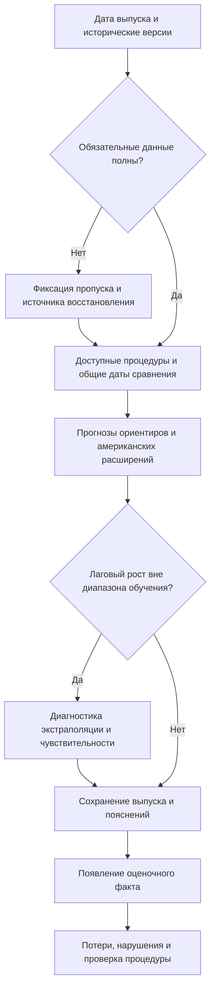

# Глава 3. Рекомендации по использованию финансовых условий США в мониторинге рисков роста еврозоны

Результаты прогнозного эксперимента позволяют определить условия, при которых американская финансовая информация может использоваться в анализе рисков роста еврозоны. В исходной спецификации включение NFCI и ANFCI снижает среднюю квантильную потерю относительно европейской модели AR + ESI. Вместе с тем это преимущество зависит от реакции базовой регрессии на экстремальный лаговый рост и не сопровождается устойчивым превосходством над простыми ориентирами. Поэтому практическое применение результатов требует внимания к устройству всей прогнозной процедуры: составу информации, способу формирования прогноза и правилам последующей оценки его качества.

Основным адресатом рекомендаций является макроэкономический аналитик, подготавливающий квартальную записку о рисках роста еврозоны для руководителя аналитического подразделения. Его задача — представить сопоставимые оценки нижней границы роста, объяснить расхождения моделей и определить, какие результаты требуют дополнительной проверки перед использованием в общем экономическом обзоре. Такой выбор адресата конкретизирует практическое применение исследования: итогом становится аналитический выпуск с проверяемой информационной основой. Решения о ставке центрального банка, кредитовании отдельных заёмщиков или составе инвестиционного портфеля остаются за пределами оцениваемой задачи. В главе предлагаются порядок подготовки выпуска, два его исторических примера и условия пересмотра прогнозной процедуры.

## 3.1. Экономическое значение американских финансовых сигналов для оценки рисков роста еврозоны

Для аналитика еврозоны американские финансовые показатели представляют интерес как сведения о внешней среде финансирования. Международная переоценка риска может отражаться на ценах активов в разных странах, а стоимость долларовых средств — на положении посредников, участвующих в трансграничном кредитовании. Исследование S. Miranda-Agrippino и H. Rey связывает идентифицированные изменения денежно-кредитной политики США с международной динамикой финансового рычага, кредитных потоков и цен активов [9]. Работа V. Bruno и H. S. Shin раскрывает передачу финансовых условий через балансы глобальных и местных банков [12]. Для настоящего исследования это экономическое основание наблюдать американский финансовый блок при оценке европейских рисков.

В аналитической записке предлагается различать наблюдаемое финансовое состояние, модельную оценку роста и объяснение предполагаемого механизма. Значение NFCI или ANFCI характеризует соответствующий американский информационный блок. Прогноз десятого процентиля показывает результат его использования в выбранной спецификации. Утверждение о передаче риска через конкретный канал потребовало бы отдельных данных о кредитовании, стоимости финансирования или балансах. Такая последовательность позволяет содержательно комментировать международные взаимосвязи, сохраняя границы выполненной модели. Коэффициент при индексе и разность прогнозов не являются оценками воздействия отдельного решения Федеральной резервной системы.

Агрегированный выпуск еврозоны также задаёт уровень допустимых выводов. В записке можно обсуждать совокупную нижнюю границу роста валютного союза, но её нельзя переносить на отдельную страну или отрасль без собственной проверки. Для международно-экономической интерпретации полезно обозначать, какое звено передачи требует уточнения: внешнее фондирование, переоценка активов либо реакция европейской активности. Если прямых наблюдений о звене нет, в выпуске фиксируется открытый вопрос. Это делает комментарий содержательнее общего утверждения о влиянии США и одновременно показывает, какие дополнительные сведения действительно помогли бы аналитику.

Дополнительность американского показателя определяется относительно доступной европейской информации. ESI и лаговый рост могут уже отражать часть новостей о внешней среде. Предположение о таком пересечении представляет возможное объяснение, которое отдельно не идентифицировалось. Проверяемый в работе результат относится к конкретному набору переменных: улучшается ли прогноз после добавления индекса при сохранении остальных правил сравнения. Поэтому оценка индекса должна сопровождаться указанием базы и горизонта, по отношению к которым обнаружен выигрыш.

Выбор базы существенно меняет ответ. В исходном расширяющемся эксперименте NFCI и ANFCI уменьшают потерю AR + ESI примерно на 9% на горизонте одного квартала; на четырёхквартальном горизонте выигрыш составляет 23,2 и 42,5%. После ограничения экстремального текущего роста потеря самой европейской базы снижается на 26,3 и 51,5%, и американские расширения уже уступают ей [^calc3-3]. Для квартальной записки это означает, что процента улучшения одной модели недостаточно. Рядом необходимо показывать качество простых ориентиров и результат диагностики базы. Вывод о компенсации неустойчивой экстраполяции поддерживается проведённой проверкой; точная доля выигрыша, связанная с этим механизмом, не оценивалась.

NFCI и ANFCI следует сохранять отдельными вариантами внешнего сигнала. Учитываемая в ANFCI обычная связь финансовых переменных с активностью и инфляцией меняет его экономическое содержание; одновременно различаются оценённые веса, поэтому разность индексов не выделяет чистый макроэкономический компонент [7; 51]. Практическая записка должна сообщать, совпадают ли выводы двух расширений. Если они расходятся, предпочтение одному из них требует объяснения через ранее накопленное качество и свойства конкретного набора информации. Одного названия «скорректированный индекс» для такого выбора недостаточно.

Собственный результат о смене ранжирования NFCI и ANFCI при использовании поздних версий определяет требование к воспроизводимости записки. Американский показатель должен сопровождаться датой версии и фактическим охватом наблюдений. Это согласуется с постановкой A. J. Amburgey и M. W. McCracken, рассматривающих прогнозное содержание финансовых индексов с учётом пересмотров [30]. Если современная история изменяет оценку прошлой модели, аналитик сохраняет первоначальный выпуск и отдельно описывает результат пересмотра. Аналогично проверка первых двух месяцев показывает роль охвата, но не устраняет все различия календарей. Для пользователя существенно понимать, какая именно информация создала расхождение прогнозов.

Десятый процентиль в записке обозначается как модельная оценка нижней границы роста, с указанием горизонта и годовой логарифмической шкалы. Его отрицательное значение не сообщает точную вероятность рецессии. Вопрос о качестве этой границы решается по потерям и калибровке, а не по её внешней убедительности. Показателен период 2022–2025 годов: при 16 и 13 прогнозах по двум горизонтам у исходных моделей нет нарушений границы [^calc3-6]. Меньшая потеря на таком отрезке показывает более близкое положение границы к реализовавшемуся росту снизу, но не способность обнаруживать фактические пересечения нижнего хвоста. Этот смысл должен сохраняться в кратком комментарии для руководителя.

Практическая роль американского блока в итоге определяется двумя разными действиями. Его значения наблюдаются и объясняются как часть внешней финансовой среды. Его включение в основной численный прогноз проверяется относительно европейских и простых ориентиров. Такое разграничение позволяет продолжать исследовать международные сигналы при отсутствии устойчивого выигрыша конкретного расширения и не превращает результат одного благоприятного эпизода в рекомендацию постоянно выбирать эту модель.

На имеющихся результатах оправдан именно параллельный аналитический выпуск. Исследование не обосновывает автоматическое повышение веса американского блока в итоговом прогнозе и не оценивает оптимальные веса объединения моделей. HIST следует сохранять как обязательный ориентир, а европейскую базу и американские расширения — показывать для объяснения зависимости результата от текущих сигналов. Если пользователю нужен один итоговый квантиль, выбор основной процедуры необходимо обосновать отдельно: среднее или медиана пяти оценок не наследует автоматически калибровку уровня 0,10.

Таблица 3.1. Эмпирические результаты и рекомендации по использованию финансовых индикаторов США

| Результат исследования | Аналитическое значение | Рекомендация | Граница применения |
| --- | --- | --- | --- |
| Американские расширения улучшают исходную AR + ESI, но проигрывают ей после ограничения экстремального роста | Выигрыш зависит от устойчивости базы | Использовать несколько ориентиров и диагностику экстраполяции | Эффективность ограничения роста на новых прогнозах не установлена |
| Поздние версии индексов меняют ранжирование NFCI и ANFCI | Версия данных влияет на содержательный вывод | Сохранять исходные версии и отдельно оценивать пересмотры | Современная история не воспроизводит прошлый информационный набор |
| Сокращение охвата до двух месяцев сохраняет исходный выигрыш | Третий месяц не является необходимым условием выигрыша | Раскрывать охват и проверять его влияние | Все различия календарей этим не устранены |
| Результаты различаются по горизонтам и по частоте нарушений | Средняя потеря не исчерпывает свойства прогноза | Оценивать каждый горизонт и калибровку отдельно | Наблюдаемое преимущество одного горизонта не переносится на другой |
| Устойчивое превосходство американских расширений статистически не подтверждено | Выбор единственного победителя недостаточно обоснован | Сохранять параллельное сравнение и показывать неопределённость | Отсутствие подтверждения не устанавливает равенства моделей |

Источник: составлено автором по результатам главы 2.

Американские индикаторы, таким образом, сохраняют содержательное место в наблюдении за внешней финансовой средой еврозоны. Их роль в основном количественном прогнозе должна определяться дополнительной проверкой относительно достаточно устойчивой европейской процедуры. Такая постановка позволяет связать международно-экономическую мотивацию с фактическим качеством прогноза и задаёт основу для предлагаемого порядка мониторинга.

## 3.2. Организация мониторинга рисков роста с учётом финансовых условий США

Практическая организация мониторинга должна приводить к определённому аналитическому продукту. Предлагается квартальный выпуск, в котором макроэкономический аналитик представляет руководителю прогнозы на один и четыре квартала, объясняет существенные расхождения и отмечает, какой вывод достаточно обоснован для общего обзора. Приоритетом является возможность восстановить информационную основу каждого вывода. Если качество отдельного прогноза вызывает сомнение, аналитик фиксирует причину и дополнительную проверку, сохраняя исходное значение в сравнении.

Первый этап заключается в формировании исторически определённого информационного набора. Для европейского блока необходимы версия реального ВВП, доступный лаговый рост и значения ESI, включаемые в квартальный агрегат. Для американского блока сохраняются NFCI и ANFCI с датами наблюдений и версиями публикации. По каждому источнику необходимо различать период измерения, дату публичной доступности и дату получения данных исследователем. Такая запись особенно важна для пересматриваемых рядов: файл, загруженный сегодня, может содержать значения, которых не было в момент прежнего прогноза. Подход следует из устройства использованных баз ЕЦБ и ALFRED и из результатов проверки версий во второй главе [47; 52; 53].

Для продолжения сопоставимого эксперимента целесообразно сохранить дату выпуска — пятнадцатый календарный день после окончания исходного квартала. Европейский снимок должен удовлетворять ограничениям по дате фиксации и публичной доступности, применённым в главе 2. Американские индексы берутся в версии на конец квартала. В ESI включаются первые два месяца, а в исходный американский агрегат — допустимые недельные наблюдения с семидневным запасом между датой наблюдения и концом квартала [^calc3-8]. Этот календарь имеет ценность как единое правило сравнения; он намеренно не использует все публикации, которые могли появиться к дате выпуска.

При переходе к более оперативному набору данных потребуется выделить новую прогнозную процедуру. Например, включение третьего месяца ESI или более позднего американского выпуска изменит информационные преимущества модели. Такой вариант можно исследовать, но его результаты следует хранить отдельно от исходной последовательности. В противном случае изменение качества будет трудно связать с конкретной причиной: новым показателем, более свежими сведениями или пересмотренной историей. Разделение процедур делает календарь экономически содержательной частью модели.

Между квартальными выпусками возможно наблюдение за недельными значениями NFCI и ANFCI. В предлагаемой организации это отдельный информационный обзор: он фиксирует движение индексов и вопросы, требующие дальнейшего анализа. Перенос квартальной регрессии на еженедельный выпуск означал бы изменение частоты прогнозирования и способа обращения с неодновременным обновлением данных. Такая модель в работе не оценивалась. Поэтому недельный комментарий и квартальная количественная оценка должны иметь ясно обозначенные даты и задачи.

Второй этап включает проверку полноты и сопоставимости информации. Если один из двух необходимых месяцев ESI отсутствует, нельзя незаметно заменять двухмесячное среднее единственным наблюдением. Аналогично требуется фиксировать пропуски недель американского индекса и изменения состава исходной истории. В исследовании отдельные архивные значения восстанавливались по опубликованным материалам ЕЦБ. Для практического продолжения предлагается сохранять источник такого восстановления и его основание. Когда восстановление невозможно, прогноз, требующий отсутствующего показателя, отмечается как недоступный; сравнение моделей проводится на явно указанном общем наборе дат. Прогнозы остальных процедур при этом могут сохраняться отдельно.

Третий этап — получение сопоставимых оценок. В основном наборе остаются исторический квантиль HIST, авторегрессионная модель AR, европейская AR + ESI и два её американских расширения. Все процедуры должны использовать одинаковое определение будущего роста, допустимые обучающие цели и общий календарь в пределах каждого горизонта. Регрессии необходимо сравнивать при одинаковой доступности факта в обучении. Пересчёт одной модели по поздним данным при сохранении исторического набора у другой изменил бы предмет сравнения и мог бы создать ложное впечатление преимущества.

Оценки на один и четыре квартала предлагается представлять в отдельных частях выпуска. Короткий горизонт характеризует ближайшую динамику, тогда как четырёхквартальная цель охватывает накопленное изменение выпуска за более продолжительный интервал. Их нельзя объединять в один показатель качества без дополнительного определения весов и практической задачи. При сопоставлении сохраняется принятое в исследовании годовое выражение логарифмических темпов. В частности, прогноз одноквартального роста в годовом выражении не следует описывать как буквальное процентное изменение уровня ВВП за три месяца.

Четвёртый этап направлен на выявление неустойчивой экстраполяции. Для текущего лагового роста проверяется его положение относительно диапазона допустимого обучающего окна. При выходе за границы требуется показать, насколько этот предиктор влияет на прогноз и как меняется оценка при диагностическом ограничении. Событие выхода за диапазон не означает ошибочности самого наблюдения: необычное значение может быть корректным отражением экономической динамики. Поэтому исходные данные сохраняются, а результат чувствительности публикуется рядом с исходным прогнозом. Решение об изменении постоянной рабочей процедуры должно приниматься отдельно.

Применение диагностики не предполагает автоматической замены исходного прогноза. В реконструированном выпуске за январь 2021 года, приведённом ниже, текущий лаговый рост многократно превышает прежнюю верхнюю границу обучения. Это основание проверить зависимость результата от экстраполяции. В выпуске за январь 2025 года та же проверка не обнаруживает выхода за диапазон. Она отвечает на конкретный вопрос об одном регрессоре и не служит общим свидетельством надёжности всей модели.

При этом исторический минимум и максимум не являются экономическими пределами будущего роста. В новом режиме ограничение может подавить полезную информацию о необычном, но содержательном изменении. Поэтому в предлагаемом мониторинге ему отводится диагностическая роль. Сама процедура позволяет увидеть зависимость прогноза от предположения о продолжении прежней линейной связи за наблюдавшийся диапазон. Для превращения этой диагностики в постоянное правило требуется последующая проверка, рассмотренная в параграфе 3.3.

Пятый этап связан с интерпретацией расхождений моделей. Если американское расширение даёт существенно иную границу, сначала проверяются технические основания: версия индекса, его охват, наличие пропусков и положение текущих предикторов относительно обучения. После этого обсуждается экономическая интерпретация. Возможные направления анализа включают изменение внешних условий финансирования и согласованность американского сигнала с европейскими настроениями. Величина расхождения сама по себе не идентифицирует внешний шок и не даёт оснований приписать изменение прогноза отдельному международному механизму.

При разборе расхождений следует учитывать, что добавление индекса меняет оценку всех коэффициентов. Снижение прогноза американского расширения поэтому нельзя автоматически назвать отрицательным вкладом американских условий. Во второй главе для января 2021 года непосредственное слагаемое индекса положительно, хотя общий прогноз расширения ниже прогноза европейской базы [^calc3-9]. В записке корректно описывать различие между двумя спецификациями и отдельно обсуждать возможные экономические объяснения.

Рисунок 3.1. Порядок формирования и последующей проверки квартальной оценки рисков роста

Источник: разработано автором; схема предлагаемой организации анализа.

Итогом квартального цикла становится краткий аналитический документ. В нём необходимо указать дату выпуска, исходный квартал, целевой интервал и горизонт, использованные версии и фактический охват данных. Затем представляются прогнозы пяти процедур, отметка о необычных предикторах и комментарий к расхождениям. Если рассчитан диагностический вариант, он получает отдельное обозначение. Диапазон оценок разных моделей показывает чувствительность к спецификации; без специального вероятностного обоснования его нельзя называть доверительным или прогнозным интервалом.

Ключевой вывод записки целесообразно формулировать в трёх предложениях: какие сигналы дают доступные европейские и американские показатели; как изменяется оценка риска между сопоставимыми процедурами; какое основание имеется для доверия к этому различию. Например, сочетание мягких американских условий с низким ESI описывает несовпадение финансового и конъюнктурного сигналов, но не даёт само по себе основания повысить итоговую оценку роста. Такой порядок делает международный комментарий связанным с наблюдаемыми данными и качеством модели.

После появления оценочного факта в сохранённый выпуск добавляются потери и сведения о нарушении границы. Исходный прогноз остаётся неизменным. Основная оценка должна сохранять принятое во второй главе определение факта с ограниченной зрелостью — версию, выбираемую по установленному правилу примерно через шесть месяцев после конца целевого интервала. Сопоставление с поздней историей ВВП ведётся дополнительно [^calc3-10]. Это позволяет отделить собственно прогнозную ошибку от последующего изменения статистического измерения выпуска.

Реконструированные выпуски позволяют проследить предложенный порядок на сохранённых данных. Для этого выбраны 15 января 2021 года — ранее выявленный случай экстремальной экстраполяции — и 15 января 2025 года, последняя общая дата с оценимыми целями обоих горизонтов в зафиксированной выборке. Первый пример выбран намеренно для диагностики, второй — по календарному признаку. Это не независимая проверка и не подбор двух победителей: представлены все пять исходных моделей, а факт отделён от информации прогнозной даты. Тексты комментариев составлены в рамках исследования как реконструкция; они не выдаются за документы, реально выпущенные в 2021 и 2025 годах [^calc3-16].

Таблица 3.2. Информационная часть реконструированных квартальных выпусков

| Показатель | 15.01.2021 | 15.01.2025 |
| --- | --- | --- |
| Исходный квартал | 2020Q4 | 2024Q4 |
| Последний известный квартал ВВП | 2020Q3 | 2024Q3 |
| Дата регулярного выпуска этого ВВП | 08.12.2020 | 06.12.2024 |
| Фиксация европейского снимка / публикация бюллетеня | 09.12.2020 / 07.01.2021 | 11.12.2024 / 09.01.2025 |
| Лаговый рост, годовая логарифмическая шкала, % | 47,01 | 1,64 |
| Месяцы ESI | 2020-10; 2020-11 | 2024-10; 2024-11 |
| Даты публикаций этих месяцев ESI | 29.10.2020; 27.11.2020 | 30.10.2024; 28.11.2024 |
| Среднее ESI | 89,35 | 95,75 |
| Версия NFCI и ANFCI | 31.12.2020 | 31.12.2024 |
| Последняя использованная неделя обоих индексов | 18.12.2020 | 20.12.2024 |
| Квартальные средние NFCI / ANFCI | −0,542 / −0,504 | −0,575 / −0,621 |
| Диапазон лагового роста в обучении, h=1 | [−15,20; 4,93] | [−47,25; 44,09] |
| Выход текущего роста за этот диапазон | Да | Нет |

Примечание. Исторические данные представлены в версии, использованной в исследовании. Сопоставлены исходные квартальные агрегаты, без сокращения охвата до M2. Числа индексов округлены только для представления. Источник: расчёты автора по сохранённым календарям [^calc3-16].

Различие между датой фиксации европейского снимка и датой публикации бюллетеня видно в обоих выпусках. Например, данные, зафиксированные 11 декабря 2024 года, использованы из бюллетеня, опубликованного 9 января 2025 года. Это раньше выбранной даты прогноза 15 января. Месяцы ESI и использованные недели американских индексов также известны к соответствующей дате. Следовательно, последующий факт ВВП не нужен для составления информационной части карточки.

Таблица 3.3. Прогнозы десятого процентиля в реконструированных выпусках

| Модель | 15.01.2021, h=1 | 15.01.2021, h=4 | 15.01.2025, h=1 | 15.01.2025, h=4 |
| --- | ---: | ---: | ---: | ---: |
| HIST | −1,20 | −1,04 | −1,05 | −1,05 |
| AR | 36,72 | 22,34 | −0,94 | −0,89 |
| AR + ESI | 28,05 | 46,17 | −0,83 | −0,93 |
| AR + ESI + NFCI | 13,25 | 5,08 | −0,16 | 0,49 |
| AR + ESI + ANFCI | 12,91 | 4,71 | −0,23 | 0,78 |

Примечание. Расширяющееся окно, исходная процедура Q_raw. Все значения — проценты в годовой логарифмической шкале. Цели h=1 — I квартал соответствующего года; h=4 — интервал с I по IV квартал. Здесь показаны прогнозы, без использования последующего факта. Источник: сохранённые расчёты автора [^calc3-16].

Для 15 января 2021 года допустим следующий комментарий, основанный только на реконструированной информации прогнозной даты: «Лаговый рост составляет 47,01% в годовой логарифмической шкале при верхней границе одноквартального обучающего диапазона 4,93%. Все регрессии дают положительную нижнюю границу, тогда как HIST — отрицательную. Прогнозы AR и AR + ESI требуют проверки экстраполяции. Американские расширения уменьшают величину границы относительно AR + ESI, но общий результат зависит от оценивания всей спецификации. В обзор следует включить расхождение моделей и его источник; вывод о надёжно исключённом снижении выпуска не обоснован».

Конкретное действие аналитика здесь состоит в проверке вклада лагового роста и в отказе от представления исходной европейской регрессии как единственной опорной оценки. Отрицательные уровни индексов характеризуют более мягкие условия относительно соответствующих ориентиров; направление их изменения в этой карточке отдельно не анализируется. Разницу между прогнозами также нельзя отождествить с ужесточением американской финансовой среды. Позднее предложенное ограничение роста даёт для AR + ESI значения 0,61 и 3,71% по двум горизонтам. Эти величины публикуются как ретроспективная чувствительность; они не включаются задним числом в комментарий, якобы сформированный в январе 2021 года.

Для 15 января 2025 года комментарий имеет другое содержание: «Текущий рост находится внутри обучающего диапазона; экстраполяции по этому признаку не обнаружено. На одноквартальном горизонте все пять нижних границ отрицательны. На четырёхквартальном горизонте американские расширения дают положительные значения 0,49 и 0,78%, а европейские ориентиры — отрицательные. Включение американского блока смягчает модельную оценку нижнего риска. Расхождение знаков следует вынести в обзор как чувствительность к информационному набору, сохраняя обе группы оценок».

В этом случае задача аналитика — объяснить различие горизонтов и сопоставить внешний финансовый блок с европейской информацией. Значение ESI 95,75 ниже его долгосрочного ориентира 100, а средние NFCI и ANFCI отрицательны. Это позволяет обозначить сочетание относительно слабых европейских настроений и мягких по соответствующим определениям американских условий. Оно не устанавливает причинный источник расхождения прогнозов. Выбор только положительной четырёхквартальной границы исключил бы из обзора существенную зависимость вывода от модели. При этом нахождение роста внутри диапазона не исключает ошибок в других переменных или в форме связи.

После публикации оценочного факта карточка получает отдельную часть с потерями. Даты в таблице 3.4 позднее прогнозных дат, поэтому эти результаты не используются в предыдущих комментариях. Единичный победитель приводится для проверки того, что произошло в конкретном выпуске; он не определяет заранее выбор модели для следующего квартала.

Таблица 3.4. Последующая оценка выбранных выпусков по факту с ограниченной зрелостью

| Дата прогноза / h | Целевой интервал | Оценочный факт, % | Публикация оценочной версии | Наименьшая потеря среди пяти исходных моделей | Потеря |
| --- | --- | ---: | --- | --- | ---: |
| 15.01.2021 / 1 | 2021Q1 | −1,15 | 23.09.2021 | HIST | 0,0051 |
| 15.01.2021 / 4 | 2021Q1–2021Q4 | 4,54 | 23.06.2022 | AR + ESI + ANFCI | 0,1581 |
| 15.01.2025 / 1 | 2025Q1 | 2,24 | 25.09.2025 | AR + ESI + NFCI | 0,2396 |
| 15.01.2025 / 4 | 2025Q1–2025Q4 | 1,21 | 25.06.2026 | AR + ESI + ANFCI | 0,0432 |

Примечание. Ранжирование относится к одной дате и одному горизонту, а не ко всей выборке. Оценочный факт имеет установленную в исследовании ограниченную зрелость; это не первая публикация ВВП и не современная окончательная история. Потеря рассчитана по неокруглённым значениям. Источник: расчёты автора [^calc3-16].

В январском выпуске 2021 года HIST оказывается лучшим на коротком горизонте, а ANFCI — на четырёхквартальном. Преимущество ANFCI в этом отдельном сравнении совместимо с его проигрышем HIST по средней потере всей выборки. Ограничение роста уменьшает одноквартальную потерю AR + ESI с 26,2814 до 1,5859, но не устраняет нарушение границы: оценочный факт −1,15% остаётся ниже диагностического прогноза 0,61%. На четырёхквартальном горизонте для ANFCI ограничение, напротив, увеличивает потерю с 0,1581 до 0,3492. Поэтому один и тот же способ ограничения не следует автоматически считать улучшением каждого расширения на каждой дате.

В выпуске 2025 года NFCI имеет наименьшую потерю на один квартал, а ANFCI — на четыре квартала. Факт находится выше всех исходных границ, поэтому нарушений нет. Американские расширения в данном случае проводят границу ближе к реализовавшемуся росту, однако наблюдение не проверяет их способность распознавать пересечение нижнего хвоста. Ограничение роста не меняет ни одного из этих прогнозов. Для следующего выпуска разумно сохранить результат как одно наблюдение в общей последовательности качества, не заменяя им вывод по всей выборке.

Оба примера показывают конкретный результат применения предложенного порядка: в первом случае выявляется риск механической экстраполяции, во втором — зависимость знака четырёхквартальной границы от выбранного информационного блока. Аналитик получает разные основания для комментария и сохраняет прозрачную последующую оценку. Из этих иллюстраций не следует измеренный экономический эффект внедрения системы, но видно, какие недостаточно обоснованные выводы она помогает обнаружить: уверенность в высокой нижней границе после экстремального отскока и представление одного благоприятного расширения как согласованного сигнала всех моделей.

## 3.3. Оценка надёжности прогнозных сигналов и условия пересмотра моделей

Регулярное получение прогнозов имеет практический смысл, если сопровождается последовательной оценкой их качества. В противном случае аналитик может выбирать модель по отдельному удачному эпизоду или по соответствию ожидаемой экономической истории. Для рассматриваемой задачи предлагается заранее определить главный горизонт, основной показатель потерь, набор ориентиров и порядок анализа ошибок. В исследовании основным является горизонт в один квартал, а четырёхквартальный результат используется дополнительно. Такое разграничение следует сохранять при дальнейшем накоплении прогнозов, чтобы выбор предпочтительного горизонта не зависел от получившегося ранжирования.

Для руководителя аналитического подразделения полезно разделить два вопроса: какой прогноз точнее по принятому критерию и достаточно ли устойчиво это преимущество для изменения рабочего выпуска. Первый вопрос оценивается квантильной потерей, соответствующей прогнозируемому десятому процентилю [40]. Второй требует анализа распределения ошибок, калибровки и неопределённости сравнения. Их последовательное рассмотрение не позволяет объявить предпочтительной модель, которая выиграла на одной дате, как в приведённых карточках, но пока не показала надёжной дополнительности в общей оценке.

Средняя потеря должна рассматриваться вместе с распределением ошибок по времени. Для каждой пары моделей полезно сохранять последовательность разностей потерь и показывать, какая часть итогового разрыва приходится на отдельные даты. Дополнительно можно указывать число прогнозов, на которых одна процедура лучше другой, и результат диагностического исключения каждого наблюдения. Эти характеристики помогают отличить частый небольшой выигрыш от компенсации нескольких крупных ошибок. При этом основной результат сохраняет все допустимые даты: редкие неблагоприятные исходы составляют сам предмет анализа рисков. Удаление неудобного эпизода ради более привлекательной средней потери изменило бы задачу исследования.

Оценка нарушений должна давать аналитику основание для дальнейшего действия. Если они концентрируются в определённых состояниях экономики, требуется проверить, не даёт ли процедура систематически завышенную нижнюю границу именно при таких условиях. Если нарушений на коротком отрезке нет, предпочтение более высокой границе по потерям ещё не подтверждает распознавание хвостовых событий. Для более строгой проверки условного покрытия методологическим ориентиром является работа V. Corradi, J. Fosten и D. Gutknecht; её специальная процедура в настоящем исследовании не выполнялась [42]. Предлагаемый выпуск должен сохранять последовательность ошибок, необходимую для такой последующей проверки.

Для объяснения крупных ошибок полезно также показывать разложение квантильной потери на вклад нарушений и остальных исходов, применённое в параграфе 2.3. Оно сообщает, проигрывает ли модель из-за частых или глубоких завышений границы либо из-за чрезмерно осторожных прогнозов на других датах. Эта диагностика использует все наблюдения с одним знаменателем и не подменяет итоговую потерю выбором наиболее благоприятной группы ошибок. Для годового горизонта результат дополняется проверкой последовательностей неперекрывающихся целей, сохраняя оговорку об их малом числе.

Эмпирические результаты показывают необходимость этой дополнительной характеристики. В объединённой проверке с двухмесячными индексами и ограничением роста частоты нарушений NFCI составляют 25,9 и 43,6% на двух горизонтах, тогда как для ANFCI — 12,1 и 16,4% [^calc3-3]. Эти значения нельзя заменить общим утверждением, что американские расширения одинаково хорошо отражают нижний хвост. Вместе с тем близость ANFCI к номинальному уровню на коротком горизонте не устанавливает его условную калибровку. Различие между качеством по потерям и свойствами нарушений должно сохраняться и в аналитическом выводе, и в последующем выборе модели.

При выборе постоянной процедуры следует учитывать неопределённость сравнительных оценок. Имеются 58 и 55 вневыборочных прогнозов; четыре квартала целевого интервала создают перекрытие соседних целей. Вспомогательные результаты скользящего окна не устанавливают устойчивого превосходства американских расширений после поправки на множественные сравнения [^calc3-13]. Для текущей организации выпуска это означает сохранение параллельных ориентиров. Ни один из победителей отдельных карточек не получает автоматически статус основной модели.

При последующем пересмотре процедуры аналитик должен указать, какое сравнение обосновывает решение: горизонт, способ обучения, ориентир и информационный набор. Результаты фиксированного скользящего окна в использованной постановке Giacomini–White не обосновывают тот же вывод для расширяющегося окна [43]. Изменение правила на основании одного благоприятного теста при множестве рассмотренных вариантов требует отдельной проверки. Поэтому новая версия выпуска получает собственное описание, а её качество накапливается рядом с прежней процедурой.

Для рабочего выпуска предлагается различать три основания действий. Ошибка или неполнота входной информации требует исправления источника либо прозрачного обозначения недоступности прогноза. Чувствительность к экстраполяции или расхождение знаков между корректно рассчитанными моделями требует аналитического комментария и дополнительной проверки, сохраняя результаты сравнения. Изменение постоянной прогнозной процедуры требует заранее описанного кандидата и последующей оценки его качества. Это классификация действий аналитика, а не шкала тяжести макроэкономического риска. Она позволяет связать каждое выявленное обстоятельство с определённым решением.

Таблица 3.5. Основания для проверки и пересмотра прогнозной процедуры

| Наблюдаемая проблема | Необходимая проверка | Возможное действие | Требуемое подтверждение |
| --- | --- | --- | --- |
| Текущий рост выходит за диапазон обучения | Вклад регрессора и чувствительность к ограничению | Публикация диагностического варианта и проверка формы зависимости | Качество зафиксированного изменения на новых прогнозах |
| Выигрыш имеется только над одной европейской базой | Сравнение с HIST, AR и устойчивостью европейской спецификации | Пересмотр обоснования дополнительности индекса | Сохранение содержательного выигрыша относительно нескольких ориентиров |
| Нарушения границы концентрируются в отдельных состояниях | Хронология ошибок и условное покрытие | Проверка калибровки и причин систематических отклонений | Улучшение соответствующих свойств при приемлемой квантильной потере |
| Изменяется методика или история индекса | Сопоставимость версий и вклад пересмотров | Выделение новой версии прогнозной процедуры | Отдельная оценка без подмены ранее сохранённых прогнозов |
| Преимущество зависит от одной даты или настройки | Влияние наблюдений, интервалы и заранее заданные проверки | Сохранение нескольких ориентиров и осторожного вывода | Последующее подтверждение устойчивости на новых наблюдениях |
| Для отдельных дат отсутствует обязательный показатель | Причина пропуска и состав доступных моделей | Прозрачное обозначение пропуска или документированное восстановление | Сопоставимость данных и общий набор дат для парной оценки |

Источник: разработано автором на основе результатов главы 2. Таблица задаёт основания для аналитической проверки; универсальные численные пороги принятия решений в исследовании не устанавливались.

Для ограничения экстремального роста особенно важна независимая последующая проверка. Правило было предложено после обнаружения проблемной экстраполяции и оценено на уже известном историческом периоде. Прозрачность его определения и одинаковое применение к регрессиям делают диагностику содержательной, но не устраняют ретроспективный характер решения. Поэтому предлагается зафиксировать правило до формирования новых прогнозов, сохранять рядом исходную и диагностическую процедуры и оценивать их по общему календарю появления факта. Если правило меняется после очередной ошибки, такое изменение должно получать новую дату начала проверки.

Уже накопленная история при этом остаётся описательным материалом; она не объявляется новой независимой выборкой. Вывод об ограниченной устойчивости исторического преимущества и решение о будущем внедрении процедуры относятся к разным этапам оценки.

Независимость последующего этапа определяется порядком принятия решений. Формальное выделение части уже изученной истории недостаточно, если её результаты повлияли на выбор спецификации. Более убедительная проверка предусматривает сохранение прогнозов до реализации целевых значений и отсутствие последующей корректировки этих прогнозов. Для четырёхквартального горизонта требуется учитывать не только время ожидания факта, но и перекрытие соседних целей. Поэтому быстрое накопление большого числа выпусков не гарантирует столь же быстрого увеличения информации о редких событиях.

Решение о включении американского индекса в основной прогноз должно учитывать величину выигрыша, его неопределённость и практическую устойчивость. Возможен результат, при котором средняя потеря немного уменьшается, но улучшение сопровождается ухудшением калибровки или сильной зависимостью от версии. В таком случае требуется содержательная оценка компромисса. Аналогично небольшое преимущество сложной процедуры может не оправдывать дополнительные затраты на получение исторических данных и поддержку расчёта. В настоящей работе такие организационные затраты и денежная ценность прогноза не измерялись, поэтому количественная оценка эффективности внедрения не приводится.

В дальнейшем следует сохранять простую последовательность приоритетов. Первым направлением является накопление новых прогнозов по уже определённым правилам. Вторым — более строгая оценка калибровки и статистическое сравнение, согласованное с вложенностью моделей, способом обучения и пересмотрами данных. Третьим — исследование отдельных международных каналов с использованием соответствующих показателей и самостоятельной идентификационной стратегии. Последнее направление может уточнить, почему финансовая информация США полезна в одних состояниях и мало добавляет в других, но требует иной эмпирической постановки. Оно не заменяет проверку качества текущего агрегированного прогноза.

Такой порядок соответствует более общему вопросу литературы о Growth-at-Risk: в какой мере обнаруженные связи сохраняют полезность при прогнозировании за пределами обучающей выборки. Работа M. Plagborg-Møller и соавторов рассматривает именно проблему оценки предсказуемости распределения роста с использованием финансовой информации [26]. Результаты настоящего исследования дополняют эту постановку прикладным сравнением двух американских индикаторов для еврозоны. Их практическое значение заключается в выявлении условий, от которых зависит вывод о дополнительности, и в формировании проверяемого порядка работы с такими сигналами.

**Выводы по третьей главе**

Американская финансовая информация имеет содержательное основание для включения в наблюдение за внешней средой еврозоны. Международная переоценка риска и трансграничное финансирование объясняют экономический интерес к NFCI и ANFCI, однако выполненная модель оценивает их прогнозное содержание, сохраняя границы причинной интерпретации. Практический вывод зависит от качества европейского ориентира: после диагностики экстремального лагового роста средний выигрыш американских расширений над базой исчезает. Поэтому выбор одного индекса как безусловно предпочтительного инструмента оценки рисков роста не обоснован.

Предложена организация квартального мониторинга для макроэкономического аналитика, подготавливающего записку о рисках роста еврозоны. В двух реконструированных выпусках показаны доступные данные, прогнозы всех исходных моделей, допустимый комментарий и отдельно — последующая оценка по факту. Пример января 2021 года выявляет риск экстремальной экстраполяции; пример января 2025 года показывает расхождение знаков четырёхквартальной границы при отсутствии выхода текущего роста за обучающий диапазон. Эти случаи демонстрируют применение рекомендаций, сохраняя статус ретроспективных иллюстраций.

Условия пересмотра моделей связаны с конкретными источниками нестабильности: экстремальными предикторами, пересмотрами индексов, качеством базы и калибровкой нижней границы. Последующая проверка зафиксированных процедур должна предшествовать сильным заявлениям об их устойчивом преимуществе. Тем самым рекомендации сохраняют международно-экономический смысл исследования и соответствуют объёму эмпирических свидетельств, полученных во второй главе.
