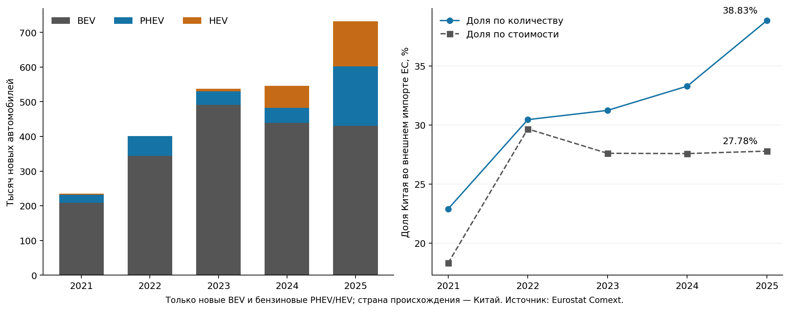
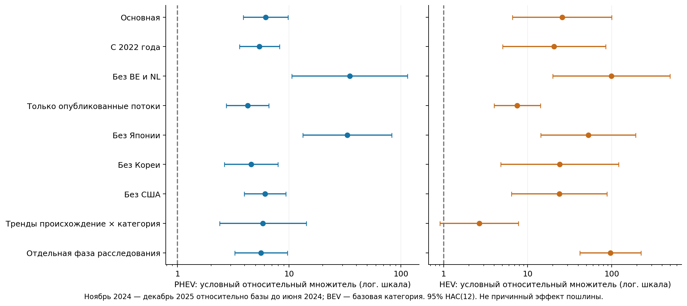
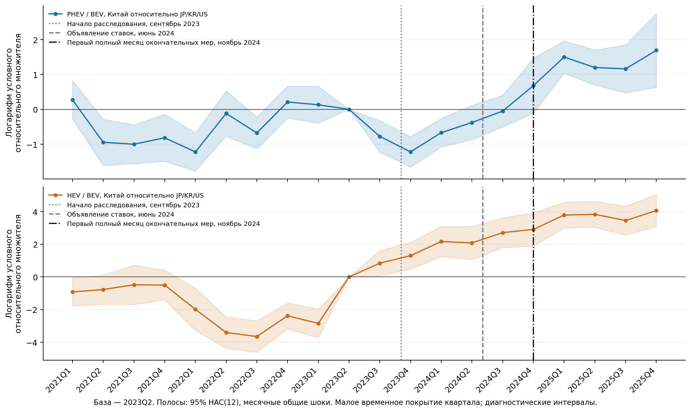

# Автомобильная тема: итог полного расчёта

Дата: 26 октября 2026 года. Назначение документа — принять решение о теме по данным и моделям. Это расчётная записка, а не текст статьи.

## 1. Решение

**Тему оставляем. Данных и полученных результатов достаточно, чтобы переходить к прикладной эмпирической статье о товарной адаптации китайских поставок в ЕС.** Исследовательская база собрана и рассчитана; новой загрузки для решения о выборе темы не требуется.

Рабочее название: **«Товарная адаптация китайских поставок новых электромобилей и бензиновых гибридов в ЕС: количество, стоимость и география ввоза»**.

Основной результат — увеличение физической доли Китая при почти неизменной стоимостной доле, связанное с расширением гибридных поставок и изменением мест таможенного ввоза. Условная перестройка в сторону PHEV сохраняет направление во всех оценимых заранее намеченных проверках. Размер коэффициента меняется существенно. Для HEV величина и значимость не выдерживают включения трендов так же уверенно.

**Формат «причинный эффект пошлин» эта проверка не поддерживает.** Предшествующая динамика неоднородна, единого нетронутого контроля нет, один общеевропейский эпизод не становится 27 независимыми экспериментами. Это конкретная граница выбранного дизайна, а не незавершённый сбор данных.

## 2. Какие данные фактически рассчитаны

- Eurostat Comext DS-045409, месяцы с января 2021 по декабрь 2025.
- 27 стран ЕС постоянного состава; происхождение — Китай, Япония, Республика Корея, США.
- Новые BEV (87038010), новые бензиновые PHEV (87036010), новые бензиновые HEV (87034010).
- Количество автомобилей и таможенная стоимость в евро. Дополнительно получены агрегаты EU27_2020 и EXT_EU27_2020 для проверки и знаменателей; они не добавлены как страны в регрессию.
- Полная национальная сетка модели: **19440 потоков**, каждый с двумя показателями. Все 27 стран сохраняются в основной оценке.
- Исходный API-ответ содержит 50400 ячеек показателей, включая контрольные агрегаты; опубликовано 29544. У самой национальной модельной сетки 9490 положительных и 9950 нулевых потоков.

API не публикует явные числовые нули. Они не заменены нулями механически: для каждого сочетания происхождения, товара, месяца и показателя сумма опубликованных значений всех 27 членов **точно** совпала с агрегатом ЕС из того же ответа; все значения неотрицательны, флагов нет. При этих условиях остаток для неопубликованных членов равен нулю. Исходное отсутствие и способ восстановления сохранены в отдельных столбцах CSV. Это нули, согласованные с опубликованной таблицей Comext, а не независимая гарантия отсутствия любой неучтённой торговли. Строго опубликованная выборка проверена отдельно; она включает 100% положительной массы торговли, но исключает нулевые возможности и потому меняет объект оценки.

Неразрешённых пропусков в выбранной сетке: **0**. Дубликатов: 0. Расхождений национальных сумм и агрегатов: 0. Случаев положительной стоимости при нулевом количестве: 0; обратных случаев: 0.

Выгрузка: 2026-10-26T11:56:16.188755+00:00; версия источника: 2026-10-16T11:00:00+0200. SHA-256 исходного ответа: `908c5cd39456c3f6e51d6117e1ddf510b7bcb4707658dffe37f5aae02497cec0`. Запрос, контрольная сумма и исходный JSON находятся в `data/full_raw/`.

«Из Китая» — происхождение машины, включая иностранные марки, произведённые в Китае. Импортёр — место таможенной регистрации, которое может отличаться от страны конечной продажи. Охват ограничен тремя кодами новых машин; это не все автомобили и не розничные регистрации. Средняя таможенная стоимость не является ценой постоянного качества. Данные 2026 года не включались в основной период и не подбирались по знаку результата.

## 3. Фактическая динамика

| Год | BEV, шт. | PHEV, шт. | HEV, шт. | Всего, шт. | Стоимость, млрд евро | Доля Китая по количеству, % | Доля по стоимости, % |
|---|---:|---:|---:|---:|---:|---:|---:|
| 2023 | 491 165 | 38 931 | 7 028 | 537 124 | 12,277 | 31,23 | 27,60 |
| 2024 | 439 419 | 42 587 | 63 830 | 545 836 | 11,102 | 33,28 | 27,57 |
| 2025 | 430 616 | 171 348 | 130 347 | 732 311 | 11,731 | 38,83 | 27,78 |

Обе доли рассчитаны среди внешних поставщиков ЕС и только внутри трёх выбранных категорий. Например, физическая доля выросла в 2023–2025 годах на 7,60 п.п., стоимостная — на 0,19 п.п. Количество китайских машин выросло на 36,34%, их суммарная стоимость сократилась на 4,44%. За 2024–2025 годы PHEV выросли в 4,02 раза, HEV — в 2,04 раза, BEV сократились на 2,00%. 2024 год уже содержит меры, поэтому это не чистое сравнение «до/после».

## 4. Основная модель и интервалы

Оценена PPML условного среднего:

`E(Y_mopt | X, FE) = exp(alpha_mop + delta_mpt + gamma_ot + sum_h,k beta_hk * CN_o * hybrid_h,p * phase_k,t)`.

Индексы: m — страна ввоза, o — происхождение, p — категория, t — месяц. Постоянные эффекты: импортёр × происхождение × категория; импортёр × категория × месяц; происхождение × месяц. BEV — базовая категория. Последние эффекты поглощают общие для категорий месячные изменения происхождения; отдельный абсолютный эффект мер на весь китайский импорт здесь не идентифицируется.

Фазы: июнь 2024; июль–октябрь 2024; ноябрь 2024–декабрь 2025. База основной модели — месяцы до июня 2024, включая расследование; отдельная проверка выделяет сентябрь 2023–май 2024. Окончательные меры действуют с 30 октября, поэтому первый полный месяц — ноябрь.

Основные оценки используют **14733 наблюдения**. Из начальной сетки исключены 4707 нулевых наблюдений в полностью нулевых группах постоянных эффектов; положительные потоки не удалены. Дополнительная линейная программа не обнаружила оставшейся сепарации. Количество и стоимость имеют одну и ту же основную выборку.

В таблице — множители условного относительного сдвига гибридов к BEV для Китая относительно сравниваемых происхождений в окончательной фазе. Например, 6,17 **не означает**, что пошлина увеличила продажи PHEV в 6,17 раза. Это коэффициент выбранного условного соотношения, а не фактический темп роста и не причинный эффект.

| Категория | Количество: оценка и 95% HAC(12) | Стоимость: оценка и 95% HAC(12) | Количество: блочный интервал, 6 мес. | Количество: блочный интервал, 12 мес. |
|---|---:|---:|---:|---:|
| PHEV / BEV | 6,17 [3,90; 9,77] | 6,42 [4,40; 9,37] | [4,31; 10,02] | [4,52; 12,52] |
| HEV / BEV | 25,77 [6,61; 100,49] | 21,59 [4,85; 96,17] | [10,80; 101,31] | [11,00; 99,37] |

HAC построен по суммам эффективных скор-функций за каждый месяц, синхронно по всем странам; использованы Bartlett-лаги 6 и 12, множитель T/(T−k) и критическое t(T−1). Полные результаты обеих длин лагов сохранены. Блочная проверка — положительные экспоненциальные веса непрерывных временных блоков со случайным смещением, общие для всех поперечных наблюдений, с полной повторной оценкой PPML. Выполнены 398 успешных пересчётов из 398 (199 для каждой длины); неудачных: 0. Это анализ чувствительности к зависимости во времени, не рандомизационный тест.

При 60 месяцах и 14 месяцах окончательной фазы интервалы остаются приближёнными. Они не корректируют смещение от большого числа постоянных эффектов и не учитывают всю неопределённость выбора условной модели. Четыре происхождения — небольшой набор сравнения; это не полноценная глобальная гравитационная сеть.

## 5. Устойчивость и слабые места

Количество; в скобках 95% HAC(12). Все оценимые заранее намеченные варианты показаны, включая неудобные результаты.

| Проверка | PHEV / BEV | HEV / BEV |
|---|---:|---:|
| Окно с 2022 года | 5,43 [3,59; 8,22] | 20,64 [5,03; 84,66] |
| Исключены BE и NL | 34,83 [10,58; 114,60] | 99,58 [19,95; 497,10] |
| Только явно опубликованные потоки | 4,25 [2,74; 6,59] | 7,51 [3,98; 14,18] |
| Без Японии | 33,15 [13,30; 82,61] | 52,73 [14,36; 193,63] |
| Без Кореи | 4,58 [2,64; 7,93] | 24,12 [4,80; 121,06] |
| Без США | 6,09 [3,96; 9,35] | 23,79 [6,41; 88,32] |
| Тренды происхождения × категории | 5,83 [2,39; 14,23] | 2,66 [0,91; 7,79] |
| Отдельная фаза расследования с сентября 2023 | 5,61 [3,27; 9,64] | 96,78 [41,78; 224,20] |

Вывод: **направление PHEV устойчиво, единая точная величина эффекта — нет**. Исключение Японии и исключение BE/NL существенно увеличивают множитель. Следовательно, нельзя выбирать самый большой коэффициент или называть 6,17 универсальной эластичностью. Для HEV включение трендов даёт интервал, содержащий 1; устойчивое статистически выделенное изменение поверх собственного тренда не подтверждено.

Для стоимости также оценены окно с 2022 года, исключение BE/NL и строго опубликованные потоки. Их численные результаты вместе со всеми фазами находятся в `results/full/model_coefficients.csv`, а не скрыты за одной основной оценкой.

Проверка только непрерывно положительных 60-месячных направлений **не идентифицирует полную модель**: остаётся 52 направлений, но нет ни одного непрерывно положительного китайского HEV-направления. Причина и исходные направления сохранены в `continuing_observed_units.csv`, `observability_details.json`, `fit_errors.json`. Эта проверка выполнена до установления неидентифицируемости; коэффициент для неё не подставлялся и ограничение не выдаётся за пройденный тест.

### Предшествующая динамика

Динамическая PPML оценена по кварталам с базой 2023Q2. Лиды заметно отличаются от нуля, особенно для HEV; усиление HEV видно уже в конце 2023 — начале 2024 года. Совместные асимптотические тесты 18 предшествующих коэффициентов дают крайне малые p, но множество лидов при трёх месяцах на коэффициент делает такой тест ненадёжным в малой временной выборке. Он сохранён как предупреждающая диагностика, а не как точная вероятность причинного вывода.

Более узкий тест линейных трендов до сентября 2023 года не отвергает их совместное равенство нулю: количество p=0,168 при HAC(6) и 0,157 при HAC(12), стоимость p=0,111 и 0,146. Это не доказательство параллельности: тест ловит только линейное изменение, имеет небольшую мощность и не устраняет наблюдаемую нелинейную динамику. Поэтому причинная формулировка не принимается даже при статистически заметной основной оценке PHEV.

## 6. Бухгалтерские разложения: что именно изменилось

Доля Китая представлена как сумма по категориям `S = sum_p w_p * s_p`, где w — вес категории во всём внешнем импорте ЕС, s — китайская доля внутри неё. Симметричное разложение использует средние веса двух концов; взаимодействие делится поровну.

2023–2025, процентные пункты:

| Показатель | Изменение доли Китая | Изменение долей внутри категорий | Изменение структуры всего внешнего импорта |
|---|---:|---:|---:|
| Количество | 7,60 | 10,89 | -3,29 |
| Стоимость | 0,19 | 4,90 | -4,71 |

В физическом выражении усиление Китая внутри категорий было больше итогового прироста доли: общая структура европейского импорта сдерживала его на 3,29 п.п. В стоимости внутрикатегорийный вклад +4,90 п.п. почти полностью компенсирован структурным вкладом −4,71 п.п. Покатегорийные вклады и альтернативная база 2024 сохранены в `accounting_decompositions.json`.

Дополнительно рассчитано трёхфакторное разложение Шепли `S = sum_m a_m sum_p b_mp s_mp`: a — вес места ввоза, b — структура категорий внутри места, s — китайская доля внутри пары «место–категория». Все шесть порядков замены усреднены. Вклады в п.п.:

| Период | Показатель | Географическая структура ввоза | Категории внутри места ввоза | Доля Китая внутри места и категории | Всего |
|---|---|---:|---:|---:|---:|
| 2023–2025 | Количество | -0,35 | -1,66 | 9,61 | 7,60 |
| 2024–2025 | Количество | -0,36 | 1,75 | 4,16 | 5,55 |
| 2023–2025 | Стоимость | 0,01 | -4,00 | 4,18 | 0,19 |
| 2024–2025 | Стоимость | -0,70 | -0,15 | 1,06 | 0,21 |

Есть единичные годовые ячейки с нулевым знаменателем. Для них условная доля принята равной нулю, но отдельно рассчитаны границы каждого компонента при произвольной ненаблюдаемой доле от 0 до 1. Разброс менее 0,005 п.п.; экономический вывод не зависит от этого соглашения. Компонентные границы нельзя одновременно суммировать как один сценарий. Поимпортёрные и товарные вклады доступны в `shapley_member_category_contributions.csv`.

География изменилась существенно: доля BE/NL в китайском PHEV-ввозе уменьшилась с 88,44% до 41,00%, в HEV — с 95,89% до 10,46% (2023–2025). HHI мест ввоза PHEV снизился с 0,787 до 0,258, HEV — с 0,920 до 0,166. Это расширение географии таможенного оформления, а не автоматически рост конечного спроса в тех же странах. Географический вклад в общую долю и концентрация китайских потоков измеряют разные стороны изменения и не должны отождествляться.

Наконец, точное разложение изменения стоимости китайских поставок `V = sum_p q_p * u_p` даёт за 2023–2025 годы: +4,549 млрд евро от изменения количеств при средних unit values и −5,094 млрд от изменения средних unit values при средних количествах; всего −0,546 млрд евро. Второй компонент включает смену моделей и качества внутри CN8, оценку трансфертов и другие изменения таможенной стоимости. Называть его чистым снижением цен или эффектом переноса тарифа нельзя.

Бухгалтерские разложения — тождества опубликованной торговли; для них не изобретаются выборочные интервалы. Разложения географии и стоимости добавлены после основного расчёта как описательная диагностика, а не заявлены внешне пререгистрированными причинными тестами.

## 7. Проверка реализации

- PPML сошлись; максимальная нормированная ошибка условий первого порядка основных моделей менее 2×10⁻¹². Проверены ранг остаточных регрессоров и отсутствие оставшейся сепарации линейной программой.
- Независимый расчёт с явными разреженными дамми и SciPy LSMR совпал с поглощением эффектов на агрегатной задаче (720 наблюдений) с максимальным расхождением коэффициента 9.71e-11.
- Вторая независимая проверка на национальной задаче BE/DE (1440 наблюдений, в том числе 162 нуля) дала расхождение 2.18e-09.
- Умножение зависимой переменной на 1000 не меняет интересующие коэффициенты (ошибка менее 10⁻⁹).
- Разложения доли и Шепли складываются с ошибкой менее 10⁻¹⁰ п.п.; разложение стоимости — с ошибкой менее 0,01 евро.
- Самостоятельная реализация IRLS не выдаётся за запуск пакета Stata ppmlhdfe. Методические источники и ограничения собраны в `method_sources.json`.

Всего оценено 17 спецификаций и отдельно зафиксирована одна неидентифицируемая предусмотренная проверка. Блочные пересчёты учтены отдельно. Скрипт `validate_full_outputs.py` проверяет сохранённый комплект и исходные контрольные суммы.

## 8. Что составляет вклад и насколько тема подходит

Ближайшая бакалаврская работа Ke (2026) исследует отдельный BEV-поток. Более сильный близкий ориентир — Barwick et al., NBER WP35334 (2026): модель спроса и благосостояния, а также синтетический контроль суммарных BEV/PHEV-регистраций существовавших моделей пяти китайских марок в шести странах ЕС. Наши пограничные потоки включают новые модели и иностранные марки китайского происхождения; результаты по ним не равны оценке регистраций постоянного набора марок. Поэтому новизну нельзя обосновывать только добавлением PHEV. Dou et al. (2026), IMF WP24/218 и USITC WP2024–05–A преимущественно решают сценарные и модельные задачи. Minondo (2024) уже показывает сам механизм адаптации к тарифам через изменение поставок на другом эпизоде. Поэтому новизна не в утверждении «фирмы могут переключиться на гибриды» и не в смене периода.

Содержательный собственный результат этого проекта — совместное измерение трёх технологий, расхождения физической и стоимостной долей, различия PHEV/HEV после учёта трендов и географии ввоза, с явной оценкой чувствительности. Это достаточная эмпирическая основа для студенческой научной работы и прикладной статьи по международной торговле. Она не равна разработке новой эконометрической теории и не поддерживает сильный причинный тезис о размере эффекта пошлин.

Полные тексты основных сопоставленных работ и глубина их просмотра отмечены в `literature/source_manifest.json`. Дополнительный поиск 26.10.2026 выявил NBER WP35334: полный первичный PDF получен, рассмотрены данные, европейская оценка и приложение. Ещё один обзорный кандидат 2025 года через страницу издателя не получен (403); статус отражён в `literature/search_update_2026-10-26.json`. Утверждение мирового приоритета не делается. Это ограничение литературного поиска, а не препятствие расчёту текущей эмпирической конструкции.

**Расчётная развилка закрыта: тема пригодна в формате наблюдаемой товарной адаптации. Центральный тезис будущего текста — рост физического присутствия без сопоставимого усиления стоимостной доли, а не доказанная эффективность или неэффективность пошлин.** Для подготовки текста можно использовать уже сохранённые таблицы, оценки и диагностику. Статья в рамках этого задания не написана.

## 9. Навигация и источники

- `full_model_spec.json` — датированный внутренний план до полной выгрузки и оценивания; не внешняя пререгистрация.
- `data/full_raw/eurostat_full.json`, `request.json` — неизменённый ответ и запрос.
- `results/full/panel.csv`, `coverage.csv`, `adding_up_audit.csv`, `data_audit.json` — панель и проверки.
- `results/full/model_coefficients.csv` и 17 JSON моделей — все численные оценки и оба HAC.
- `results/full/block_bootstrap_draws.json`, `block_bootstrap_summary.json` — каждый из 398 пересчётов и интервалы.
- `results/full/accounting_decompositions.json`, `china_value_change_accounting.json`, `entry_concentration.csv` — все разложения и география.
- `results/full/numerical_validation*.json`, `output_validation.json` — проверки воспроизводимости и численных тождеств.
- `requirements_full.txt` — версии зависимостей; команды воспроизведения — в README.

Первичные источники: [Eurostat Comext API](https://ec.europa.eu/eurostat/api/comext/dissemination/statistics/1.0/data/DS-045409); [метаданные Eurostat](https://ec.europa.eu/eurostat/cache/metadata/en/ext_go_detail_sims.htm); [Correia, Guimarães, Zylkin, 2019](https://arxiv.org/abs/1903.01690); [документация авторов ppmlhdfe](https://scorreia.com/help/ppmlhdfe.html); [Weidner, Zylkin, 2021](https://arxiv.org/abs/1909.01327). Источники по мерам и товарному охвату: `policy_and_data_sources.json` и исходный паспорт в README.
