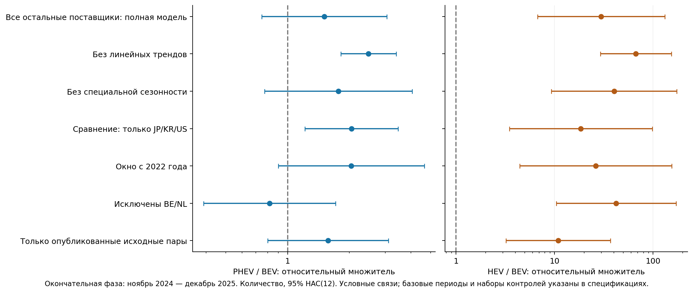
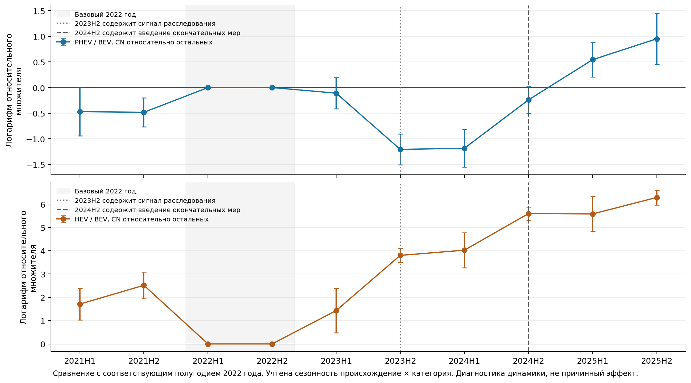

# Пересмотр модели и исследовательского акцента

Дата: 26.10.2026. Это методическая и расчётная записка. План глав — в `WORK_PLAN_3_CHAPTERS.md`; текст глав не написан.

## 1. Что изменилось в выводе

**Завершён дополнительный ограниченный цикл: 18 спецификаций,398 парно согласованных блочных пересчётов, независимая проверка модели на полной информативной панели.** Исходные 17 спецификаций и данные сохранены без замены.

Ранее для PHEV в трёхэффектной модели с JP/KR/US получался множитель 6,17. После расширения ориентира сравнения, выделения фазы расследования, добавления специфической сезонности и трендов предпочтительная оценка количества равна **1,510**, HAC(12)95% **[0,748; 3,050]**, блочный интервал **[0,705; 4,393]**. Поэтому прежнее утверждение об устойчивом отдельном PHEV-сдвиге нельзя переносить на расширенный дизайн.

Фактический рост PHEV, расхождение физических и стоимостных долей и перестройка мест оформления остаются наблюдаемыми результатами. Исследование следует строить вокруг **товарной и географической адаптации и границ её модельной интерпретации**, а не вокруг единственной большой оценки причинного тарифного эффекта.

## 2. Почему выбрана эта спецификация

1. Сравнение только с тремя происхождениями заметно влияло на величину коэффициентов. Основной ориентир теперь — весь остальной внешний импорт ЕС, `REST = EXT_EU27_2020 − CN`. Это широкий сравнительный набор, а не гарантированно нетронутый контроль.
2. Введены эффекты «происхождение × категория × календарный месяц»: сезонность китайского PHEV/BEV-соотношения может отличаться от сезонности других поставщиков.
3. Включены линейные тренды по происхождению и категории; ранний сигнал расследования с сентября 2023 выделен отдельно. Формальное расследование началось в октябре; название модельной фазы охватывает и объявление.
4. Географическая неоднородность оценивается взаимодействиями для BE/NL и остальных 25 стран с собственными трендами. Простое удаление стран оставлено проверкой.

Дизайн выбран по обнаруженным пропускам контроля до новых фазовых оценок. Это **пересмотр после первоначального анализа**, не внешняя пререгистрация. Первоначальный внутренний план сохранён в `augmented_model_spec_initial.json`; итоговый — в `augmented_model_spec.json`.

Потребовалась одна техническая поправка динамической нормировки: эффекты календарного месяца и полная полугодовая динамика не идентифицируются с одним опущенным полугодием. В диагностике опущены оба полугодия 2022 — последний полный год до сигнала расследования; сравниваются соответствующие календарные половины. Ошибка ранга и исходный план сохранены. Предпочтительные фазовые коэффициенты от этой поправки изменились на **0**.

## 3. Данные и объект оценки

Использована прежняя проверенная выгрузка Eurostat 2021–2025; новых запросов торговых данных не потребовалось. Две группы происхождения ×27 импортёров ×3 категории ×60 месяцев: **9720 потоков**. Для каждого есть количество и стоимость. Остатки REST неотрицательны; Китай+REST точно восстанавливают внешний импорт ЕС. Неразрешённых пропусков нет.

После удаления полностью нулевых отделённых групп основная PPML содержит **8500 потоков**. Внутри них **264 одиночные строки** не дают информации о структурных коэффициентах: после профилирования общего эффекта их итог подгоняется точно. Информативная часть — **4118 пар «импортёр–категория–месяц»**, или 8236 строк происхождения. Положительные потоки при проверке отделимости не удалялись.

Источник измеряет страну таможенного оформления и происхождение автомобиля. Это не география конечного спроса, не национальность марки и не физическая трасса через порт. Три кода новых машин не охватывают весь рынок автомобилей. CN8 шире юридического `ex`-охвата меры; фирменные ставки и модели автомобилей не наблюдаются.

## 4. Модель можно объяснить как модель долей

Для каждого импортёра m, категории p и месяца t вычисляется доля Китая:

`s_mpt = Y_CN,mpt / (Y_CN,mpt + Y_REST,mpt)`.

Предпочтительная PPML с эффектом «импортёр × категория × месяц» имеет эквивалентное представление:

`logit(s_mpt) = a_mp + g_t + k_p,calendar_month + trend_p * t + sum_phase beta_p,phase * I(phase)`.

BEV — базовая категория; её тренд и фазовые изменения поглощаются общим месячным компонентом. Доли взвешиваются общим внешним импортом соответствующей ячейки. Количество и стоимость дают две отдельные модели. Для евро это квазиправдоподобие, денежные единицы не объявляются независимыми испытаниями.

Множитель `exp(beta_PHEV,phase)` описывает относительное изменение соотношения PHEV/BEV у Китая по сравнению с остальными внешними поставщиками при указанных контролях. Он не равен процентному изменению рыночной доли, росту фактических продаж или абсолютному эффекту на весь китайский экспорт.

Это известное преобразование multinomial–Poisson, а не новый метод. Самостоятельный Newton-расчёт долей на полной информативной панели воспроизвёл PPML-коэффициенты с ошибкой менее 10⁻¹¹ и HAC-ковариации с ошибкой менее 2×10⁻¹¹. Совпадение подтверждает реализацию и интерпретацию; оно не создаёт причинной идентификации. Подробности — `conditional_share_equivalence.json`, методические источники S29–S30.

## 5. Основные числа

Окончательная фаза: ноябрь 2024–декабрь 2025; базовые месяцы — январь 2021–август 2023, с трендом и сезонностью. Интервалы в таблицах приблизительные, условные на спецификации.

| Категория | Зависимая величина | Множитель и 95%HAC(12) | Парный блочный 95%-интервал |
|---|---|---: |---: |
| PHEV | Количество | 1,510 [0,748; 3,050] | [0,705; 4,393] |
| PHEV | Стоимость | 2,312 [0,996; 5,370] | [0,822; 6,976] |
| HEV | Количество | 29,788 [6,729; 131,874] | [6,938; 249,773] |
| HEV | Стоимость | 17,047 [3,682; 78,934] | [3,122; 98,273] |

**PHEV:** дополнительный фазовый сдвиг сверх включённых трендов и сезонности устойчиво не выделяется ни в количестве, ни в стоимости. Это совместимо с большим наблюдаемым ростом: фактическое изменение и условное отклонение от модельной траектории — разные величины.

**HEV:** поздние условные ассоциации велики, но интервалы очень широки. В старой проверке с другим набором фаз и трендов интервал HEV включал 1; поэтому формулировка «универсальный устойчивый эффект» также неприемлема. Ранняя динамика и низкая база имеют большое значение.

Все фазы, чтобы результат не ограничивался удобным поздним периодом:

| Категория | Фаза | Количество | Стоимость |
|---|---|---: |---: |
| PHEV | Сигнал/расследование 09.2023–05.2024 | 0,224 [0,156; 0,323] | 0,281 [0,188; 0,419] |
| PHEV | Объявление 06.2024 | 0,706 [0,496; 1,003] | 0,755 [0,533; 1,068] |
| PHEV | Временные меры 07–10.2024 | 0,410 [0,214; 0,786] | 0,494 [0,233; 1,046] |
| PHEV | Окончательная фаза 11.2024–12.2025 | 1,510 [0,748; 3,050] | 2,312 [0,996; 5,370] |
| HEV | Сигнал/расследование 09.2023–05.2024 | 6,260 [2,064; 18,988] | 6,687 [2,214; 20,200] |
| HEV | Объявление 06.2024 | 14,230 [3,940; 51,391] | 10,476 [2,322; 47,267] |
| HEV | Временные меры 07–10.2024 | 17,111 [5,306; 55,185] | 9,604 [2,891; 31,907] |
| HEV | Окончательная фаза 11.2024–12.2025 | 29,788 [6,729; 131,874] | 17,047 [3,682; 78,934] |

## 6. Устойчивость

Количество, окончательная фаза:

| Вариант | PHEV/BEV | HEV/BEV |
|---|---: |---: |
| Предпочтительная | 1,510 [0,748; 3,050] | 29,788 [6,729; 131,874] |
| Без линейных трендов | 2,484 [1,819; 3,391] | 67,009 [29,247; 153,527] |
| Без специальной сезонности | 1,769 [0,772; 4,057] | 40,252 [9,323; 173,790] |
| Только JP/KR/US, остальные контроли сохранены | 2,051 [1,214; 3,464] | 18,529 [3,494; 98,272] |
| С 2022 года | 2,047 [0,901; 4,648] | 26,289 [4,458; 155,030] |
| Без BE/NL | 0,817 [0,389; 1,716] | 42,321 [10,415; 171,962] |
| Только опубликованные исходные пары | 1,575 [0,800; 3,103] | 10,892 [3,213; 36,924] |

Состав контроля, сезонность, тренды и география меняют численную интерпретацию. Значения разных спецификаций нельзя объявлять оценками одной неизменной «истинной величины тарифа»: отличаются базовые фазы и условные сравнения. Для публикации предпочтительный вариант выбран заранее по логике контроля, остальные показывают его границы. Подбирать победивший вариант по p-value не следует.



Полугодовая диагностика сравнивает 2021H1/H2 и 2023H1 с соответствующим полугодием 2022. Совместные асимптотические проверки шести предшествующих взаимодействий дают p<0,001 в обеих зависимых величинах. При короткой временной опоре это предупреждающий диагностический тест, а не точный экспериментальный уровень ошибки. График также показывает, почему одной линейной поправки недостаточно для утверждения параллельности.



## 7. Географическая неоднородность

Отношение условных окончательных множителей «остальные 25 / BE+NL» из одной модели с взаимодействиями; интервалы используют ковариацию двух коэффициентов, а не вычитание независимых интервалов:

| Категория | Показатель | Отношение множителей | 95%HAC(12) |
|---|---|---: |---: |
| PHEV | Количество | 0,587 | [0,082; 4,199] |
| HEV | Количество | 58,697 | [3,777; 912,298] |
| PHEV | Стоимость | 0,234 | [0,049; 1,107] |
| HEV | Стоимость | 76,995 | [4,569; 1 297,633] |

Для PHEV различие групп в этой модели статистически не выделяется уверенно. Для HEV относительный контраст велик, но его точность низкая. Группы отражают юрисдикции оформления; это не доказательство разных тарифных воздействий на конечных потребителей.

Точное разложение роста по странам оформления,2023–2025:

| Категория | Активных стран | Общее изменение, машин | Изменение в продолжающих направлениях | Новые положительные направления | Исчезнувшие направления |
|---|---: |---: |---: |---: |---: |
| BEV | 26→26 | -60 549 | -60 549 | 0 | -0 |
| PHEV | 14→21 | 132 417 | 118 810 | 13 607 | -0 |
| HEV | 15→22 | 123 319 | 113 282 | 10 043 | -6 |

Большая часть прироста гибридов приходится на страны, где поставки уже были положительны в 2023. Число стран расширяется, но само появление новых стран не объясняет весь рост. Это **страны оформления**, а не вход новых фирм, моделей или клиентов.

## 8. Количество, стоимость и рекомендации

Одинаковые месячные веса в 199 блочных повторениях обеих моделей позволяют проверить отношение их относительных множителей:

| Категория | Множитель стоимости / множитель количества | Парный блочный 95%-интервал |
|---|---: |---: |
| PHEV | 1,531 | [1,099; 1,868] |
| HEV | 0,572 | [0,289; 0,745] |

Это отношение двух условных индексов средних, а не `E[value/quantity]`, не очищенная цена и не оценка переноса пошлины. Оно показывает, что количественный и стоимостной результаты нельзя механически считать одним каналом.

Для третьей главы дополнительно подготовлены механические сценарии экспозиции к 10% и 25% ограничению оформления в BE/NL при фиксированной структуре 2025. Они измеряют долю статистически экспонированных потоков. Это не прогноз потерь продаж и не модель закрытия физических портов: разрешено перенаправление или нет — отдельное допущение, в текущей арифметике реакции нет. Сценарии служат иллюстрацией мониторинга концентрации, а не основанием для оптимальной ставки тарифа.

## 9. Литература и исследовательский вклад

Собрана карта 31 научной/учебной работы и 10 официальных источников. Различаются эмпирические статьи, сценарные модели, комментарии, рабочие статьи и две студенческие работы. Для каждой указан уровень доступа и фактически выполненного чтения.

Дополнительный поиск выявил близкий комментарий Dou et al.(2026), Joule, DOI 10.1016/j.joule.2026.102486. Основной полный текст в текущем доступе не получен; известны первичные метаданные и отдельные подписи приложений. Нельзя утверждать, что в нём отсутствует пересечение с нашей конструкцией. Поэтому приоритет открытия гибридной адаптации или связи количества и стоимости не заявляется. Работы Ke, NBER 35334, DouNatureEnergy также обязательно сопоставляются напрямую.

Самостоятельный проверяемый вклад нынешнего проекта — совместная бухгалтерская и условная модельная оценка товарной/географической перестройки, роль продолжающих направлений и чувствительность распространённого тарифного прочтения к сравнению и контролям. Основная доказательная часть не зависит от попытки получить значимость PHEV.

## 10. Проверки и воспроизведение

Все 18 спецификаций сошлись; 398 блочных оценок успешны. Проверены исходные суммы, неотрицательность REST, отделимость нулевых групп, условия первого порядка, тождества страновых вкладов, эквивалентность первоначального алгоритма и независимое решение с явными разреженными эффектами. Максимальная нормированная ошибка скор-функций: 1.80e-12. Модель долей отдельно проверила полную информативную панель.

HAC учитывает общие месячные шоки и серийную зависимость; синхронный блочный пересчёт не считает 27 стран независимыми мерами. В каждой схеме всего 60 месяцев и 14 окончательных месяцев. Приближённые интервалы не исправляют все смещения условной модели; аналитическая поправка из Weidner–Zylkin не заявляется выполненной. Никакая численная проверка не заменяет содержательные условия причинной идентификации.

```bash
OPENBLAS_NUM_THREADS=1 python research/04_auto_trade/run_augmented_model.py
OPENBLAS_NUM_THREADS=1 python research/04_auto_trade/run_augmented_model.py --bootstrap
OPENBLAS_NUM_THREADS=1 python research/04_auto_trade/run_augmented_model.py --validation
OPENBLAS_NUM_THREADS=1 python research/04_auto_trade/verify_conditional_shares.py
OPENBLAS_NUM_THREADS=1 python research/04_auto_trade/analyze_augmented.py
python research/04_auto_trade/build_literature_catalog.py
python research/04_auto_trade/write_model_revision.py
```

Зависимости прежние: `requirements_full.txt`. Локальный кэш `data/augmented_cache/` пересоздаётся и не нужен в GitHub. Сырые ответы и базовая панель находятся в прежних папках; новые 18 моделей, интервалы и разложения — в `results/augmented/`. Исходный расчётный документ сохранён как предыдущая контрольная точка; настоящая записка уточняет выбор предпочтительной спецификации и выводы.
