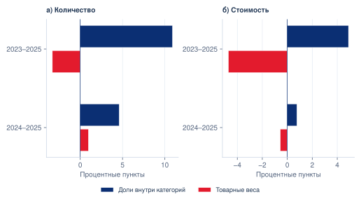
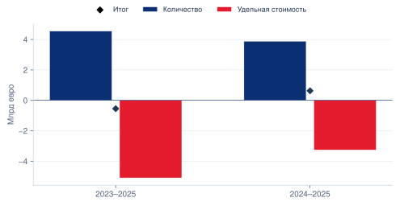
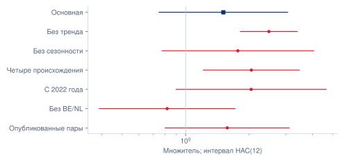
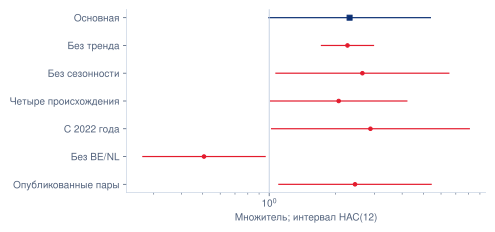
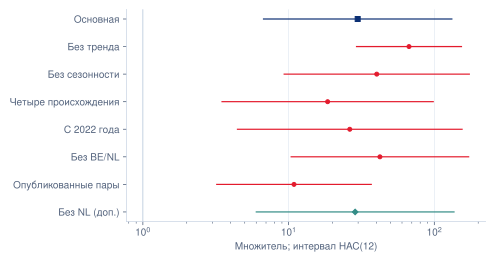
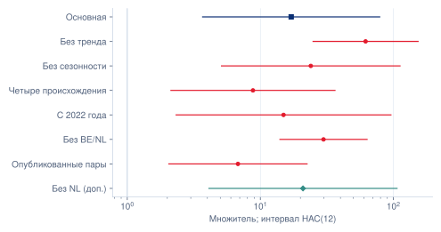
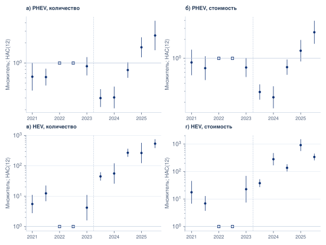
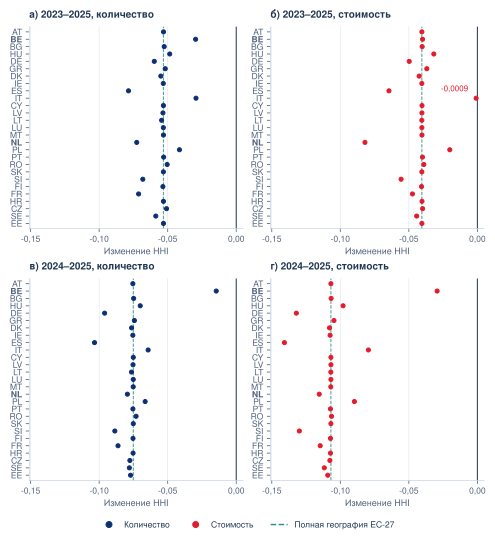

# Приложение А. Методы и дополнительные проверки второй главы

## А.1 Точные структурные разложения

Обозначения соответствуют параграфу 2.2. Индексы 0 и 1 обозначают начальный и конечный годы. Для совокупной доли применяется равенство:

\[
\Delta S=\sum_p\frac{w_{p1}+w_{p0}}2(s_{p1}-s_{p0})+
\sum_p\frac{s_{p1}+s_{p0}}2(w_{p1}-w_{p0}). \tag{А.1}
\]

Первое слагаемое — изменение долей Китая внутри технологий, второе — изменение весов технологий во всём внешнем импорте выбранных кодов. Для стоимости, где \(u_p=V_p/q_p\), используется:

\[
\Delta V=\sum_p\frac{u_{p1}+u_{p0}}2(q_{p1}-q_{p0})+
\sum_p\frac{q_{p1}+q_{p0}}2(u_{p1}-u_{p0}). \tag{А.2}
\]

Товарный и географический компоненты общего HHI определяются следующими формулами:

\[
\begin{aligned}
D_b&=\tfrac12[H(b_1,G_0)-H(b_0,G_0)+H(b_1,G_1)-H(b_0,G_1)],\\
D_G&=\tfrac12[H(b_0,G_1)-H(b_0,G_0)+H(b_1,G_1)-H(b_1,G_0)].
\end{aligned} \tag{А.3}
\]

Взаимодействие равно \(I=H(b_1,G_1)-H(b_1,G_0)-H(b_0,G_1)+H(b_0,G_0)\); каждый компонент включает половину \(I\). Компоненты относятся к выбранным состояниям и правилу симметричного распределения.[^C2SHAPLEY]

Для каждой технологии выделяются группа A (Бельгия и Нидерланды) и группа B (остальные 25 стран). Если \(z\) — доля A, \(h_A,h_B\) — HHI внутри групп после нормировки на их собственные итоги, то:

\[
H_p=z^2h_A+(1-z)^2h_B. \tag{А.4}
\]

Три компонента распределены усреднением всех шести порядков замены \(z,h_A,h_B\). Для стран с положительными поставками выделяются множества продолжающих C, новых N и исчезнувших X направлений:

\[
\Delta Q=\sum_{m\in C}(q_{m1}-q_{m0})+\sum_{m\in N}q_{m1}-\sum_{m\in X}q_{m0}. \tag{А.5}
\]

Страна N определяется относительно исходного года; формула не устанавливает фирменный вход. Во всех разложениях используются исходные значения до округления.[^C2GROUP][^C2ENTRY]

Рисунок А.1 — Компоненты изменения доли Китая при двух базах сравнения

Источник: Eurostat Comext; расчёты автора.

Рисунок А.2 — Количественный и удельный компоненты изменения стоимости

Источник: Eurostat Comext; расчёты автора.

## А.2 Проверка стоимостных данных Нидерландов

Независимая проверка напрямую извлекает 24 значения JSON-stat — два показателя за 12 месяцев 2025 года — по координатам частоты, страны, происхождения, кода, направления, показателя и месяца. Все значения совпадают с сохранённой панелью. Следовательно, низкое отношение стоимости к количеству BEV в Нидерландах не вызвано расхождением этой панели с сохранённым исходным ответом. Причина значений на уровне деклараций остаётся неизвестной.

Для определения влияния данного направления выполнена конечная описательная чувствительность: полная география, исключение Нидерландов, исключение Бельгии и Нидерландов. В каждом случае знаменатель внешнего импорта пересчитан для той же совокупности оставшихся стран. Это дополнительные описательные срезы; предпочтительная модель и исходные наблюдения сохранены.

Таблица А.1 — Географическая чувствительность количественных и денежных итогов за 2023–2025 годы

| География | Изменение физической доли, п.п. | Изменение денежной доли, п.п. | Темп стоимости, % |
| --- | --- | --- | --- |
| Полный ЕС-27 | 7,60 | 0,19 | -4,44 |
| Без Нидерландов | 7,66 | 1,29 | 2,88 |
| Без Бельгии и Нидерландов | 9,96 | 3,40 | 20,41 |

Источник: Eurostat Comext; расчёты автора. Изменения долей — процентные пункты, темп стоимости — проценты. Во всех трёх срезах физическая доля растёт сильнее денежной. Знак изменения совокупной стоимости зависит от охвата; уменьшение полной стоимости нельзя объявлять общим для любой географии.[^C2UNITFLAG]

## А.3 Полная спецификация и неопределённость

В формуле (2.4) основного текста использовано сокращение:

\[
F_{mopt}=\alpha_{mop}+\lambda_{mpt}+\gamma_{ot}+\sigma_{op,k(t)}, \tag{А.6}
\]

где \(k(t)\) — календарный месяц. Уравнения количества и стоимости оцениваются отдельно. Средние нормируются при вычислении; коэффициенты структурных взаимодействий от этого не меняются. PPML не требует считать денежную величину пуассоновской счётной переменной.[^C2PPML]

Оценка HAC строится по синхронным месячным суммам вкладов в условия оценивания, с весами Бартлетта, лагами 6/12, поправкой \(T/(T-k)\) по числу структурных параметров и критическим значением распределения Стьюдента при \(T-1\) степенях свободы. Дополнительно выполнены 199 положительных экспоненциально взвешенных оценок блоков длиной 12 месяцев со случайным сдвигом границ. Месячные веса одинаковы для двух исходов; сохранены все 398 успешных оценок. Интервалы по процентилям являются временной чувствительностью. Коррекция смещения от большого числа постоянных эффектов не реализована.[^C2MODEL]

Из 9 720 строк предпочтительной панели удалены 1 220 нулевых строк в группах эффектов с нулевыми итогами; положительные наблюдения не удалялись. Эквивалентное представление содержит 4 118 информативных пар и 264 неинформативные одиночные строки. Максимальное расхождение основных коэффициентов парного и исходного представлений меньше \(10^{-12}\); расхождения матриц HAC — порядка \(10^{-11}\). Независимая явная запись эффектов на подвыборке даёт расхождение коэффициентов менее \(10^{-9}\). Эти проверки характеризуют реализацию вычислений.[^C2AUDIT]

Таблица А.2 — Полный набор фазовых множителей предпочтительной модели

| Исход | Категория | Фаза | Множитель | HAC(12) |
| --- | --- | --- | --- | --- |
| Количество | PHEV | Сигнал/расследование | 0,224 | [0,156; 0,323] |
| Количество | PHEV | Объявление | 0,706 | [0,496; 1,003] |
| Количество | PHEV | Временная | 0,410 | [0,214; 0,786] |
| Количество | PHEV | Окончательная | 1,510 | [0,748; 3,050] |
| Количество | HEV | Сигнал/расследование | 6,260 | [2,064; 18,988] |
| Количество | HEV | Объявление | 14,230 | [3,940; 51,391] |
| Количество | HEV | Временная | 17,111 | [5,306; 55,185] |
| Количество | HEV | Окончательная | 29,788 | [6,729; 131,874] |
| Стоимость | PHEV | Сигнал/расследование | 0,281 | [0,188; 0,419] |
| Стоимость | PHEV | Объявление | 0,755 | [0,533; 1,068] |
| Стоимость | PHEV | Временная | 0,494 | [0,233; 1,046] |
| Стоимость | PHEV | Окончательная | 2,312 | [0,996; 5,370] |
| Стоимость | HEV | Сигнал/расследование | 6,687 | [2,214; 20,200] |
| Стоимость | HEV | Объявление | 10,476 | [2,322; 47,267] |
| Стоимость | HEV | Временная | 9,604 | [2,891; 31,907] |
| Стоимость | HEV | Окончательная | 17,047 | [3,682; 78,934] |

Источник: авторская PPML. Показаны HAC(12); блочные интервалы окончательной фазы приведены в таблице 2.5, всех фаз — в сохранённом реестре результатов.

## А.4 Чувствительность и предшествующая динамика

Таблица А.3 — Окончательные множители в предусмотренных вариантах

| Исход | Вариант | Категория | Множитель | HAC(12) |
| --- | --- | --- | --- | --- |
| Количество | Основная | PHEV | 1,510 | [0,748; 3,050] |
| Количество | Основная | HEV | 29,788 | [6,729; 131,874] |
| Количество | Без тренда | PHEV | 2,484 | [1,819; 3,391] |
| Количество | Без тренда | HEV | 67,009 | [29,247; 153,527] |
| Количество | Без сезонности | PHEV | 1,769 | [0,772; 4,057] |
| Количество | Без сезонности | HEV | 40,252 | [9,323; 173,790] |
| Количество | Четыре происхождения | PHEV | 2,051 | [1,214; 3,464] |
| Количество | Четыре происхождения | HEV | 18,529 | [3,494; 98,272] |
| Количество | С 2022 года | PHEV | 2,047 | [0,901; 4,648] |
| Количество | С 2022 года | HEV | 26,289 | [4,458; 155,030] |
| Количество | Без BE/NL | PHEV | 0,817 | [0,389; 1,716] |
| Количество | Без BE/NL | HEV | 42,321 | [10,415; 171,962] |
| Количество | Опубликованные пары | PHEV | 1,575 | [0,800; 3,103] |
| Количество | Опубликованные пары | HEV | 10,892 | [3,213; 36,924] |
| Стоимость | Основная | PHEV | 2,312 | [0,996; 5,370] |
| Стоимость | Основная | HEV | 17,047 | [3,682; 78,934] |
| Стоимость | Без тренда | PHEV | 2,262 | [1,724; 2,967] |
| Стоимость | Без тренда | HEV | 61,782 | [24,894; 153,329] |
| Стоимость | Без сезонности | PHEV | 2,643 | [1,073; 6,509] |
| Стоимость | Без сезонности | HEV | 23,931 | [5,104; 112,193] |
| Стоимость | Четыре происхождения | PHEV | 2,064 | [1,014; 4,201] |
| Стоимость | Четыре происхождения | HEV | 8,800 | [2,128; 36,399] |
| Стоимость | С 2022 года | PHEV | 2,874 | [1,025; 8,059] |
| Стоимость | С 2022 года | HEV | 14,936 | [2,328; 95,834] |
| Стоимость | Без BE/NL | PHEV | 0,507 | [0,268; 0,959] |
| Стоимость | Без BE/NL | HEV | 29,831 | [14,029; 63,431] |
| Стоимость | Опубликованные пары | PHEV | 2,447 | [1,106; 5,414] |
| Стоимость | Опубликованные пары | HEV | 6,787 | [2,052; 22,451] |

Источник: расчёты автора. Опубликованные пары меняют наблюдаемость; полностью сбалансированная наблюдаемая панель без китайских HEV не образует дополнительной модели трёх технологий.[^C2SENSITIVITY]

Рисунок А.3 — Чувствительность окончательных множителей к спецификации — а) PHEV, количество

Источник: Eurostat Comext; расчёты автора. Все интервалы HAC(12). Основная спецификация выделена синим, отдельная дополнительная диагностика без NL — бирюзовым, остальные варианты — красным. Исключение NL меняет географический охват.

Продолжение рисунка А.3 — б) PHEV, стоимость

Источник: Eurostat Comext; расчёты автора. Все интервалы HAC(12). Основная спецификация выделена синим, отдельная дополнительная диагностика без NL — бирюзовым, остальные варианты — красным. Исключение NL меняет географический охват.

Продолжение рисунка А.3 — в) HEV, количество

Источник: Eurostat Comext; расчёты автора. Все интервалы HAC(12). Основная спецификация выделена синим, отдельная дополнительная диагностика без NL — бирюзовым, остальные варианты — красным. Исключение NL меняет географический охват.

Продолжение рисунка А.3 — г) HEV, стоимость

Источник: Eurostat Comext; расчёты автора. Все интервалы HAC(12). Основная спецификация выделена синим, отдельная дополнительная диагностика без NL — бирюзовым, остальные варианты — красным. Исключение NL меняет географический охват.

Полугодовая диагностика не содержит линейного тренда. Одновременно исключены обе половины 2022 года, что необходимо при сохранении календарной сезонности: каждая половина сопоставляется с соответствующей половиной базового года. Шесть коэффициентов двух технологий за 2021H1, 2021H2, 2023H1 проверяются совместно. Значения статистик HAC(12) — 261,20 и 352,72 при шести степенях свободы; короткая временная опора ограничивает асимптотическую интерпретацию.[^C2DYNAMIC]

Рисунок А.4 — Полугодовые относительные множители; база — соответствующая половина 2022 года

Источник: Eurostat Comext; расчёты автора.

Таблица А.4 — Контраст окончательных множителей остальных стран к Бельгии и Нидерландам

| Исход | Категория | Отношение множителей | HAC(12) |
| --- | --- | --- | --- |
| Количество | PHEV | 0,587 | [0,082; 4,199] |
| Количество | HEV | 58,697 | [3,777; 912,298] |
| Стоимость | PHEV | 0,234 | [0,049; 1,107] |
| Стоимость | HEV | 76,995 | [4,569; 1 297,633] |

Источник: авторские расчёты. Интервал разности логарифмов учитывает ковариацию двух оценок; после экспоненцирования получается интервал отношения. Отдельные p-значения групп не заменяют этот контраст.[^C2GEOMODEL]

## А.5 Дополнительные проверки концентрации и исходного присутствия

Во всех географических исключениях заново нормируются товарные веса и доли оставшихся стран; исключённые значения не заменяются нулями. Основной объект ЕС-27 сохраняется, а суженные совокупности используются для проверки влияния географии.

Таблица А.5 — Концентрация и её компоненты при исключениях, 2023–2025 годы

| Охват | Измеритель | HHI 2023 | HHI 2025 | Веса | География |
| --- | --- | --- | --- | --- | --- |
| ЕС-27 | Количество | 0,2405 | 0,1873 | 0,0568 | −0,1100 |
| Без NL | Количество | 0,2831 | 0,2105 | 0,0506 | −0,1232 |
| Без BE/NL | Количество | 0,2087 | 0,1651 | −0,0196 | −0,0240 |
| ЕС-27 | Стоимость | 0,2967 | 0,2562 | 0,0340 | −0,0745 |
| Без NL | Стоимость | 0,3468 | 0,2648 | 0,0272 | −0,1092 |
| Без BE/NL | Стоимость | 0,2875 | 0,1980 | −0,0654 | −0,0241 |

Источник: Eurostat Comext; расчёты автора. Два последних столбца — симметричные вклады в изменение индекса.

Таблица А.6 — Полный результат последовательного исключения одной страны

| Период | Измеритель | HHI снижается | Мин.; макс. изменения HHI | Географический вклад < 0 |
| --- | --- | --- | --- | --- |
| 2023–2025 | Количество | 27/27 | −0,0786; −0,0294 | 27/27 |
| 2023–2025 | Стоимость | 27/27 | −0,0820; −0,0009 | 26/27 |
| 2024–2025 | Количество | 27/27 | −0,1034; −0,0146 | 27/27 |
| 2024–2025 | Стоимость | 27/27 | −0,1408; −0,0294 | 27/27 |

Источник: расчёты автора по всем 108 вариантам. Минимум и максимум характеризуют влияние исключений, а не доверительный интервал. В денежном сравнении 2023–2025 годов исключение Бельгии меняет знак географического вклада на +0,0081 при сохранении снижения общего HHI.

На рисунке А.5 представлены все индивидуальные исключения: во всех четырёх сочетаниях периода и измерителя точки находятся левее нуля.

Рисунок А.5 — Изменение общего HHI при последовательном исключении одной страны

Источник: Eurostat Comext; расчёты автора. Каждая точка — исключение одной страны с повторной нормировкой весов; подписи по вертикали — двухбуквенные коды стран ЕС. Штриховая линия — изменение при полной географии ЕС-27; сплошная вертикальная линия — нуль. Сохранены все 108 вариантов. Это диагностика влияния, а не доверительные интервалы.

Таблица А.7 — Вклад стран с нулевым или малым исходным количеством

| Период | Категория | Порог, шт. | Вклад в прирост, шт. | Доля чистого прироста, % |
| --- | --- | --- | --- | --- |
| 2023–2025 | PHEV | 1 | 13 607 | 10,28 |
| 2023–2025 | PHEV | 10 | 15 293 | 11,55 |
| 2023–2025 | PHEV | 100 | 23 643 | 17,85 |
| 2023–2025 | PHEV | 1000 | 54 881 | 41,45 |
| 2023–2025 | HEV | 1 | 10 043 | 8,14 |
| 2023–2025 | HEV | 10 | 55 280 | 44,83 |
| 2023–2025 | HEV | 100 | 123 835 | 100,42 |
| 2023–2025 | HEV | 1000 | 123 835 | 100,42 |
| 2024–2025 | PHEV | 1 | 495 | 0,38 |
| 2024–2025 | PHEV | 10 | 495 | 0,38 |
| 2024–2025 | PHEV | 100 | 10 019 | 7,78 |
| 2024–2025 | PHEV | 1000 | 21 620 | 16,79 |
| 2024–2025 | HEV | 1 | 24 | 0,04 |
| 2024–2025 | HEV | 10 | 24 | 0,04 |
| 2024–2025 | HEV | 100 | 87 | 0,13 |
| 2024–2025 | HEV | 1000 | 5 933 | 8,92 |

Источник: Eurostat Comext; расчёты автора. В группу включаются страны, ввезшие в исходном году меньше указанного порога. При пороге 1 это страны с нулевым исходным количеством; при остальных порогах добавляются малые положительные потоки. Исходные данные не усекались, обе группы точно складываются в полный прирост. Значение выше 100% возможно при сокращении потока в другой группе. Пороги являются диагностическими условиями, а не установленными отраслевыми нормативами.

## А.6 Устройство интервалов и длина окна HAC

Пусть \(\widetilde x_i\) — регрессоры после взвешенного поглощения постоянных эффектов, \(s_t=\sum_{i\in t}\widetilde x_i(y_i-\widehat\mu_i)\) — сумма вкладов одного месяца, а \(A=\sum_i\widehat\mu_i\widetilde x_i\widetilde x_i^{\prime}\). В реализованной ковариационной оценке используется:

\[
\widehat V_L=\frac{T}{T-k}A^{-1}\left[\Gamma_0+\sum_{\ell=1}^{L}\left(1-\frac{\ell}{L+1}\right)(\Gamma_\ell+\Gamma_\ell^{\prime})\right]A^{-1}, \tag{А.7}
\]

где \(\Gamma_\ell=\sum_{t=\ell+1}^{T}s_ts_{t-\ell}^{\prime}\), \(T=60\), \(k=10\) структурных коэффициентов предпочтительной модели. Веса Бартлетта соответствуют принципу Ньюи–Уэста; коэффициент \(T/(T-k)\) является принятой поправкой реализации. Число поглощённых эффектов не подставляется вместо \(k\). Интервалы логарифмических коэффициентов строятся с критическим значением \(t_{59}\), затем границы экспоненцируются. Эта процедура не является конечновыборочной гарантией покрытия и не устраняет возможное смещение из-за большого числа постоянных эффектов.[^C2HAC86]

Таблица А.8 — Чувствительность интервалов окончательной фазы к окну HAC

| Категория | Измеритель | Множитель | HAC(6) | HAC(12) |
| --- | --- | --- | --- | --- |
| PHEV | Количество | 1,510 | [0,708; 3,221] | [0,748; 3,050] |
| HEV | Количество | 29,788 | [6,508; 136,351] | [6,729; 131,874] |
| PHEV | Стоимость | 2,312 | [0,971; 5,507] | [0,996; 5,370] |
| HEV | Стоимость | 17,047 | [3,615; 80,383] | [3,682; 78,934] |

Источник: сохранённые оценки предпочтительной PPML; расчёты автора. Длина окна меняет оценку неопределённости при неизменных точечных коэффициентах.

Блочные интервалы основной таблицы получены другим способом: календарные месяцы разбиваются на 12-месячные блоки со случайным сдвигом границ, блокам назначаются положительные экспоненциальные веса, одинаковые для количества и стоимости. Каждая модель оценивается заново. При 199 повторениях границы 2,5 и 97,5% опираются приблизительно на шестой и сто девяносто четвёртый порядковые результаты с интерполяцией; крайние квантили чувствительны к ограниченному числу повторений. Поэтому показаны и HAC, и блочный диапазон, а близость границы к единице не трактуется как точный порог экономического эффекта. Эти диапазоны отражают неопределённость принятой спецификации и не включают ошибки первоначального статистического учёта.[^C2MODEL]

Таблица А.9 — Отдельная модельная диагностика без Нидерландов

| Измеритель | Категория | Полная панель | Без NL | HAC(12), без NL |
| --- | --- | --- | --- | --- |
| Количество | PHEV | 1,510 | 1,794 | [0,808; 3,986] |
| Количество | HEV | 29,788 | 28,618 | [6,001; 136,471] |
| Стоимость | PHEV | 2,312 | 3,014 | [1,418; 6,407] |
| Стоимость | HEV | 17,047 | 20,916 | [4,108; 106,497] |

Источник: дополнительная авторская PPML без NL, 26 стран и 8 140 строк. Период 2021–2025, эффекты, сезонность и тренды сохранены. Полная модель воспроизведена без расхождений коэффициентов. Блочные интервалы для этого варианта не рассчитывались. Результат характеризует условную ассоциацию в суженной географии.

# Приложение Б Сценарные и исторические материалы рекомендательной главы

## Б.1 Полный набор сценарных сочетаний

Таблица Б.1 — Условная экспозиция и неперенесённая часть

| Категория | α, % | ρ, % | Затронутый объём, шт. | Неперенесённый объём, шт. | Доля категории, % |
| --- | --- | --- | --- | --- | --- |
| BEV | 10 | 0 | 22 876,4 | 22 876,4 | 5,31 |
| BEV | 10 | 50 | 22 876,4 | 11 438,2 | 2,66 |
| BEV | 10 | 100 | 22 876,4 | 0,0 | 0,00 |
| BEV | 25 | 0 | 57 191,0 | 57 191,0 | 13,28 |
| BEV | 25 | 50 | 57 191,0 | 28 595,5 | 6,64 |
| BEV | 25 | 100 | 57 191,0 | 0,0 | 0,00 |
| PHEV | 10 | 0 | 7 024,6 | 7 024,6 | 4,10 |
| PHEV | 10 | 50 | 7 024,6 | 3 512,3 | 2,05 |
| PHEV | 10 | 100 | 7 024,6 | 0,0 | 0,00 |
| PHEV | 25 | 0 | 17 561,5 | 17 561,5 | 10,25 |
| PHEV | 25 | 50 | 17 561,5 | 8 780,8 | 5,12 |
| PHEV | 25 | 100 | 17 561,5 | 0,0 | 0,00 |
| HEV | 10 | 0 | 1 362,8 | 1 362,8 | 1,05 |
| HEV | 10 | 50 | 1 362,8 | 681,4 | 0,52 |
| HEV | 10 | 100 | 1 362,8 | 0,0 | 0,00 |
| HEV | 25 | 0 | 3 407,0 | 3 407,0 | 2,61 |
| HEV | 25 | 50 | 3 407,0 | 1 703,5 | 1,31 |
| HEV | 25 | 100 | 3 407,0 | 0,0 | 0,00 |

Источник: расчёты автора по Eurostat Comext. Все 18 сочетаний сохранены; α и ρ являются заданными условиями, а дробные единицы — расчётными величинами.[^C3EXPOSURE]

## Б.2 Полный набор квартальных сопоставлений

Таблица Б.2 — Изменение количества относительно того же квартала предыдущего года

| Категория | Квартал | Изменение BE/NL, шт. | Изменение остальных стран, шт. | Общее изменение, шт. |
| --- | --- | --- | --- | --- |
| BEV | 2022Q1 | 66 912 | 11 310 | 78 222 |
| BEV | 2022Q2 | -3 185 | 7 021 | 3 836 |
| BEV | 2022Q3 | 5 586 | 4 080 | 9 666 |
| BEV | 2022Q4 | 25 908 | 17 329 | 43 237 |
| BEV | 2023Q1 | -5 953 | 34 127 | 28 174 |
| BEV | 2023Q2 | 52 996 | 33 327 | 86 323 |
| BEV | 2023Q3 | 1 462 | 17 960 | 19 422 |
| BEV | 2023Q4 | 8 645 | 4 746 | 13 391 |
| BEV | 2024Q1 | -1 492 | -14 287 | -15 779 |
| BEV | 2024Q2 | -8 640 | -5 038 | -13 678 |
| BEV | 2024Q3 | 4 584 | -13 589 | -9 005 |
| BEV | 2024Q4 | -2 880 | -10 404 | -13 284 |
| BEV | 2025Q1 | -13 758 | -9 096 | -22 854 |
| BEV | 2025Q2 | -6 240 | -9 292 | -15 532 |
| BEV | 2025Q3 | 15 458 | 15 003 | 30 461 |
| BEV | 2025Q4 | 686 | -1 564 | -878 |
| PHEV | 2022Q1 | 3 549 | 206 | 3 755 |
| PHEV | 2022Q2 | 11 273 | 691 | 11 964 |
| PHEV | 2022Q3 | 6 791 | 148 | 6 939 |
| PHEV | 2022Q4 | 10 649 | 43 | 10 692 |
| PHEV | 2023Q1 | 8 809 | 422 | 9 231 |
| PHEV | 2023Q2 | -1 864 | 552 | -1 312 |
| PHEV | 2023Q3 | -10 210 | 1 463 | -8 747 |
| PHEV | 2023Q4 | -17 600 | 654 | -16 946 |
| PHEV | 2024Q1 | -12 138 | 1 508 | -10 630 |
| PHEV | 2024Q2 | -8 713 | 930 | -7 783 |
| PHEV | 2024Q3 | 7 129 | 569 | 7 698 |
| PHEV | 2024Q4 | 7 086 | 7 285 | 14 371 |
| PHEV | 2025Q1 | 15 697 | 8 578 | 24 275 |
| PHEV | 2025Q2 | 14 149 | 12 804 | 26 953 |
| PHEV | 2025Q3 | 14 677 | 31 692 | 46 369 |
| PHEV | 2025Q4 | -2 071 | 33 235 | 31 164 |
| HEV | 2022Q1 | 0 | 93 | 93 |
| HEV | 2022Q2 | -213 | -234 | -447 |
| HEV | 2022Q3 | -626 | -301 | -927 |
| HEV | 2022Q4 | -837 | 23 | -814 |
| HEV | 2023Q1 | 0 | -198 | -198 |
| HEV | 2023Q2 | 885 | 20 | 905 |
| HEV | 2023Q3 | 1 639 | -9 | 1 630 |
| HEV | 2023Q4 | 4 215 | 51 | 4 266 |
| HEV | 2024Q1 | 6 723 | 832 | 7 555 |
| HEV | 2024Q2 | 4 803 | 6 452 | 11 255 |
| HEV | 2024Q3 | 6 409 | 14 673 | 21 082 |
| HEV | 2024Q4 | -1 113 | 18 023 | 16 910 |
| HEV | 2025Q1 | -5 901 | 19 283 | 13 382 |
| HEV | 2025Q2 | -4 624 | 19 335 | 14 711 |
| HEV | 2025Q3 | -1 782 | 13 181 | 11 399 |
| HEV | 2025Q4 | 2 374 | 24 651 | 27 025 |

Источник: расчёты автора по Eurostat Comext. Приведены все 48 сопоставлений, включая случаи роста пары. Совместное изменение не устанавливает перенос партий между странами.[^C3HISTORY]

# Приложение В Паспорт данных и контрольные проверки

## В.1 Охват и версия исходной статистики

В исследовании используется месячный импорт за январь 2021 — декабрь 2025 года из Eurostat Comext DS-045409. Постоянный состав стран — ЕС-27. Происхождение CN означает Китай; REST рассчитывается как внешний импорт за вычетом CN в каждой сопоставимой ячейке. Коды новых автомобилей: 87038010, 87036010 и 87034010. Показатели: SUPPLEMENTARY_QUANTITY и VALUE_IN_EUROS. Дата выгрузки — 26 октября 2026 года, обновление источника — 16 октября 2026 года.

Непосредственно опубликованное значение и восстановленный нуль сохраняют разные статусы. Восстановление допускается при точном равенстве европейского агрегата и суммы всех опубликованных национальных значений, неотрицательности и отсутствии ограничивающих флагов. Оставшиеся неопределённые значения не заменяются нулями. Ключ потока: страна, происхождение, товарный код и месяц.[^C2AUDIT]

Таблица В.1 — Основные результаты контроля исходной панели и вычислений

| Проверка | Результат | Значение для интерпретации |
| --- | --- | --- |
| Основная сетка CN/REST | 9 720 потоков | Одинаковый охват двух показателей |
| Неопределённые показатели | 0 | Все значения имеют установленный статус |
| Отрицательные остатки REST | 0 | Остаточное происхождение не требует исправления знака |
| Совпадение CN + REST с внешним импортом | Точное | Одинаковый знаменатель сравнения |
| Предпочтительная PPML | 8 500 строк | Удалены нулевые группы; положительная торговля сохранена |
| Информативное парное представление | 4 118 пар и 264 одиночные строки | Состав информации отличается от числа исходных строк |
| Общие и групповые разложения HHI | 4 общих и 12 групповых; ошибка ниже 10⁻¹² | Компоненты складываются до округления |
| Повторные взвешенные оценки | 398 успешных, 199 на исход | Сохранён полный предусмотренный набор |
| Сценарные сочетания переноса | 18; границы и сложение соблюдены | Условия заданы, поведение не оценивалось |
| Квартальные сопоставления | 48; 20 случаев сокращения BE/NL | Полный ретроспективный набор |

Источник: авторские проверки сохранённых данных и результатов.

Таблица В.2 — Положительные китайские потоки и установленные нули

| Категория | Потоков | Положительное количество | Установленный нуль |
| --- | --- | --- | --- |
| BEV | 1 620 | 1 302 | 318 |
| PHEV | 1 620 | 537 | 1 083 |
| HEV | 1 620 | 450 | 1 170 |
| Всего | 4 860 | 2 289 | 2 571 |

Источник: авторский аудит основной панели CN/REST. Период — 60 месяцев, 27 стран. Числа относятся к потокам CN, а не ко всем исходным ячейкам показателей. REST рассчитывается из отдельно проверенных исходных компонентов и не представлен непосредственно опубликованным рядом.

## В.2 Дополнительные сведения и воспроизведение

Первичные регистрации новых BEV в ЕС-27 взяты из выпуска ACEA от 27 января 2026 года, с. 4. Они относятся ко всем происхождениям и используются как отдельный рыночный ряд. Таможенный импорт не делится на регистрации для получения доли марки. Последующие документы Европейской комиссии 2026 года образуют контекст рекомендательной главы и не включаются в оценочное окно 2021–2025.

Воспроизведение предполагает последовательную проверку версии исходного ответа, построение панели, структурные расчёты, оценивание фиксированной спецификации и подготовку иллюстраций. Контрольные суммы позволяют установить совпадение файлов; они не устраняют возможные ошибки первоначальных деклараций или ограничения сравнительной конструкции. Материалы исследования и код доступны в репозитории artyom4iklol/diploma, раздел research/04_auto_trade. Состояние данных и результатов, использованное для итогового текста, зафиксировано 28 октября 2026 года.

