# Введение

Международная автомобильная торговля изменяется одновременно под воздействием технологического перехода, развития производственных сетей и торговой политики. Для электромобилей и гибридов эти процессы особенно тесно связаны: выпуск может быть сосредоточен в одной стране, марка принадлежать компании другой страны, а оформление импорта и конечная продажа происходить в разных государствах. Поэтому увеличение внешних поставок нельзя полноценно охарактеризовать только общим количеством автомобилей или одной долей рынка. Необходимо установить, какие товары формируют изменение и как распределяется их ввоз.

Актуальность исследования определяется перестройкой поставок автомобилей китайского происхождения в Европейский союз на фоне европейского антисубсидиарного расследования и последующего введения компенсационных мер по новым BEV. Публичный сигнал о расследовании появился в сентябре 2023 года, формальная процедура началась в октябре; временные меры стали применяться в июле 2024 года, окончательные — 30 октября 2024 года. Эта последовательность позволяет рассмотреть изменение торговли на нескольких стадиях, сохраняя различие между датой события и первым полным месяцем соответствующего режима.[^I_CONTEXT]

Экономический вопрос при этом шире динамики непосредственно затронутой категории. При изменении условий торговли может меняться состав поставок между полностью электрическими автомобилями, подключаемыми гибридами и гибридами без внешней зарядки. Одновременно меняется распределение ввоза между странами ЕС. Общая деконцентрация способна сочетаться с сохранением крупного канала оформления отдельной технологии, а увеличение числа машин — с иной денежной динамикой. Для участников торговли и аналитиков политики существенны именно сочетания этих изменений.

Проблема исследования заключается в том, что агрегированные показатели могут скрывать неоднородность адаптации. Снижение общего индекса концентрации ещё не устанавливает одинаковую диверсификацию всех технологий, а рост стоимости не раскрывает отдельно количество и среднюю оценку единицы товара. Кроме того, зарегистрированный в конкретной стране ЕС импорт не обязательно характеризует конечный спрос этой страны. Эти различия требуют согласованной единицы наблюдения и раздельного измерения компонентов перестройки.

Теоретические основания работы связаны с исследованиями неоднородности фирм и организации международного производства. Подход М. Мелитца раскрывает значение производительности и затрат участия во внешних рынках; модель К. Хеда и Т. Майера связывает выбор места сборки и поставок с международными производственными сетями. Для рассматриваемой задачи эти работы важны как объяснение того, почему страна происхождения, принадлежность марки и рынок продажи представляют разные стороны автомобильной торговли.[^I_THEORY]

Современная литература по европейским мерам в отношении китайских автомобилей включает исследования наблюдаемых потоков, спроса и ценовых решений, а также сценарии отраслевых и распределительных последствий. Ближайшими ориентирами выступают работа Ю. Кэ, сценарный анализ Х. Доу с соавторами и исследование П. Дж. Барвик с соавторами. Их данные и единицы анализа различаются. Поэтому эмпирическое сопоставление в настоящей работе строится с учётом того, наблюдаются ли таможенные потоки, регистрации определённых моделей или результаты заданного модельного сценария.[^I_RESEARCH]

В центре диплома находится вопрос: как изменение товарного состава сочетается с изменением географической концентрации поставок новых электромобилей и бензиновых гибридов китайского происхождения в ЕС? Дополнительно рассматривается, какую часть прироста обеспечивают продолжающие направления и сохраняются ли условные относительные изменения гибридных потоков в разных торговых фазах после учёта предшествующей динамики и сезонности.

**Объект исследования** — международная торговля новыми легковыми электромобилями и бензиновыми гибридами китайского происхождения в направлении ЕС.

**Предмет исследования** — товарная, стоимостная и географическая перестройка этих поставок, соотношение вкладов товарных весов и распределения стран оформления внутри технологий, роль продолжающих и новых положительных направлений, а также условные модельные ассоциации торговых фаз с относительными потоками.

**Цель исследования** — выявить и количественно разграничить компоненты товарной и географической адаптации китайских поставок в ЕС в 2021–2025 годах и на этой основе разработать рекомендации по совместному мониторингу количества, стоимости и концентрации оформления.

Для достижения цели поставлены следующие задачи:

1. Систематизировать экономические механизмы адаптации автомобильной торговли и разграничить происхождение, принадлежность марки, оформление импорта и конечные продажи.
2. Сопоставить ближайшие исследования и определить содержание собственного эмпирического вклада.
3. Сформировать и проверить сопоставимую месячную панель внешнеторговых потоков.
4. Оценить динамику количества, стоимости и товарного состава, разложить изменения долей и денежного объёма.
5. Разграничить изменение товарных весов, географии внутри технологий и вклад продолжающих, новых положительных и исчезнувших направлений.
6. Оценить условную модель относительных потоков с учётом фаз, постоянных эффектов, трендов и сезонности, проверить неопределённость и устойчивость результатов.
7. Сопоставить структурные и модельные результаты, определить границы их экономической интерпретации.
8. Разработать рекомендации по мониторингу, сценарной оценке географической экспозиции и применению полученных показателей.

Информационную основу составляет Eurostat Comext DS-045409 за январь 2021 — декабрь 2025 года. Используется постоянный состав 27 стран ЕС и три восьмизначных кода новых автомобилей: 87038010 для BEV, 87036010 для бензиновых PHEV и 87034010 для бензиновых HEV. Рассматриваются количество в дополнительных единицах и стоимость в евро. Выгрузка получена 26 октября 2026 года. Дополнительный контекст образуют первичные материалы Европейской комиссии и данные ACEA о регистрациях BEV; последние используются отдельно от таможенного знаменателя.[^I_DATA]

Методы исследования включают сравнительный анализ литературы, проверку сопоставимости статистики, расчёт долей и индексов концентрации, симметричные структурные разложения и разделение прироста по статусу направлений. В эконометрической части применяется PPML с постоянными эффектами; Китай сопоставляется с остальными внешними происхождениями, а гибридные категории — с BEV. Неопределённость раскрывается через месячную коррекцию HAC и синхронные взвешенные повторные оценки. Сценарии третьей главы дополняют применение результатов заданными условиями, а не новой оценкой причинного эффекта.[^I_METHOD]

Работа организована вокруг четырёх аналитических вопросов: может ли общий показатель скрывать разные технологические траектории; какова роль продолжающих направлений; насколько расходятся физическое и денежное присутствие; выделяется ли дополнительный фазовый сдвиг PHEV после учёта контролей. Эти вопросы систематизируют проведённый анализ. Постановка уточнялась после первоначального изучения данных и не представляется независимой предварительной регистрацией гипотез.

Собственный вклад заключается в совместном измерении нескольких компонентов адаптации на одной сопоставимой панели. Общая концентрация сопоставляется с технологическими индексами и стандартизованными корзинами; количественный прирост — с составом направлений; физическая доля — со стоимостной. Условная модель используется для дополнительного временного сопоставления. Известные методы разложения и оценивания атрибутируются литературе; вклад определяется эмпирическими результатами рассматриваемого случая и их взаимосвязью.

Практическая значимость состоит в разработке порядка совместного наблюдения показателей и адресной последующей проверки. Для отраслевого аналитика он задаёт согласованные определения и признаки содержательного расхождения; для импортёра — переход от агрегированной экспозиции к сверке маршрутов, запасов и затрат; для оценщика политики — требования к разделению торговых, потребительских и производственных результатов. Область применения ограничивается фактически наблюдаемыми данными и явно заданными предпосылками.

Структура работы включает введение, три главы, заключение, список использованных источников и приложения. Первая глава формирует теоретические основания и исследовательский вопрос. Во второй представлены данные, методы, структурные результаты и эконометрическая модель. Третья посвящена рекомендациям и их количественному обоснованию. В приложениях приведены полные методические формулы, дополнительные оценки и материалы проверки воспроизводимости.

# Глава 1 Теоретические основы товарной и географической адаптации автомобильной торговли

## 1.1 Международная организация автомобильного производства и особенности электрифицированных технологий

Международная торговля автомобилями связывает решения о размещении производства, выборе модельного ряда и организации продаж. Автомобиль может выпускаться за пределами страны, в которой расположена штаб-квартира его производителя, а затем поставляться на несколько зарубежных рынков. Поэтому положение страны в автомобильной торговле нельзя определять только по национальной принадлежности известных марок. Для анализа необходимо установить, где произведён автомобиль, к какой технологии он относится и какое перемещение отражает используемая статистика. Эти различия особенно существенны при исследовании электрифицированного транспорта, в котором одновременно представлены несколько типов силовых установок и различные способы организации международного производства.

Объяснение международной торговли на уровне отраслевых преимуществ дополняется анализом различий между фирмами. В модели М. Мелица производители одной отрасли имеют неодинаковую производительность, а выход на зарубежный рынок требует затрат, которые не зависят от объёма отдельной поставки. Поэтому наличие спроса за рубежом ещё не делает экспорт выгодным для каждого предприятия: ожидаемая прибыль должна покрывать затраты участия. Изменение условий торговли одновременно затрагивает объёмы действующих экспортёров и состав фирм, способных обслуживать внешний рынок. Эта логика связывает расширение торговли с перераспределением долей внутри отрасли.[^MELITZ]

Для автомобильного производства данное различие особенно существенно при обсуждении ассортимента и географии сбыта. Поставщик с уже организованным обслуживанием покупателей может наращивать продажи в существующем направлении, тогда как освоение нового требует дополнительных организационных решений. Это позволяет ожидать неодинаковой реакции продолжающих и новых направлений. Однако производительность отдельных фирм и наличие потока по стране относятся к разным уровням наблюдения; фирменная теория здесь объясняет возможный механизм, а страна выступает единицей последующего измерения.

Более подробное объяснение организации именно автомобильной отрасли предложено в исследовании К. Хэда и Т. Майера о размещении многонационального автомобильного производства. Авторы выделяют издержки перевозки готового автомобиля, передачи ресурсов от штаб-квартиры к месту сборки и обслуживания зарубежного рынка. Последние включают как переменные затраты, так и фиксированные затраты предложения дополнительной модели. Фирма решает, выводить ли модель на рынок, с какой из имеющихся сборочных площадок её поставлять и какой объём продавать. Близость к покупателю снижает часть торговых затрат, но может сочетаться с более высокой стоимостью сборки или управления зарубежным производством.[^HM17]

Из этой постановки следует, что повышение барьера на готовый автомобиль способно изменить и объём поставок из прежнего источника, и выбор источника для сохранённой модели. У производителя с несколькими сборочными площадками существуют возможности, которых нет у экспортёра с единственным местом выпуска. При этом изменение источника в пределах действующей сети и строительство нового завода различаются по необходимому капиталу и срокам. В модели Хэда и Майера выбор источника осуществляется среди заданных площадок; создание новых мощностей требует отдельного инвестиционного анализа. Для исследования торговли это означает, что один и тот же бренд может сохранить продажи, одновременно сократив ввоз из определённой страны.

Для настоящего исследования из данного подхода следует необходимость разграничить конкурентные позиции фирмы и потоки товаров определённого происхождения. Рост импорта автомобилей, произведённых в Китае, может включать продукцию как китайских, так и иностранных производителей. В то же время расширение продаж марки, принадлежащей китайской компании, может обеспечиваться производством за пределами Китая. При анализе первого процесса объектом становится география производственного происхождения, второго — деятельность фирм и брендов. Эти процессы связаны, но требуют разных данных. Отчёты Международного энергетического агентства также разделяют расположение автомобильного производства и местонахождение штаб-квартир производителей, что позволяет сопоставлять международные потоки без отождествления страны сборки с национальностью компании.[^IEA25PROD]

В данной работе выражение «китайские поставки» обозначает автомобили китайского происхождения независимо от национальности владельца марки. Такое определение соответствует объекту таможенного наблюдения. Распределение доходов между компаниями и созданной стоимости между странами относится к другому вопросу, для которого понадобились бы сведения о производственной цепочке.

Следующее различие связано с устройством силовой установки. Под электрификацией автомобильного транспорта можно понимать применение электрической тяги с различной степенью участия двигателя внутреннего сгорания. Поэтому объединение всех электрифицированных автомобилей в одну группу затрудняет экономическое сравнение: машины различаются способом получения энергии, требованиями к зарядке и режимом использования. В исследовании выделяются аккумуляторные электромобили, подключаемые гибриды и гибриды без внешней зарядки. Такое разделение задаёт основу для анализа товарного состава поставок.

Аккумуляторный электромобиль, или BEV, использует электрический двигатель и тяговую батарею, которая заряжается от внешнего источника электроэнергии. В технологическом смысле это полностью электрический автомобиль, для эксплуатации которого доступность зарядки имеет самостоятельное значение. Характеристики батареи и условия использования влияют на запас хода, а потребность в зарядке связывает выбор автомобиля с инфраструктурой. Поэтому сравнение BEV с другими автомобилями предполагает учёт не только цены приобретения, но и условий последующей эксплуатации.[^AFBEV]

Подключаемый гибрид, или PHEV, сочетает электрический двигатель, заряжаемую от внешнего источника батарею и двигатель внутреннего сгорания. Возможность использовать два источника энергии отличает его и от BEV, и от гибрида без внешней зарядки. Экономические свойства такого автомобиля зависят от того, как часто владелец заряжает батарею и какую часть пробега обеспечивает электрическая тяга. Поэтому само отнесение машины к PHEV ещё не определяет фактическую структуру её энергопотребления. Для бензиновых PHEV, рассматриваемых в работе, сохраняется возможность использования бензина наряду с электричеством.[^AFPHEV]

Гибрид без внешней зарядки, или HEV, также объединяет двигатель внутреннего сгорания и электрический привод, однако его батарея не подключается к внешней электрической сети. Энергия восполняется в процессе работы автомобиля, в том числе при рекуперативном торможении. Ключевой отличительный признак здесь — отсутствие возможности внешней зарядки, а не полное отсутствие электрической тяги. Технические решения внутри гибридного класса могут различаться, поэтому используемая категория не должна пониматься как единая модель с одинаковыми характеристиками. В эмпирическую часть включаются бензиновые гибриды, соответствующие выбранной товарной классификации.[^AFHEV]

Различия технологий имеют значение для международной торговли через структуру спроса и условия конкуренции. Покупатель, имеющий доступ к регулярной зарядке, и покупатель, для которого такая возможность ограничена, могут по-разному оценивать одинаковую разницу в цене BEV и PHEV. При этом сходство назначения автомобилей не делает их совершенными заменителями: значение имеют размеры, запас хода, комплектация и предпочтения потребителей. Поэтому расширение поставок одной технологии не означает автоматического замещения такого же количества машин другой технологии. Степень взаимозаменяемости является отдельным экономическим вопросом, а её численная оценка требует более подробной информации о моделях и ценах.

Технологические определения необходимо отличать от границ статистического и правового учёта. Товарная номенклатура группирует машины по установленным признакам, тогда как маркетинговое название модели может подчёркивать иные характеристики. Кроме того, юридический охват конкретной торговой меры может относиться только к части товарной позиции. Например, в описании европейской компенсационной меры для новых BEV предусмотрены автомобили с двигателем внутреннего сгорания, выполняющим функцию вспомогательного увеличителя запаса хода. Поэтому техническое наименование, полный код CN8 и юридический объект меры требуют отдельного согласования. Подробная классификация используемых кодов рассматривается во второй главе.[^SCOPE]

Для анализа адаптации текущего предложения также важно различать новые и подержанные машины. Поставка нового автомобиля и международная перепродажа ранее эксплуатировавшегося транспортного средства относятся к разным процессам формирования предложения. Их объединение затруднило бы сопоставление количества и средней стоимости: изменение доли подержанных машин могло бы изменить показатели даже без пересмотра предложения новых моделей. Поэтому ограничение исследования новыми автомобилями задаёт более определённый предмет сравнения. Оно одновременно сужает выводы: полученные результаты будут относиться к выбранной части торговли, а не ко всему автомобильному рынку.

Отдельного внимания требует географическое измерение ввоза. В статистике Eurostat партнёром по импорту из-за пределов ЕС выступает страна происхождения товара, а отчитывающаяся страна отражает соответствующий поток в рамках правил европейской статистики. Такая запись описывает пересечение статистической границы и не содержит полного пути товара до конечного покупателя. Детализированная Комбинированная номенклатура позволяет разделять товарные позиции, однако сама по себе не добавляет к ним сведения о фирме, марке или последующем использовании автомобиля.[^ESTATDEF]

Наиболее наглядно расхождение страны ввоза и конечного назначения раскрывается через так называемый роттердамский эффект. Товар, прибывший из третьей страны и прошедший таможенное оформление в Нидерландах, может затем направляться в другую страну ЕС. Во внешнеторговой статистике первоначальный ввоз при этом будет связан с Нидерландами. Подобное устройство учёта показывает, почему высокая доля отдельного государства во ввозе ещё не характеризует спрос его населения. На основе этих данных можно исследовать распределение потоков между странами оформления, но для восстановления физических маршрутов и конечных продаж потребовались бы дополнительные сведения.[^ROTTERDAM]

По той же причине необходимо согласовывать показатели разных источников. В отраслевом анализе международная торговля может измеряться через продажи автомобилей, произведённых за пределами страны реализации. В частности, такой подход используется в соответствующих расчётах Global EV Outlook 2025, где отдельно оговаривается роль различий между экспортными поставками и фактическими зарубежными продажами. Таможенный ввоз и продажи могут относиться к разным моментам времени, в том числе из-за накопления запасов. Следовательно, отраслевой отчёт полезен для характеристики производственных связей, но его показатели не становятся автоматически сопоставимым знаменателем для долей, рассчитанных по Comext.[^IEA25TRADE]

Таким образом, исследование автомобильной торговли требует согласовать технологию, происхождение, состояние автомобиля и характер наблюдаемого перемещения. В настоящей работе эти признаки объединяются в анализе новых BEV и бензиновых PHEV и HEV китайского происхождения, ввезённых в ЕС. Разделение технологий позволяет рассматривать изменение товарного состава, а распределение ввоза между странами — его географическую структуру. При этом особенности организации отрасли оставляют производителям несколько направлений приспособления к изменению внешних условий. Для объяснения таких изменений далее необходимо рассмотреть экономические каналы торговых барьеров и промышленной политики.

## 1.2 Торговые барьеры и промышленная политика в условиях технологического перехода

Торговый барьер меняет соотношение затрат и доходов при обслуживании зарубежного рынка. Адвалорная пошлина начисляется в процентах к таможенной стоимости и увеличивает расходы импортёра, однако её ставка не определяет автоматически рост конечной цены. Экспортёр может изменить цену поставки, импортёр и дилер — наценку, покупатель — выбранную модель. Поэтому экономический результат зависит от распределения нагрузки между участниками и от того, какие альтернативы им доступны.

В конкурентном частичном равновесии распределение нагрузки связывается с относительной чувствительностью спроса и предложения к цене. Сторона, которой сложнее изменить объём сделки, обычно принимает большую часть дополнительной нагрузки. Если у покупателя много близких заменителей, повышение цены сильнее сокращает спрос и ограничивает возможности поставщика переложить на него пошлину. При ограниченном выборе объём может реагировать слабее. Такой подход объясняет, почему одинаковый тариф способен сопровождаться разными изменениями количества и цены в различных товарных сегментах.

В автомобильной отрасли модели дифференцированы, а производители управляют ассортиментом. Поэтому имеет значение не только чувствительность спроса на отдельную машину, но и то, куда переходит покупатель: к другой модели того же производителя, к конкуренту или за пределы рынка новых автомобилей. В модели П. Барвик с соавторами фирма учитывает взаимное влияние продаж собственных моделей при установлении цен. Нагрузка на один товар тем самым способна изменить ценовые решения и по другим товарам её ассортимента.[^PORTFOLIO]

Это различие важно для интерпретации возможного роста гибридных поставок. Часть покупателей может перейти к PHEV после относительного удорожания BEV, но расширение предложения гибридов также способно быть самостоятельной стратегией производителя. Наличие нескольких силовых установок в модельном ряду облегчает перераспределение продаж, тогда как специализация только на BEV сужает выбор. Следовательно, реакция определяется пересечением потребительского замещения и возможностей предложения, а не только формальным различием ставок.

Исследования тарифного эпизода 2018 года в США показывают, зачем разделять цены на разных этапах движения товара. М. Амити, С. Реддинг и Д. Вайнштейн анализируют импортные цены, объёмы и доступные разновидности, а А. Кавалло с соавторами сопоставляют пограничные и розничные цены. Их работы объясняют, почему сохранение цены экспортёра ещё не означает сохранения затрат покупателя, а изменения в рознице могут отличаться от изменений на границе. Для европейской автомобильной торговли это прежде всего требование к выбору показателя: средняя таможенная стоимость и розничная цена отражают разные звенья передачи издержек.[^INCIDENCE]

Общий импортный тариф необходимо отличать от компенсационной меры против субсидируемого импорта. В европейской процедуре рассматриваются субсидирование, ущерб отрасли, причинная связь между ними и интересы ЕС. Поэтому компенсационная мера имеет специальное правовое основание. Вместе с тем наличие такого основания не отвечает на все экономические вопросы о последствиях для покупателей, производителей и бюджета. Правовая проверка субсидирования и оценка общественного результата политики выполняют разные задачи.[^ECAS]

Промышленная поддержка влияет на международную конкуренцию через несколько решений фирмы. Субсидирование капитальных вложений облегчает создание мощностей; финансирование исследований — разработку новой технологии; льготное кредитование — привлечение ресурсов. Поддержка покупателя действует прежде всего через спрос. Даже одинаковые государственные расходы могут давать разный результат в зависимости от того, снижаются ли текущие затраты выпуска, расходы на разработку или цена приобретения автомобиля.

Ф. Биккенбах с соавторами рассматривают китайские субсидии как сочетание прямых и косвенных инструментов и показывают сложность их измерения. Для анализа конкурентоспособности существенно, кто получает поддержку и как она влияет на производственные решения. Сумма помощи сама по себе не характеризует величину преимущества конкретной модели. В настоящем исследовании сведения о поддержке задают институциональный контекст, тогда как перестройка поставок измеряется по внешнеторговым данным.[^SUBSIDIES]

Технологический переход усложняет выбор политики, поскольку интересы защищаемой промышленности и доступность электрического транспорта могут изменяться в разных направлениях. Удорожание импортного BEV улучшает относительные условия для одних конкурентов, но результат для электрификации зависит от выбранной покупателем альтернативы. Переход к другому BEV, подключаемому гибриду и автомобилю с обычным двигателем внутреннего сгорания означает разные изменения использования технологии. Следовательно, рост продаж местного производителя и увеличение доли электромобилей не являются одним и тем же результатом.

Х. Доу с соавторами связывают этот вопрос с совокупной стоимостью владения, включающей затраты приобретения и эксплуатации. Авторы сопоставляют сценарии ценового приспособления, переноса производства в ЕС и сокращения доступности китайских BEV. Последствия различаются по странам и автомобильным классам. Важно, что эти стратегии заданы как альтернативные сценарии: работа показывает, как меняется технологический переход при разных ответах производителей, а не устанавливает единственный фактически реализованный ответ.[^DOU]

Экономический смысл локализации состоит в обмене одних затрат на другие. Производство ближе к покупателю позволяет сократить часть расходов международной поставки, но требует капитала, организации снабжения и взаимодействия с местной производственной средой. Выигрыш зависит от ожидаемого объёма сбыта и горизонта эксплуатации мощностей. Поэтому кратковременный спад импорта и устойчивый перенос производства могут совпасть по направлению изменения торговли, оставаясь разными хозяйственными процессами.

Различаются также ограничения на готовый автомобиль и на его компоненты. Защита сборочного сегмента может облегчать конкуренцию для местного производителя, тогда как удорожание ввозимых деталей повышает его собственные затраты. Д. Коффин с соавторами для USITC разделяют в модели готовые автомобили и комплектующие и прослеживают межотраслевые связи. Такой подход показывает, почему оценка меры зависит от её положения в цепочке: одинаковое ограничение на разных стадиях производства не создаёт одинаковых стимулов.[^USITC]

Работа Ф. Вингендера с соавторами для МВФ добавляет к этому различия национальной специализации и приспособление капитала. Страна, в которой автомобильный сектор занимает большое место в производстве и экспорте, иначе реагирует на изменение конкуренции, чем экономика с иной отраслевой структурой. Различие сохраняется и внутри ЕС. Поэтому география оформления импортных автомобилей и география производственных последствий могут расходиться: через трансграничные цепочки изменение спроса передаётся предприятиям нескольких стран.[^IMF]

Оценка благосостояния требует учитывать не только защищённый выпуск. В постановке Барвик с соавторами сравниваются интересы потребителей и производителей, бюджет и внешние эффекты; тариф рассматривается совместно с субсидиями, финансируемыми его доходами. Это меняет сам предмет сравнения: результат отдельной пошлины и результат пакета мер различаются. Получаемое оптимальное сочетание зависит от спроса, конкуренции и бюджетных условий модели.[^BARWICKPOL]

Временной горизонт также влияет на ожидаемый ответ. Цены, запасы и состав отгрузок могут изменяться при действующих мощностях. Перестройка производственной сети требует более длительных решений, а результаты поддержки исследований проявляются ещё иначе. Поэтому анализ периода непосредственно после введения меры прежде всего характеризует раннюю адаптацию. При его интерпретации необходимо учитывать, мог ли наблюдаемый процесс реализоваться в рассматриваемые сроки.

Таким образом, теория не задаёт единственного направления изменения всей автомобильной торговли после повышения барьера. Прямое удорожание затронутого товара сочетается с ценовыми решениями фирм, замещением между моделями, изменением происхождения и ассортиментной перестройкой. Для последующего анализа важно установить, какие из этих процессов совместимы с наблюдаемой динамикой и какие показатели позволяют их различать. Именно это связывает рассмотрение торговой политики с исследованием адаптации поставок.

## 1.3 Механизмы адаптации экспортных поставок к торговым ограничениям

Под адаптацией поставок в настоящей работе понимается изменение их объёма, товарного состава и распределения по направлениям при изменении условий торговли. Эти измерения связаны с решениями разных участников: производитель определяет ассортимент и место выпуска, импортёр — закупки, посредники — запасы и распределение. Поэтому сохранение общего потока может сопровождаться существенной перестройкой его структуры, а рост отдельной категории — сочетаться со снижением другой.

Товарное переключение становится возможным, когда близкие по назначению продукты сталкиваются с разными условиями доступа на рынок. Если дополнительные издержки затрагивают BEV, относительное положение других технологий может улучшиться. Но возможность расширить предложение PHEV или HEV зависит от наличия моделей, производственных мощностей и спроса. Поставщик, уже выпускающий несколько типов автомобилей, и производитель, специализирующийся на одной технологии, имеют неодинаковый набор доступных решений.

Работа А. Минондо показывает, почему реакцию экспортёров нельзя оценивать только по непосредственно затронутому товару. В эпизоде американских тарифов на испанскую продукцию автор обнаруживает сохранение выручки экспортёров при изменении происхождения части товаров и переходе к незатронутым разновидностям. Для проверки используются фирменные и товарные данные, причём возможность проследить переключение на уровне фирмы различается между продуктами. Автор отдельно указывает, что несовпадение классификаций ограничивает такую проверку для вина и сыра.[^MINONDO]

Экономический механизм этого приспособления состоит в сохранении доступа к покупателю за счёт изменения характеристик поставляемого продукта. Однако его осуществимость зависит от технологии производства. Перераспределить отгрузки между уже выпускаемыми моделями автомобиля и освоить новую силовую установку — разные решения по затратам и срокам. Поэтому для автомобильной отрасли важны исходный ассортимент и наличие готовых альтернатив. Из исследования Минондо следует возможность структурной адаптации, но не одинаковая скорость её реализации во всех отраслях.

Наблюдаемым признаком товарной перестройки служит сочетание абсолютного объёма и доли категории. Доля гибридов способна увеличиться при их росте, сокращении BEV либо одновременном движении обоих потоков. В последнем случае вклад каждой стороны зависит от масштаба изменения. Поэтому вывод о переключении требует сначала установить, что произошло с отдельными категориями и с общей корзиной. Мотивы конкретного производителя проверяются уже на другом уровне данных.

Второе измерение адаптации связано со стоимостью. Стоимость потока определяется количеством автомобилей и средней стоимостью единицы; каждый из этих компонентов может меняться. Расширение поставок сравнительно недорогих моделей, например, увеличивает физический объём быстрее общей стоимости. Напротив, переход к более дорогому модельному составу способен поддерживать стоимостный поток при сокращении числа машин. Эти варианты имеют разный экономический смысл, хотя в общей выручке различие может быть неочевидно.

Р. Фенстра и Дж. Ромалис рассматривают связь международных цен с качеством и объясняют необходимость отделять наблюдаемую стоимость единицы от цены сопоставимого качества. Для автомобильных данных это означает, что отношение таможенной стоимости к количеству машин отражает также состав моделей. Его снижение может быть связано с ценой, качественными характеристиками или изменением весов различных автомобилей. Поэтому в дальнейшем используется термин «средняя таможенная стоимость», а выделяемый стоимостный компонент трактуется с учётом состава потока.[^QUALITY]

Количество и стоимость характеризуют также разные стороны позиции Китая в европейском ввозе. Его доля в машинах зависит от физического объёма относительно других внешних поставщиков; доля в евро — дополнительно от средней стоимости сравниваемых потоков. Эти доли могут двигаться по-разному даже при одинаковых границах товарной корзины. Для анализа конкурентного присутствия такое расхождение содержательно: расширение числа поставленных машин и увеличение их веса в расходах импортёров не совпадают по определению.

Географическая адаптация требует разделять два уровня. Первый — перенаправление экспорта между ЕС и другими мировыми рынками. Второй — перераспределение ввоза между государствами внутри ЕС. В первом случае изменяются внешние направления сбыта; во втором наблюдается география оформления в пределах общего объединения. Переход от одной страны ЕС к другой сам по себе не означает ухода от общеевропейской торговой меры. Для настоящей работы основным является именно второе измерение, доступное по сопоставимым таможенным записям.

На мировом уровне ответ третьих стран может выходить за рамки простой замены одного поставщика другим. П. Файгельбаум с соавторами исследуют глобальное перераспределение торговли после конфликта США и Китая и показывают изменение экспорта стран, непосредственно не участвовавших в повышении взаимных тарифов. Для нашего исследования это означает, что остальные внешние поставщики ЕС также могут приспосабливаться к новой конкуренции. Их совокупность служит сравнительным ориентиром, динамика которого является частью общего торгового изменения.[^REALLOCATION]

И. Балтеану, М. Морено и Ф. Виани рассматривают перенаправление китайского экспорта в ЕС после американских тарифов. Эта работа дополняет глобальный подход анализом неоднородности по товарам и рынкам назначения. Совместное чтение этих исследований даёт основание ожидать различий между направлениями, но не предполагает равной компенсации каждого сокращённого потока увеличением другого. Возможность перенаправления зависит от характеристик предложения и от условий спроса на принимающем рынке.[^FLOODED]

Внутри ЕС распределение ввоза может отражать организацию обслуживания рынка, роль действующих сетей и порядок оформления. Затраты освоения новых направлений делают экономически правдоподобным расширение уже сложившихся связей, рассмотренное в параграфе 1.1. Однако страна оформления не тождественна конечному рынку сбыта. Поэтому выделение продолжающих и новых направлений является характеристикой наблюдаемой торговли, а не прямой проверкой фирменной модели выхода на рынок.

Интенсивный компонент отражает изменение потока там, где он существовал в обоих сравниваемых периодах. Появление направления означает положительный поток при его подтверждённом отсутствии в исходном периоде; прекращение — обратный переход. Увеличение числа активных стран и вклад новых стран в общий прирост при этом различаются. Несколько новых направлений с небольшими объёмами могут сочетаться с основным расширением ввоза через уже действующие. Классификация требует проверять наблюдаемость: отсутствие записи в источнике не всегда означает нулевой поток.

Другую сторону географии характеризует концентрация. Индекс Херфиндаля–Хиршмана представляет сумму квадратов долей стран; он сильнее реагирует на вес крупных направлений. Если доли выражены в единицах, обратная величина индекса показывает эффективное число равновесных направлений. В отличие от простого подсчёта стран этот показатель учитывает неравномерность распределения. Его экономическая интерпретация зависит от того, построены ли доли по количеству или стоимости и для одной технологии либо всей корзины.

Совокупная концентрация зависит не только от географии каждой технологии, но и от их весов и совпадения крупнейших направлений. Это можно показать на условном примере. Пусть каждая из двух технологий поступает исключительно через одну страну, причём страны различаются. При весах технологий 80 и 20 процентов общий индекс равен 0,68, а при равных весах — 0,50. География внутри технологий не изменилась, обе остались полностью сконцентрированными. Общий показатель снизился из-за состава корзины. Если бы обе технологии поступали через одну и ту же страну, изменение их весов не дало бы такого результата.

Следовательно, общий индекс нельзя интерпретировать как простое среднее отдельных технологических индексов. Необходимо учитывать распределение каждой технологии по странам и их сочетание в общей корзине. Содержательный вопрос состоит в том, какая часть наблюдаемого изменения связана с товарными весами, а какая — с географией внутри категорий. Поскольку эти элементы меняются совместно, вклад замены весов зависит от того, при какой географии она выполняется.

Методическое решение такой зависимости рассматривается в работе Э. Шоррокса. В разложении на основе значения Шепли вклад фактора усредняется по возможным порядкам его изменения. Для двух блоков это означает равный учёт двух последовательностей: сначала меняется состав, затем география, и наоборот. Сумма вкладов воспроизводит общее изменение показателя. Симметрия правила устраняет произвольный выбор одного порядка, но сохраняет необходимость содержательно определить сами факторы и базу сравнения.[^DECOMPOSITION]

Снижение географической концентрации свидетельствует о более равномерном статистическом распределении ввоза. Для вывода об устойчивости поставок необходимо дополнительно знать, насколько независимы используемые маршруты и инфраструктура. Несколько стран оформления способны опираться на общие порты или перевозчиков. Поэтому в настоящей работе концентрация рассматривается как характеристика структуры потока; оценка логистической надёжности не выводится из одного индекса.

Наконец, адаптация различается по времени. Ожидание изменения условий может ускорять закупки и накопление запасов, а после вступления меры в силу — временно снижать потребность в новых поставках. Кавалло с соавторами обсуждают такую реакцию в исследуемом американском эпизоде. Для автомобильной торговли это одно из объяснений расхождения дат ввоза и продаж. Поэтому последующий анализ учитывает последовательность торговых фаз, сезонность и предшествующую траекторию, а не ограничивается сравнением двух соседних месяцев.[^TIMING]

Таким образом, адаптация представляет систему связанных изменений. Масштаб определяет объём торговли, состав — распределение между технологиями и моделями, география — распределение наблюдаемых потоков по странам. Различение этих элементов позволяет объяснить, почему рост гибридов, снижение общей концентрации и сохранение поставок через прежние направления могут происходить одновременно. Для их анализа далее используются сопоставимые доли, уровни и разложения, а связь с торговыми мерами проверяется отдельно.

## 1.4 Современные исследования и постановка собственного вопроса

Рассмотренные подходы по-разному объясняют изменение автомобильной торговли. Фирменные модели раскрывают выбор производителей, модели спроса — перераспределение покупок между автомобилями, модели общего равновесия — передачу изменений между секторами и странами. Эмпирические исследования торговых эпизодов устанавливают наблюдаемые реакции на конкретные ограничения. Для постановки собственного вопроса важно сопоставить не только их результаты, но и предпосылки, определяющие экономический смысл этих результатов.

Модель Мелица объясняет отбор производителей через различия производительности и затраты участия в экспорте. Автомобильная модель Хэда и Майера добавляет выбор модели для рынка и сборочной площадки для поставки. Эти подходы дополняют друг друга: первый объясняет, почему фирмы неодинаково участвуют в торговле, второй — почему продажи бренда могут сохраняться при изменении производственного происхождения. В обеих постановках существенны решения, которые агрегированный поток объединяет в одну величину.[^HMREVIEW]

При этом представление о конкуренции в данных моделях отличается от подхода Барвик с соавторами. У Хэда и Майера используется постоянная эластичность замещения и постоянная наценка, тогда как у Барвик ценовые решения многопродуктовых фирм зависят от оцениваемого замещения между моделями. Это различие объясняет, почему одинаковое изменение издержек нельзя переводить в готовый параметр ценового переноса без выбора модели спроса. Для нашего исследования оно обосновывает совместное рассмотрение количества и стоимости; сами параметры автомобильного спроса по таможенной панели не оцениваются.[^COMPETITION]

Сопоставление работы Доу с соавторами и исследования Барвик раскрывает различие между сценарным и поведенческим способом анализа. Доу задаёт альтернативные ответы производителей и рассчитывает, как они меняют стоимость владения и электрификацию по странам и классам. Барвик использует модель потребительского выбора и ценовой конкуренции для оценки пакетов торговой и промышленной политики. В первом случае диапазон результатов связан с принятым сценарием реакции, во втором — с оценёнными зависимостями спроса и принятым механизмом конкуренции. Эти результаты отвечают на разные вопросы и не образуют единой оценки фактического тарифного эффекта.[^SCENARIOS]

Особенно существенна связь сценария с исходными данными. В работе Доу база рынка относится к первой половине 2024 года, а стоимость локализации приближается через сопоставление цен моделей, выпускаемых в Китае и ЕС. С методической точки зрения такое приближение требует осторожности: межрыночная цена может отражать не только производственные затраты, но и позиционирование, налоги и различия конкуренции. Это ограничение не отменяет ценности сценария; оно показывает, какая часть ответа зависит от способа задать условия локализации. При анализе наших данных, напротив, фиксируются реализованные потоки за выбранный период, а не рассчитывается траектория принятия технологии до 2035 года.

Межотраслевые модели меняют масштаб вопроса. Коффин с соавторами отделяют готовые транспортные средства от компонентов, но объединяют электромобили и гибриды в один сектор, причём рассматривают не только легковые машины. В работе Вингендера с соавторами модели МВФ используют общий автомобильный сектор без отдельного производственного сектора EV; воздействие электрификации передаётся через заданные изменения производительности и спроса. Такая агрегация позволяет исследовать межотраслевые и макроэкономические последствия, но не предназначена для измерения перестройки между новыми BEV, бензиновыми PHEV и HEV.[^MACROREVIEW]

Здесь возникает содержательное различие между широтой охвата и товарной детализацией. Секторальная модель прослеживает распространение изменения по экономике, опираясь на калиброванные производственные связи. Детальная торговая панель позволяет разделять технологии, сохраняя более узкий объект — зарегистрированный внешнеторговый поток. Для настоящей работы выбран второй масштаб. Его преимущество состоит в сопоставимости наблюдений по категориям и странам; вопросы выпуска и благосостояния рассматриваются как внешняя область применения, требующая дополнительных данных.

Эмпирическая литература показывает, почему даже корректно измеренный суммарный поток может быть недостаточным. В работе Минондо снижение импорта товара определённого происхождения сочетается с сохранением выручки экспортёров, поскольку меняется состав поставок. У Файгельбаума с соавторами изменяются позиции третьих стран в мировой торговле. Общее для этих работ состоит в том, что границы непосредственно затронутого потока уже границ хозяйственного приспособления. Различие заключается в наблюдаемом механизме: адаптация ассортимента и происхождения у экспортёров либо перераспределение между странами.[^ADAPTREVIEW]

Для исследования китайских автомобилей из этого следует необходимость сопоставлять отдельные технологии и общую корзину. Уменьшение BEV не описывает весь ответ, если одновременно растут другие категории; изменение корзины не описывает географию, если технологии распределены между странами по-разному. В отличие от прямого воспроизведения фирменного механизма такая постановка требует разложить наблюдаемый результат на согласованные компоненты. Она также позволяет отделить расширение продолжающих направлений от появления новых.

Ближайшим эмпирическим аналогом первоначального вопроса является бакалаврское исследование Ю. Кэ о ввозе китайских BEV в ЕС. В нём используются месячные данные за январь 2022 — январь 2026 года, а Китай сопоставляется с Японией, Республикой Корея и США методом разностей разностей. Анализируются количество, стоимость и средняя стоимость единицы. В самой работе обсуждаются неполная параллельность предшествующих трендов, ограниченность группы сравнения и отсутствие учёта серийной корреляции. Поэтому она полезна как прямой аналог данных и постановки, при сохранении её статуса бакалаврской работы.[^KE]

Сопоставление с Кэ уточняет, что расширение набора контролей или стран само по себе не образует содержательного вклада. Важно изменить вопрос, на который отвечает расчёт. В нашем случае акцент переносится с одной категории и единого показателя последующей динамики на взаимосвязь товарных весов, географии внутри технологий и состава продолжающих направлений. Кроме того, предшествующая динамика рассматривается как часть интерпретации: рост после события может продолжать ранее сложившуюся траекторию. Учёт этой возможности влияет на смысл итогового фазового коэффициента.

Ещё один близкий ориентир — европейская проверка в приложении к работе Барвик. В ней используются регистрации BEV и PHEV существовавших моделей пяти китайских марок в шести странах ЕС и синтетическая сравнительная траектория. Следовательно, само включение PHEV уже представлено в литературе. Отличие нашей единицы анализа состоит в производственном происхождении товара, охвате всех стран ЕС и возможности изменения модельного состава внутри таможенного потока. Регистрации фиксированного набора моделей и ввоз автомобилей китайского происхождения способны расходиться без логического противоречия.[^BARWICKREVIEW]

Наблюдаемая реакция европейского рынка рассматривается также в комментарии Х. Доу с соавторами в Joule, посвящённом расширению предложения и доступности китайских электромобилей. Наличие этой публикации дополнительно подтверждает, что вопрос адаптации уже входит в предмет современной дискуссии.[^JOULE]

На этой основе центральный вопрос формулируется следующим образом: как изменение товарного состава сочетается с изменением географической концентрации поставок новых электромобилей и бензиновых гибридов китайского происхождения в ЕС? Для ответа необходимо сопоставить общую корзину с отдельными технологиями, количество со стоимостью и общий прирост с вкладом направлений, на которых поток уже существовал. Такое сопоставление позволяет определить, означает ли изменение агрегированного показателя однотипную перестройку всех составляющих.

Собственный эмпирический вклад состоит в совместном измерении этих компонентов на согласованной месячной панели. Для структурного анализа используется известный принцип симметричного распределения вкладов, рассмотренный Шорроксом; он не заявляется новой математической конструкцией. Вклад определяется полученным разложением конкретного торгового изменения и тем, какие экономические объяснения согласуются с его составом. Подробные формулы, базы сравнения и проверки точного сложения компонентов относятся ко второй главе.[^METHODREVIEW]

Из теории вытекают четыре аналитических положения, организующие дальнейшую проверку. Первое связывает изменение общей концентрации с сочетанием товарных весов и географии внутри технологий: одинаковое движение отдельных категорий не предполагается. Второе допускает преобладающий вклад продолжающих направлений в расширение гибридных поставок. Его экономическая мотивация связана с использованием уже действующих связей, а проверка проводится на уровне наблюдаемых стран оформления. Третье предполагает возможность различной динамики физической и стоимостной долей Китая вследствие изменения средней стоимости и состава потоков.

Четвёртое положение касается дополнительного изменения относительных потоков PHEV после введения окончательных мер при учёте сезонности и предшествующей траектории. Это положение проверяется отдельно от структурных тождеств: его результат зависит от модели и сравнительной группы. Положения сформулированы как рабочие направления анализа; предварительная регистрация гипотез не проводилась, а постановка уточнялась после первоначального изучения данных. Они не используются как заранее доказанные объяснения наблюдаемой динамики.

В исследовании тем самым разделяются описательное разложение и проверка условной связи. Первое устанавливает, из каких наблюдаемых компонентов складывается изменение. Вторая использует PPML для неотрицательных торговых потоков и сопоставляет фазы при включённых контролях. Работа Ж. Сантуша Силвы и С. Тенрейро обосновывает применение такого оценивателя без предварительного логарифмирования зависимой переменной; выбор оценивателя при этом не заменяет обоснование сравнительной конструкции.[^PPML]

Таким образом, теоретическая основа работы связывает решения производителей с измерением товарной и географической перестройки. Во второй главе эта постановка реализуется через сопоставимую панель, разложения и модельные проверки. На установленные изменения торговли будут опираться последующие рекомендации.

## Выводы по первой главе

Теоретическая основа исследования связывает автомобильную торговлю с неоднородностью производителей, затратами участия в зарубежных рынках и организацией многонационального производства. При изменении торговых условий фирмы способны менять объём продаж, ассортимент и источник поставки. Возможность каждого решения определяется исходной производственной сетью и доступными моделями. Поэтому происхождение автомобиля, принадлежность марки и конечный рынок необходимо различать при переходе от поведения фирм к таможенным показателям.

Реакция на торговый барьер зависит от замещения между автомобилями и ценовых решений производителей. В условиях технологического перехода защита определённого выпуска и доступность электрического транспорта могут изменяться по-разному. Рассмотренные работы также показывают значение стадии производственной цепочки и горизонта адаптации. Сценарий локализации, модель ценовой конкуренции и наблюдаемое изменение импорта характеризуют разные стороны одного процесса и требуют соответствующих данных.

В товарном анализе необходимо разделять BEV, PHEV и HEV, абсолютные количества и доли, общую стоимость и среднюю стоимость единицы. В географическом анализе следует учитывать продолжающие и новые направления, неравномерность распределения и различие между оформлением и конечным потреблением. Общая концентрация зависит от товарных весов и сочетания географии технологий. Поэтому её снижение возможно даже при неизменной концентрации каждой категории; объяснение такого результата требует отдельного разложения состава и географии.

Сопоставление литературы определило задачу исследования: установить, как совместно меняются товарный состав и распределение китайских поставок новых электромобилей и бензиновых гибридов между странами ЕС. Эмпирический вклад состоит в измерении компонентов этой перестройки по количеству и стоимости. Связь с торговыми фазами проверяется дополнительно с учётом предшествующей динамики.

# Глава 2 Анализ товарной и географической перестройки поставок новых электромобилей и бензиновых гибридов из Китая в ЕС

## 2.1 Торговый контекст и информационная база исследования

Переход от теоретической постановки к анализу требует определить, какие изменения торговли могут быть непосредственно установлены по имеющимся наблюдениям. В центре настоящей главы находятся поставки новых автомобилей китайского происхождения в страны ЕС, их товарный состав и распределение между странами оформления. Последовательность анализа соответствует исследовательскому вопросу: сначала рассматриваются объёмы и доли, затем компоненты географической концентрации, после чего проверяется дополнительная связь относительных потоков с фазами европейского расследования и введения мер.

Институциональной отправной точкой служит объявление о предстоящем антисубсидиарном расследовании 13 сентября 2023 года. Формально Европейская комиссия открыла расследование 4 октября 2023 года. Между этими датами необходимо проводить различие: сентябрь обозначает публичный сигнал для участников рынка, тогда как октябрь — начало установленной процедуры. Первоначальные выводы и предполагаемые временные меры были объявлены в июне 2024 года. Временные компенсационные пошлины начали применяться 5 июля 2024 года.[^C2LAUNCH][^C2PROVISIONAL]

Окончательные меры были приняты Регламентом (ЕС) 2024/2754 от 29 октября 2024 года и стали применяться 30 октября. Поскольку единицей времени в исследовании является месяц, первым полным месяцем окончательного режима считается ноябрь 2024 года. Поэтому выделяются четыре фазы: сентябрь 2023 — май 2024 года, объединяющие публичный сигнал и расследование; объявление в июне 2024 года; июль — октябрь 2024 года; ноябрь 2024 — декабрь 2025 года. Такое деление согласует месячные наблюдения с хронологией событий, хотя не воспроизводит внутри месяца каждый день действия правового режима.[^C2JUNE][^C2DEFINITIVE]

Товарный охват исследования шире совокупности автомобилей, непосредственно облагаемых окончательной компенсационной пошлиной. В правовом акте используется уточнённая позиция ex 8703 80 10 и детализация TARIC, а в доступной сопоставимой панели — полный восьмизначный код CN. В неё включены также два кода бензиновых гибридов. Следовательно, работа позволяет изучить перестройку между тремя таможенными категориями, но не рассчитывает среднюю фактически уплаченную ставку по каждой партии. Различия ставок между производителями не восстанавливаются по стране происхождения.[^C2DEFINITIVE]

Основой расчётов являются месячные данные Eurostat Comext DS-045409 за январь 2021 — декабрь 2025 года. Выгрузка получена 26 октября 2026 года; дата обновления источника в сохранённом ответе — 16 октября 2026 года. Используется постоянный состав ЕС из 27 государств. Тем самым изменения показателей не обусловлены присоединением к выборке новых стран. Пять календарных лет обеспечивают сопоставление нескольких предшествующих периодов с 2024–2025 годами, а месячная частота позволяет различать торговые фазы внутри года.[^C2DATA]

Отбираются новые легковые автомобили по кодам 87038010 — BEV, 87036010 — бензиновые PHEV и 87034010 — бензиновые HEV. Дизельные гибриды, подержанные автомобили и обычные бензиновые и дизельные машины в расчёт не входят. Поэтому выражение «совокупные поставки» далее относится только к этим трём позициям. Их сумма не является всем автомобильным импортом ЕС. Технологические обозначения используются в соответствии с выбранной таможенной классификацией; более детальное устройство отдельных моделей по агрегированным кодам не устанавливается.

Для каждого потока наблюдаются количество автомобилей в дополнительных единицах измерения и стоимость в евро. Количество характеризует физический объём, стоимость — денежную величину зарегистрированного импорта. Деление стоимости на количество образует среднюю таможенную стоимость автомобиля. В дальнейшем эти показатели анализируются параллельно, поскольку изменение ассортимента или оценки товара способно менять их соотношение. Таможенная стоимость относится к внешней торговле; она не совпадает с ценой автомобиля для конечного покупателя.[^C2METADATA]

Китай определяется как страна происхождения товара. В эту группу входят автомобили иностранных марок, произведённые в Китае. Соответственно, результаты не описывают исключительно экспансию марок, принадлежащих китайским собственникам. Страна ЕС в панели обозначает страну статистического учёта импорта, связанную с таможенным оформлением. Она может отличаться от конечного рынка использования машины. Особенно существенна эта оговорка при интерпретации Бельгии и Нидерландов: концентрация оформленных потоков не тождественна концентрации покупательского спроса. Eurostat рассматривает подобное расхождение в связи с так называемым роттердамским эффектом.[^C2METADATA][^C2ROTTERDAM]

Для модельного сопоставления создаётся группа REST, включающая все остальные внешние происхождения. Она рассчитывается вычитанием китайского потока из совокупного внешнего импорта ЕС отдельно для каждой страны, товарной категории, месяца и показателя. Это обеспечивает одинаковый знаменатель для структурных долей и основной сравнительной конструкции. Однако REST представляет меняющуюся совокупность поставщиков: перераспределение торговли между ними является частью наблюдаемого процесса. Назвать эту группу заведомо не затронутой европейской политикой нельзя.

Таблица 2.1 — Охват данных и формирование модельной выборки

| Элемент | Содержание или число наблюдений |
| --- | --- |
| Период и география | 60 месяцев; постоянный состав 27 стран ЕС |
| Товарные позиции | 87038010, 87036010, 87034010; только новые автомобили |
| Исходный ответ | 50 400 ячеек показателей, включая агрегат ЕС и пять групп происхождения |
| Национальная сетка четырёх происхождений | 19 440 потоков: Китай, Япония, Республика Корея, США |
| Основная панель CN/REST | 9 720 потоков; у каждого два показателя |
| Неопределённые показатели после аудита | 0 |
| Предпочтительная PPML | 8 500 строк; положительные потоки при сокращении не удалялись |
| Информативные пары CN/REST | 4 118 пар, или 8 236 строк; ещё 264 одиночные строки |

Источник: Eurostat Comext; составлено по сохранённому ответу и авторскому аудиту данных.[^C2DATA][^C2AUDIT]

При подготовке панели отсутствие опубликованного значения не приравнивалось к отсутствию торговли автоматически. Нули восстанавливались только при выполнении проверяемого условия: опубликованный агрегат ЕС точно совпадает с суммой всех опубликованных национальных значений соответствующей группы, показатели неотрицательны и ограничивающие флаги отсутствуют. При этих условиях сумма оставшихся значений равна нулю. Все иные пропуски должны были бы оставаться неопределёнными. В принятой панели таких неопределённых показателей не осталось; отрицательных остатков REST и дублирующихся ключей также не обнаружено. При этом проверка аддитивности подтверждает внутреннюю согласованность источника, а не безошибочность каждой первоначальной декларации.

Различие между полной панелью и выборкой PPML связано с устройством оценивания. Из 9 720 строк исключаются 1 220 нулевых наблюдений, принадлежащих группам постоянных эффектов с нулевым итогом. Положительная торговля при этом сохраняется полностью. В оставшихся 8 500 строках 4 118 пар содержат два происхождения для одной страны, категории и месяца. Ещё 264 строки не имеют сохранённого второго элемента пары и после поглощения соответствующего эффекта не добавляют информации к условному сопоставлению CN/REST. Независимая проверка эквивалентного парного представления воспроизводит основные коэффициенты. Таким образом, восстановленные нули, исключённые нулевые группы и неинформативные одиночные строки имеют разный статистический смысл.[^C2AUDIT]

Выбранная база позволяет исследовать совместную товарную и географическую перестройку при сопоставимых определениях. Её границы определяют и последующую аргументацию: годовые сравнения характеризуют структурное изменение, а месячная модель — условные отношения потоков. Ни 2023, ни 2024 год целиком не рассматриваются как период, свободный от публичного сигнала или торговых мер. Это особенно важно при переходе от описания динамики к её экономическому объяснению.

## 2.2 Методы структурного анализа и спецификация эконометрической модели

Методы исследования подчинены трём задачам: измерить изменение присутствия Китая, определить состав географической перестройки и сопоставить относительные потоки в разных торговых фазах. Сначала используются доли и точные разложения, затем — модель условных средних. Такое сочетание позволяет объяснить наблюдаемую структуру изменения, сохраняя различие между её составом и причинами.

Обозначим китайские поставки технологии \(p\) через \(C_p\), весь внешний импорт той же технологии — через \(E_p\). Все величины рассчитываются отдельно по числу автомобилей и стоимости. Доля Китая внутри категории равна \(s_p=C_p/E_p\), а вес категории во внешнем импорте — \(w_p=E_p/\sum_p E_p\). Тогда общая доля Китая составляет:

\[
S=\frac{\sum_p C_p}{\sum_p E_p}=\sum_p w_p s_p. \tag{2.1}
\]

Общая доля способна измениться по двум причинам: Китай усиливает присутствие внутри технологий либо ЕС меняет состав внешних закупок. Для разделения используется симметричное разложение: каждый фактор заменяется в обоих возможных порядках, результаты усредняются. Компоненты точно складываются в наблюдаемое изменение и выражаются в процентных пунктах. Такой принцип распределения вкладов соответствует подходу, рассмотренному Шорроксом; полная формула приведена в приложении А.[^C2SHAPLEY]

Аналогично стоимость представляется как сумма произведений количества машин на среднюю таможенную стоимость внутри каждого кода. Её изменение раскладывается на количественный и удельный компоненты. Первый показывает вклад изменения числа автомобилей, второй объединяет изменение оценки и состава товара внутри категории. Подробные характеристики моделей в панели не наблюдаются, поэтому цена неизменного качества не выделяется. Это разграничение согласуется с постановкой Фейнстры и Ромалиса о связи международных цен и качества.[^C2QUALITY]

Географический анализ относится к китайским поставкам. Доля технологии в китайской корзине обозначается \(b_p=C_p/\sum_p C_p\), доля страны оформления внутри технологии — \(g_{mp}=C_{mp}/C_p\). Эти веса имеют другие знаменатели, чем \(w_p\). Общая доля страны равна сумме \(b_p g_{mp}\), поэтому индекс концентрации записывается следующим образом:

\[
H(b,G)=\sum_m\left(\sum_p b_p g_{mp}\right)^2. \tag{2.2}
\]

Для отдельной технологии используется \(H_p=\sum_m g_{mp}^2\). Шкала индекса — от 0 до 1; при равном распределении между 27 странами значение равно \(1/27\), при сосредоточении в одной — 1. Обратная величина \(1/H\) даёт эффективное число равновеликих направлений. Она дополняет фактическое число стран с положительной торговлей: появление нового небольшого потока почти не меняет распределение основных объёмов.

В общем HHI учитываются также совпадения географии разных технологий. Поэтому он не равен простому среднему технологических индексов. Для объяснения изменения строятся четыре сочетания начальных и конечных товарных весов и географических распределений: \(H(b_0,G_0)\), \(H(b_0,G_1)\), \(H(b_1,G_0)\), \(H(b_1,G_1)\). Наблюдаются первое и последнее; два промежуточных представляют стандартизованные корзины. Усреднение двух порядков замены даёт точное равенство:

\[
\Delta H=D_b+D_G, \tag{2.3}
\]

где \(D_b\) — вклад товарных весов, \(D_G\) — вклад географии внутри технологий. Взаимодействие факторов распределяется между ними поровну. Расчёт проводится для обеих баз, 2023 и 2024 годов, относительно 2025 года и для обоих показателей. Стандартизация характеризует состав изменения между наблюдаемыми состояниями, а не прогноз торговли при вмешательстве в один фактор.

Внутри технологий дополнительно разделяются роль Бельгии и Нидерландов, распределение потока внутри этой пары и распределение среди остальных 25 стран. Отдельное тождество выделяет вклад продолжающих, новых положительных и исчезнувших направлений в прирост количества. Новизна направления определяется относительно начального года; фирменный вход по этим данным не устанавливается. Формулы группового и количественного разложений вынесены в приложение А.

Таблица 2.2 — Основные показатели и основания их интерпретации

| Показатель | Знаменатель или база | Содержание результата |
| --- | --- | --- |
| Доля Китая \(S\) | Внешний импорт трёх выбранных кодов | Присутствие происхождения в сопоставимой корзине |
| Вес технологии \(b_p\) | Китайские поставки трёх кодов | Состав китайской корзины |
| Доля страны \(g_{mp}\) | Китайские поставки одной технологии | География оформления внутри категории |
| HHI и \(1/H\) | Доли стран с суммой 1 | Неравномерность и эффективное число направлений |
| Компоненты изменения стоимости | Количество и средняя стоимость внутри CN8 | Состав денежного изменения |
| Компоненты общего HHI | Четыре сочетания \(b\) и \(G\) | Роль весов и географии с распределённым взаимодействием |
| Фазовый множитель PPML | CN/REST, гибридная категория относительно BEV | Изменение условного относительного отношения потоков |

Источник: составлено автором по определениям и принятой спецификации.

Модельная часть использует PPML — пуассоновский метод псевдомаксимального правдоподобия. Оценивается мультипликативное условное среднее в уровнях, поэтому сохраняются допустимые нулевые потоки и не требуется логарифмировать количество или стоимость. Методическое основание такого выбора представлено Сантушем Силвой и Тенрейро.[^C2PPML] Для каждого исхода спецификация имеет вид:

\[
\mu_{mopt}=\exp\left[F_{mopt}+\mathbf1(o=CN)
\sum_{h\in\{PHEV,HEV\}}\mathbf1(p=h)
\left(\delta_h\tau_t+\sum_r\beta_{hr}D_{rt}\right)\right]. \tag{2.4}
\]

Здесь \(m\) обозначает страну ЕС, \(o\) — происхождение CN или REST, \(p\) — технологию, \(t\) — месяц; \(\mu\) — условное среднее потока, \(\mathbf1\) — индикатор выполнения условия. Блок \(F\) включает четыре группы постоянных эффектов: страна × происхождение × технология; страна × технология × месяц; происхождение × месяц; происхождение × технология × календарный месяц. Они учитывают устойчивые различия, местные месячные условия, общую динамику происхождения и сезонность. Линейное время \(\tau_t\) измеряется в годах; \(D_{rt}\) обозначает одну из четырёх фаз параграфа 2.1. BEV служит базовой технологией.

Содержательный результат — множитель \(\exp(\beta_{hr})\). Например, значение 1,5 означает, что отношение CN/REST для гибридной категории относительно соответствующего отношения BEV в данной фазе в полтора раза выше учтённой модельной траектории. Абсолютный импорт при этом может меняться иначе. Для удобства интерпретации коэффициенты количества и стоимости представлены раздельно.

Для интервалов используется коррекция HAC на 12 месячных лагов; шесть лагов — дополнительный вариант. Она учитывает зависимость результатов во времени при общей европейской политике. Также сохранены по 199 оценок с синхронными случайными весами 12-месячных блоков для каждого исхода. Два вида интервалов показываются совместно. Технический протокол, полная запись эффектов и численные проверки находятся в приложении А.[^C2MODEL]

Модель уточнялась после первоначальной диагностики, а не регистрировалась независимо до знакомства с данными. Предпочтение расширенному знаменателю, сезонности и трендам определяется содержанием сравнения. При короткой временной опоре модельные оценки рассматриваются как условные ассоциации; причинный эффект торговой политики из этой конструкции не устанавливается. Далее сначала анализируются наблюдаемые потоки, а затем оценивается, что добавляет к их описанию модель.

## 2.3 Динамика объёмов и изменение товарного состава поставок

За рассматриваемый период китайские поставки трёх выбранных категорий расширились, однако их увеличение сопровождалось заметной сменой состава. В 2021 году в ЕС было ввезено 234,8 тыс. таких автомобилей, в 2023 году — 537,1 тыс., в 2025 году — 732,3 тыс. Денежная динамика отличалась: стоимость выросла с 4,13 млрд евро в 2021 году до 12,28 млрд в 2023 году, затем составила 11,10 млрд в 2024 году и 11,73 млрд в 2025 году. Следовательно, конечный физический объём превышал уровень 2023 года на 36,34%, тогда как стоимость оставалась ниже него на 4,44%. Общий рост числа машин сам по себе не описывает изменение денежного масштаба торговли.[^C2DATA]

Таблица 2.3 — Поставки новых автомобилей выбранных категорий из Китая в ЕС

<!-- BEGIN AUTO T03 -->
| Год | Категория | Количество, шт. | Стоимость, млрд евро | Средняя стоимость, евро/шт. |
| --- | --- | --- | --- | --- |
| 2021 | BEV | 208 894 | 3,498 | 16 743 |
| 2021 | PHEV | 23 355 | 0,597 | 25 553 |
| 2021 | HEV | 2 520 | 0,036 | 14 438 |
| 2021 | Всего | 234 769 | 4,131 | — |
| 2022 | BEV | 343 855 | 8,134 | 23 656 |
| 2022 | PHEV | 56 705 | 1,446 | 25 504 |
| 2022 | HEV | 425 | 0,006 | 13 932 |
| 2022 | Всего | 400 985 | 9,586 | — |
| 2023 | BEV | 491 165 | 11,028 | 22 452 |
| 2023 | PHEV | 38 931 | 1,064 | 27 324 |
| 2023 | HEV | 7 028 | 0,185 | 26 392 |
| 2023 | Всего | 537 124 | 12,277 | — |
| 2024 | BEV | 439 419 | 8,878 | 20 204 |
| 2024 | PHEV | 42 587 | 1,084 | 25 454 |
| 2024 | HEV | 63 830 | 1,140 | 17 865 |
| 2024 | Всего | 545 836 | 11,102 | — |
| 2025 | BEV | 430 616 | 6,345 | 14 734 |
| 2025 | PHEV | 171 348 | 3,576 | 20 870 |
| 2025 | HEV | 130 347 | 1,811 | 13 892 |
| 2025 | Всего | 732 311 | 11,731 | — |
<!-- END AUTO T03 -->

Источник: Eurostat Comext; расчёты автора. Стоимость номинальная, в текущих евро. Средняя стоимость рассчитывается внутри категории до округления. Итоги относятся только к трём выбранным кодам.

В начале периода преобладание BEV было особенно выраженным. В 2021 году на них приходилось 88,98% китайской корзины по количеству, в 2023 году — 91,44%. К 2025 году этот вес снизился до 58,80%. Одновременно доля PHEV достигла 23,40%, а HEV — 17,80%. Таким образом, BEV сохранили первое место, но перестали определять почти весь результат. Совокупный вес двух гибридных категорий увеличился с 8,56 до 41,20% между 2023 и 2025 годами. Это изменение характеризует ассортиментную структуру таможенного потока; по агрегированным данным нельзя установить, какие именно фирмы заменили одну модель другой.

<!-- BEGIN FIG G04_mix -->
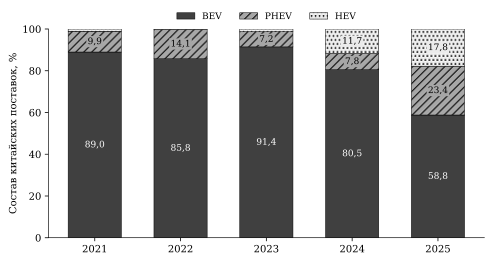

Рисунок 2.1 — Товарный состав китайских поставок по количеству, 2021–2025 годы

Источник: Eurostat Comext; расчёты автора.
<!-- END FIG G04_mix -->

Траектории технологий существенно различались. Количество BEV достигло 491 165 машин в 2023 году, затем сократилось до 439 419 в 2024 году и 430 616 в 2025 году. Итоговое снижение относительно 2023 года составило 12,33%, а относительно 2024 года — 2,00%. При этом в течение 2025 года поток не сокращался равномерно: в первом квартале наблюдалось 88 632 машины, в третьем — 122 188, в четвёртом — 117 442. Годовой результат поэтому не следует описывать как непрерывное помесячное падение. Он показывает снижение относительно прежнего годового уровня при сохраняющемся крупном объёме ввоза.

<!-- BEGIN FIG G02_monthly -->
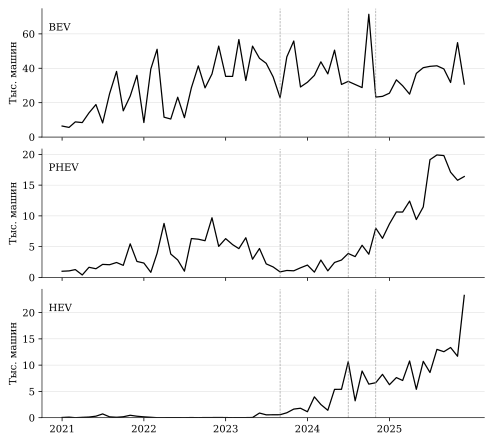

Рисунок 2.2 — Месячные количества китайских BEV, PHEV и HEV

Источник: Eurostat Comext; расчёты автора. Вертикальные линии: сентябрь 2023, июль и ноябрь 2024 года; масштабы панелей различаются.
<!-- END FIG G02_monthly -->

Для PHEV 2023 год, напротив, не был максимумом предшествующей динамики: в 2022 году ввезено 56 705 машин, в 2023 году — 38 931. В 2024 году поток увеличился умеренно, до 42 587, после чего достиг 171 348 в 2025 году. Рост за последний год составил 302,35%. Внутри 2025 года особенно крупные объёмы приходились на второе полугодие: 58 853 машины в третьем квартале и 49 285 в четвёртом против 29 949 в первом. Сопоставление нескольких исходных лет важно, поскольку выбор только низкой базы способен преувеличить представление о плавности и устойчивости расширения.

HEV отличались крайне небольшим начальным масштабом. После 425 машин в 2022 году поставки составили 7 028 в 2023 году, 63 830 в 2024 году и 130 347 в 2025 году. Последнее увеличение — на 104,21% за год — экономически значимо и в абсолютном выражении. Однако многократное изменение относительно 2022–2023 годов следует читать вместе с исходными уровнями. Низкая база является одной из причин, по которым относительные показатели и последующие модельные множители для HEV оказываются столь большими.

Изменение китайской корзины необходимо сопоставить со всем внешним импортом тех же категорий. Доля Китая по количеству увеличилась с 31,23% в 2023 году до 33,28% в 2024 году и 38,83% в 2025 году. По стоимости соответствующие значения составили 27,60, 27,57 и 27,78%. Разность между 2023 и 2025 годами равна 7,60 процентного пункта по количеству и лишь 0,19 пункта по стоимости. Китайское происхождение усилило физическое присутствие в выбранной внешней корзине заметно больше, чем денежное. Эти доли не являются долями китайских марок в европейских регистрациях: в их знаменателе отсутствуют автомобили европейского производства.

<!-- BEGIN FIG G03_shares -->
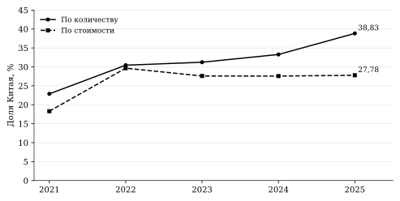

Рисунок 2.3 — Физическая и стоимостная доли Китая во внешнем импорте трёх кодов

Источник: Eurostat Comext; расчёты автора.
<!-- END FIG G03_shares -->

Внутри технологий результат также неоднороден. Физическая доля Китая в BEV составляла 58,43% в 2023 году, поднялась до 66,81% в 2024 году и снизилась до 58,92% в 2025 году. Поэтому почти неизменный результат при сравнении крайних лет скрывает промежуточный подъём. У PHEV доля увеличилась с 18,29 до 45,45%, у HEV — с 1,05 до 16,76%. Главным источником укрепления Китая внутри выбранных категорий стали гибриды, хотя в конечном году их абсолютный объём всё ещё уступал BEV.

Симметричное разложение совокупной физической доли уточняет этот вывод. За 2023–2025 годы изменение китайских долей внутри технологий давало +10,89 процентного пункта, а изменение состава всего внешнего импорта — −3,29 пункта. Внутритоварные компоненты PHEV и HEV составили соответственно +4,40 и +6,28 пункта; вклад BEV был небольшим положительным, +0,22 пункта. В структурной части наиболее заметен отрицательный компонент BEV, −5,94 пункта. Следовательно, усиление Китая внутри отдельных технологий было частично компенсировано изменением весов технологий в закупках ЕС.[^C2ACCOUNT]

При сравнении только 2024 и 2025 годов картина меняется. Общее увеличение физической доли на 5,55 пункта складывается из +4,60 пункта внутритоварных изменений и +0,96 пункта товарного состава. При этом внутритоварный вклад BEV уже отрицателен, −3,11 пункта, а PHEV и HEV дают +3,88 и +3,83 пункта. Сходный рост совокупной доли в разных временных сопоставлениях тем самым имеет неодинаковую внутреннюю структуру. Обе базы сохраняются в анализе, поскольку 2024 год отражает отдельную стадию перестройки, а не нейтральную исходную точку.

Для стоимостной доли за 2023–2025 годы положительный внутритоварный компонент равен +4,90 пункта, отрицательный структурный — −4,71 пункта. Их почти полная компенсация объясняет небольшой итоговый прирост. За 2024–2025 годы компоненты составляют +0,76 и −0,55 пункта. Поэтому относительная устойчивость денежной доли не означает отсутствия изменений внутри корзины. Напротив, она возникает при существенных встречных движениях, которые скрываются при рассмотрении одного итогового процента.

Дополнительное объяснение даёт разложение стоимости китайских поставок. Между 2023 и 2025 годами количественный компонент равен +4,55 млрд евро, а компонент средней стоимости внутри кодов — −5,09 млрд евро. Их сумма даёт фактическое уменьшение стоимости на 0,55 млрд евро. У BEV оба компонента отрицательны: −1,13 млрд вследствие количества и −3,56 млрд вследствие удельной стоимости. У PHEV и HEV положительные количественные компоненты, +3,19 и +2,48 млрд евро, превосходят соответствующее снижение удельной составляющей. Поэтому расширение гибридов компенсировало значительную часть денежного сокращения BEV.[^C2VALUE]

Для 2024–2025 годов количественный компонент составляет +3,88 млрд евро, удельный — −3,26 млрд; итоговая стоимость увеличивается на 0,63 млрд. Между двумя базами меняется знак общего денежного результата, но сохраняется сочетание положительного количественного и отрицательного удельного компонентов. Это более устойчивое наблюдение, чем вывод о росте или снижении всей стоимости, сделанный по одной паре лет. При этом первый компонент формулы учитывает изменение количества каждой технологии со своей средней оценкой: его нельзя получить простым умножением прироста общего числа машин на одну среднюю цену.

Средняя таможенная стоимость BEV снизилась с 22 452 евро в 2023 году до 14 734 евро в 2025 году, PHEV — с 27 324 до 20 870 евро, HEV — с 26 392 до 13 892 евро. Этот показатель объединяет оценку и состав товаров. В Нидерландах в 2025 году наблюдается особенно низкое отношение для BEV: 41 808 машин стоимостью 82,84 млн евро, около 1 982 евро на единицу. Независимое извлечение 24 месячных значений из сохранённого исходного ответа подтверждает совпадение с панелью. Следовательно, расхождение при переносе данных не обнаружено, но экономическая причина столь низкой удельной стоимости остаётся неустановленной.[^C2UNITFLAG]

Чтобы определить зависимость выводов от этой особенности, выполнено сопоставление полной географии с двумя исключениями при одинаковом пересчёте числителя и знаменателя. Без Нидерландов стоимость китайских поставок за 2023–2025 годы увеличивается на 2,88% вместо снижения на 4,44%; без Бельгии и Нидерландов — на 20,41%. Значит, знак совокупной денежной динамики чувствителен к охвату стран. Его нельзя использовать как общий вывод о сокращении китайского автомобильного присутствия.

Вместе с тем физическая доля Китая растёт сильнее денежной во всех трёх срезах. В полной панели изменения составляют +7,60 и +0,19 процентного пункта, без Нидерландов — +7,66 и +1,29, без пары — +9,96 и +3,40. Тем самым сохраняется вывод о расхождении двух измерителей, хотя его точный размер зависит от географии. Полные результаты проверки и правила исключения представлены в приложении А; исходные значения и предпочтительная модель сохранены.

Таким образом, товарная адаптация проявляется в расширении гибридных категорий и снижении веса BEV, тогда как количественные и денежные итоги расходятся. Наиболее убедительно данные устанавливают саму перестройку состава и её арифметические компоненты. Объяснение через снижение розничных цен или перенос пошлины потребовало бы сведений о сопоставимых моделях и сделках. Следующий вопрос состоит в том, сопровождалась ли эта товарная перестройка расширением географии оформления или преимущественно усиливала прежние направления.

## 2.4 Географическая концентрация и источники расширения поставок

Изменение распределения между странами ЕС является самостоятельной стороной адаптации. Оно может отражать изменение роли крупных центров оформления, перераспределение между уже действующими направлениями и появление положительных потоков в дополнительных странах. Для их разграничения первоначально рассматривается каждая технология, затем общий индекс, после чего выделяются компоненты концентрации и прироста количества. Такой порядок позволяет избежать отождествления роста числа наблюдаемых стран с равномерным распределением торговли.

<!-- BEGIN FIG G07_geography -->
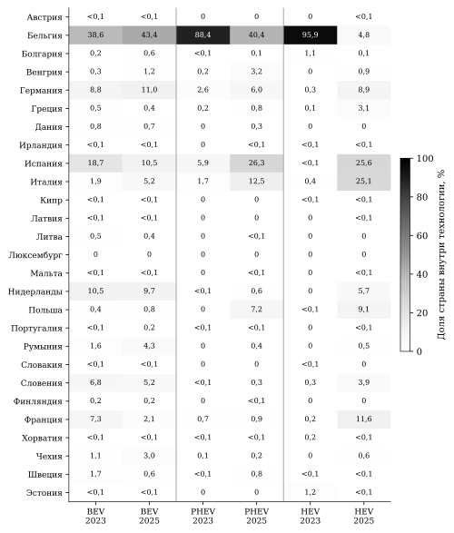

Рисунок 2.4 — Доли стран оформления внутри технологий, 2023 и 2025 годы

Источник: Eurostat Comext; расчёты автора. Показатель — количество. Каждая колонка нормирована на свой итог; значения менее 0,1% выделены отдельно.
<!-- END FIG G07_geography -->

В 2025 году крупнейшим направлением оформления китайских BEV оставалась Бельгия: 186 956 машин, или 43,42% категории. Далее следовали Германия с 47 555 машинами, Испания с 45 428 и Нидерланды с 41 808. Совместная доля Бельгии и Нидерландов составляла 53,12%. У PHEV Бельгия также занимала первое место — 69 235 машин, или 40,41%, однако крупный поток приходился и на Испанию — 45 014 машин, или 26,27%. У HEV наиболее значимыми были Испания и Италия: соответственно 33 340 и 32 776 машин, вместе 50,72% категории. Следовательно, даже в одном году пространственные конфигурации трёх технологий заметно различались.[^C2GEODATA]

Изменения относительно 2023 года особенно выразительны для гибридов. Доля рассматриваемой пары стран оформления, Бельгии и Нидерландов, в PHEV снизилась с 88,44 до 41,00%, а в HEV — с 95,89 до 10,46%. У BEV она, напротив, выросла с 49,08 до 53,12%. Уже это сопоставление показывает, что совокупное ослабление концентрации нельзя одинаково распространить на все технологии. Вместе с тем доля двух стран не описывает распределение оставшегося потока, поэтому далее используется HHI.

Физический HHI для BEV увеличился с 0,2137 в 2023 году до 0,2303 в 2025 году. Эквивалентное число равновеликих направлений сократилось с 4,68 до 4,34 при неизменных 26 странах с положительными годовыми поставками. Это пример того, что широкое формальное присутствие совместимо с усилением неравномерности. Если исходной датой взять 2024 год, индекс BEV, наоборот, снижается с 0,2641. Поэтому для BEV корректен вывод о частичном ослаблении концентрации после промежуточного максимума, но не о её снижении за весь интервал 2023–2025 годов.[^C2CONCENTRATION]

Для PHEV HHI по количеству снижается с 0,7865 до 0,2581, а эффективное число направлений растёт с 1,27 до 3,88. Для HEV индекс уменьшается с 0,9198 до 0,1664, эффективное число увеличивается с 1,09 до 6,01. Однако большая часть изменения HEV произошла уже между 2023 и 2024 годами, когда индекс достиг 0,2038. У PHEV промежуточное значение составляло 0,4171. Деконцентрация гибридов представляет последовательность изменений разного масштаба, а не единичный переход в конце 2024 года.

В стоимостном измерении направление изменений гибридов сохраняется: HHI PHEV уменьшается с 0,7975 до 0,2596, HEV — с 0,9049 до 0,1588. Для BEV расхождение двух измерителей существенно: стоимостной HHI возрастает с 0,2649 до 0,3723, сильнее физического. В 2025 году на Бельгию и Нидерланды приходится 58,97% стоимости китайских BEV. При этом внутри данной пары денежный поток гораздо сильнее сосредоточен в Бельгии, чем физическое количество. Отмеченная ранее низкая удельная стоимость Нидерландов поэтому имеет значение и для сопоставления географических индексов; она не должна исчезать за общим объяснением через ценовую конкуренцию.

В целом по трём технологиям физический HHI сокращается с 0,2405 в 2023 году до 0,1873 в 2025 году, а эффективное число направлений увеличивается с 4,16 до 5,34. Стоимостной индекс снижается с 0,2967 до 0,2562. Эти результаты совместимы с ростом концентрации BEV, поскольку общий индекс зависит от товарных весов и сочетания географических долей. Проверить относительную роль двух составляющих позволяет стандартизация корзин.

<!-- BEGIN FIG G08_hhi -->
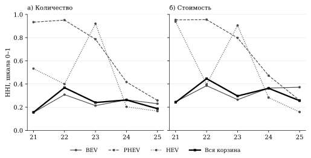

Рисунок 2.5 — Общая и технологическая концентрация, 2021–2025 годы

Источник: Eurostat Comext; расчёты автора. Годы на горизонтальной оси сокращены до двух последних цифр.
<!-- END FIG G08_hhi -->

Таблица 2.4 — Стандартизованные корзины и разложение общей географической концентрации

<!-- BEGIN AUTO T04 -->
Панель А. Наблюдаемые и стандартизованные корзины

| Период | Показатель | H(b₀,G₀) | H(b₀,G₁) | H(b₁,G₀) | H(b₁,G₁) |
| --- | --- | --- | --- | --- | --- |
| 2023–2025 | Количество | 0,2405 | 0,2251 | 0,3920 | 0,1873 |
| 2024–2025 | Количество | 0,2624 | 0,1984 | 0,2770 | 0,1873 |
| 2023–2025 | Стоимость | 0,2967 | 0,3483 | 0,4568 | 0,2562 |
| 2024–2025 | Стоимость | 0,3631 | 0,3033 | 0,3778 | 0,2562 |

Панель Б. Симметричные вклады в изменение HHI

| Период | Показатель | Изменение HHI | Товарные веса | География внутри технологий |
| --- | --- | --- | --- | --- |
| 2023–2025 | Количество | -0,0532 | 0,0568 | -0,1100 |
| 2024–2025 | Количество | -0,0751 | 0,0018 | -0,0769 |
| 2023–2025 | Стоимость | -0,0405 | 0,0340 | -0,0745 |
| 2024–2025 | Стоимость | -0,1068 | -0,0162 | -0,0906 |
<!-- END AUTO T04 -->

Источник: Eurostat Comext; расчёты автора. Индексы приведены на шкале 0–1. Обозначения соответствуют формулам (2.2)–(2.3). Компоненты рассчитаны до округления; небольшие расхождения сумм в отображении возможны из-за четырёх знаков после запятой.

За 2023–2025 годы общий физический HHI снизился на 0,0532. Симметричный товарный компонент равен +0,0568, а компонент географии внутри технологий — −0,1100. Они направлены противоположно. Падение общего индекса обеспечивается прежде всего изменением распределения отдельных технологий между странами, тогда как усреднённый вклад товарных весов сдерживает это падение. Наблюдение уточняет распространённое интуитивное объяснение: увеличение доли гибридов само по себе не обязательно диверсифицирует общий поток.

<!-- BEGIN FIG G09_hhi_components -->
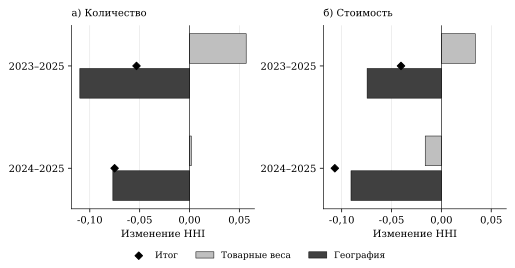

Рисунок 2.6 — Товарный и географический компоненты изменения общего HHI

Источник: Eurostat Comext; расчёты автора. Ромб обозначает итог; шкала — единицы HHI, а не процентные пункты доли.
<!-- END FIG G09_hhi_components -->

Причину такого результата видно по стандартизованным состояниям. При товарных весах 2025 года и географии 2023 года физический HHI составил бы 0,3920 вместо исходных 0,2405. В начальном состоянии гибриды были особенно тесно связаны с небольшим числом направлений; увеличение их веса при сохранении прежнего распределения усиливало бы общий перекос. Напротив, при товарных весах 2023 года и географии 2025 года индекс равен 0,2251. В действительности изменились обе составляющие, что привело к конечному значению 0,1873. Стандартизованные состояния выявляют роль исходной географии без предположения, что такая комбинация могла реализоваться в экономическом равновесии.

Нелинейность здесь существенна. Если сначала заменить товарные веса при географии 2023 года, их вклад составит +0,1515. Если заменить веса после перехода к географии 2025 года, вклад будет −0,0378. Разность двух порядков, около −0,1893, показывает большое взаимодействие состава и географии. Симметричное усреднение распределяет это взаимодействие между факторами; трактовать +0,0568 как неизменный структурный параметр товарной адаптации нельзя. Это характеристика двух конкретных состояний и принятого правила распределения.

По стоимости в сравнении 2023–2025 годов наблюдается аналогичное противодействие: товарные веса дают +0,0340, география — −0,0745, общий итог равен −0,0405. Однако при базе 2024 года товарный компонент стоимости уже отрицателен, −0,0162, и действует в одном направлении с географическим, −0,0906. По количеству для 2024–2025 годов весовой компонент близок к нулю, +0,0018, при географическом −0,0769. Поэтому устойчивый вывод состоит в значимости перестройки географии внутри технологий; знак товарного вклада зависит от периода и измерителя.

Групповое разложение уточняет, что именно изменилось внутри категорий. Для PHEV за 2023–2025 годы снижение физического HHI на 0,5284 включает −0,5039 за счёт изменения доли Бельгии и Нидерландов, −0,0134 за счёт распределения внутри пары и −0,0111 за счёт распределения среди остальных 25 стран. Основная часть деконцентрации связана с ослаблением прежнего доминирующего канала оформления. Выравнивание остальных направлений присутствует, но имеет существенно меньший вклад.[^C2GROUP]

Для HEV соответствующие компоненты равны −0,5286, −0,2308 и +0,0060. Внутри остальных 25 стран концентрация немного повысилась: их собственный нормированный HHI изменился с 0,1856 до 0,2006. Общий индекс при этом резко снизился. Значит, появление крупного объёма вне прежней пары не сопровождалось равномерным распределением по всем другим странам. В 2025 году заметную часть потока сосредоточили Испания и Италия. Это существенное различие между распространением торговли за пределы прежнего центра и полным географическим выравниванием.

У BEV за тот же период положительный вклад изменения доли пары равен +0,0212, изменения внутри пары — +0,0100, а распределения остальных стран — −0,0145. Здесь некоторое выравнивание вне Бельгии и Нидерландов не компенсирует усиление роли основных направлений. Таким образом, один и тот же инструмент разложения раскрывает три разных процесса: ослабление единственного преобладающего канала у PHEV, переход HEV к нескольким крупным направлениям и сохранение высокой роли пары у BEV.

Наконец, требуется определить, связан ли рост гибридов преимущественно с новыми положительными странами. У PHEV число активных годовых направлений увеличилось с 14 в 2023 году до 21 в 2025 году. Новые положительные наблюдения отмечены в Дании, Финляндии, Ирландии, Литве, Мальте, Польше и Румынии. Однако из общего прироста 132 417 машин на продолжающие направления приходится 118 810, а на новые — 13 607. Вклад новых стран равен 10,28% чистого прироста; основная часть расширения осуществляется там, где положительные поставки уже наблюдались в 2023 году.[^C2ENTRY]

Для HEV число положительных направлений увеличилось с 15 до 22. Возникло восемь новых положительных стран — Австрия, Чехия, Венгрия, Латвия, Мальта, Нидерланды, Португалия и Румыния, — тогда как поток в Словакию, равный шести машинам в начальном году, в конечном году отсутствовал. Поэтому чистое увеличение числа стран равно семи. Прирост 123 319 машин складывается из +113 282 в продолжающих направлениях, +10 043 в новых и −6 в исчезнувшем. Новые страны обеспечивают 8,14% чистого изменения. Различие между восемью появлениями и чистым приростом на семь стран важно для точного описания географической границы.

Для BEV набор положительных годовых направлений не изменился, а сокращение на 60 549 машин полностью приходится на продолжающие страны. Сопоставление трёх категорий показывает, что наличие новых направлений и изменение концентрации не имеют простой однозначной связи. Гибриды расширяются преимущественно в уже действующей географии, одновременно меняя распределение её весов. Наиболее содержательный итог параграфа состоит именно в этом сочетании: деконцентрация возникает главным образом через перераспределение крупных объёмов, а не только через увеличение числа стран с ненулевыми поставками.

<!-- BEGIN FIG G10_entry -->
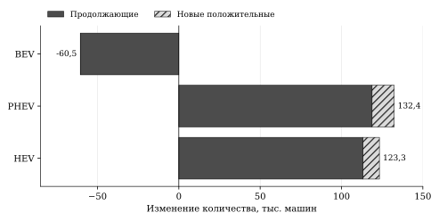

Рисунок 2.7 — Источники изменения количества по направлениям, 2023–2025 годы

Источник: Eurostat Comext; расчёты автора. Исчезнувшее направление HEV даёт −6 машин; подписи показывают чистое изменение с его учётом.
<!-- END FIG G10_entry -->

Эти результаты согласуются с теоретической ролью существующих связей, но не позволяют наблюдать сами фирменные решения. Таможенная страна остаётся агрегатом, внутри которого могут действовать разные производители и посредники. Поэтому подтверждается положение о преобладающем вкладе продолжающих направлений на принятом уровне наблюдения. Для проверки связи перестройки с торговыми фазами далее необходимо отделить фактический рост от относительного изменения, выделяемого моделью после включения сезонности и предшествующей траектории.

## 2.5 Модельные оценки торговых фаз и проверка устойчивости

Фактическое расширение гибридов не обязательно означает дополнительный сдвиг сверх предшествующей относительной траектории. Поэтому модель сопоставляет Китай с остальными внешними происхождениями, а каждую гибридную категорию — с BEV, учитывая сезонность, постоянные различия и линейные тренды. Единица на шкале множителей означает отсутствие выделяемого фазового отклонения. Результаты окончательной фазы приведены в таблице 2.5.

Таблица 2.5 — Предпочтительные множители окончательной фазы, ноябрь 2024 — декабрь 2025 года

<!-- BEGIN AUTO T05 -->
| Категория | Показатель | Множитель | 95%-интервал HAC(12) | Блочный интервал, 2,5–97,5% |
| --- | --- | --- | --- | --- |
| PHEV | Количество | 1,510 | [0,748; 3,050] | [0,705; 4,393] |
| HEV | Количество | 29,788 | [6,729; 131,874] | [6,938; 249,773] |
| PHEV | Стоимость | 2,312 | [0,996; 5,370] | [0,822; 6,976] |
| HEV | Стоимость | 17,047 | [3,682; 78,934] | [3,122; 98,273] |
<!-- END AUTO T05 -->

Источник: авторская PPML по Eurostat Comext. Базовая технология — BEV, сравнительное происхождение — REST. Оба уравнения: 8 500 строк, 60 месяцев. Блочные интервалы получены по 199 повторным оценкам на исход. Множители относятся к условным относительным отношениям потоков.

Для PHEV количественный множитель равен 1,510, однако оба интервала включают единицу. Стоимостная оценка, 2,312, также не даёт устойчивого выделения положительного сдвига. Нижняя граница HAC(12), 0,996, особенно близка к единице, а блочный интервал шире. Следовательно, положительные точечные оценки сочетаются с существенной неопределённостью. Фактическое четырёхкратное увеличение количества относительно 2024 года при этом остаётся установленным: оно сравнивает наблюдаемые уровни, тогда как модель оценивает отклонение относительного отношения от контролируемой траектории.[^C2MODEL]

<!-- BEGIN FIG G11_intervals -->
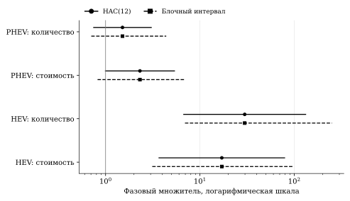

Рисунок 2.8 — Окончательные фазовые множители с двумя видами интервалов

Источник: Eurostat Comext; расчёты автора. Вертикальная линия — единица; ось множителей логарифмическая.
<!-- END FIG G11_intervals -->

У HEV множители значительно выше — 29,788 по количеству и 17,047 по стоимости; оба вида интервалов расположены выше единицы. Направление ассоциации выражено сильнее, чем для PHEV, но точный размер определяется широко. Этому соответствует крайне малая исходная торговля. Оценка 29,788 относится ко всему относительному сравнению CN/REST и HEV/BEV; она не измеряет почти тридцатикратный прирост абсолютного импорта вследствие пошлины.

Хронология оценок помогает понять этот результат. Количественный множитель HEV равен 6,260 уже в фазе сигнала и расследования, 14,230 в месяце объявления и 17,111 во временной фазе. Для PHEV значения составляют 0,224, 0,706 и 0,410. Расхождение технологий возникает до окончательного режима. Таким образом, поздняя перестройка связана с длительной неоднородной динамикой, а не сводится к одному переходу в ноябре 2024 года.

Полугодовая диагностика подтверждает наличие выраженной предыстории. Совместная проверка шести предшествующих коэффициентов при HAC(12) даёт статистики 261,20 по количеству и 352,72 по стоимости при шести степенях свободы; асимптотические p-значения меньше 0,001. Это основание отказаться от простого причинного прочтения сравнения «до — после». Диагностика строится без линейного тренда и относительно соответствующих половин 2022 года; её график и техническая нормировка приведены в приложении А.[^C2DYNAMIC]

Предусмотренные варианты показывают, какие элементы сравнения особенно важны. Без линейных трендов количественный множитель PHEV возрастает до 2,484, и его интервал уже не включает единицу. При сопоставлении Китая только с Японией, Республикой Корея и США он равен 2,051 с интервалом [1,214; 3,464]. В основной модели с полным остаточным происхождением REST результат менее определён. Следовательно, предшествующая траектория и состав сравнительных поставщиков влияют на вывод о дополнительном сдвиге PHEV. Эти варианты сохраняются как чувствительности при неизменной роли предпочтительной спецификации.

Остальные проверки не сводятся к единому критерию «значимо — незначимо». По количеству начало выборки с 2022 года даёт PHEV-множитель 2,047 с интервалом, включающим единицу; использование только непосредственно опубликованных пар — 1,575 с таким же выводом. Исключение сезонности меняет оценки количества и стоимости неодинаково. Полная таблица семи сопоставимых вариантов для двух исходов и их интервалов вынесена в приложение А. Там же раскрыто ограничение сбалансированной наблюдаемой панели: для китайских HEV в ней отсутствуют единицы, положительно наблюдавшиеся во все 60 месяцев.

Географическая чувствительность PHEV существенна. Без Бельгии и Нидерландов множитель по количеству становится 0,817, по стоимости — 0,507. Интервал количества [0,389; 1,716] включает единицу, стоимостной [0,268; 0,959] лежит ниже неё. Положительная точечная оценка полной панели, таким образом, не переносится на остальные страны. Для HEV в той же проверке сохраняются крупные положительные значения — 42,321 и 29,831. Во всём предусмотренном наборе количественные оценки HEV варьируются примерно от 10,89 до 67,01, стоимостные — от 6,79 до 61,78: направление устойчивее точного масштаба.[^C2SENSITIVITY]

Прямое сравнение групп проводится отдельным ковариационно согласованным контрастом. Для PHEV отношение множителей остальных стран к Бельгии и Нидерландам равно 0,587 по количеству и 0,234 по стоимости, но оба интервала включают единицу. Для HEV отношения равны 58,697 и 76,995, с очень широкими интервалами выше единицы. Следовательно, модель выделяет более сильное относительное изменение HEV вне пары, согласующееся с наблюдаемым перераспределением. Для PHEV различие групп определяется недостаточно точно. Такой вывод основан на контрасте коэффициентов, а не на сравнении отдельных p-значений.[^C2GEOMODEL]

Численная воспроизводимость проверена независимо: расширенная реализация воспроизводит исходную при одинаковых эффектах, явная запись эффектов подтверждает расчёт на подвыборке, эквивалентная парная модель — на всей информативной панели. Все 398 взвешенных оценок завершились успешно. Подробные показатели точности и полные интервалы групповых контрастов приведены в приложении А.[^C2AUDIT]

Итог модели дополняет структурные результаты. Для PHEV наблюдаемая экспансия подтверждается уровнями и географией, но отдельный положительный окончательный сдвиг сверх контролируемой траектории устойчиво не выделяется. Для HEV положительная относительная ассоциация сохраняется при предусмотренных изменениях спецификации, хотя началась ранее и имеет большой диапазон оценок. Дальнейшее обсуждение опирается прежде всего на установленную структуру адаптации; фазовые коэффициенты уточняют её временную неоднородность.

## 2.6 Обсуждение результатов и основания последующих рекомендаций

Совместное рассмотрение результатов позволяет уточнить экономическое содержание адаптации китайских поставок. Она проявляется в изменении технологического состава, перераспределении между странами оформления и расхождении физического и денежного присутствия. Эти процессы связаны, однако не сводятся к одному показателю. Увеличение доли Китая по количеству происходит одновременно со снижением общего географического HHI и почти неизменной стоимостной долей. Внутри этой совокупности сохраняется высокая концентрация BEV и расширяется география двух гибридных категорий.

Первое положение теоретической главы подтверждается в форме разложения: общий индекс скрывает разные технологические траектории, а его изменение определяется сочетанием весов и географии. Особенно содержателен встречный знак компонентов за 2023–2025 годы. Товарное изменение при прежнем распределении могло бы усиливать концентрацию, тогда как наблюдаемая перестройка внутри технологий понижает её. Поскольку взаимодействие велико, отдельный компонент нельзя переносить на другой период как постоянную характеристику технологии.

Второе положение получает поддержку на уровне стран оформления. Новые положительные направления наблюдаются у обеих гибридных категорий, но обеспечивают около одной десятой или меньше чистого прироста. Преобладающий объём появляется в продолжающих странах. Это согласуется с использованием уже существующей географии торговли, хотя не идентифицирует фирменные связи или фиксированные издержки. В частности, направление могло оставаться положительным при смене марки, посредника либо модельного состава внутри него.

Третье положение проявляется в различии физических и стоимостных долей. Значительное усиление присутствия по количеству не сопровождается сопоставимым денежным увеличением. Разложения показывают встречные количественные, удельные и структурные компоненты, однако не выделяют цену автомобиля постоянного качества. Проверка без Нидерландов и без пары Бельгия/Нидерланды сохраняет это расхождение, но меняет знак общего изменения стоимости. Следовательно, снижение полной стоимости является результатом конкретного географического охвата. Поэтому данные достаточны для анализа состава таможенного потока, но не для расчёта выигрыша европейского потребителя или точной степени переноса пошлины.

Четвёртое положение относится к условной фазовой связи PHEV и имеет иной статус. В предпочтительной модели интервалы окончательного множителя включают единицу по обоим исходам. Из этого не следует, что политика не имела последствий или гибридная адаптация отсутствовала. Устанавливается более узкий результат: при принятых контролях и сравнительном знаменателе отдельный положительный окончательный сдвиг PHEV определяется недостаточно точно и зависит от спецификации. Рабочие положения здесь систематизируют исследование, а не образуют набор предварительно зарегистрированных подтверждающих тестов.

Таблица 2.6 — Сводные результаты проверки аналитических положений

| Положение | Основное свидетельство | Статус и экономическое содержание |
| --- | --- | --- |
| Общая концентрация зависит от товарных весов и географии | За 2023–2025 годы физический HHI: −0,0532; веса: +0,0568; география: −0,1100 | Установлено точным разложением; агрегат скрывает встречные компоненты |
| Продолжающие направления преобладают в росте гибридов | Новые страны: 10,28% чистого прироста PHEV и 8,14% HEV | Поддержано на уровне стран оформления; фирменный вход не наблюдается |
| Физическая и денежная доли способны расходиться | За 2023–2025 годы +7,60 и +0,19 процентного пункта | Установлено и сохраняется при исключениях; знак общей стоимости чувствителен к географии |
| После окончательных мер выделяется дополнительное относительное изменение PHEV | Множители 1,510 и 2,312; оба вида интервалов включают 1 | Устойчивого подтверждения отдельного положительного фазового сдвига нет |

Источник: обобщение авторских расчётов по Eurostat Comext и предпочтительной модели.

Сопоставление с ближайшими исследованиями помогает определить самостоятельное содержание работы. Бакалаврская работа Кэ рассматривает торговые потоки BEV из Китая относительно Японии, Республики Корея и США. Наша модельная чувствительность показывает, что выбор этих происхождений действительно влияет на результат, однако эмпирический вклад здесь заключается прежде всего в другом вопросе: как совместно меняются товарные веса, география внутри технологий и вклад продолжающих направлений. Расширение периода или добавление контрольных эффектов сами по себе не объявляются научной новизной.[^C2KE]

Европейская проверка у Барвик и соавторов использует регистрации существовавших моделей пяти китайских марок в шести странах, включая BEV и PHEV. Поэтому включение PHEV как таковое уже представлено в литературе. Наша панель, в отличие от фиксированного набора моделей, охватывает китайское производственное происхождение во всех 27 странах и допускает изменение состава моделей внутри кода. Регистрации, импорт и состав брендов различаются по единице наблюдения и моменту учёта. Расхождение их динамики не означает, что один из результатов обязательно неверен.[^C2BARWICK]

Сценарный анализ Доу с соавторами рассматривает последствия европейских мер для рынков разных стран при заданных поведенческих и ценовых предпосылках. Его предмет включает доступность автомобилей и распределение последствий, тогда как настоящие расчёты описывают реализованную таможенную структуру и условные фазовые отношения. Полученные компоненты могут уточнять исходные представления о неоднородности технологий и стран, но не заменяют модель спроса, ценового равновесия и благосостояния.[^C2DOU]

Таким образом, самостоятельный результат исследования определяется согласованным измерением нескольких сторон одной перестройки. Ограничения связаны с таможенным уровнем агрегирования, изменяемым составом сравнительного происхождения, короткой временной опорой и неоднозначностью удельной стоимости. При этих границах наиболее надёжны уровни и проверенные тождества, а модельные выводы требуют сохранения интервалов и альтернативных спецификаций. Из анализа следуют основания для третьей главы: совместное наблюдение количественных и денежных показателей, раздельный учёт технологий, контроль зависимости от стран оформления и оценка роли действующих направлений. Конкретные меры и их адресаты должны обсуждаться уже с опорой на эти установленные различия.

## Выводы по второй главе

Анализ месячной панели за 2021–2025 годы выявил значительную товарную перестройку китайских поставок новых автомобилей трёх выбранных категорий в ЕС. Между 2023 и 2025 годами вес BEV по количеству снизился с 91,44 до 58,80%, тогда как совокупная доля бензиновых PHEV и HEV достигла 41,20%. Физическое присутствие Китая во внешнем импорте этих кодов увеличилось с 31,23 до 38,83%, а стоимостная доля изменилась лишь с 27,60 до 27,78%.

Расхождение двух измерителей связано со встречными компонентами. За 2023–2025 годы количественные изменения внутри технологий давали +4,55 млрд евро стоимости, а изменение средней таможенной стоимости — −5,09 млрд евро. В полной панели общий денежный объём оставался ниже уровня 2023 года. При исключении Нидерландов знак меняется на положительный, поэтому данный итог зависит от охвата. Более устойчиво расхождение долей: физическая доля растёт сильнее денежной и в полной панели, и при двух предусмотренных географических исключениях. Удельные компоненты характеризуют таможенные оценки и состав товаров.

Общая географическая концентрация по количеству снизилась: HHI изменился с 0,2405 до 0,1873. Однако товарные веса дали положительный симметричный вклад +0,0568, которому противостоял географический вклад −0,1100. У BEV концентрация относительно 2023 года повысилась, у гибридов — существенно снизилась. При этом деконцентрация HEV не означает равномерного распределения по остальным странам: внутри группы за пределами Бельгии и Нидерландов сохраняются крупные направления.

Расширение гибридов преимущественно осуществлялось в продолжающих странах оформления. Новые положительные направления обеспечили 10,28% чистого прироста PHEV и 8,14% HEV. Следовательно, географическая адаптация состоит главным образом в изменении весов действующих направлений, хотя появление дополнительных стран также присутствует.

Предпочтительная PPML не даёт устойчивого подтверждения отдельного положительного окончательного фазового сдвига PHEV после учёта сезонности и предшествующей траектории. Для HEV относительная положительная ассоциация сохраняется в предусмотренных вариантах, но имеет широкий интервал и выраженную предысторию. Эти оценки характеризуют условные отношения потоков и не устанавливают причинный эффект пошлин. Полученные различия между технологиями, измерителями и географическими компонентами образуют эмпирическую основу последующей рекомендательной главы.

# Глава 3 Рекомендации по мониторингу и оценке товарной и географической адаптации поставок автомобилей из Китая в ЕС

## 3.1 Разработка системы совместного мониторинга товарной структуры и концентрации поставок

Полученные результаты позволяют перейти к рекомендациям по наблюдению и оценке адаптации китайских поставок в ЕС. Их основным пользователем может выступать аналитическое подразделение отраслевой организации или импортёра, которому необходимо различать изменение масштаба торговли, состава товаров и географии оформления. Для подразделений торговой политики та же система образует исходный материал оценки мер. Предлагается организовать наблюдение как последовательность проверок с определённым содержательным результатом: каждое изменение показателя должно вести к уточняющему вопросу и ответственному за его рассмотрение.

Первой рекомендацией является сохранение единого паспорта наблюдаемой торговли. В него следует включить товарные коды, состав стран, определение происхождения, период, единицы и дату версии источника. Для данного исследования исходным охватом являются три кода новых автомобилей, 27 стран ЕС и китайское производственное происхождение. Расширение набора кодов или переход к китайским маркам допустимы как отдельные задачи, однако должны сопровождаться пересчётом сопоставимой истории. Иначе изменение знаменателя может восприниматься как адаптация поставщиков. Определения внешней торговли и страны-партнёра следует согласовывать с метаданными Eurostat.[^C3METADATA]

Вторая рекомендация состоит в совместном представлении пяти блоков показателей. Первый объединяет абсолютное количество и стоимость, второй — доли Китая во внешнем импорте одинакового охвата. Третий характеризует технологические веса китайской корзины, четвёртый — общую и технологическую концентрацию, пятый — продолжающие и новые положительные направления. Средняя таможенная стоимость используется для проверки согласованности денежной и физической динамики. Такой набор позволяет установить, какая сторона изменения требует дополнительного объяснения, без сведения разнородных процессов к одному условному баллу.

Таблица 3.1 — Паспорт совместного мониторинга поставок

| Блок наблюдения | Показатель и основание сравнения | Порядок обновления | Действие при содержательном расхождении |
| --- | --- | --- | --- |
| Масштаб торговли | Количество и стоимость по каждой технологии; одинаковые периоды и страны | По месячным публикациям, с сопоставимыми годовыми итогами | Проверить, какая категория и страна определяют изменение |
| Присутствие происхождения | Доли Китая по количеству и стоимости во внешнем импорте трёх кодов | Вместе с абсолютными уровнями | Разложить изменение доли на внутритоварную и структурную части |
| Товарная корзина | Веса BEV, PHEV и HEV внутри китайских поставок | Месячные значения и скользящий год при достаточной истории | Определить, меняется ли вывод при раздельном рассмотрении технологий |
| География оформления | Общий и технологические HHI, эффективное число направлений, доля BE/NL | С одинаковыми знаменателями и составом стран | Разделить товарные веса, географию внутри технологий и роль крупных стран |
| Источники расширения | Вклад продолжающих, новых положительных и исчезнувших стран | Для явно названной пары годовых состояний | Выделить крупные действующие потоки для предметного разбора |
| Согласованность оценки | Средняя таможенная стоимость, пропуски, флаги и пересмотры | При каждом обновлении | Сверить исходный ответ и детализацию до экономической интерпретации |

Источник: разработано автором по результатам главы 2 и определениям Eurostat.

Для месячного наблюдения рекомендуется сохранять исходный ряд, а сезонные колебания сопоставлять с тем же месяцем предыдущего года. Скользящую годовую сумму следует рассчитывать только при наличии всех 12 месяцев, без замены неопределённых значений нулями. Годовое изменение удобно для выявления накопленной перестройки, но оно сглаживает момент перехода. Поэтому в рабочей записке месячная траектория и годовой итог должны сопровождать друг друга. В редких потоках относительный темп дополнительно раскрывается через исходное и конечное количество: рост от нескольких автомобилей имеет иной масштаб, чем аналогичный процент для крупной категории.

Первый ретроспективный пример показывает пользу технологической детализации. Между 2023 и 2025 годами общий физический HHI уменьшился с 0,2405 до 0,1873. Рассмотрение одного агрегата привело бы к выводу об ослаблении концентрации всей корзины. Однако HHI BEV вырос с 0,2137 до 0,2303, тогда как индексы гибридов существенно снизились. Поэтому предлагается сопровождать каждое сообщение об общей концентрации технологическими индексами и разложением. Действие аналитика в данном случае состоит в определении категорий, обеспечивших общий результат; вопрос о зависимости конкретной фирмы рассматривается уже после такой проверки.[^C3GEOGRAPHY]

Второй пример относится к стоимостной оценке. За те же годы полная стоимость китайских поставок уменьшилась на 4,44%, но без Нидерландов увеличилась на 2,88%, а без Бельгии и Нидерландов — на 20,41%. При этом физическая доля Китая росла сильнее денежной во всех трёх вариантах. Рекомендуется разделять вывод, сохраняющийся при обоснованных исключениях, и вывод, зависящий от географии. В рабочую записку должны входить оба результата. Низкая средняя стоимость BEV в Нидерландах требует документированной проверки, а её необъяснённая причина — явного ограничения ценового заключения.[^C3VALUATION]

<!-- BEGIN FIG G01 -->
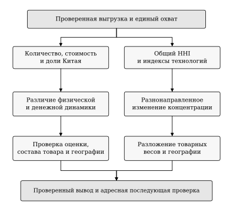

Рисунок 3.1 — Последовательность совместного разбора торговых показателей

Источник: составлено автором. Схема предложена автором; ветви показывают разные направления проверки.
<!-- END FIG G01 -->

Предлагаемая последовательность обработки сигналов представлена на рисунке 3.1. При расхождении количества и стоимости сначала проверяются единицы, источник и состав товара; при расхождении общего и технологических индексов — вклад весов и географии. После этого формулируется содержательный вопрос для отраслевого аналитика, подразделения поставок или оценщика политики. Таким образом, система имеет определённый выход: проверенный вывод с указанием следующего действия, а не только обновлённый график.

Для первоначального внедрения целесообразно использовать названные исторические случаи как проверку полноты аналитической процедуры. Они показывают, способна ли форма записки отразить уже известное встречное движение показателей и зависимость результата от охвата. Поскольку случаи выбраны после анализа, по ним не рассчитывается точность прогнозирования или частота предотвращённых ошибок. Проверка имеет более узкий результат: все существенные стороны установленного изменения должны быть видимы в подготовленном материале.

Численные пороги автоматического вмешательства на этом этапе вводить преждевременно. В частности, пороги концентрации, предназначенные для определения рыночной власти фирм, не имеют готового экономического смысла для юрисдикций оформления. Внутренний порядок может предусматривать обязательный разбор разнонаправленных показателей, крупных пересмотров или необъяснённых оценок, сохраняя решение за ответственным специалистом. По мере накопления опыта организация сможет оценивать нагрузку такой процедуры и обосновывать более избирательные правила.

Предложенная система тем самым делает наблюдение предметным: абсолютный поток связывается с долей, доля — с товарным составом, общий индекс — с географией технологий. Для импортёра следующий шаг состоит в проверке того, какие из выявленных направлений действительно соответствуют его операциям. Этому посвящено сценарное обоснование рекомендаций.

## 3.2 Обоснование рекомендаций на основе сценарных расчётов

Рекомендации по учёту географии поставок должны учитывать различие технологий и масштаб зарегистрированных потоков. Снижение общего HHI не даёт основания одинаково оценивать зависимость всех категорий от Бельгии и Нидерландов. Для определения приоритетов проверки используются сценарные расчёты на фиксированной структуре 2025 года. Они дополняют эконометрическую модель второй главы прикладной арифметикой заданных условий: параметры ограничения и переноса задаются исследователем, а поведенческая реакция поставщиков не оценивается заново.

В 2025 году в Бельгии и Нидерландах статистически учитывались 228 764 китайских BEV, 70 246 PHEV и 13 628 HEV. Эти объёмы составляли соответственно 53,12, 41,00 и 10,46% количества каждой технологии в ЕС. Различие позволяет выдвинуть конкретную рекомендацию: проверку зависимости от выбранной пары следует проводить по технологиям, начиная с категорий, у которых соответствующий поток имеет больший масштаб. Это порядок аналитического внимания на агрегированном уровне. Применение к отдельному импортёру требует сопоставления с его собственными декларациями и контрактами.[^C3EXPOSURE]

Предположим, что затруднение касается доли \(\alpha\) потока, учитываемого в данной паре стран. В исходном расчёте рассматриваются \(\alpha=0{,}10\) и \(\alpha=0{,}25\). При отсутствии переноса затронутый объём категории \(p\) равен \(\alpha Q_{BE/NL,p}\). Для чувствительности вводится условная доля переноса \(\rho\), после которого неперенесённая часть составляет:

\[
E_p(\alpha,\rho)=\alpha Q_{BE/NL,p}(1-\rho). \tag{3.1}
\]

Здесь \(Q_{BE/NL,p}\) — число автомобилей категории в исходном году, \(\rho\) — заданная доля переноса затронутого объёма. Для сопоставления технологий расчёт делится на общее количество соответствующей категории \(Q_{EU,p}\):

\[
e_p(\alpha,\rho)=100\frac{E_p(\alpha,\rho)}{Q_{EU,p}}. \tag{3.2}
\]

Показатель \(e_p\) выражен в процентах всей категории. Рассматриваются три значения \(\rho\): 0, 0,5 и 1, что даёт 18 комбинаций для трёх технологий и двух масштабов затруднения. Значения не характеризуют оценённую вероятность события или наблюдавшуюся способность перенаправления. Полный перенос является граничным условием формулы, при котором неперенесённый объём равен нулю; из него не следует отсутствие затрат и задержек.

<!-- BEGIN FIG G02 -->
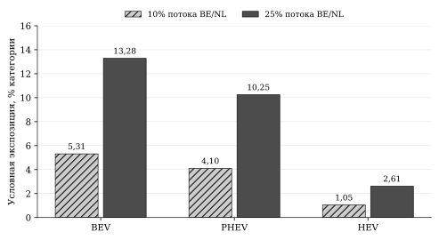

Рисунок 3.2 — Условная географическая экспозиция при двух масштабах затруднения

Источник: составлено автором. Структура 2025 года; перенос отсутствует. Параметры 10 и 25% заданы для иллюстрации.
<!-- END FIG G02 -->

При условном затруднении 10% потока пары и отсутствии переноса расчётная экспозиция BEV составляет 22 876,4 автомобиля, или 5,31% всего количества категории. Для PHEV она равна 7 024,6 автомобиля, или 4,10%, для HEV — 1 362,8 автомобиля, или 1,05%. При масштабе 25% соответствующие доли увеличиваются до 13,28, 10,25 и 2,61%. Рисунок 3.2 показывает, насколько различаются категории даже при одинаковом условии \(\alpha\). Поэтому общее снижение концентрации не должно заменять раздельную оценку экспозиции.

Таблица 3.2 — Сценарная чувствительность объёма к условному переносу потока

<!-- BEGIN AUTO T02 -->
| Технология | Условный масштаб α | Без переноса, расчётных шт. | При переносе 50%, расчётных шт. | После переноса, доля всей категории |
| --- | --- | --- | --- | --- |
| BEV | 10% | 22 876,4 | 11 438,2 | 2,66% |
| BEV | 25% | 57 191,0 | 28 595,5 | 6,64% |
| PHEV | 10% | 7 024,6 | 3 512,3 | 2,05% |
| PHEV | 25% | 17 561,5 | 8 780,8 | 5,12% |
| HEV | 10% | 1 362,8 | 681,4 | 0,52% |
| HEV | 25% | 3 407,0 | 1 703,5 | 1,31% |
<!-- END AUTO T02 -->

Источник: Eurostat Comext; расчёты автора по структуре 2025 года. Дробные единицы представляют арифметический результат умножения, а не прогноз числа фактически задержанных машин. При условном переносе 100% неперенесённый объём во всех комбинациях равен нулю.

Сценарий частичного переноса раскрывает второй источник различий. Если при \(\alpha=0{,}25\) перенесена половина затронутого потока, для BEV неперенесённая часть составляет 28 595,5 расчётной единицы, или 6,64% категории, для PHEV — 8 780,8 единицы, или 5,12%, для HEV — 1 703,5 единицы, или 1,31%. Значение сокращается пропорционально заданному переносу, однако сами условия переноса в торговой статистике не наблюдаются. Практический смысл расчёта состоит в определении того, насколько результат зависит от способности организации перераспределить поток.

Для содержательного обоснования сценариев дополнительно рассмотрена наблюдавшаяся квартальная динамика. За каждый квартал 2022–2025 годов количество сравнивается с тем же кварталом предыдущего года: по 16 сопоставлений на технологию, всего 48. Выделены все случаи сокращения потока BE/NL. Для них определяется, выросло ли количество в остальных странах и насколько этот рост соотносился с сокращением пары. Такой разбор фиксирует совместные изменения торговли; фактический перенос тех же партий из одной страны в другую не устанавливается.[^C3HISTORY]

Таблица 3.3 — Исторические сочетания изменения потоков BE/NL и остальных стран, 2022–2025 годы

<!-- BEGIN AUTO THISTORY -->
| Категория | Сравнения | Сокращение BE/NL | Вне пары роста нет | Рост вне пары меньше сокращения | Рост вне пары не меньше сокращения |
| --- | --- | --- | --- | --- | --- |
| BEV | 16 | 7 | 5 | 0 | 2 |
| PHEV | 16 | 6 | 0 | 5 | 1 |
| HEV | 16 | 7 | 2 | 1 | 4 |
<!-- END AUTO THISTORY -->

Источник: Eurostat Comext; расчёты автора по количеству китайских поставок. Сравниваются одинаковые кварталы соседних лет. Группы совместного изменения исчерпывают все случаи сокращения BE/NL.

Для BEV сокращение пары наблюдалось в семи сопоставлениях, в пяти из них роста за её пределами не было. У PHEV в пяти из шести случаев положительное изменение остальных стран было меньше сокращения пары. Для HEV в четырёх из семи случаев рост остальных стран превышал либо покрывал сокращение, но этому соответствовала и общая экспансия технологии. Поэтому наблюдаемые сочетания не дают единого эмпирического коэффициента переноса для всех категорий.

<!-- BEGIN FIG G03 -->
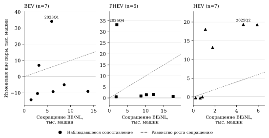

Рисунок 3.3 — Исторические сочетания квартальных изменений BE/NL и остальных стран

Источник: составлено автором. Показаны все 20 случаев сокращения пары относительно того же квартала предыдущего года; линия — равенство прироста вне пары её сокращению. Совместное изменение не устанавливает перенос партий.
<!-- END FIG G03 -->

У BEV величина отрицательного квартального изменения относительно того же квартала предыдущего года лежала от 2,29 до 21,66%. Условный масштаб 10% имеет аналоги внутри этого диапазона, а 25% представляет более жёсткий сценарий относительно наблюдавшихся квартальных сокращений. У гибридов диапазоны шире, в том числе вследствие малых исходных потоков. Это сопоставление обосновывает статус заданных масштабов как разных условий проверки; частоты 20 исторических эпизодов не объявляются вероятностями будущего затруднения.

Первая рекомендация для подразделения поставок — сопоставить выявленную статистическую географию со своей операционной цепочкой. Eurostat отмечает, что страна учёта внешнего импорта может отличаться от страны конечного использования товара. Из этого следует необходимость связать декларацию с физическим маршрутом, складом и последующим перемещением внутри ЕС. Такая сверка устанавливает, относится ли концентрация национального показателя к реальной зависимости конкретного импортёра от одного канала.[^C3ROTTERDAM]

Вторая рекомендация — сформировать паспорт доступных альтернатив по срокам, ёмкости и дополнительным расходам. Для каждого рассматриваемого канала необходимо установить техническую возможность обслуживания автомобилей, договорные ограничения, доступность перевозчика и склада, сроки оформления и транспортировки. Ключевым результатом является подтверждённая доступная альтернатива для заданного объёма и горизонта. Простое увеличение числа стран в статистической корзине такой доступности не гарантирует.

Третья рекомендация — оценивать резервный канал вместе с запасами и календарём поставок. Одинаковый объём экспозиции может иметь разное значение при различных запасах, сроках доставки и обязательствах перед покупателем. Если затронутая партия может быть обслужена из запаса, непосредственное ограничение продаж будет отличаться от ситуации с отсутствием резерва. Поэтому механический объём сначала переводится в нагрузку на операционную систему, а затем — при наличии фирменных данных — в сроки и денежные последствия.

Четвёртая рекомендация касается экономического обоснования. Расходы на подготовку и поддержание альтернативы следует сопоставлять с сокращением ожидаемых затрат задержки, срыва договора и дефицита продукции. Для этого необходимы фирменные оценки вероятностей, стоимости времени, хранения и упущенной маржи. В данном исследовании такие параметры не наблюдаются, поэтому сценарные объёмы не умножаются на среднюю таможенную стоимость для получения предполагаемого ущерба. Положительный эффект резервирования должен подтверждаться отдельным расчётом у импортёра, учитывающим как предотвращаемые последствия, так и цену резерва.

Сопоставление технологий при этом сохраняет прикладную пользу. Для агрегированной корзины большая доля BEV в рассматриваемой паре обосновывает более раннюю проверку соответствующих каналов. Низкая доля HEV в BE/NL не означает общей операционной устойчивости HEV: значимые направления могли переместиться в другие страны. Поэтому после проверки пары анализ продолжается по фактической географии категории и организации. Рекомендация направлена на выявление существенных зависимостей, а не на достижение минимального национального HHI любой ценой.

Для принятия решения предлагается дополнить паспорт альтернативы порогом допустимых дополнительных расходов. Если \(F\) — фиксированные расходы на резерв за выбранный период, \(n>0\) — ожидаемое число машин, для которых он будет использован, \(d\) — ожидаемые предотвращаемые расходы в расчёте на такую машину, а \(c\) — дополнительные переменные расходы, то условие \(F+nc\leq nd\) даёт:

\[
c\leq c^*=d-\frac{F}{n}. \tag{3.3}
\]

Все денежные параметры и ожидаемый объём использования должны подтверждаться данными организации. Порог показывает, какую дополнительную стоимость можно принять при заданной оценке предотвращаемых расходов. Если фиксированная нагрузка на машину уже превосходит \(d\), одних сведений о географической экспозиции недостаточно для обоснования положительных дополнительных расходов. Это критерий проверки решения, а не оценка фактически достигнутой экономии.

Таким образом, сценарии задают прозрачный переход от наблюдаемой структуры к прикладному вопросу. Их результат — размер потока при заданных условиях и перечень необходимых проверок. Решение о резервировании, переносе или изменении договоров принимается после подтверждения операционной и экономической реализуемости. Такой порядок использует количественную основу диплома и сохраняет различие между экспозицией, задержкой и конечными потерями.

## 3.3 Рекомендации по оценке торговых мер с учётом межтоварной адаптации

Для подразделений торговой политики практическое значение исследования состоит в расширении предмета оценки. Изменение одной технологии не характеризует автоматически адаптацию всей товарной корзины, а рост соседней категории не устанавливает механизм реакции производителей. Поэтому рекомендуется рассматривать меру и наблюдаемые потоки на нескольких уровнях: непосредственно затронутые товары, соседние технологии, производственное происхождение и конечный рынок. Такая последовательность позволяет связать статистическое наблюдение с вопросами, на которые должна отвечать оценка политики.

Первое предложение заключается в подготовке единой межтоварной записки при рассмотрении изменения режима торговли. Она должна содержать количество и стоимость BEV, PHEV и HEV, их веса, доли происхождения и географическую структуру. Юридический охват следует сопоставлять с более широкой статистической позицией CN8 по детализации TARIC и соответствующей редакции акта. Исторически рассмотренная в работе мера использует уточнённый охват ex 8703 80 10, поэтому полный восьмизначный поток не тождественен совокупности партий, к которым применена конкретная ставка.[^C3SCOPE]

Содержательным основанием предложения служит установленное расхождение технологий. В анализируемой корзине сокращение количества BEV относительно 2023 года сопровождалось ростом гибридов и увеличением общей физической доли Китая. Оценка только BEV дала бы неполное представление об адаптации происхождения. Вместе с тем расширение гибридов может включать изменение спроса, состава моделей и производственных решений. Поэтому предлагаемая записка должна фиксировать наблюдаемые перемещения и отделять их от объяснений, требующих иных данных.

Второе предложение — разделить показатели торгового присутствия, потребительской доступности и производственного результата. Импорт характеризует внешний поток; регистрации и продажи — реализацию на рынке; выпуск и инвестиции — производственную сторону. Для каждой цели следует выбрать соответствующий показатель результата. Увеличение или уменьшение средней таможенной стоимости само по себе не определяет выигрыш потребителя: внутри кода могут меняться модели, комплектация и качество. Постановка Фейнстры и Ромалиса подчёркивает значение качества при интерпретации международных ценовых показателей.[^C3QUALITY]

Для оценки доступности автомобилей рекомендуется формировать сопоставимую выборку моделей с характеристиками, розничными ценами и регистрациями, различая происхождение сборки и принадлежность марки. Для анализа производства — наблюдать выпуск, загрузку мощностей, поставки компонентов и фактически осуществлённые инвестиции. Эти наборы дополняют таможенную панель в зависимости от поставленной задачи. Их объединение должно сопровождаться явным описанием соответствия единиц: внешнеторговый код, конкретная модель и производственное предприятие отражают разные уровни наблюдения.

Рекомендацию о разделении торговли и рынка конкретизирует дополнительное сопоставление с регистрациями ACEA. В 2025 году количество китайских BEV, ввезённых в ЕС, сократилось на 2,0%, тогда как регистрации новых BEV всех происхождений выросли на 29,9%.

Таблица 3.4 — Различие динамики китайского импорта и общеевропейских регистраций BEV

<!-- BEGIN AUTO TMARKET -->
| Ряд и охват | 2024, шт. | 2025, шт. | Темп, % |
| --- | --- | --- | --- |
| Импорт BEV происхождением из Китая, ЕС-27 | 439 419 | 430 616 | -2,0 |
| Регистрации новых BEV всех происхождений, ЕС-27 | 1 447 631 | 1 880 370 | 29,9 |
<!-- END AUTO TMARKET -->

Источник: Eurostat Comext; ACEA, выпуск от 27.01.2026, с. 4; расчёты автора. Данные ACEA за 2025 год в выпуске обозначены предварительными.[^C3ACEA]

Сопоставляются разные совокупности и моменты учёта. Поэтому отношение этих уровней не рассчитывается как доля китайских марок, а расхождение темпов не приписывается одной причине. Практический вывод — оценочную записку следует сопровождать отдельными рядами внешнего потока и конечных регистраций, чтобы сокращение импорта одного происхождения не подменяло вывод о развитии BEV в ЕС.

Третье предложение относится к использованию результатов модели. В записке об изменении мер следует сохранять предпочтительную спецификацию, оба вида интервалов и предусмотренные чувствительности, а фактические уровни показывать отдельно. Для PHEV отдельный положительный окончательный сдвиг в основной конструкции определяется недостаточно точно; для HEV положительная относительная ассоциация выражена сильнее, но имеет предысторию и широкий диапазон. Поэтому автоматическое усиление ограничения по одному коэффициенту не имеет достаточного основания в выполненном расчёте. Модель используется для постановки уточняющих вопросов о времени и неоднородности адаптации.[^C3MODEL]

Таблица 3.5 — Направления оценки торговых и промышленных вариантов

| Рассматриваемый вариант | Основной вопрос оценки | Дополнительные данные | Роль результатов исследования |
| --- | --- | --- | --- |
| Сохранение либо изменение действующей меры | Как соотносятся производственные цели, предложение и межтоварная адаптация? | Данные расследования, сопоставимые модели, цены, спрос и выпуск | Выделение категорий и географии для совместного наблюдения |
| Рассмотрение ценового обязательства | Каковы охват предложения и условия его выполнения по моделям и каналам? | Условия предложения, сделки, каналы продаж и юридическая оценка | Проверка ограничений агрегированных удельных стоимостей и смешения технологий |
| Поддержка локализации производства | Как меняются фактический выпуск, издержки и организация поставок? | Мощности, инвестиции, компоненты, занятость и производственные расходы | Исходная характеристика внешних поставок; отделение сборки от принадлежности марки |
| Оценка потребительской доступности | Как меняются цены и набор доступных автомобилей сопоставимого качества? | Характеристики моделей, розничные цены, продажи и регистрации | Определение технологий для последующего анализа; исключение подмены цены таможенной стоимостью |

Источник: разработано автором по результатам главы 2 и сопоставлению научных и официальных материалов.

Матрица предполагает оценку экономических противоречий каждого подхода. Мера, направленная на определённый выпуск, может одновременно менять ассортимент и расходы покупателя; поддержка локализации требует оценки издержек и фактического размещения производства. В работе Барвик и соавторов спрос и ценовые решения многопродуктовых фирм рассматриваются совместно. Для нашей рекомендательной части это основание включать взаимодействие моделей и ассортимент в задание на оценку. Численные параметры их модели не переносятся на агрегированные потоки настоящего исследования.[^C3BARWICK]

Сценарии Доу и соавторов показывают значение различий между европейскими рынками и исходных предпосылок для обсуждения последствий мер. Поэтому агрегированный результат по ЕС целесообразно дополнять анализом сопоставимых моделей и рынков, когда целью является доступность автомобилей. Таможенная страна оформления не используется как готовая замена стране потребительского спроса. В противном случае географическая неоднородность торговли может быть ошибочно принята за распределение последствий для покупателей.[^C3DOU]

При обсуждении промышленной политики полезно также разделять масштаб анализа. IMF и USITC рассматривают изменения автомобильного сектора и торговой политики в моделях, включающих более широкие производственные связи. Это подчёркивает необходимость данных об отраслях и ресурсах для оценки выпуска и межсекторных последствий. Наша панель может описать исходную торговую структуру, но не даёт готовых оценок эффекта на занятость, выбросы или благосостояние. Рекомендуется заранее указывать, какой дополнительной моделью и данными должен оцениваться каждый из этих результатов.[^C3MACRO]

Последующий институциональный контекст усиливает актуальность совместного наблюдения. В официальном сообщении Европейской комиссии от 12 января 2026 года о руководстве по предложениям ценовых обязательств названы минимальная импортная цена, каналы продаж, перекрёстная компенсация и будущие инвестиции в ЕС. Для аналитической процедуры это обосновывает внимание к составу сделок и условиям предложения, которые не восстанавливаются по одной средней стоимости CN8. Сообщение используется как описание направлений рассмотрения предложений; полный текст руководства не подменяется его кратким изложением.[^C3GUIDANCE]

В совместном заявлении ЕС–Китай от 9 октября 2026 года упомянуты достигнутое понимание по торговле гибридными автомобилями и продолжение процедур, связанных с корпоративными ценовыми обязательствами и пересмотрами по BEV. Документ относится к периоду после нашей выборки. В нём не приведены численная квота на гибриды и дата её применения, поэтому такие параметры из заявления не выводятся. Для рекомендательной части значимо само наличие отдельных направлений обсуждения BEV и гибридов; оно не превращает динамику 2021–2025 годов в доказанный результат позднейших договорённостей.[^C3JOINT]

Практическим итогом параграфа является предложение включать в оценочную записку три самостоятельных блока: наблюдаемые изменения торговли, дополнительные рыночные и производственные сведения, условия рассматриваемого инструмента. Это помогает установить, какой вывод поддерживается выполненными расчётами и какой требует отдельного основания. Обоснованность применения конкретной меры определяется в соответствующей процедуре; представленные результаты улучшают полноту экономической оценки через совместный учёт технологий, измерителей и географии.

## 3.4 Порядок внедрения и оценка применимости рекомендаций

Предложенные инструменты целесообразно объединить в последовательный порядок работы, в котором статистическое наблюдение связано с конкретным действием. Его реализация предполагает три уровня ответственности: подготовку и проверку аналитических материалов, операционную сверку у участника поставок и оценку торговых мер. Такое разделение позволяет применять общую информационную основу для разных задач и сохранять полномочия решения за соответствующим подразделением.

На первом этапе рекомендуется сформировать эталонную версию данных и согласовать паспорт показателей. Аналитик фиксирует запрос, состав кодов и стран, дату выгрузки и статус исходных значений, затем воспроизводит агрегаты и разложения. Для каждого показателя назначаются источник, знаменатель и правило обновления. Результатом этапа является согласованный набор рядов, расчётных формул и пояснений, который другой сотрудник способен воспроизвести по сохранённым материалам. В настоящем исследовании такую основу образуют проверенная панель и результаты второй главы.[^C3DATA]

Второй этап — пилотный разбор исторических случаев и условных сценариев. Рекомендуется проверить, различает ли аналитическая форма изменение общей и технологической концентрации, фиксирует ли расхождение физических и стоимостных долей и раскрывает ли зависимость вывода от охвата стран. Сценарный блок должен сохранять заданные параметры и показывать все предусмотренные сочетания. Итогом пилота становится уточнённый порядок разбора, включающий список проверок и ответственного за каждый вопрос. Предложенные в главе случаи позволяют проверить полноту формы; для оценки её прогностической результативности потребовалась бы отдельная проверка на новых наблюдениях.

На третьем этапе организуется регулярное обновление по мере публикации источника. Каждая новая версия сопоставляется с предыдущей: изменения могут относиться к последнему месяцу или к пересмотру прошлых периодов. Рекомендуется сохранять журнал пересмотров с указанием затронутого показателя, величины изменения и его влияния на содержательный вывод. Если пересмотр меняет знак результата или сопоставимость знаменателя, сопровождающая записка обновляется вместе с таблицей. Продолжение ряда без пояснения такой корректировки снижает полезность наблюдения для пользователя.

<!-- BEGIN FIG G04 -->
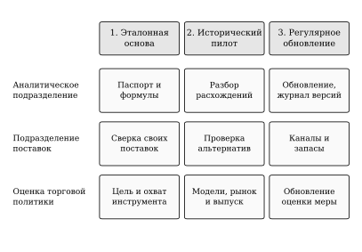

Рисунок 3.4 — Предлагаемое распределение действий по этапам и ответственным

Источник: составлено автором. Матрица разработана автором; фактическое распределение ролей определяется организацией.
<!-- END FIG G04 -->

Рисунок 3.4 показывает распределение действий между этапами и ответственными. Аналитическое подразделение обеспечивает согласованность показателей и выделяет вопросы для дальнейшей проверки. Специалист по поставкам устанавливает связь с декларациями, маршрутами, запасами и договорными обязательствами. Подразделение оценки политики определяет цель рассмотрения меры и привлекает необходимые рыночные и производственные сведения. Конкретная организация может объединять некоторые роли, однако содержание проверок должно оставаться различимым.

Таблица 3.6 — Рекомендации, адресаты и критерии применения

| Адресат | Рекомендуемое действие | Эмпирическое основание | Контроль выполнения | Условие применения |
| --- | --- | --- | --- | --- |
| Отраслевой аналитик | Сопоставлять физическую и стоимостную доли | Различный масштаб их роста в главе 2 | Два показателя представлены при одинаковом охвате | Проверены единицы и знаменатели |
| Отраслевой аналитик | Показывать общий и технологические HHI | Встречные траектории BEV и гибридов | Общий вывод сопровождается разбором технологий | Сохраняется постоянный состав стран |
| Аналитик и специалист по данным | Проверять удельную стоимость и пересмотры | Чувствительность денежных итогов к Нидерландам | Проверка зарегистрирована, вывод уточнён | Причина исходной оценки не заменена предположением |
| Подразделение поставок | Проверять действующие крупные направления и альтернативы | Преобладание продолжающих стран в приросте гибридов | Статистические объёмы сопоставлены с фирменной цепочкой | Имеются декларации, маршруты и контракты |
| Подразделение поставок | Оценивать резерв вместе с запасами и расходами | Неодинаковая экспозиция технологий в сценариях | Установлены доступный объём и стоимость; проверен порог (3.3) | Применены согласованные фирменные параметры одного периода |
| Оценщик торговой политики | Разделять уровни, условные оценки и цели инструмента | Неопределённость фазового сдвига PHEV и межтоварная перестройка | Сохранены интервалы и соответствующие показатели результата | Дополнены данные для конкретной цели оценки |

Источник: разработано автором на основе результатов второй главы и сценарных расчётов параграфа 3.2.

Для контроля работы системы предлагается использовать несколько проверяемых характеристик. Первая — определённость статуса исходных ячеек: положительное значение, установленный нуль либо неопределённое наблюдение. Такая классификация показывает полноту базы без сокрытия пропусков. Вторая — воспроизводимость: основные доли, годовые итоги и компоненты должны совпадать при повторном расчёте из сохранённой версии. Для точных тождеств допустимое численное расхождение определяется точностью вычислений и округления, а не экономической интерпретацией результата.

Третья характеристика — своевременность подготовки материала. Следует регистрировать время от доступности новой версии источника до выпуска проверенной записки, отдельно отмечая технические задержки и содержательную сверку. До пилотного применения оснований для указания конкретной продолжительности или экономии трудозатрат нет. Рекомендуется сначала измерить фактическую нагрузку, затем установить внутренний норматив обновления с учётом частоты публикаций и возможностей подразделения.

Четвёртая характеристика — завершённость обработки выделенных вопросов. Для каждого существенного расхождения полезно хранить запись о проверенных данных, полученном результате и следующем действии. В частности, по необычной стоимости в Нидерландах итог проверки должен сохранять два положения: совпадение панели с исходным ответом и неустановленную причину исходного отношения стоимости к количеству. Это завершённый аналитический статус текущей проверки, который позволяет ограничить заключение, сохранив вопрос для уточнения источника. Наличие записи не означает, что экономическая причина уже объяснена.[^C3VALUATION]

Оценку полезности рекомендаций следует проводить на соответствующем уровне. Для отраслевой аналитики проверяемый результат — согласованное описание перестройки и прозрачные основания вывода. Для подразделения поставок — подтверждённая связь сигнала с операциями и обоснованное решение по альтернативам. Для оценки политики — полнота рассмотрения технологий, целей и необходимых данных. Показатели сокращения денежных потерь или роста доходности могут включаться после появления фирменной оценки, но в настоящем дипломе фактически достигнутыми не обозначаются.

Отдельно следует отказаться от использования снижения HHI как универсального критерия успеха. Перераспределение оформления может сопровождаться дополнительными расходами, не изменяя конечный спрос или реальную цепочку доставки. Напротив, концентрированный поток может обслуживаться экономически эффективно при наличии достаточных резервов и альтернатив. Поэтому цель применения системы состоит в выявлении и осмысленном учёте зависимости; решение о её изменении требует сопоставления издержек и результатов на надлежащих данных.

Предлагаемый порядок реализуем последовательно. На открытой статистике формируются паспорт, расчёты и аналитическая записка. После фирменной сверки к ним добавляются операционные сценарии и оценка альтернатив. При рассмотрении политики подключаются сведения о моделях, спросе, производстве и условиях инструмента. В таком виде рекомендации соответствуют полученной доказательной базе и завершают переход от измерения адаптации к её практическому учёту.

## Выводы по третьей главе

На основе выявленной товарной и географической перестройки предложена система совместного мониторинга поставок автомобилей китайского происхождения в ЕС. Её основу составляют количество и стоимость, сопоставимые доли Китая, технологические веса, общий и технологические HHI, а также вклад продолжающих и новых положительных направлений. Паспорт показателей и последовательность обработки сигналов позволяют связать наблюдаемое изменение с адресной проверкой.

Сценарные расчёты обосновывают необходимость раздельного рассмотрения технологий при проверке географической зависимости. При условном затруднении 25% потока Бельгии и Нидерландов экспозиция составляет 13,28% всего количества BEV, 10,25% PHEV и 2,61% HEV. Частичный перенос сокращает неперенесённый объём в соответствии с заданным условием, однако способность переноса, задержки и расходы требуют фирменных данных. Рекомендации поэтому включают сверку реальных маршрутов, запасов, договоров и стоимости альтернатив.

Историческая проверка по 48 квартальным сопоставлениям показала неодинаковые сочетания изменений пары BE/NL и остальных стран. Для BEV рост за пределами пары отсутствовал в пяти из семи случаев её сокращения. Это поддерживает рекомендацию предварительно подтверждать доступность альтернативы. Условие допустимых дополнительных расходов позволяет затем проверить её экономическое обоснование на фирменных данных.

Для оценки торговых мер предложено совместно учитывать непосредственно охваченные товары и соседние технологии, разделяя импорт, конечные продажи и производственные результаты. Наблюдаемый рост гибридов и условные фазовые коэффициенты используются для постановки вопросов оценки. Решения о конкретном инструменте требуют соответствующих рыночных, производственных и юридических оснований.

Порядок внедрения включает эталонную версию данных, пилотный разбор и регулярное обновление с журналом пересмотров. Контроль основан на определённости наблюдений, воспроизводимости, своевременности и завершённости проверки. Результат — согласованная процедура применения выводов; экономия и предотвращённые потери требуют отдельной оценки на данных организации.

# Заключение

Проведённое исследование позволило разграничить товарную и географическую составляющие адаптации поставок новых электромобилей и бензиновых гибридов китайского происхождения в ЕС. Центральный результат состоит в том, что увеличение физического присутствия, изменение товарной корзины и снижение общей концентрации представляют взаимосвязанные, но неодинаковые процессы. Совокупный показатель скрывает разные технологические траектории, а состав его изменения зависит от географии, исходной даты и выбранного измерителя.

Решение первых двух задач сформировало теоретическую и сравнительную основу анализа. Международная организация автомобильного производства требует различать происхождение сборки, принадлежность марки и конечный рынок. Возможные ответы на торговые барьеры включают изменение объёмов, ассортимента и организации поставок, причём каждый механизм наблюдается на своём уровне данных. Сопоставление литературы показало, что исследования таможенных потоков, регистраций фиксированных моделей и сценарных последствий мер отвечают на разные вопросы. Поэтому собственная постановка сосредоточена на согласованном измерении компонентов торговой перестройки.

В рамках третьей задачи сформирована месячная панель за 2021–2025 годы при постоянном составе ЕС-27 и трёх кодах новых автомобилей. Основная панель CN/REST содержит 9 720 потоков; предпочтительная модель использует 8 500 строк после исключения нулевых групп постоянных эффектов. Происхождение REST рассчитано как остаток всего внешнего импорта после вычитания Китая. Положительные потоки при сокращении выборки не удалялись. Проверки подтвердили согласованность национальных и европейских итогов, неотрицательность остатков и воспроизводимость вычислений. Они характеризуют внутреннюю согласованность базы, сохраняя возможность пересмотров и ошибок первоначального статистического учёта.

Четвёртая задача выявила значительную смену товарного состава. Между 2023 и 2025 годами вес BEV в китайских поставках по количеству снизился с 91,44 до 58,80%, тогда как совокупный вес PHEV и HEV достиг 41,20%. Физическая доля Китая во внешнем импорте выбранных кодов увеличилась с 31,23 до 38,83%, стоимостная — с 27,60 до 27,78%. Основное усиление долей внутри технологий пришлось на гибридные категории. При этом итоговое изменение общей доли зависело также от состава всего внешнего импорта ЕС.

Разложение стоимости показало встречные компоненты. За 2023–2025 годы количественные изменения внутри технологий давали +4,55 млрд евро, изменение средней таможенной стоимости — −5,09 млрд евро. В полной географии стоимость уменьшилась на 4,44%, однако без Нидерландов она увеличилась на 2,88%, а без Бельгии и Нидерландов — на 20,41%. Поэтому знак полного денежного изменения чувствителен к охвату. Более устойчиво расхождение долей: физическая доля росла сильнее стоимостной во всех трёх рассмотренных срезах. Средняя таможенная стоимость не выделяет цену неизменного качества, а причина необычно низкого отношения стоимости к количеству BEV в Нидерландах по имеющейся панели не установлена.

Пятая задача раскрыла неоднородность концентрации и источников расширения. Общий физический HHI снизился с 0,2405 до 0,1873 между 2023 и 2025 годами. Симметричный товарный компонент равен +0,0568, географический — −0,1100. Следовательно, наблюдаемое снижение обеспечивалось перестройкой распределения внутри технологий при встречном усреднённом вкладе товарных весов. У BEV концентрация относительно 2023 года увеличилась, у гибридов — значительно уменьшилась. Нелинейность общего индекса и большое взаимодействие компонентов требуют сохранять оба порядка замены и явно указывать правило распределения вкладов.

Расширение гибридов происходило преимущественно в продолжающих странах оформления. Новые положительные направления обеспечили 10,28% чистого прироста PHEV и 8,14% HEV за 2023–2025 годы. Это поддерживает вывод о ведущей роли изменения весов уже действующей географии на принятом уровне наблюдения. При этом уменьшение общей концентрации HEV не означало выравнивания всех остальных стран: внутри группы за пределами Бельгии и Нидерландов концентрация немного повысилась. Данные характеризуют юрисдикции учёта, поэтому фирменный вход, реальное изменение маршрутов и распределение конечного спроса отдельно не устанавливаются.

Шестая задача решена посредством PPML с четырьмя блоками постоянных эффектов, товарными трендами, сезонностью и торговыми фазами. Для PHEV окончательный количественный множитель составляет 1,510; интервал HAC(12) [0,748; 3,050] и блочный интервал [0,705; 4,393] включают единицу. По стоимости точечная оценка равна 2,312, и оба интервала также включают единицу. Поэтому дополнительный положительный окончательный сдвиг PHEV сверх контролируемой траектории устойчиво не выделяется, хотя фактическое расширение поставок установлено уровнями и структурным анализом.

Для HEV предпочтительные множители значительно выше: 29,788 по количеству и 17,047 по стоимости. Их интервалы расположены выше единицы, но широки; выраженные изменения присутствуют уже в ранних фазах. Предусмотренные варианты сохраняют положительное направление ассоциации при заметном изменении размера оценок. Это подтверждает важность предыстории, сравнительного знаменателя и географии. Множители относятся к условному отношению CN/REST для гибридной категории относительно BEV; они не равны прямому приросту абсолютного импорта вследствие пошлины.

Выполнение седьмой задачи позволило объединить эти результаты без смешения их доказательного статуса. Структурные тождества устанавливают состав наблюдаемого изменения, а модель уточняет условную временную неоднородность. Они совместно показывают адаптацию товарной и географической структуры, но не создают экспериментального сценария без европейской политики. Самостоятельное содержание работы состоит в согласованном эмпирическом разложении конкретного случая, а не в разработке нового PPML, индекса концентрации или метода Шепли.

Восьмая задача реализована в рекомендательной главе. Предложены паспорт совместного мониторинга, порядок разбора сигналов, сценарная оценка географической экспозиции и матрица ответственных действий. При условном затруднении 25% потока BE/NL экспозиция составляет 13,28% всего количества BEV, 10,25% PHEV и 2,61% HEV. Дополнительный разбор 48 квартальных сопоставлений выявил различные сочетания изменения пары и остальных стран; у BEV в пяти из семи случаев сокращения пары роста за её пределами не было. Это обосновывает необходимость подтверждать доступность альтернатив, прежде чем считать условный перенос реализуемым.

Порог допустимых дополнительных расходов переводит общую рекомендацию о резервном канале в проверяемое условие на фирменных данных. Для оценки политики предложено сопровождать таможенную динамику отдельными сведениями о конечных регистрациях, моделях и производстве. Критерии применения относятся к полноте статуса наблюдений, воспроизводимости, своевременности и завершённости проверки. Фактически достигнутая экономия или предотвращённые потери в исследовании не оценены.

Цель работы достигнута в пределах выбранного объекта: измерены и разграничены компоненты товарной и географической перестройки, определены условные модельные результаты и предложен порядок их практического использования. Дальнейшее развитие связано с сопоставимыми моделями автомобилей, фирменными цепочками и более длинным временным рядом. Эти данные позволили бы перейти от наблюдения оформления и условных ассоциаций к самостоятельной оценке цен, операционных издержек и последствий конкретных инструментов политики.

# Список использованных источников

1. ACEA. New car registrations: +1.8% in 2025; battery-electric 17.4% market share. Press release car registrations December 2025. 27.01.2026. URL: https://www.acea.auto/files/Press_release_car_registrations_December_2025.pdf (дата обращения: 28.10.2026).

2. Amiti M., Redding S. J., Weinstein D. E. The Impact of the 2018 Tariffs on Prices and Welfare // Journal of Economic Perspectives. 2019. Vol. 33, no. 4. P. 187–210. DOI: 10.1257/jep.33.4.187. URL: https://www.princeton.edu/~reddings/pubpapers/JEP-tariffs-2019.pdf (дата обращения: 27.10.2026).

3. Balteanu I., Moreno M., Viani F. Flooded by China? Trade diversion due to US tariffs during Trump’s first mandate. Banco de España Working Paper 2634. October 2026. DOI: 10.53479/44545. URL: https://www.bde.es/f/webbe/SES/Secciones/Publicaciones/PublicacionesSeriadas/DocumentosTrabajo/26/Files/dt2634e.pdf (дата обращения: 27.10.2026).

4. Barwick P. J., Collison J., Goldberg P. K., Li S., Wang Y. From Trade War to Green Transition: Optimal Electric Vehicle Tariffs with Revenue-Funded Subsidies. NBER Working Paper 35334. June 2026. DOI: 10.3386/w35334. URL: https://www.nber.org/system/files/working_papers/w35334/w35334.pdf (дата обращения: 27.10.2026).

5. Bickenbach F., Dohse D., Langhammer R. J., Liu W.-H. EU Concerns About Chinese Subsidies: What the Evidence Suggests // Intereconomics. 2024. Vol. 59, no. 4. P. 214–221. DOI: 10.2478/ie-2024-0044. URL: https://www.intereconomics.eu/contents/year/2024/number/4/article/eu-concerns-about-chinese-subsidies-what-the-evidence-suggests.html (дата обращения: 27.10.2026).

6. Cavallo A., Gopinath G., Neiman B., Tang J. Tariff Pass-Through at the Border and at the Store: Evidence from US Trade Policy. NBER Working Paper 26396. 2019. URL: https://www.nber.org/system/files/working_papers/w26396/w26396.pdf (дата обращения: 27.10.2026).

7. Coffin D., Crotty P., Walling J., Yuan W. J. J. The Impact of Changes in Trade Policies on the Electric Vehicle (EV) Sector — A CGE Analysis. USITC Economics Working Paper 2024–05–A. 2024. URL: https://www.usitc.gov/sites/default/files/publications/332/working_papers/ev_paper_05072024_ec_working_paper_series.pdf (дата обращения: 27.10.2026).

8. Dou H. et al. Distributional impacts of EU tariffs on Chinese electric vehicles across European markets // Nature Energy. Accepted author version. 2026. DOI: 10.1038/s41560-026-02105-7. URL: https://www.repository.cam.ac.uk/bitstreams/cb25a54a-43c9-454b-a24b-4d4d5cfa78e2/download (дата обращения: 27.10.2026).

9. Dou H., Hao H., Mai L., Liu B., Liu M., Sun X. Observed constrained expansion and diminished affordability under the EU’s tariffs on Chinese electric vehicles // Joule. 2026. Vol. 10, no. 6. Article 102486. DOI: 10.1016/j.joule.2026.102486. URL: https://www.sciencedirect.com/science/article/pii/S2542435126001704 (дата обращения: 27.10.2026).

10. European Commission, Representation in Ireland. Commission imposes provisional countervailing duties on imports of battery electric vehicles from China while discussions with China continue. 04.07.2024. Раздел Procedure and next steps. URL: https://ireland.representation.ec.europa.eu/news-and-events/news/commission-imposes-provisional-countervailing-duties-imports-battery-electric-vehicles-china-while-2024-07-04_en (дата обращения: 27.10.2026).

11. European Commission. Anti-subsidy investigations. URL: https://policy.trade.ec.europa.eu/enforcement-and-protection/trade-defence/anti-subsidy-measures/anti-subsidy-investigations_en (дата обращения: 27.10.2026).

12. European Commission. Anti-subsidy measures. URL: https://policy.trade.ec.europa.eu/enforcement-and-protection/trade-defence/anti-subsidy-measures_en (дата обращения: 27.10.2026).

13. European Commission. Commission Implementing Regulation (EU) 2024/2754 of 29 October 2024. URL: https://eur-lex.europa.eu/legal-content/EN/TXT/PDF/?uri=OJ:L_202402754 (дата обращения: 27.10.2026).

14. European Commission. Commission investigation provisionally concludes that electric vehicle value chains in China benefit from unfair subsidies. Press release, 12.06.2024. URL: https://ec.europa.eu/commission/presscorner/api/files/document/print/en/ip_24_3231/IP_24_3231_EN.pdf (дата обращения: 27.10.2026).

15. European Commission. Commission issues Guidance Document on submission of price undertaking offers for battery electric vehicles from China. 12.01.2026. URL: https://policy.trade.ec.europa.eu/news/commission-issues-guidance-document-submission-price-undertaking-offers-battery-electric-vehicles-2026-01-12_en (дата обращения: 28.10.2026).

16. European Commission. Commission launches investigation on subsidised electric cars from China. Press release, 04.10.2023. URL: https://ec.europa.eu/commission/presscorner/api/files/document/print/en/ip_23_4752/IP_23_4752_EN.pdf (дата обращения: 27.10.2026).

17. European Commission. EU Commission imposes countervailing duties on imports of battery electric vehicles (BEVs) from China. Access2Markets. 12.12.2024. URL: https://trade.ec.europa.eu/access-to-markets/en/news/eu-commission-imposes-countervailing-duties-imports-battery-electric-vehicles-bevs-china (дата обращения: 27.10.2026).

18. European Commission. Joint Statement at the second meeting of the EU-China Trade and Investment Consultations. Beijing, 09.10.2026. URL: https://ec.europa.eu/commission/presscorner/api/files/document/print/en/statement_26_2122/STATEMENT_26_2122_EN.pdf (дата обращения: 28.10.2026).

19. Eurostat. Comext DS-045409. International trade in goods — detailed data. Месячная статистика 2021–2025; выгрузка 26.10.2026. API guide. URL: https://ec.europa.eu/eurostat/web/user-guides/data-browser/api-data-access/api-getting-started/comext-database (дата обращения: 27.10.2026).

20. Eurostat. International trade in goods — detailed data: reference metadata. URL: https://ec.europa.eu/eurostat/cache/metadata/en/ext_go_detail_sims.htm (дата обращения: 27.10.2026).

21. Eurostat. Trade in goods — Rotterdam effect. URL: https://ec.europa.eu/eurostat/web/european-statistics-learning-hub/statistics-for-beginners/trade-in-goods (дата обращения: 27.10.2026).

22. Fajgelbaum P., Goldberg P., Kennedy P., Khandelwal A., Taglioni D. The US-China Trade War and Global Reallocations. NBER Working Paper 29562. Revised December 2023. URL: https://www.nber.org/system/files/working_papers/w29562/w29562.pdf (дата обращения: 27.10.2026).

23. Feenstra R. C., Romalis J. International Prices and Endogenous Quality. NBER Working Paper 18314. 2012. URL: https://www.nber.org/system/files/working_papers/w18314/w18314.pdf (дата обращения: 27.10.2026).

24. Head K., Mayer T. Brands in Motion: How frictions shape multinational production. Banque de France Working Paper 629. May 2017. URL: https://publications.banque-france.fr/sites/default/files/medias/documents/dt629_0.pdf (дата обращения: 27.10.2026).

25. IEA. Global EV Outlook 2025. Paris, 2025. URL: https://www.iea.org/reports/global-ev-outlook-2025 (дата обращения: 27.10.2026).

26. Ke Y. EU Countervailing Duties and Chinese BEV Trade Flows: Descriptive Evidence from a Difference-in-Differences Analysis. Bachelor thesis. Umeå University, 2026. URL: https://umu.diva-portal.org/smash/get/diva2:2109224/FULLTEXT01.pdf (дата обращения: 27.10.2026).

27. Melitz M. J. The Impact of Trade on Intra-Industry Reallocations and Aggregate Industry Productivity // Econometrica. 2003. Vol. 71, no. 6. P. 1695–1725. DOI: 10.1111/1468-0262.00467. URL: https://melitz.scholars.harvard.edu/sites/g/files/omnuum5906/files/melitz/files/aggprod_ecma.pdf (дата обращения: 27.10.2026).

28. Minondo A. How exporters neutralised an increase in tariffs // The World Economy. 2024. Vol. 47, no. 3. P. 1274–1296. DOI: 10.1111/twec.13492. URL: https://deustoteka.deusto.es/bitstreams/93e968e9-9824-4a0d-ba81-78895e82902b/download (дата обращения: 27.10.2026).

29. Santos Silva J. M. C., Tenreyro S. The Log of Gravity // Review of Economics and Statistics. 2006. Vol. 88, no. 4. P. 641–658. DOI: 10.1162/rest.88.4.641. URL: https://personal.lse.ac.uk/TENREYRO/jensen08k.pdf (дата обращения: 27.10.2026).

30. Shorrocks A. F. Decomposition Procedures for Distributional Analysis: A Unified Framework Based on the Shapley Value. First draft. June 1999. URL: https://www.komkon.org/~tacik/science/shapley.pdf (дата обращения: 27.10.2026).

31. U.S. Department of Energy. All-Electric Vehicles. URL: https://afdc.energy.gov/vehicles/electric-basics-ev (дата обращения: 27.10.2026).

32. U.S. Department of Energy. Hybrid Electric Vehicles. URL: https://afdc.energy.gov/vehicles/electric-basics-hev (дата обращения: 27.10.2026).

33. U.S. Department of Energy. Plug-In Hybrid Electric Vehicles. URL: https://afdc.energy.gov/vehicles/electric-basics-phev (дата обращения: 27.10.2026).

34. Wingender P., Yao J., Zymek R., Carton B., Cerdeiro D., Weber A. Europe’s Shift to EVs Amid Intensifying Global Competition. IMF Working Paper 24/218. 2024. URL: https://www.imf.org/-/media/files/publications/wp/2024/english/wpiea2024218-print-pdf.pdf (дата обращения: 27.10.2026).

# Приложение А. Методы и дополнительные проверки второй главы

## А.1 Точные структурные разложения

Обозначения соответствуют параграфу 2.2. Индексы 0 и 1 обозначают начальный и конечный годы. Для совокупной доли применяется равенство:

\[
\Delta S=\sum_p\frac{w_{p1}+w_{p0}}2(s_{p1}-s_{p0})+
\sum_p\frac{s_{p1}+s_{p0}}2(w_{p1}-w_{p0}). \tag{А.1}
\]

Первое слагаемое — изменение долей Китая внутри технологий, второе — изменение весов технологий во всём внешнем импорте выбранных кодов. Для стоимости, где \(u_p=V_p/q_p\), используется:

\[
\Delta V=\sum_p\frac{u_{p1}+u_{p0}}2(q_{p1}-q_{p0})+
\sum_p\frac{q_{p1}+q_{p0}}2(u_{p1}-u_{p0}). \tag{А.2}
\]

Товарный и географический компоненты общего HHI определяются следующими формулами:

\[
\begin{aligned}
D_b&=\tfrac12[H(b_1,G_0)-H(b_0,G_0)+H(b_1,G_1)-H(b_0,G_1)],\\
D_G&=\tfrac12[H(b_0,G_1)-H(b_0,G_0)+H(b_1,G_1)-H(b_1,G_0)].
\end{aligned} \tag{А.3}
\]

Взаимодействие равно \(I=H(b_1,G_1)-H(b_1,G_0)-H(b_0,G_1)+H(b_0,G_0)\); каждый компонент включает половину \(I\). Компоненты относятся к выбранным состояниям и правилу симметричного распределения.[^C2SHAPLEY]

Для каждой технологии выделяются группа A (Бельгия и Нидерланды) и группа B (остальные 25 стран). Если \(z\) — доля A, \(h_A,h_B\) — HHI внутри групп после нормировки на их собственные итоги, то:

\[
H_p=z^2h_A+(1-z)^2h_B. \tag{А.4}
\]

Три компонента распределены усреднением всех шести порядков замены \(z,h_A,h_B\). Для стран с положительными поставками выделяются множества продолжающих C, новых N и исчезнувших X направлений:

\[
\Delta Q=\sum_{m\in C}(q_{m1}-q_{m0})+\sum_{m\in N}q_{m1}-\sum_{m\in X}q_{m0}. \tag{А.5}
\]

Страна N определяется относительно исходного года; формула не устанавливает фирменный вход. Во всех разложениях используются исходные значения до округления.[^C2GROUP][^C2ENTRY]

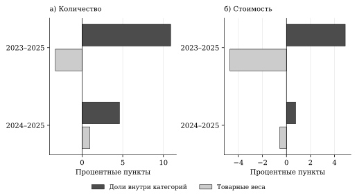

Рисунок А.1 — Компоненты изменения доли Китая при двух базах сравнения

Источник: Eurostat Comext; расчёты автора.

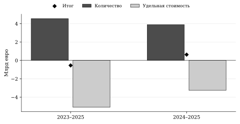

Рисунок А.2 — Количественный и удельный компоненты изменения стоимости

Источник: Eurostat Comext; расчёты автора.

## А.2 Проверка стоимостных данных Нидерландов

Независимая проверка напрямую извлекает 24 значения JSON-stat — два показателя за 12 месяцев 2025 года — по координатам частоты, страны, происхождения, кода, направления, показателя и месяца. Все значения совпадают с сохранённой панелью. Следовательно, низкое отношение стоимости к количеству BEV в Нидерландах не вызвано расхождением этой панели с сохранённым исходным ответом. Причина значений на уровне деклараций остаётся неизвестной.

Для определения влияния данного направления выполнена конечная описательная чувствительность: полная география, исключение Нидерландов, исключение Бельгии и Нидерландов. В каждом случае знаменатель внешнего импорта пересчитан для той же совокупности оставшихся стран. Это дополнительные описательные срезы; предпочтительная модель и исходные наблюдения сохранены.

Таблица А.1 — Географическая чувствительность количественных и денежных итогов за 2023–2025 годы

| География | Изменение физической доли, п.п. | Изменение денежной доли, п.п. | Темп стоимости, % |
| --- | --- | --- | --- |
| Полный ЕС-27 | 7,60 | 0,19 | -4,44 |
| Без Нидерландов | 7,66 | 1,29 | 2,88 |
| Без Бельгии и Нидерландов | 9,96 | 3,40 | 20,41 |

Источник: Eurostat Comext; расчёты автора. Изменения долей — процентные пункты, темп стоимости — проценты. Во всех трёх срезах физическая доля растёт сильнее денежной. Знак изменения совокупной стоимости зависит от охвата; уменьшение полной стоимости нельзя объявлять общим для любой географии.[^C2UNITFLAG]

## А.3 Полная спецификация и неопределённость

В формуле (2.4) основного текста использовано сокращение:

\[
F_{mopt}=\alpha_{mop}+\lambda_{mpt}+\gamma_{ot}+\sigma_{op,k(t)}, \tag{А.6}
\]

где \(k(t)\) — календарный месяц. Уравнения количества и стоимости оцениваются отдельно. Средние нормируются при вычислении; коэффициенты структурных взаимодействий от этого не меняются. PPML не требует считать денежную величину пуассоновской счётной переменной.[^C2PPML]

Оценка HAC строится по синхронным месячным суммам вкладов в условия оценивания, с весами Бартлетта, лагами 6/12, поправкой \(T/(T-k)\) по числу структурных параметров и критическим значением распределения Стьюдента при \(T-1\) степенях свободы. Дополнительно выполнены 199 положительных экспоненциально взвешенных оценок блоков длиной 12 месяцев со случайным сдвигом границ. Месячные веса одинаковы для двух исходов; сохранены все 398 успешных оценок. Интервалы по процентилям являются временной чувствительностью. Коррекция смещения от большого числа постоянных эффектов не реализована.[^C2MODEL]

Из 9 720 строк предпочтительной панели удалены 1 220 нулевых строк в группах эффектов с нулевыми итогами; положительные наблюдения не удалялись. Эквивалентное представление содержит 4 118 информативных пар и 264 неинформативные одиночные строки. Максимальное расхождение основных коэффициентов парного и исходного представлений меньше \(10^{-12}\); расхождения матриц HAC — порядка \(10^{-11}\). Независимая явная запись эффектов на подвыборке даёт расхождение коэффициентов менее \(10^{-9}\). Эти проверки характеризуют реализацию вычислений.[^C2AUDIT]

Таблица А.2 — Полный набор фазовых множителей предпочтительной модели

| Исход | Категория | Фаза | Множитель | HAC(12) |
| --- | --- | --- | --- | --- |
| Количество | PHEV | Сигнал/расследование | 0,224 | [0,156; 0,323] |
| Количество | PHEV | Объявление | 0,706 | [0,496; 1,003] |
| Количество | PHEV | Временная | 0,410 | [0,214; 0,786] |
| Количество | PHEV | Окончательная | 1,510 | [0,748; 3,050] |
| Количество | HEV | Сигнал/расследование | 6,260 | [2,064; 18,988] |
| Количество | HEV | Объявление | 14,230 | [3,940; 51,391] |
| Количество | HEV | Временная | 17,111 | [5,306; 55,185] |
| Количество | HEV | Окончательная | 29,788 | [6,729; 131,874] |
| Стоимость | PHEV | Сигнал/расследование | 0,281 | [0,188; 0,419] |
| Стоимость | PHEV | Объявление | 0,755 | [0,533; 1,068] |
| Стоимость | PHEV | Временная | 0,494 | [0,233; 1,046] |
| Стоимость | PHEV | Окончательная | 2,312 | [0,996; 5,370] |
| Стоимость | HEV | Сигнал/расследование | 6,687 | [2,214; 20,200] |
| Стоимость | HEV | Объявление | 10,476 | [2,322; 47,267] |
| Стоимость | HEV | Временная | 9,604 | [2,891; 31,907] |
| Стоимость | HEV | Окончательная | 17,047 | [3,682; 78,934] |

Источник: авторская PPML. Показаны HAC(12); блочные интервалы окончательной фазы приведены в таблице 2.5, всех фаз — в сохранённом реестре результатов.

## А.4 Чувствительность и предшествующая динамика

Таблица А.3 — Окончательные множители в предусмотренных вариантах

| Исход | Вариант | Категория | Множитель | HAC(12) |
| --- | --- | --- | --- | --- |
| Количество | Основная | PHEV | 1,510 | [0,748; 3,050] |
| Количество | Основная | HEV | 29,788 | [6,729; 131,874] |
| Количество | Без тренда | PHEV | 2,484 | [1,819; 3,391] |
| Количество | Без тренда | HEV | 67,009 | [29,247; 153,527] |
| Количество | Без сезонности | PHEV | 1,769 | [0,772; 4,057] |
| Количество | Без сезонности | HEV | 40,252 | [9,323; 173,790] |
| Количество | Четыре происхождения | PHEV | 2,051 | [1,214; 3,464] |
| Количество | Четыре происхождения | HEV | 18,529 | [3,494; 98,272] |
| Количество | С 2022 года | PHEV | 2,047 | [0,901; 4,648] |
| Количество | С 2022 года | HEV | 26,289 | [4,458; 155,030] |
| Количество | Без BE/NL | PHEV | 0,817 | [0,389; 1,716] |
| Количество | Без BE/NL | HEV | 42,321 | [10,415; 171,962] |
| Количество | Опубликованные пары | PHEV | 1,575 | [0,800; 3,103] |
| Количество | Опубликованные пары | HEV | 10,892 | [3,213; 36,924] |
| Стоимость | Основная | PHEV | 2,312 | [0,996; 5,370] |
| Стоимость | Основная | HEV | 17,047 | [3,682; 78,934] |
| Стоимость | Без тренда | PHEV | 2,262 | [1,724; 2,967] |
| Стоимость | Без тренда | HEV | 61,782 | [24,894; 153,329] |
| Стоимость | Без сезонности | PHEV | 2,643 | [1,073; 6,509] |
| Стоимость | Без сезонности | HEV | 23,931 | [5,104; 112,193] |
| Стоимость | Четыре происхождения | PHEV | 2,064 | [1,014; 4,201] |
| Стоимость | Четыре происхождения | HEV | 8,800 | [2,128; 36,399] |
| Стоимость | С 2022 года | PHEV | 2,874 | [1,025; 8,059] |
| Стоимость | С 2022 года | HEV | 14,936 | [2,328; 95,834] |
| Стоимость | Без BE/NL | PHEV | 0,507 | [0,268; 0,959] |
| Стоимость | Без BE/NL | HEV | 29,831 | [14,029; 63,431] |
| Стоимость | Опубликованные пары | PHEV | 2,447 | [1,106; 5,414] |
| Стоимость | Опубликованные пары | HEV | 6,787 | [2,052; 22,451] |

Источник: авторские расчёты. Все семь вариантов приведены для обоих исходов и технологий; выборка и основная спецификация не пересматривались по знаку оценки. Вариант только опубликованных пар меняет наблюдаемость; полностью сбалансированная наблюдаемая панель не содержит китайских HEV и не образует полноценной дополнительной модели трёх технологий.[^C2SENSITIVITY]

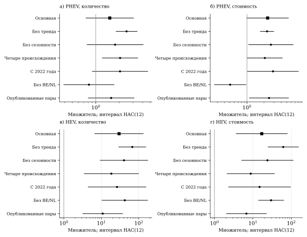

Рисунок А.3 — Чувствительность окончательных множителей к спецификации

Источник: Eurostat Comext; расчёты автора.

Полугодовая диагностика не содержит линейного тренда. Одновременно исключены обе половины 2022 года, что необходимо при сохранении календарной сезонности: каждая половина сопоставляется с соответствующей половиной базового года. Шесть коэффициентов двух технологий за 2021H1, 2021H2, 2023H1 проверяются совместно. Значения статистик HAC(12) — 261,20 и 352,72 при шести степенях свободы; короткая временная опора ограничивает асимптотическую интерпретацию.[^C2DYNAMIC]

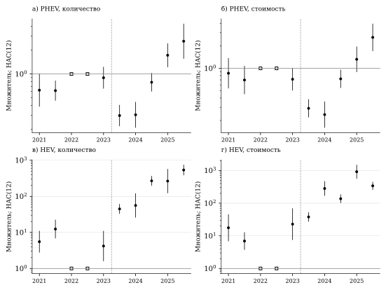

Рисунок А.4 — Полугодовые относительные множители; база — соответствующая половина 2022 года

Источник: Eurostat Comext; расчёты автора.

Таблица А.4 — Контраст окончательных множителей остальных стран к Бельгии и Нидерландам

| Исход | Категория | Отношение множителей | HAC(12) |
| --- | --- | --- | --- |
| Количество | PHEV | 0,587 | [0,082; 4,199] |
| Количество | HEV | 58,697 | [3,777; 912,298] |
| Стоимость | PHEV | 0,234 | [0,049; 1,107] |
| Стоимость | HEV | 76,995 | [4,569; 1 297,633] |

Источник: авторские расчёты. Интервал разности логарифмов учитывает ковариацию двух оценок; после экспоненцирования получается интервал отношения. Отдельные p-значения групп не заменяют этот контраст.[^C2GEOMODEL]

# Приложение Б Сценарные и исторические материалы рекомендательной главы

## Б.1 Полный набор сценарных сочетаний

Таблица Б.1 — Условная экспозиция и неперенесённая часть

| Категория | α, % | ρ, % | Затронутый объём, шт. | Неперенесённый объём, шт. | Доля категории, % |
| --- | --- | --- | --- | --- | --- |
| BEV | 10 | 0 | 22 876,4 | 22 876,4 | 5,31 |
| BEV | 10 | 50 | 22 876,4 | 11 438,2 | 2,66 |
| BEV | 10 | 100 | 22 876,4 | 0,0 | 0,00 |
| BEV | 25 | 0 | 57 191,0 | 57 191,0 | 13,28 |
| BEV | 25 | 50 | 57 191,0 | 28 595,5 | 6,64 |
| BEV | 25 | 100 | 57 191,0 | 0,0 | 0,00 |
| PHEV | 10 | 0 | 7 024,6 | 7 024,6 | 4,10 |
| PHEV | 10 | 50 | 7 024,6 | 3 512,3 | 2,05 |
| PHEV | 10 | 100 | 7 024,6 | 0,0 | 0,00 |
| PHEV | 25 | 0 | 17 561,5 | 17 561,5 | 10,25 |
| PHEV | 25 | 50 | 17 561,5 | 8 780,8 | 5,12 |
| PHEV | 25 | 100 | 17 561,5 | 0,0 | 0,00 |
| HEV | 10 | 0 | 1 362,8 | 1 362,8 | 1,05 |
| HEV | 10 | 50 | 1 362,8 | 681,4 | 0,52 |
| HEV | 10 | 100 | 1 362,8 | 0,0 | 0,00 |
| HEV | 25 | 0 | 3 407,0 | 3 407,0 | 2,61 |
| HEV | 25 | 50 | 3 407,0 | 1 703,5 | 1,31 |
| HEV | 25 | 100 | 3 407,0 | 0,0 | 0,00 |

Источник: расчёты автора по Eurostat Comext. Все 18 сочетаний сохранены; α и ρ являются заданными условиями, а дробные единицы — расчётными величинами.[^C3EXPOSURE]

## Б.2 Полный набор квартальных сопоставлений

Таблица Б.2 — Изменение количества относительно того же квартала предыдущего года

| Категория | Квартал | Изменение BE/NL, шт. | Изменение остальных стран, шт. | Общее изменение, шт. |
| --- | --- | --- | --- | --- |
| BEV | 2022Q1 | 66 912 | 11 310 | 78 222 |
| BEV | 2022Q2 | -3 185 | 7 021 | 3 836 |
| BEV | 2022Q3 | 5 586 | 4 080 | 9 666 |
| BEV | 2022Q4 | 25 908 | 17 329 | 43 237 |
| BEV | 2023Q1 | -5 953 | 34 127 | 28 174 |
| BEV | 2023Q2 | 52 996 | 33 327 | 86 323 |
| BEV | 2023Q3 | 1 462 | 17 960 | 19 422 |
| BEV | 2023Q4 | 8 645 | 4 746 | 13 391 |
| BEV | 2024Q1 | -1 492 | -14 287 | -15 779 |
| BEV | 2024Q2 | -8 640 | -5 038 | -13 678 |
| BEV | 2024Q3 | 4 584 | -13 589 | -9 005 |
| BEV | 2024Q4 | -2 880 | -10 404 | -13 284 |
| BEV | 2025Q1 | -13 758 | -9 096 | -22 854 |
| BEV | 2025Q2 | -6 240 | -9 292 | -15 532 |
| BEV | 2025Q3 | 15 458 | 15 003 | 30 461 |
| BEV | 2025Q4 | 686 | -1 564 | -878 |
| PHEV | 2022Q1 | 3 549 | 206 | 3 755 |
| PHEV | 2022Q2 | 11 273 | 691 | 11 964 |
| PHEV | 2022Q3 | 6 791 | 148 | 6 939 |
| PHEV | 2022Q4 | 10 649 | 43 | 10 692 |
| PHEV | 2023Q1 | 8 809 | 422 | 9 231 |
| PHEV | 2023Q2 | -1 864 | 552 | -1 312 |
| PHEV | 2023Q3 | -10 210 | 1 463 | -8 747 |
| PHEV | 2023Q4 | -17 600 | 654 | -16 946 |
| PHEV | 2024Q1 | -12 138 | 1 508 | -10 630 |
| PHEV | 2024Q2 | -8 713 | 930 | -7 783 |
| PHEV | 2024Q3 | 7 129 | 569 | 7 698 |
| PHEV | 2024Q4 | 7 086 | 7 285 | 14 371 |
| PHEV | 2025Q1 | 15 697 | 8 578 | 24 275 |
| PHEV | 2025Q2 | 14 149 | 12 804 | 26 953 |
| PHEV | 2025Q3 | 14 677 | 31 692 | 46 369 |
| PHEV | 2025Q4 | -2 071 | 33 235 | 31 164 |
| HEV | 2022Q1 | 0 | 93 | 93 |
| HEV | 2022Q2 | -213 | -234 | -447 |
| HEV | 2022Q3 | -626 | -301 | -927 |
| HEV | 2022Q4 | -837 | 23 | -814 |
| HEV | 2023Q1 | 0 | -198 | -198 |
| HEV | 2023Q2 | 885 | 20 | 905 |
| HEV | 2023Q3 | 1 639 | -9 | 1 630 |
| HEV | 2023Q4 | 4 215 | 51 | 4 266 |
| HEV | 2024Q1 | 6 723 | 832 | 7 555 |
| HEV | 2024Q2 | 4 803 | 6 452 | 11 255 |
| HEV | 2024Q3 | 6 409 | 14 673 | 21 082 |
| HEV | 2024Q4 | -1 113 | 18 023 | 16 910 |
| HEV | 2025Q1 | -5 901 | 19 283 | 13 382 |
| HEV | 2025Q2 | -4 624 | 19 335 | 14 711 |
| HEV | 2025Q3 | -1 782 | 13 181 | 11 399 |
| HEV | 2025Q4 | 2 374 | 24 651 | 27 025 |

Источник: расчёты автора по Eurostat Comext. Приведены все 48 сопоставлений, включая случаи роста пары. Совместное изменение не устанавливает перенос партий между странами.[^C3HISTORY]

# Приложение В Паспорт данных и контрольные проверки

## В.1 Охват и версия исходной статистики

В исследовании используется месячный импорт за январь 2021 — декабрь 2025 года из Eurostat Comext DS-045409. Постоянный состав стран — ЕС-27. Происхождение CN означает Китай; REST рассчитывается как внешний импорт за вычетом CN в каждой сопоставимой ячейке. Коды новых автомобилей: 87038010, 87036010 и 87034010. Показатели: SUPPLEMENTARY_QUANTITY и VALUE_IN_EUROS. Дата выгрузки — 26 октября 2026 года, обновление источника — 16 октября 2026 года.

Непосредственно опубликованное значение и восстановленный нуль сохраняют разные статусы. Восстановление допускается при точном равенстве европейского агрегата и суммы всех опубликованных национальных значений, неотрицательности и отсутствии ограничивающих флагов. Оставшиеся неопределённые значения не заменяются нулями. Ключ потока: страна, происхождение, товарный код и месяц.[^C2AUDIT]

Таблица В.1 — Основные результаты контроля исходной панели и вычислений

| Проверка | Результат | Значение для интерпретации |
| --- | --- | --- |
| Основная сетка CN/REST | 9 720 потоков | Одинаковый охват двух показателей |
| Неопределённые показатели | 0 | Все значения имеют установленный статус |
| Отрицательные остатки REST | 0 | Остаточное происхождение не требует исправления знака |
| Совпадение CN + REST с внешним импортом | Точное | Одинаковый знаменатель сравнения |
| Предпочтительная PPML | 8 500 строк | Удалены нулевые группы; положительная торговля сохранена |
| Информативное парное представление | 4 118 пар и 264 одиночные строки | Состав информации отличается от числа исходных строк |
| Общие и групповые разложения HHI | 4 общих и 12 групповых; ошибка ниже 10⁻¹² | Компоненты складываются до округления |
| Повторные взвешенные оценки | 398 успешных, 199 на исход | Сохранён полный предусмотренный набор |
| Сценарные сочетания переноса | 18; границы и сложение соблюдены | Условия заданы, поведение не оценивалось |
| Квартальные сопоставления | 48; 20 случаев сокращения BE/NL | Полный ретроспективный набор |

Источник: авторские проверки сохранённых данных и результатов.

## В.2 Дополнительные сведения и воспроизведение

Первичные регистрации новых BEV в ЕС-27 взяты из выпуска ACEA от 27 января 2026 года, с. 4. Они относятся ко всем происхождениям и используются как отдельный рыночный ряд. Таможенный импорт не делится на регистрации для получения доли марки. Последующие документы Европейской комиссии 2026 года образуют контекст рекомендательной главы и не включаются в оценочное окно 2021–2025.

Воспроизведение предполагает последовательную проверку версии исходного ответа, построение панели, структурные расчёты, оценивание фиксированной спецификации и подготовку иллюстраций. Контрольные суммы позволяют установить совпадение файлов; они не устраняют возможные ошибки первоначальных деклараций или ограничения сравнительной конструкции. Материалы исследования и код доступны в репозитории artyom4iklol/diploma, раздел research/04_auto_trade. Состояние данных и результатов, использованное для итогового текста, зафиксировано 28 октября 2026 года.

[^I_CONTEXT]: European Commission. Commission launches investigation on subsidised electric cars from China. Press release, 04.10.2023. С. 1. Commission Implementing Regulation (EU) 2024/2754 of 29 October 2024. Art. 1, 5. European Commission. EU Commission imposes countervailing duties on imports of battery electric vehicles (BEVs) from China. Access 2Markets, 12.12.2024 (дата обращения: 27.10.2026).
[^I_THEORY]: Melitz M. J. The Impact of Trade on Intra-Industry Reallocations and Aggregate Industry Productivity // Econometrica 71(6),1695–1725. 2003. DOI 10.1111/1468-0262.00467. С. 1695–1698. Head K., Mayer T. Brands in Motion: How frictions shape multinational production. Banque de France Working Paper 629. 2017. Раздел 3, с. 14–19 (рабочая версия).
[^I_RESEARCH]: Ke Y. EU Countervailing Duties and Chinese BEV Trade Flows: Descriptive Evidence from a Difference-in-Differences Analysis // Bachelor thesis, Umeå University. 2026. Аннотация; обсуждение ограничений. Бакалаврская работа. Dou H. et al. Distributional impacts of EU tariffs on Chinese electric vehicles across European markets // Nature Energy; accepted author version. 2026. DOI 10.1038/s41560-026-02105-7. Принятая авторская версия, с. 5–9, 18–19. Barwick P. J., Collison J., Goldberg P. K. et al. From Trade War to Green Transition: Optimal Electric Vehicle Tariffs with Revenue-Funded Subsidies // NBER Working Paper 35334, June 2026. DOI 10.3386/w35334. Разделы 4.1–4.2.
[^I_DATA]: Eurostat. Comext DS-045409. Месячный импорт, январь 2021 — декабрь 2025 года; CN 87038010, 87036010, 87034010; SUPPLEMENTARY_QUANTITY и VALUE_IN_EUROS. Выгрузка 26.10.2026, обновление источника 16.10.2026. Расчёты автора. ACEA. New car registrations: +1.8% in 2025; battery-electric 17.4% market share. Press release car registrations December 2025, 27.01.2026. С. 4, строка European Union (дата обращения: 28.10.2026).
[^I_METHOD]: Santos Silva J. M. C., Tenreyro S. The Log of Gravity // Review of Economics and Statistics 88(4),641–658. 2006. DOI 10.1162/rest.88.4.641. Shorrocks A. F. Decomposition Procedures for Distributional Analysis: A Unified Framework Based on the Shapley Value. First draft, June 1999. Раздел 2, с. 4–7.
[^MELITZ]: Melitz M. J. The Impact of Trade on Intra-Industry Reallocations and Aggregate Industry Productivity // Econometrica 71(6),1695–1725. 2003. DOI 10.1111/1468-0262.00467. С. 1695–1698.
[^HM17]: Head K., Mayer T. Brands in Motion: How frictions shape multinational production. Banque de France Working Paper 629. 2017. Раздел 3, с. 14–19 (рабочая версия).
[^IEA25PROD]: IEA. Global EV Outlook 2025. Paris, 2025. P. 31–34.
[^AFBEV]: U.S. Department of Energy. Alternative Fuels Data Center. All-Electric Vehicles. Раздел How It Works (дата обращения: 27.10.2026).
[^AFPHEV]: U.S. Department of Energy. Alternative Fuels Data Center. Plug-In Hybrid Electric Vehicles. Разделы How It Works, Fueling and Driving Options (дата обращения: 27.10.2026).
[^AFHEV]: U.S. Department of Energy. Alternative Fuels Data Center. Hybrid Electric Vehicles. Разделы Regenerative Braking, Fuel-Efficient System Design (дата обращения: 27.10.2026).
[^SCOPE]: European Commission. EU Commission imposes countervailing duties on imports of battery electric vehicles (BEVs) from China. Access 2Markets, 12.12.2024. Описание охвата меры по Регламенту (ЕС) 2024/2754 (дата обращения: 27.10.2026).
[^ESTATDEF]: Eurostat. International trade in goods — detailed data. Reference metadata. Разделы 3.2–3.4 (дата обращения: 27.10.2026).
[^ROTTERDAM]: Eurostat. Trade in goods. European statistics learning hub. Раздел What is the Rotterdam effect? (дата обращения: 27.10.2026).
[^IEA25TRADE]: IEA. Global EV Outlook 2025. Paris, 2025. P. 33–35, примечания к данным международной торговли.
[^PORTFOLIO]: Barwick P. J., Collison J., Goldberg P. K. et al. From Trade War to Green Transition: Optimal Electric Vehicle Tariffs with Revenue-Funded Subsidies // NBER Working Paper 35334, June 2026. DOI 10.3386/w35334. Разделы 4.1–4.2.
[^INCIDENCE]: Amiti M., Redding S. J., Weinstein D. E. The Impact of the 2018 Tariffs on Prices and Welfare // Journal of Economic Perspectives 33(4),187–210. 2019. DOI 10.1257/jep.33.4.187. С. 187–189. Cavallo A., Gopinath G., Neiman B., Tang J. Tariff Pass-Through at the Border and at the Store: Evidence from US Trade Policy. NBER Working Paper 26396. 2019. Аннотация и введение.
[^ECAS]: European Commission. Anti-subsidy measures; Anti-subsidy investigations. Trade and Economic Security. Описание инструментов и предмета расследования (дата обращения: 27.10.2026).
[^SUBSIDIES]: Bickenbach F., Dohse D., Langhammer R. J., Liu W.-H. EU Concerns About Chinese Subsidies: What the Evidence Suggests // Intereconomics 59(4),214–221. 2024. DOI 10.2478/ie-2024-0044.
[^DOU]: Dou H. et al. Distributional impacts of EU tariffs on Chinese electric vehicles across European markets // Nature Energy; accepted author version. 2026. DOI 10.1038/s41560-026-02105-7. Принятая авторская версия, с. 5–9, 18–19.
[^USITC]: Coffin D., Crotty P., Walling J., Yuan W. J. J. The Impact of Changes in Trade Policies on the Electric Vehicle (EV) Sector – A CGE Analysis // USITC Economics Working Paper 2024–05–A. Раздел методологии, с. 7–9.
[^IMF]: Wingender P., Yao J., Zymek R. et al. Europe’s Shift to EVs Amid Intensifying Global Competition // IMF Working Paper 24/218. 2024. Разделы 3.1–3.2, с. 12–16.
[^BARWICKPOL]: Barwick P. J. et al. From Trade War to Green Transition. NBER WP 35334. 2026. Раздел 2.
[^MINONDO]: Minondo A. How exporters neutralised an increase in tariffs // The World Economy 47(3), 1274–1296. 2024. DOI 10.1111/twec.13492. С. 1275–1277, 1292–1293.
[^QUALITY]: Feenstra R. C., Romalis J. International Prices and Endogenous Quality. NBER Working Paper 18314. 2012. Аннотация и введение.
[^REALLOCATION]: Fajgelbaum P., Goldberg P., Kennedy P. et al. The US-China Trade War and Global Reallocations. NBER Working Paper 29562. Revised December 2023. Введение.
[^FLOODED]: Balteanu I., Moreno M., Viani F. Flooded by China? Trade diversion due to US tariffs during Trump’s first mandate // Banco de España Working Paper 2634, October 2026. DOI 10.53479/44545. Аннотация.
[^DECOMPOSITION]: Shorrocks A. F. Decomposition Procedures for Distributional Analysis: A Unified Framework Based on the Shapley Value. First draft, June 1999. Раздел 2, с. 4–7.
[^TIMING]: Cavallo A. et al. Tariff Pass-Through at the Border and at the Store. NBER WP 26396. 2019. С. 3–4.
[^HMREVIEW]: Head K., Mayer T. Brands in Motion. Banque de France WP 629. 2017. Раздел 3. Melitz M. J. The Impact of Trade on Intra-Industry Reallocations and Aggregate Industry Productivity // Econometrica 71(6),1695–1725. 2003. DOI 10.1111/1468-0262.00467. С. 1695–1698.
[^COMPETITION]: Head K., Mayer T. Brands in Motion. Banque de France WP 629. 2017. Раздел 3. Barwick P. J. et al. From Trade War to Green Transition. NBER WP 35334. 2026. Разделы 4.1–4.2.
[^SCENARIOS]: Dou H. et al. Distributional impacts of EU tariffs on Chinese electric vehicles across European markets. 2026. Принятая авторская версия, с. 5–9, 18–19. Barwick P. J. et al. From Trade War to Green Transition. NBER WP 35334. 2026. Разделы 2 и 4.
[^MACROREVIEW]: Wingender P. et al. Europe’s Shift to EVs Amid Intensifying Global Competition. IMF WP 24/218. 2024. С. 12–16. Coffin D. et al. The Impact of Changes in Trade Policies on the Electric Vehicle Sector. USITC 2024–05–A. С. 7–9.
[^ADAPTREVIEW]: Minondo A. How exporters neutralised an increase in tariffs. 2024. С. 1275–1277. Fajgelbaum P. et al. The US-China Trade War and Global Reallocations. NBER WP 29562. Редакция декабря 2023.
[^KE]: Ke Y. EU Countervailing Duties and Chinese BEV Trade Flows: Descriptive Evidence from a Difference-in-Differences Analysis // Bachelor thesis, Umeå University. 2026. Аннотация; обсуждение ограничений. Бакалаврская работа.
[^BARWICKREVIEW]: Barwick P. J. et al. From Trade War to Green Transition. NBER WP 35334. 2026. Раздел 6.2 и приложение D.1.
[^JOULE]: Dou H., Hao H., Mai L. et al. Observed constrained expansion and diminished affordability under the EU’s tariffs on Chinese electric vehicles // Joule 10(6),102486. 2026. DOI 10.1016/j.joule.2026.102486. Основной полный текст не получен. Проверены издательские метаданные и карточка University of Groningen (дата обращения: 27.10.2026).
[^METHODREVIEW]: Shorrocks A. F. Decomposition Procedures for Distributional Analysis. First draft, 1999. Раздел 2.
[^PPML]: Santos Silva J. M. C., Tenreyro S. The Log of Gravity // Review of Economics and Statistics 88(4),641–658. 2006. DOI 10.1162/rest.88.4.641.
[^C2LAUNCH]: European Commission. Commission launches investigation on subsidised electric cars from China. Press release, 04.10.2023. С. 1.
[^C2PROVISIONAL]: European Commission, Representation in Ireland. Commission imposes provisional countervailing duties on imports of battery electric vehicles from China while discussions with China continue. 04.07.2024. Раздел Procedure and next steps (дата обращения: 27.10.2026).
[^C2JUNE]: European Commission. Commission investigation provisionally concludes that electric vehicle value chains in China benefit from unfair subsidies. Press release, 12.06.2024. С. 1.
[^C2DEFINITIVE]: Commission Implementing Regulation (EU) 2024/2754 of 29 October 2024. Art. 1, 5. European Commission. EU Commission imposes countervailing duties on imports of battery electric vehicles (BEVs) from China. Access 2Markets, 12.12.2024 (дата обращения: 27.10.2026).
[^C2DATA]: Eurostat. Comext DS-045409. Месячный импорт, январь 2021 — декабрь 2025 года; CN 87038010, 87036010, 87034010; SUPPLEMENTARY_QUANTITY и VALUE_IN_EUROS. Выгрузка 26.10.2026, обновление источника 16.10.2026. Расчёты автора.
[^C2METADATA]: Eurostat. International trade in goods — detailed data. Reference metadata. Разделы 3.2–3.4 (дата обращения: 27.10.2026).
[^C2ROTTERDAM]: Eurostat. Trade in goods. European statistics learning hub. Раздел What is the Rotterdam effect? (дата обращения: 27.10.2026).
[^C2AUDIT]: Аудит исходной панели и независимые численные проверки авторских расчётов, 26–27.10.2026.
[^C2SHAPLEY]: Shorrocks A. F. Decomposition Procedures for Distributional Analysis: A Unified Framework Based on the Shapley Value. First draft, June 1999. Раздел 2, с. 4–7.
[^C2QUALITY]: Feenstra R. C., Romalis J. International Prices and Endogenous Quality. NBER Working Paper 18314. 2012. Аннотация и введение.
[^C2PPML]: Santos Silva J. M. C., Tenreyro S. The Log of Gravity // Review of Economics and Statistics 88(4),641–658. 2006. DOI 10.1162/rest.88.4.641.
[^C2MODEL]: Расчёты автора: предпочтительная PPML CN/REST, спецификация от 26.10.2026; два исхода и синхронные взвешенные повторные оценки.
[^C2ACCOUNT]: Расчёты автора: симметричное разложение доли Китая во внешнем импорте выбранных кодов, базы 2023/2024 и конечный 2025 год.
[^C2VALUE]: Расчёты автора: разложение изменения стоимости на количество и среднюю таможенную стоимость внутри CN8.
[^C2UNITFLAG]: Eurostat Comext; независимая проверка 24 исходных месячных значений BEV из Китая, Нидерланды, 2025 год, и описательная чувствительность без NL и без BE/NL. Причина низкой удельной стоимости по агрегированной панели не установлена.
[^C2GEODATA]: Eurostat Comext; расчёты автора по годовым потокам стран оформления, 2023–2025 годы.
[^C2CONCENTRATION]: Расчёты автора: технологические и совокупные HHI по количеству и стоимости; шкала 0–1.
[^C2GROUP]: Расчёты автора: трёхфакторное групповое разложение технологических HHI с усреднением шести порядков замены.
[^C2ENTRY]: Расчёты автора: тождество продолжающих, новых положительных и исчезнувших направлений относительно 2023 года.
[^C2DYNAMIC]: Расчёты автора: полугодовая PPML без тренда; обе половины 2022 года исключены; совместная предшествующая диагностика по шести коэффициентам.
[^C2SENSITIVITY]: Расчёты автора: предусмотренные варианты расширенной PPML по количеству и стоимости. Полный набор коэффициентов сохранён отдельно от основной таблицы.
[^C2GEOMODEL]: Расчёты автора: модель групповой неоднородности и ковариационно согласованные контрасты окончательной фазы.
[^C2KE]: Ke Y. EU Countervailing Duties and Chinese BEV Trade Flows: Descriptive Evidence from a Difference-in-Differences Analysis // Bachelor thesis, Umeå University. 2026. Аннотация; обсуждение ограничений. Бакалаврская работа.
[^C2BARWICK]: Barwick P. J. et al. From Trade War to Green Transition. NBER WP 35334. 2026. Раздел 6.2 и приложение D.1.
[^C2DOU]: Dou H. et al. Distributional impacts of EU tariffs on Chinese electric vehicles across European markets // Nature Energy; accepted author version. 2026. DOI 10.1038/s41560-026-02105-7. Принятая авторская версия, с. 5–9, 18–19.
[^C3METADATA]: Eurostat. International trade in goods — detailed data. Reference metadata. Разделы 3.2–3.4 (дата обращения: 27.10.2026).
[^C3GEOGRAPHY]: Eurostat Comext; авторские разложения концентрации, базы 2023/2024 и конечный 2025 год. Результаты рассмотрены в параграфе 2.4.
[^C3VALUATION]: Eurostat Comext; авторская независимая проверка 24 месячных значений NL BEV и географическая чувствительность без NL/BE_NL, 27.10.2026.
[^C3EXPOSURE]: Расчёты автора по таможенно учтённым количествам 2025 года: шесть исходных сценариев и 18 комбинаций условного переноса. Параметры α и ρ заданы для иллюстрации; вероятности и фактическая способность переноса не оценены.
[^C3HISTORY]: Eurostat Comext; авторский ретроспективный разбор всех 48 годовых квартальных сопоставлений 2022–2025 годов и 20 случаев сокращения потока BE/NL. Совместные изменения не являются оценкой перенаправления или свободной мощности.
[^C3ROTTERDAM]: Eurostat. Trade in goods. European statistics learning hub. Раздел What is the Rotterdam effect? (дата обращения: 27.10.2026).
[^C3SCOPE]: Commission Implementing Regulation (EU) 2024/2754 of 29 October 2024. Art. 1, 5. European Commission. EU Commission imposes countervailing duties on imports of battery electric vehicles (BEVs) from China. Access 2Markets, 12.12.2024 (дата обращения: 27.10.2026).
[^C3QUALITY]: Feenstra R. C., Romalis J. International Prices and Endogenous Quality. NBER Working Paper 18314. 2012. Аннотация и введение.
[^C3ACEA]: ACEA. New car registrations: +1.8% in 2025; battery-electric 17.4% market share. Press release car registrations December 2025, 27.01.2026. С. 4, строка European Union (дата обращения: 28.10.2026).
[^C3MODEL]: Авторская предпочтительная PPML CN/REST по количеству и стоимости, результаты и чувствительности второй главы. Период 2021–2025; базовая технология BEV.
[^C3BARWICK]: Barwick P. J., Collison J., Goldberg P. K. et al. From Trade War to Green Transition: Optimal Electric Vehicle Tariffs with Revenue-Funded Subsidies // NBER Working Paper 35334, June 2026. DOI 10.3386/w35334. Разделы 4.1–4.2.
[^C3DOU]: Dou H. et al. Distributional impacts of EU tariffs on Chinese electric vehicles across European markets // Nature Energy; accepted author version. 2026. DOI 10.1038/s41560-026-02105-7. Принятая авторская версия, с. 5–9, 18–19.
[^C3MACRO]: Wingender P., Yao J., Zymek R. et al. Europe’s Shift to EVs Amid Intensifying Global Competition // IMF Working Paper 24/218. 2024. Разделы 3.1–3.2, с. 12–16. Coffin D., Crotty P., Walling J., Yuan W. J. J. The Impact of Changes in Trade Policies on the Electric Vehicle (EV) Sector – A CGE Analysis // USITC Economics Working Paper 2024–05–A. Раздел методологии, с. 7–9.
[^C3GUIDANCE]: European Commission. Commission issues Guidance Document on submission of price undertaking offers for battery electric vehicles from China. Официальное сообщение от 12.01.2026 (дата обращения: 28.10.2026).
[^C3JOINT]: European Commission. Joint Statement at the second meeting of the EU-China Trade and Investment Consultations. Beijing, 09.10.2026. Annex, points 2–4 (дата обращения: 28.10.2026).
[^C3DATA]: Eurostat. Comext DS-045409. Выгрузка 26.10.2026, январь 2021 — декабрь 2025 года, три кода новых автомобилей. Авторский аудит и расчёты главы 2.
